# HW03 — Bug Report — EShop Web Admin

## Task 1 (GUI Checklist) · Task 2 (Usability Evaluation)

| Trường | Nội dung |
|---|---|
| **SUT** | EShop — Web Admin (`eshop-sut/frontend-admin`) @ commit `85af3ba` |
| **Môi trường** | Chrome 157 / Windows 11, viewport 1440×900 · `http://localhost:5174` (API `:3000`) · `admin@eshop.com` / `Admin123!` |
| **Người thực hiện** | 23120341 — 23120341@student.hcmus.edu.vn |
| **Tổng số bug** | **23** — 21 bug từ Task 1 (GUI Checklist) + 2 bug từ Task 2 (Usability Evaluation) |
| **Phân bổ mức độ** | Task 1: 10 Blocker · 11 Major · 0 Minor · 0 Cosmetic — Task 2: 1 Catastrophe (S4) · 1 Major (S3) |
| **GitHub Issues** | https://github.com/kiterakun/HW03-GUI-Usability-Testing/issues — **#1 … #23**, mỗi issue có ảnh đính kèm |
| **Ảnh chụp trang Issues** | `bug_report/screenshots/github-issue-01.png` … `github-issue-23.png` (23 ảnh) |
| **Ngày lập báo cáo** | 2026-11-14 |

---

## 1. Tổng quan

| # | Mã bug | Tiêu đề | Mức độ | Nguồn phát hiện | IA / FR | GitHub Issue | Ảnh trang Issue |
|---:|---|---|---|---|---|---|---|
| 1 | **BUG-001** | [Web Admin] Mọi form đều không có thẻ `<label>` — placeholder là nhãn duy nhất và biến mất khi nhập | Blocker | Task 1 · GUI-IA02-001 | IA-02 | [#1](https://github.com/kiterakun/HW03-GUI-Usability-Testing/issues/1) | `screenshots/github-issue-01.png` |
| 2 | **BUG-002** | [Quản lý Sản phẩm / Danh mục] Form không chặn giá ≤ 0 và tên danh mục rỗng — ghi dữ liệu rác vào CSDL | Blocker | Task 1 · GUI-IA02-007, -008 | IA-02 | [#2](https://github.com/kiterakun/HW03-GUI-Usability-Testing/issues/2) | `screenshots/github-issue-02.png` |
| 3 | **BUG-003** | [Quản lý Sản phẩm / Danh mục] Xoá không có hộp thoại xác nhận — dữ liệu bị mất ngay | Blocker | Task 1 · GUI-IA04-008 | IA-04 | [#3](https://github.com/kiterakun/HW03-GUI-Usability-Testing/issues/3) | `screenshots/github-issue-03.png` |
| 4 | **BUG-004** | [Quản lý Sản phẩm] Sửa 1 sản phẩm làm đổi tên của toàn bộ danh sách sản phẩm | Blocker | Task 1 · GUI-IA04-010 | IA-04 | [#4](https://github.com/kiterakun/HW03-GUI-Usability-Testing/issues/4) | `screenshots/github-issue-04.png` |
| 5 | **BUG-005** | [Admin Dashboard] Tổng doanh thu nhân đôi so với tổng tiền đơn hàng `delivered` | Blocker | Task 1 · GUI-IA04-009 | IA-04 | [#5](https://github.com/kiterakun/HW03-GUI-Usability-Testing/issues/5) | `screenshots/github-issue-05.png` |
| 6 | **BUG-006** | [Import CSV] Import không rollback — dòng lỗi vẫn được ghi vào CSDL | Blocker | Task 1 · GUI-IA04-012 | IA-04 | [#6](https://github.com/kiterakun/HW03-GUI-Usability-Testing/issues/6) | `screenshots/github-issue-06.png` |
| 7 | **BUG-007** | [Import CSV] Trường CSV bọc dấu nháy kép bị tách sai thành nhiều cột | Blocker | Task 1 · GUI-IA02-012 | IA-02 | [#7](https://github.com/kiterakun/HW03-GUI-Usability-Testing/issues/7) | `screenshots/github-issue-07.png` |
| 8 | **BUG-008** | [Web Admin] Không có routing — mất deep-link, F5 mất tab, không có trang 404 | Blocker | Task 1 · GUI-IA03-001, -002, -005 | IA-03 | [#8](https://github.com/kiterakun/HW03-GUI-Usability-Testing/issues/8) | `screenshots/github-issue-08.png` |
| 9 | **BUG-009** | [Web Admin] Lỗi toàn bộ báo bằng `alert()` native — không phân biệt nguyên nhân, lộ “Network Error”, lỗi tải trang bị nuốt | Blocker | Task 1 · GUI-IA04-001, -002, -007 | IA-04 | [#9](https://github.com/kiterakun/HW03-GUI-Usability-Testing/issues/9) | `screenshots/github-issue-09.png` |
| 10 | **BUG-010** | [Sidebar] Menu không dùng được bằng bàn phím (0/7 mục focus được), thiếu landmark `nav`, mục active chỉ phân biệt bằng màu | Blocker | Task 1 · GUI-IA01-005, -006 | IA-01 | [#10](https://github.com/kiterakun/HW03-GUI-Usability-Testing/issues/10) | `screenshots/github-issue-10.png` |
| 11 | **BUG-011** | [Admin Login] Form không validate ở client — email sai định dạng và submit rỗng vẫn gửi request | Major | Task 1 · GUI-IA02-003, -004 | IA-02 | [#11](https://github.com/kiterakun/HW03-GUI-Usability-Testing/issues/11) | `screenshots/github-issue-11.png` |
| 12 | **BUG-012** | [Web Admin] Trường bắt buộc không có ký hiệu `*` và tên sản phẩm không giới hạn 255 ký tự | Major | Task 1 · GUI-IA02-002, -006 | IA-02 | [#12](https://github.com/kiterakun/HW03-GUI-Usability-Testing/issues/12) | `screenshots/github-issue-12.png` |
| 13 | **BUG-013** | [Import CSV] Không kiểm tra đuôi file `.csv` và không cảnh báo dòng lỗi trước khi import | Major | Task 1 · GUI-IA02-010, -011 | IA-02 | [#13](https://github.com/kiterakun/HW03-GUI-Usability-Testing/issues/13) | `screenshots/github-issue-13.png` |
| 14 | **BUG-014** | [Import CSV] Báo cáo kết quả import thiếu số dòng lỗi và không đánh dấu lỗi giá âm | Major | Task 1 · GUI-IA04-013 | IA-04 | [#14](https://github.com/kiterakun/HW03-GUI-Usability-Testing/issues/14) | `screenshots/github-issue-14.png` |
| 15 | **BUG-015** | [Admin Dashboard] Thiếu trạng thái loading (trang nháy trắng) và thiếu empty state khi chưa có đơn hàng | Major | Task 1 · GUI-IA04-004, -005 | IA-04 | [#15](https://github.com/kiterakun/HW03-GUI-Usability-Testing/issues/15) | `screenshots/github-issue-15.png` |
| 16 | **BUG-016** | [Web Admin] Thao tác ghi thành công không có bất kỳ thông báo xác nhận nào | Major | Task 1 · GUI-IA04-006 | IA-04 | [#16](https://github.com/kiterakun/HW03-GUI-Usability-Testing/issues/16) | `screenshots/github-issue-16.png` |
| 17 | **BUG-017** | [Admin Login] Nút Login không disable và không có chỉ báo đang xử lý — double submit được | Major | Task 1 · GUI-IA04-003 | IA-04 | [#17](https://github.com/kiterakun/HW03-GUI-Usability-Testing/issues/17) | `screenshots/github-issue-17.png` |
| 18 | **BUG-018** | [Web Admin] Tương phản chữ dưới WCAG AA ở 4 thành phần (1,92:1 – 3,76:1) | Major | Task 1 · GUI-IA01-001, -011 | IA-01 | [#18](https://github.com/kiterakun/HW03-GUI-Usability-Testing/issues/18) | `screenshots/github-issue-18.png` |
| 19 | **BUG-019** | [Web Admin] Giao diện còn chuỗi tiếng Anh, `lang="en"`, `<title>` là “frontend-admin” và thiếu thẻ `<h1>` | Major | Task 1 · GUI-IA01-003, -004 | IA-01 | [#19](https://github.com/kiterakun/HW03-GUI-Usability-Testing/issues/19) | `screenshots/github-issue-19.png` |
| 20 | **BUG-020** | [Quản lý Sản phẩm] Cột “Giá” không có dấu phân cách hàng nghìn | Major | Task 1 · GUI-IA01-010 | IA-01 | [#20](https://github.com/kiterakun/HW03-GUI-Usability-Testing/issues/20) | `screenshots/github-issue-20.png` |
| 21 | **BUG-021** | [Admin Dashboard] Lưới 2 cột KPI bị bóp còn 19,5px mỗi cột ở viewport 375px | Major | Task 1 · GUI-IA01-009 | IA-01 | [#21](https://github.com/kiterakun/HW03-GUI-Usability-Testing/issues/21) | `screenshots/github-issue-21.png` |
| 22 | **BUG-T2-01** | [Quản lý Danh mục] Thiếu tính năng/nút Sửa danh mục — người dùng không thể đổi tên trực tiếp | Major (S3) | Task 2 · U-01 · 7/7 phiên | FR-14 | [#22](https://github.com/kiterakun/HW03-GUI-Usability-Testing/issues/22) | `screenshots/github-issue-22.png` |
| 23 | **BUG-T2-02** | [Quản lý Sản phẩm] Sau khi sửa sản phẩm thành công, giá mới không cập nhật ngay trên UI | Major (S3) | Task 2 · U-04 · 7/7 phiên | FR-15 | [#23](https://github.com/kiterakun/HW03-GUI-Usability-Testing/issues/23) | `screenshots/github-issue-23.png` |

### 1.1. Phân bổ theo Interface Aspect và theo nguyên nhân gốc

| Interface Aspect | Số bug | Mã bug |
|---|---:|---|
| IA-01 General UI Standards | 5 | BUG-010, BUG-018, BUG-019, BUG-020, BUG-021 |
| IA-02 Forms | 6 | BUG-001, BUG-002, BUG-007, BUG-011, BUG-012, BUG-013 |
| IA-03 Navigation | 1 | BUG-008 |
| IA-04 Feedback / State | 8 | BUG-003, BUG-004, BUG-005, BUG-006, BUG-009, BUG-014, BUG-015, BUG-016, BUG-017 |
| *Khoảng trống chức năng (Task 2)* | 1 | BUG-T2-01 |
| **Tổng** | **23** | |

| Nguyên nhân gốc | Số bug | Giải thích |
|---|---:|---|
| `RC-IMP` — triển khai thiếu / sai | 14 | Ứng dụng viết tay không dùng thư viện UI / validate / CSV nào |
| `RC-UX` — thiết kế UX | 1 | Hành động phá huỷ không có bước xác nhận |
| `RC-A11Y` — accessibility | 1 | Sidebar dùng `<li onClick>` thay vì `<button>`/`<a>` |
| `RC-VIS` — thị giác | 1 | Bảng màu Tailwind mặc định: chữ trắng trên nền `yellow-500`/`red-500`/`green-600` |
| `RC-I18N` — ngôn ngữ / metadata | 1 | Chuỗi tiếng Anh còn sót, `lang="en"`, `<title>` scaffold Vite |
| `RC-RESP` — responsive | 1 | Không có breakpoint nào trong toàn bộ app |
| `RC-DATA` — dữ liệu / edge case | 1 | CSV parser tự tách bằng `split(",")` không theo RFC 4180 |
| `RC-PERF` — hiệu năng cảm nhận | 1 | 5 request nối tiếp không có trạng thái loading |
| *Khoảng trống chức năng* | 2 | BUG-T2-01 (thiếu nút Sửa danh mục) · BUG-T2-02 (state không đồng bộ sau `PUT`) |

---

## 2. Bug report chi tiết — Task 1 (GUI Checklist)

> Mỗi bug dưới đây có đầy đủ: metadata · mô tả · bước tái hiện · kết quả thực tế · kết quả mong đợi · bằng chứng ảnh · tác động lên người dùng · ghi chú kỹ thuật · checklist chất lượng — kèm **ảnh chụp trang GitHub Issues** tương ứng.

### 2.1. BUG-001 — BUG-001 — Mọi form đều không có thẻ `<label>`, placeholder là nhãn duy nhất


| Trường | Nội dung |
|---|---|
| **ID** | BUG-001 |
| **Mức độ** | Blocker |
| **Trạng thái** | Open |
| **Ngày phát hiện** | 2026-11-12 |
| **Người phát hiện** | 23120341 (23120341@student.hcmus.edu.vn) |
| **Người xác nhận** | 23120341 |
| **Màn hình / Route** | Toàn bộ Web Admin (`/`) — Admin Login, Quản lý Danh mục, Quản lý Sản phẩm, Import CSV |
| **Môi trường** | Chrome 157 / Windows 11 · viewport 1440×900 · `http://localhost:5174` (API `:3000`) · `admin@eshop.com` / `Admin123!` |
| **Đặc tả liên quan** | IA-02 (Forms) |
| **Mục checklist liên quan** | GUI-IA02-001 |
| **Nguyên nhân gốc (phân tích)** | `RC-IMP` — triển khai thiếu: không dùng thẻ `<label>`/`aria-label` cho bất kỳ control nào |
| **Tần suất** | Luôn (100% lượt thử) |

## 1. Mô tả

Không một ô nhập nào trong toàn bộ phân hệ Web Admin có thẻ `<label>` gắn với control tương ứng. Tên
field chỉ xuất hiện dưới dạng `placeholder`, nên **biến mất hoàn toàn** ngay khi người dùng bắt đầu nhập.
Đo bằng DevTools Console trên từng màn hình: `document.querySelectorAll('label').length` = **0** ở cả
4 form (Login 2 control, Danh mục 1, Sản phẩm 6, Import CSV 1) và **không có cặp `for`/`id` nào**.

## 2. Bước tái hiện

1. Mở `http://localhost:5174/` → màn Admin Login.
2. Mở DevTools → Console → gõ `document.querySelectorAll('label').length` → kết quả `0`.
3. Nhấn Tab vào ô Email, gõ bất kỳ ký tự nào → quan sát chữ "Email" biến mất khỏi ô nhập.
4. Đăng nhập (`admin@eshop.com` / `Admin123!`) → mở tab "Sản phẩm".
5. Gõ vào ô "Tên sản phẩm" → quan sát nhãn biến mất; lặp lại với ô "Giá tiền", "Mô tả", "URL Ảnh".

## 3. Kết quả thực tế

- `document.querySelectorAll('label').length` = **0** trên tất cả 4 form.
- Không có thuộc tính `aria-label` hay `aria-labelledby` nào thay thế.
- Nhãn biến mất khi nhập → người dùng không còn biết ô đó dùng cho email hay mật khẩu khi quay lại sửa.
- Với `<select>` danh mục, người dùng **không có cách nào** biết select đó chọn danh mục nào nếu chưa
  mở dropdown.

## 4. Kết quả mong đợi

Mỗi control nhập liệu có nhãn `<label for="...">` hiển thị **luôn**, không phụ thuộc việc field có
dữ liệu hay không; nhãn mô tả đúng ý nghĩa field ("Email", "Mật khẩu", "Tên sản phẩm", "Giá tiền",
"Mô tả", "URL ảnh", "Danh mục", "Tên danh mục", "File CSV"). Đây là yêu cầu cơ bản của IA-02 và
WCAG 3.3.2 (Labels or Instructions).

## 5. Bằng chứng

| Loại | Đường dẫn / mô tả |
|---|---|
| Ảnh chụp 1 | `screenshots/GUI-IA02-001.png` — màn Quản lý Sản phẩm, placeholder là nhãn duy nhất |
| Ảnh chụp 2 | `screenshots/GUI-IA02-002.png` — không có ký hiệu trường bắt buộc |
| Video | Không có |

## 6. Tác động lên người dùng

Quản trị viên buộc phải **ghi nhớ** ý nghĩa từng ô sau khi đã nhập, và phải dò ngược lại vị trí ô
để biết mình đang sửa trường nào — đặc biệt nguy hiểm với form Sản phẩm có 5 ô nằm cạnh nhau và
cùng dùng chung một kiểu hiển thị. Với người dùng điều khiển bằng trình đọc màn hình, field sẽ được
đọc với tên rỗng hoặc chỉ đọc placeholder. Đây là lỗi chặn luồng nhập liệu vì nó ảnh hưởng **mọi
form** của phân hệ quản trị.

## 7. Ghi chú kỹ thuật

- Không có thư viện form nào được dùng (không `react-hook-form`, không `zod`, không `yup`) — toàn bộ
  form viết tay bằng `<form onSubmit>` + `useState`.
- `frontend-admin/src/App.jsx:196-207` (Login), `:298-304` (Danh mục), `:491-544` (Sản phẩm),
  `:356-384` (Import CSV) — đều chỉ khai báo `placeholder`.
- Sửa được bằng cách thêm `<label htmlFor>` + `id` cho từng control, hoặc áp dụng một component
  `<Field>` dùng chung.

---

**GitHub Issue:** [#1](https://github.com/kiterakun/HW03-GUI-Usability-Testing/issues/1) — https://github.com/kiterakun/HW03-GUI-Usability-Testing/issues/1

**Ảnh chụp trang GitHub Issues:**

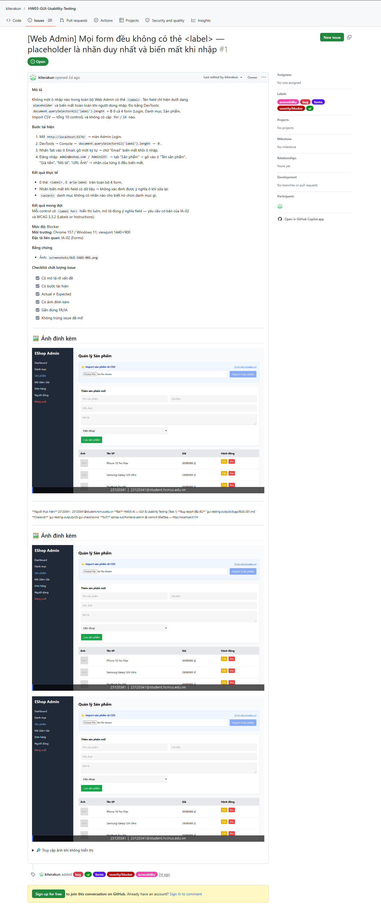

> *Trang GitHub Issues #1 — ảnh chụp toàn bộ nội dung issue kèm các ảnh bằng chứng đính kèm (có overlay email sinh viên `23120341 · 23120341@student.hcmus.edu.vn`).*

## 9. Checklist chất lượng (tự kiểm trước khi chốt)

- [x] Người khác tái hiện được lỗi chỉ bằng "Bước tái hiện"
- [x] Có ≥ 1 ảnh bằng chứng
- [x] Actual và Expected khác nhau và cụ thể
- [x] Gắn đúng mã IA và mục checklist
- [x] Mức độ có lập luận dựa trên tác động người dùng
- [x] Không trùng nguyên nhân gốc với bug khác (đã gộp rồi)
- [x] Không phải vấn đề ưu tiên thẩm mỹ / đề xuất cải tiến

---

### 2.2. BUG-002 — BUG-002 — Form Sản phẩm chấp nhận giá âm, form Danh mục chấp nhận tên rỗng


| Trường | Nội dung |
|---|---|
| **ID** | BUG-002 |
| **Mức độ** | Blocker |
| **Trạng thái** | Open |
| **Ngày phát hiện** | 2026-11-12 |
| **Người phát hiện** | 23120341 (23120341@student.hcmus.edu.vn) |
| **Người xác nhận** | 23120341 |
| **Màn hình / Route** | Quản lý Sản phẩm (`/`, tab "Sản phẩm") · Quản lý Danh mục (`/`, tab "Danh mục") |
| **Môi trường** | Chrome 157 / Windows 11 · viewport 1440×900 · `http://localhost:5174` (API `:3000`) · `admin@eshop.com` / `Admin123!` |
| **Đặc tả liên quan** | IA-02 (Forms) · đặc tả SRS FR-14, FR-15 |
| **Mục checklist liên quan** | GUI-IA02-007, GUI-IA02-008 |
| **Nguyên nhân gốc (phân tích)** | `RC-IMP` — không có validate ở client lẫn server cho dữ liệu bắt buộc |
| **Tần suất** | Luôn (100% lượt thử) |

## 1. Mô tả

Hai form quản trị không kiểm tra dữ liệu bắt buộc trước khi gửi lên server:

- **Form Sản phẩm**: ô "Giá tiền" không có thuộc tính `required`, không có validate `> 0`. Để trống,
  nhập `0` hoặc nhập `-100` đều tạo ra một request `POST /api/products` thành công.
- **Form Danh mục**: ô "Tên danh mục" không có `required` cũng không có validate rỗng. Gửi tên rỗng
  (`""`) hoặc chỉ khoảng trắng (`"   "`) đều tạo ra một request `POST /api/categories` thành công.

Không có thông báo lỗi nào hiện ra cạnh ô nhập — người dùng chỉ thấy bảng dữ liệu thay đổi.

## 2. Bước tái hiện

1. Mở `http://localhost:5174/`, đăng nhập `admin@eshop.com` / `Admin123!`.
2. Vào tab "Sản phẩm", mở DevTools → tab Network → lọc `products`.
3. Nhập tên "QA Giá Rỗng", **để trống** ô "Giá tiền" → bấm "Lưu sản phẩm".
4. Quan sát Network: có `POST http://localhost:3000/api/products` với body `{"price":""}`.
5. Lặp lại với giá `0` → body `{"price":"0"}`; lặp lại với giá `-100` → body `{"price":"-100"}`.
6. Chuyển sang tab "Danh mục" → Network lọc `categories` → để trống ô "Tên danh mục mới" →
   bấm "Thêm mới" → quan sát `POST /api/categories` body `{"name":""}`.
7. Lặp lại với tên chỉ gồm khoảng trắng → body `{"name":"   "}`.

## 3. Kết quả thực tế

- Cả 3 giá trị không hợp lệ đều gửi request và **tạo sản phẩm thật trong CSDL** (`price` = `""`, `"0"`, `"-100"`).
- Cả 2 tên danh mục không hợp lệ đều tạo **danh mục rỗng / toàn khoảng trắng** trong CSDL.
- Không có thông báo lỗi nào hiển thị; người dùng tưởng thao tác thất bại nhưng thực ra đã ghi dữ liệu rác.
- Bảng "Giá" hiển thị giá âm không có dấu phân cách (vd `-100 ₫`), rất dễ bị bỏ qua khi rà soát.

## 4. Kết quả mong đợi

- **Giá tiền**: bắt buộc, phải là số **dương** (> 0); form không submit khi sai và hiện thông báo lỗi
  cụ thể cạnh ô (đặc tả SRS FR-15: "Giá: bắt buộc, phải là số dương (> 0)").
- **Tên danh mục**: bắt buộc, không được để trống hoặc chỉ gồm khoảng trắng (đặc tả SRS FR-14:
  "Tên danh mục là bắt buộc, không được để trống").

## 5. Bằng chứng

| Loại | Đường dẫn / mô tả |
|---|---|
| Ảnh chụp 1 | `screenshots/GUI-IA02-007.png` — form Sản phẩm, không chặn giá rỗng / 0 / âm |
| Ảnh chụp 2 | `screenshots/GUI-IA02-008.png` — form Danh mục, không chặn tên rỗng / khoảng trắng |
| Video | Không có |

## 6. Tác động lên người dùng

Quản trị viên có thể vô tình tạo ra sản phẩm giá âm — dữ liệu này sẽ xuất hiện trực tiếp trên cửa hàng
và trong giỏ hàng của khách, gây sai lệch tài chính. Danh mục rỗng làm bảng danh mục bị loãng và
không có tín hiệu nào cho biết dòng đó là rác. Người dùng **không có tín hiệu phản hồi nào** để biết
mình vừa ghi dữ liệu sai, nên lỗi chỉ được phát hiện khi sản phẩm đã lên cửa hàng.

## 7. Ghi chú kỹ thuật

- `frontend-admin/src/App.jsx:500-508` — ô giá: `type="number"` nhưng **không có** `required`,
  **không có** `min`, **không có** `onBlur`/`pattern` validate.
- `frontend-admin/src/App.jsx:298-304` — ô tên danh mục: `type="text"` không `required`.
- `backend/server.js:249-255` (`POST /api/categories`) — không kiểm tra `name` rỗng.
- `backend/server.js:167-177` (`POST /api/products`) — không kiểm tra `price` dương.
- Cần sửa ở **cả hai** đầu: validate ở client để có phản hồi tức thì, và validate ở server để không
  ghi dữ liệu rác qua bất kỳ đường gọi nào.

---

**GitHub Issue:** [#2](https://github.com/kiterakun/HW03-GUI-Usability-Testing/issues/2) — https://github.com/kiterakun/HW03-GUI-Usability-Testing/issues/2

**Ảnh chụp trang GitHub Issues:**

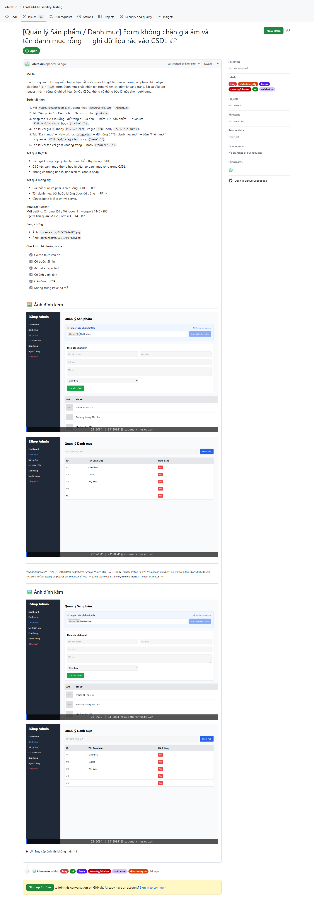

> *Trang GitHub Issues #2 — ảnh chụp toàn bộ nội dung issue kèm các ảnh bằng chứng đính kèm (có overlay email sinh viên `23120341 · 23120341@student.hcmus.edu.vn`).*

## 9. Checklist chất lượng (tự kiểm trước khi chốt)

- [x] Người khác tái hiện được lỗi chỉ bằng "Bước tái hiện"
- [x] Có ≥ 1 ảnh bằng chứng
- [x] Actual và Expected khác nhau và cụ thể
- [x] Gắn đúng mã IA/FR và mục checklist
- [x] Mức độ có lập luận dựa trên tác động người dùng
- [x] Không trùng nguyên nhân gốc với bug khác (đã gộp rồi)
- [x] Không phải vấn đề ưu tiên thẩm mỹ / đề xuất cải tiến

---

### 2.3. BUG-003 — BUG-003 — Xoá danh mục / sản phẩm không có hộp thoại xác nhận


| Trường | Nội dung |
|---|---|
| **ID** | BUG-003 |
| **Mức độ** | Blocker |
| **Trạng thái** | Open |
| **Ngày phát hiện** | 2026-11-12 |
| **Người phát hiện** | 23120341 (23120341@student.hcmus.edu.vn) |
| **Người xác nhận** | 23120341 |
| **Màn hình / Route** | Quản lý Danh mục (`/`, tab "Danh mục") · Quản lý Sản phẩm (`/`, tab "Sản phẩm") |
| **Môi trường** | Chrome 157 / Windows 11 · viewport 1440×900 · `http://localhost:5174` (API `:3000`) · `admin@eshop.com` / `Admin123!` |
| **Đặc tả liên quan** | IA-04 (Feedback / State) · đặc tả SRS FR-24 |
| **Mục checklist liên quan** | GUI-IA04-008 |
| **Nguyên nhân gốc (phân tích)** | `RC-UX` — hành động phá huỷ dữ liệu không có bước xác nhận, không thể hoàn tác |
| **Tần suất** | Luôn (100% lượt thử) |

## 1. Mô tả

Nút "Xóa" ở cả bảng Danh mục và bảng Sản phẩm thực hiện xoá **ngay lập tức** khi được bấm, không
hiện hộp thoại xác nhận, không nêu tên đối tượng sẽ bị xoá, và không có cách nào hoàn tác.
Đo bằng DevTools: `document.querySelectorAll('dialog').length` = **0** sau khi bấm "Xóa"; dòng dữ liệu
biến mất khỏi bảng ngay.

Hệ quả trực tiếp: trong lúc khảo sát giao diện trước đó, một lần bấm "Xóa" đã **vô tình xoá mất
danh mục seed "Điện thoại"** và phải khôi phục lại thủ công.

## 2. Bước tái hiện

1. Mở `http://localhost:5174/`, đăng nhập `admin@eshop.com` / `Admin123!`.
2. Vào tab "Danh mục" → tạo một danh mục tên "QA Xoá Test" để có dòng riêng để thao tác.
3. DevTools → Console → `document.querySelectorAll('dialog').length` → `0`.
4. Bấm nút "Xóa" ở dòng "QA Xoá Test".
5. Quan sát: không có hộp thoại nào xuất hiện; dòng biến mất khỏi bảng ngay lập tức.
6. Đếm lại `document.querySelectorAll('dialog').length` → vẫn `0`.
7. Lặp lại ở tab "Sản phẩm" với một sản phẩm bất kỳ → cùng hành vi.

## 3. Kết quả thực tế

- **0** hộp thoại xác nhận (`dialog` = 0) trước và sau khi bấm "Xóa".
- Dòng bị xoá khỏi bảng ngay lập tức; request `DELETE` được gửi đi không cần xác nhận.
- Không có thông báo nào cho biết đã xoá, không nêu tên đối tượng bị xoá.
- Nút "Xóa" nằm cạnh nút "Sửa" với khoảng cách rất nhỏ (vùng bấm ~40×28px) → dễ bấm nhầm.

## 4. Kết quả mong đợi

Mọi hành động xoá dữ liệu không thể hoàn tác phải có hộp thoại xác nhận nêu rõ **tên** đối tượng sẽ
bị xoá (vd "Xoá danh mục 'QA Xoá Test'?") và có 2 lựa chọn rõ ràng (Huỷ / Xoá). Bấm "Huỷ" thì dữ
liệu phải còn nguyên. Đây là yêu cầu của IA-04 ("Xác nhận hành động phá huỷ") và đặc tả SRS FR-24.

## 5. Bằng chứng

| Loại | Đường dẫn / mô tả |
|---|---|
| Ảnh chụp 1 | `screenshots/GUI-IA04-008.png` — bấm "Xóa" không có hộp thoại, dòng biến mất ngay |
| Ảnh chụp 2 | `screenshots/GUI-IA01-012.png` — vùng bấm nút "Xóa" chỉ ~40×28px, dễ bấm nhầm |
| Video | Không có |

## 6. Tác động lên người dùng

Một cú bấm chuột nhầm làm mất vĩnh viễn một danh mục hoặc một sản phẩm đã được cấu hình, đã có
ảnh, đã có giá — **không có undo, không có thùng rác**. Do nút "Xóa" đặt sát cạnh nút "Sửa" trong
bảng dữ liệu, xác suất bấm nhầm là thực tế. Với sản phẩm đã bán, việc xoá còn làm mất liên kết
giữa sản phẩm và đơn hàng cũ.

## 7. Ghi chú kỹ thuật

- `frontend-admin/src/App.jsx:153-161` (`deleteCategory`) và `:133-141` (`deleteProduct`) — gọi thẳng
  `axios.delete(...)` trong `onClick`, không có `window.confirm` hay component modal nào.
- `frontend-admin/src/App.jsx:76-83` (`deleteUser`) cũng có cùng điểm — cùng nguyên nhân gốc, nằm
  ngoài phạm vi màn hình đã test nhưng cần sửa cùng lúc.
- Backend **không** có cơ chế soft-delete, nên xoá là xoá vĩnh viễn.

---

**GitHub Issue:** [#3](https://github.com/kiterakun/HW03-GUI-Usability-Testing/issues/3) — https://github.com/kiterakun/HW03-GUI-Usability-Testing/issues/3

**Ảnh chụp trang GitHub Issues:**

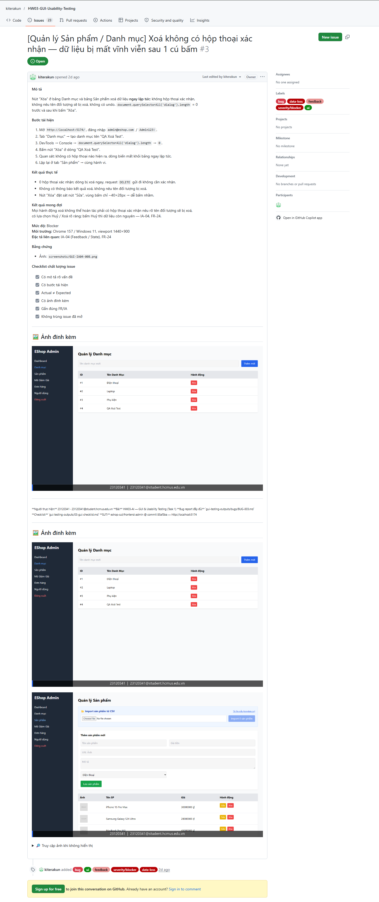

> *Trang GitHub Issues #3 — ảnh chụp toàn bộ nội dung issue kèm các ảnh bằng chứng đính kèm (có overlay email sinh viên `23120341 · 23120341@student.hcmus.edu.vn`).*

## 9. Checklist chất lượng (tự kiểm trước khi chốt)

- [x] Người khác tái hiện được lỗi chỉ bằng "Bước tái hiện"
- [x] Có ≥ 1 ảnh bằng chứng
- [x] Actual và Expected khác nhau và cụ thể
- [x] Gắn đúng mã IA/FR và mục checklist
- [x] Mức độ có lập luận dựa trên tác động người dùng
- [x] Không trùng nguyên nhân gốc với bug khác (đã gộp rồi)
- [x] Không phải vấn đề ưu tiên thẩm mỹ / đề xuất cải tiến

---

### 2.4. BUG-004 — BUG-004 — Sửa một sản phẩm làm đổi tên của toàn bộ danh sách sản phẩm


| Trường | Nội dung |
|---|---|
| **ID** | BUG-004 |
| **Mức độ** | Blocker |
| **Trạng thái** | Open |
| **Ngày phát hiện** | 2026-11-12 |
| **Người phát hiện** | 23120341 (23120341@student.hcmus.edu.vn) |
| **Người xác nhận** | 23120341 |
| **Màn hình / Route** | Quản lý Sản phẩm (`/`, tab "Sản phẩm") |
| **Môi trường** | Chrome 157 / Windows 11 · viewport 1440×900 · `http://localhost:5174` (API `:3000`) · `admin@eshop.com` / `Admin123!` |
| **Đặc tả liên quan** | IA-04 (Feedback / State) · đặc tả SRS FR-15 |
| **Mục checklist liên quan** | GUI-IA04-010 |
| **Nguyên nhân gốc (phân tích)** | `RC-IMP` — lỗi logic cập nhật state: gán tên mới cho **mọi** phần tử của mảng thay vì chỉ phần tử đang sửa |
| **Tần suất** | Luôn (100% lượt thử) |

## 1. Mô tả

Khi sửa một sản phẩm, mã nguồn tạo ra một mảng mới bằng cách `map` qua **toàn bộ** danh sách sản
phẩm và gán cho mọi phần tử cùng một `name` mới. Kết quả: sau khi lưu, **cả bảng** hiển thị tên mới
thay vì chỉ dòng được sửa. Giá và các trường khác của các dòng khác giữ nguyên, nên bảng trông như
bị nhân bản.

## 2. Bước tái hiện

1. Mở `http://localhost:5174/`, đăng nhập `admin@eshop.com` / `Admin123!`.
2. Vào tab "Sản phẩm" → ghi lại tên 5 dòng đầu bảng (seed data:
   iPhone 15 Pro Max / Samsung Galaxy S24 Ultra / MacBook Pro M3 / Tai nghe AirPods Pro 2 /
   Bàn phím cơ Keychron Q1).
3. Bấm nút "Sửa" ở dòng thứ 2 (Samsung Galaxy S24 Ultra).
4. Xoá sạch ô "Tên sản phẩm", gõ `QA Tên Mới`.
5. Bấm "Lưu sản phẩm".
6. Quan sát bảng: **cả 5 dòng** đều hiển thị "QA Tên Mới".

## 3. Kết quả thực tế

```
Trước khi sửa:  iPhone 15 Pro Max | Samsung Galaxy S24 Ultra | MacBook Pro M3 |
                Tai nghe AirPods Pro 2 | Bàn phím cơ Keychron Q1
Sau khi sửa:    QA Tên Mới | QA Tên Mới | QA Tên Mới | QA Tên Mới | QA Tên Mới
```

Giá vẫn khác nhau (30.000.000 / 28.000.000 / …) → bảng hiển thị 5 sản phẩm trùng tên với giá khác
nhau, rõ ràng là dữ liệu sai. Đây chỉ là lỗi ở tầng hiển thị; CSDL không bị sửa hàng loạt — nhưng
người dùng nhìn bảng và tin rằng cả danh mục sản phẩm bị đổi tên.

## 4. Kết quả mong đợi**

Khi sửa một sản phẩm, **chỉ sản phẩm đó** bị thay đổi; các sản phẩm khác giữ nguyên tên, giá và
mọi thuộc tính. Đặc tả SRS FR-15: "Khi Sửa một sản phẩm, chỉ sản phẩm đó bị thay đổi — các sản
phẩm khác giữ nguyên."

## 5. Bằng chứng

| Loại | Đường dẫn / mô tả |
|---|---|
| Ảnh chụp 1 | `screenshots/GUI-IA04-010.png` — cả 5 dòng cùng tên "QA Tên Mới" sau khi sửa 1 dòng |
| Video | Không có |

## 6. Tác động lên người dùng

Quản trị viên sửa **một** sản phẩm và bị mất tên của **toàn bộ** danh mục trên màn hình. Người dùng
không có cách nào tin rằng dữ liệu nền còn đúng, nên buộc phải kiểm tra lại từng sản phẩm trong
CSDL — mất thời gian và tăng rủi ro ghi đè tiếp dữ liệu đúng bằng dữ liệu sai. Với danh mục lớn,
một thao tác sửa đúng sẽ làm hỏng toàn bộ danh sách hiển thị, buộc admin phải sửa lại từng dòng.

## 7. Ghi chú kỹ thuật

- `frontend-admin/src/App.jsx:108-115`:
  ```js
  await axios.put(`${API_URL}/products/${productForm.id}`, productForm);
  const fakeMassUpdatedProducts = products.map((p) => ({
    ...p,
    name: productForm.name,          // ← gán cho MỌI phần tử
  }));
  setProducts(fakeMassUpdatedProducts);
  ```
  Tên biến `fakeMassUpdatedProducts` cho thấy đây là code dựng nhanh. Cách đúng:
  `setProducts(products.map((p) => (p.id === productForm.id ? { ...p, ...productForm } : p)))`,
  hoặc đơn giản hơn là gọi lại `fetchData()` sau khi `PUT` (giống nhánh "thêm mới" đang làm).
- Đáng chú ý: nhánh **thêm mới** gọi `fetchData()` để lấy lại danh sách từ server, còn nhánh **sửa**
  thì tự cập nhật state bằng tay → chỗ khác biệt chính là chỗ sinh bug.

---

**GitHub Issue:** [#4](https://github.com/kiterakun/HW03-GUI-Usability-Testing/issues/4) — https://github.com/kiterakun/HW03-GUI-Usability-Testing/issues/4

**Ảnh chụp trang GitHub Issues:**

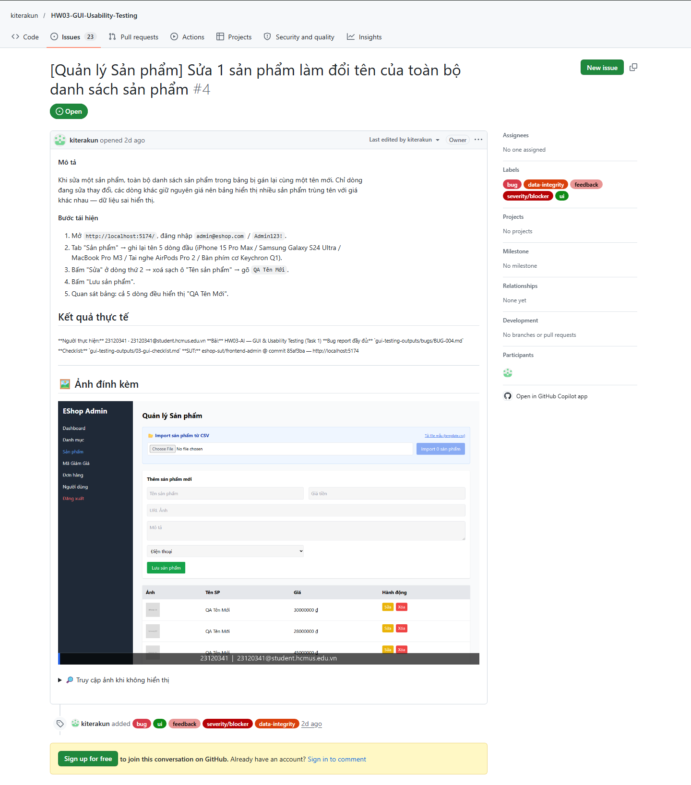

> *Trang GitHub Issues #4 — ảnh chụp toàn bộ nội dung issue kèm các ảnh bằng chứng đính kèm (có overlay email sinh viên `23120341 · 23120341@student.hcmus.edu.vn`).*

## 9. Checklist chất lượng (tự kiểm trước khi chốt)

- [x] Người khác tái hiện được lỗi chỉ bằng "Bước tái hiện"
- [x] Có ≥ 1 ảnh bằng chứng
- [x] Actual và Expected khác nhau và cụ thể
- [x] Gắn đúng mã IA/FR và mục checklist
- [x] Mức độ có lập luận dựa trên tác động người dùng
- [x] Không trùng nguyên nhân gốc với bug khác (đã gộp rồi)
- [x] Không phải vấn đề ưu tiên thẩm mỹ / đề xuất cải tiến

---

### 2.5. BUG-005 — BUG-005 — Tổng doanh thu trên Dashboard bị nhân đôi


| Trường | Nội dung |
|---|---|
| **ID** | BUG-005 |
| **Mức độ** | Blocker |
| **Trạng thái** | Open |
| **Ngày phát hiện** | 2026-11-12 |
| **Người phát hiện** | 23120341 (23120341@student.hcmus.edu.vn) |
| **Người xác nhận** | 23120341 |
| **Màn hình / Route** | Admin Dashboard (`/`, tab "Dashboard") |
| **Môi trường** | Chrome 157 / Windows 11 · viewport 1440×900 · `http://localhost:5174` (API `:3000`) · `admin@eshop.com` / `Admin123!` |
| **Đặc tả liên quan** | IA-04 (Feedback / State) · đặc tả SRS FR-13 |
| **Mục checklist liên quan** | GUI-IA04-009 |
| **Nguyên nhân gốc (phân tích)** | `RC-IMP` — công thức cộng tổng doanh thu nhân thêm hệ số `* 2` |
| **Tần suất** | Luôn (100% lượt thử) |

## 1. Mô tả

Thẻ "Tổng doanh thu (Delivered)" trên Dashboard cộng mỗi đơn hàng `delivered` với hệ số **× 2**,
khiến giá trị hiển thị gấp đôi giá trị thật. Với dữ liệu kiểm thử: 1 đơn `delivered` có tổng tiền
150.000 ₫ → Dashboard hiển thị **300.000 ₫**.

## 2. Bước tái hiện

1. Mở `http://localhost:5174/`, đăng nhập `admin@eshop.com` / `Admin123!`.
2. Chuẩn bị dữ liệu: tạo ít nhất 1 đơn hàng và chuyển nó sang trạng thái `delivered`
   (mua hàng ở `http://localhost:5173` → Checkout, rồi tab "Đơn hàng" → bấm "Hoàn thành").
3. Ghi lại tổng tiền của các đơn `delivered` (ví dụ: 1 đơn = 150.000 ₫).
4. Quay lại tab "Dashboard" → nhìn thẻ "Tổng doanh thu (Delivered)".
5. So sánh số hiển thị (300.000 ₫) với tổng tiền thật (150.000 ₫).

## 3. Kết quả thực tế

```
Dữ liệu thật:   4 đơn hàng, 1 đơn delivered có tổng tiền 150.000 ₫
Tổng delivered:  150.000 ₫
Dashboard hiện:  300.000 ₫   ← gấp đôi
```

Thẻ "Tổng số đơn hàng" hiển thị `4` — phần này **đúng** (khớp số dòng bảng Đơn hàng). Chỉ thẻ doanh
thu sai, nên người dùng nhìn 2 con số cạnh nhau và tưởng hệ thống tính toán không nhất quán.

## 4. Kết quả mong đợi

Tổng doanh thu = **đúng** tổng `total_amount` của các đơn có `status = 'delivered'`, không có hệ số
nhân nào. Đặc tả SRS FR-13: "Hiển thị tổng doanh thu: Chỉ tính tổng `total_amount` của các đơn có
`status = 'delivered'`."

## 5. Bằng chứng

| Loại | Đường dẫn / mô tả |
|---|---|
| Ảnh chụp 1 | `screenshots/GUI-IA04-009.png` — Dashboard hiện 300.000 ₫ cho đơn delivered 150.000 ₫ |
| Video | Không có |

## 6. Tác động lên người dùng

Dashboard là màn hình đầu tiên quản trị viên nhìn vào để quyết định tình hình kinh doanh. Con số
doanh thu sai gấp đôi dẫn tới **quyết định sai**: đánh giá hiệu quả chiến dịch, quy mô doanh thu,
thưởng cho đội ngũ bán hàng. Với dữ liệu lớn, sai số cũng tăng theo tỷ lệ nên rất khó phát hiện
bằng mắt.

## 7. Ghi chú kỹ thuật

- `frontend-admin/src/App.jsx:217-220`:
  ```js
  const totalRevenue = orders.reduce((sum, o) => {
    if (o.status === "delivered") return sum + o.total_amount * 2;  // ← nhân đôi
    return sum;
  }, 0);
  ```
- Sửa: `sum + Number(o.total_amount || 0)`.
- Lưu ý: `orders` được lấy từ `GET /api/admin/orders`, trả về `total_amount` dạng số — nhưng nên
  ép `Number()` để tránh nối chuỗi nếu backend đổi kiểu dữ liệu.
- Cũng nên cân nhắc hiển thị giá trị doanh thu theo **ngày** để người dùng đối chiếu được với báo cáo
  bán hàng — hiện tại chỉ có tổng chung.

---

**GitHub Issue:** [#5](https://github.com/kiterakun/HW03-GUI-Usability-Testing/issues/5) — https://github.com/kiterakun/HW03-GUI-Usability-Testing/issues/5

**Ảnh chụp trang GitHub Issues:**

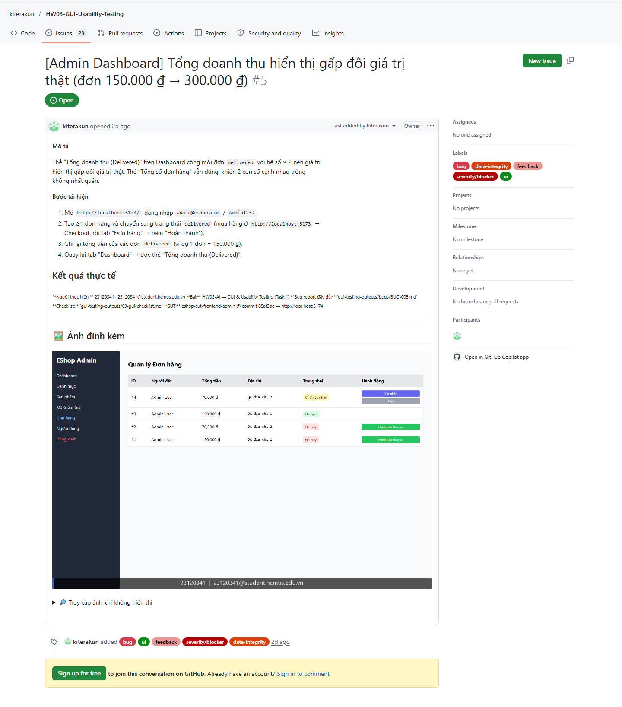

> *Trang GitHub Issues #5 — ảnh chụp toàn bộ nội dung issue kèm các ảnh bằng chứng đính kèm (có overlay email sinh viên `23120341 · 23120341@student.hcmus.edu.vn`).*

## 9. Checklist chất lượng (tự kiểm trước khi chốt)

- [x] Người khác tái hiện được lỗi chỉ bằng "Bước tái hiện"
- [x] Có ≥ 1 ảnh bằng chứng
- [x] Actual và Expected khác nhau và cụ thể
- [x] Gắn đúng mã IA/FR và mục checklist
- [x] Mức độ có lập luận dựa trên tác động người dùng
- [x] Không trùng nguyên nhân gốc với bug khác (đã gộp rồi)
- [x] Không phải vấn đề ưu tiên thẩm mỹ / đề xuất cải tiến

---

### 2.6. BUG-006 — BUG-006 — Import CSV không rollback: dòng lỗi vẫn được ghi vào CSDL


| Trường | Nội dung |
|---|---|
| **ID** | BUG-006 |
| **Mức độ** | Blocker |
| **Trạng thái** | Open |
| **Ngày phát hiện** | 2026-11-12 |
| **Người phát hiện** | 23120341 (23120341@student.hcmus.edu.vn) |
| **Người xác nhận** | 23120341 |
| **Màn hình / Route** | Import sản phẩm từ CSV (`/`, tab "Sản phẩm" → khối "📂 Import sản phẩm từ CSV") |
| **Môi trường** | Chrome 157 / Windows 11 · viewport 1440×900 · `http://localhost:5174` (API `:3000`) · `admin@eshop.com` / `Admin123!` |
| **Đặc tả liên quan** | IA-04 (Feedback / State) · đặc tả SRS FR-16 |
| **Mục checklist liên quan** | GUI-IA04-012 |
| **Nguyên nhân gốc (phân tích)** | `RC-IMP` — backend không bọc giao dịch (transaction) khi insert nhiều dòng → import không all-or-nothing |
| **Tần suất** | Luôn (100% lượt thử) |

## 1. Mô tả

Đặc tả yêu cầu import CSV phải là giao dịch **nguyên tử (all-or-nothing)**: nếu bất kỳ dòng nào lỗi
thì toàn bộ import phải được rollback. Hiện tại backend insert từng dòng một, không dùng transaction;
dòng hợp lệ vẫn được ghi vào CSDL dù các dòng khác trong cùng file sai.

## 2. Bước tái hiện

1. Mở `http://localhost:5174/`, đăng nhập `admin@eshop.com` / `Admin123!`.
2. Vào tab "Sản phẩm" → ghi lại số dòng hiện có trong bảng sản phẩm (ví dụ 69 dòng).
3. Chuẩn bị file `invalid.csv` (có sẵn trong `gui-testing-outputs/assets/`):
   - dòng 2: `name` **rỗng** → lỗi
   - dòng 3: `name` = "Tên OK", `price` = **-500** → lỗi (giá không dương)
4. Chọn file `invalid.csv` ở khối Import → quan sát preview báo "Xem trước (2 dòng)".
5. Bấm nút "Import 2 sản phẩm".
6. Quan sát ô kết quả: "✅ Import hoàn tất: 1/2 sản phẩm được thêm".
7. Quan sát bảng sản phẩm: số dòng **tăng từ 69 lên 70**, có dòng mới tên "Tên OK" với giá `-500`.

## 3. Kết quả thực tế

- Bảng sản phẩm tăng **69 → 70** dòng; dòng mới ghi vào CSDL là `"Tên OK"` với `price = -500`.
- Ô kết quả báo "Import hoàn tất: 1/2 sản phẩm được thêm" → tức là hệ thống **biết** có 1 dòng
  lỗi nhưng vẫn ghi dòng còn lại.
- Đây là dữ liệu sai được đưa vào CSDL: một sản phẩm có giá âm sẽ lên cửa hàng.
- Người dùng không có tín hiệu nào cho biết giao dịch chưa hoàn tất trọn vẹn — chỉ có dòng chữ
  "Import hoàn tất" màu xanh.

## 4. Kết quả mong đợi

Nếu **bất kỳ** dòng nào trong file lỗi, toàn bộ import phải được rollback — không sản phẩm nào từ
file đó được ghi vào CSDL. Đặc tả SRS FR-16: "Nếu có lỗi ở bất kỳ dòng nào, toàn bộ import phải
được **rollback** (giao dịch nguyên tử — all-or-nothing)."

## 5. Bằng chứng

| Loại | Đường dẫn / mô tả |
|---|---|
| Ảnh chụp 1 | `screenshots/GUI-IA04-012.png` — bảng tăng 69 → 70 dòng, dòng lỗi vẫn được insert |
| Ảnh chụp 2 | `screenshots/GUI-IA02-011.png` — preview không cảnh báo dòng lỗi |
| File test | `gui-testing-outputs/assets/invalid.csv` |
| Video | Không có |

## 6. Tác động lên người dùng

Quản trị viên tin rằng lần import đã "hoàn tất" (thông báo màu xanh) nên không kiểm tra lại. Thực tế
CSDL đã chứa sản phẩm giá âm, xuất hiện trên cửa hàng và trong báo cáo doanh thu. Nếu file import
lớn (hàng trăm dòng) và phần lớn sai, việc dọn dẹp thủ công là không khả thi → quy trình nhập hàng
hoàn toàn không đáng tin.

## 7. Ghi chú kỹ thuật

- `backend/server.js:199-241` — `POST /api/admin/import-products`:
  - Dùng `db.prepare(...)` + `stmt.run(...)` cho từng dòng, **không** có `db.transaction()`.
  - `stmt.finalize()` được gọi ngay khi vòng `forEach` kết thúc → mọi dòng đã commit.
  - Chỉ kiểm tra `!row.name` (`:214-217`); **không** kiểm tra `price` dương.
- Cách sửa: bọc toàn bộ trong `db.transaction(() => { ... })` của `sqlite3`; nếu có dòng lỗi thì
  `throw` để rollback, hoặc kiểm tra hết dữ liệu **trước** khi insert bất kỳ dòng nào (validate-first).
- Đây là lỗi **backend**, nhưng biểu hiện trực tiếp trên GUI (bảng sản phẩm + ô kết quả) nên thuộc
  phạm vi kiểm thử GUI.

---

**GitHub Issue:** [#6](https://github.com/kiterakun/HW03-GUI-Usability-Testing/issues/6) — https://github.com/kiterakun/HW03-GUI-Usability-Testing/issues/6

**Ảnh chụp trang GitHub Issues:**


> *Trang GitHub Issues #6 — ảnh chụp toàn bộ nội dung issue kèm các ảnh bằng chứng đính kèm (có overlay email sinh viên `23120341 · 23120341@student.hcmus.edu.vn`).*

## 9. Checklist chất lượng (tự kiểm trước khi chốt)

- [x] Người khác tái hiện được lỗi chỉ bằng "Bước tái hiện"
- [x] Có ≥ 1 ảnh bằng chứng
- [x] Actual và Expected khác nhau và cụ thể
- [x] Gắn đúng mã IA/FR và mục checklist
- [x] Mức độ có lập luận dựa trên tác động người dùng
- [x] Không trùng nguyên nhân gốc với bug khác (đã gộp rồi)
- [x] Không phải vấn đề ưu tiên thẩm mỹ / đề xuất cải tiến

---

### 2.7. BUG-007 — BUG-007 — CSV có trường bọc dấu nháy kép bị tách sai thành nhiều cột


| Trường | Nội dung |
|---|---|
| **ID** | BUG-007 |
| **Mức độ** | Blocker |
| **Trạng thái** | Open |
| **Ngày phát hiện** | 2026-11-12 |
| **Người phát hiện** | 23120341 (23120341@student.hcmus.edu.vn) |
| **Người xác nhận** | 23120341 |
| **Màn hình / Route** | Import sản phẩm từ CSV (`/`, tab "Sản phẩm" → khối "📂 Import sản phẩm từ CSV") |
| **Môi trường** | Chrome 157 / Windows 11 · viewport 1440×900 · `http://localhost:5174` (API `:3000`) · `admin@eshop.com` / `Admin123!` |
| **Đặc tả liên quan** | IA-02 (Forms) · đặc tả SRS FR-16 |
| **Mục checklist liên quan** | GUI-IA02-012 |
| **Nguyên nhân gốc (phân tích)** | `RC-DATA` — parser CSV tự viết bằng `split(",")`, không xử lý trường bọc dấu nháy kép theo RFC 4180 |
| **Tần suất** | Luôn (100% lượt thử với file có dấu phẩy trong trường) |

## 1. Mô tả

File CSV được parse bằng cách tách dòng theo `\n` rồi tách mỗi dòng theo `,` — không xử lý trường
được bọc trong dấu nháy kép. Theo RFC 4180, một trường chứa dấu phẩy phải được bọc `"..."` và parser
phải coi cả dấu phẩy bên trong là một phần của giá trị. Ứng dụng làm ngược lại → dữ liệu bị cắt
đôi và ghi sai vào CSDL.

## 2. Bước tái hiện

1. Mở `http://localhost:5174/`, đăng nhập `admin@eshop.com` / `Admin123!`.
2. Vào tab "Sản phẩm" → khối Import → chọn file `quoted.csv` (có sẵn trong
   `gui-testing-outputs/assets/`). Nội dung:
   ```csv
   name,price,description,imageUrl,category_id
   "Sản phẩm, loại A",100000,"Mô tả có, dấu phẩy",https://placehold.co/300,1
   Sản phẩm B,200000,Mô tả B,https://placehold.co/300,2
   ```
3. Quan sát bảng "Xem trước (2 dòng)": dòng 1 hiển thị **6 cột** thay vì 5.
4. Quan sát giá trị cột đầu của dòng 1: `"Sản phẩm` và cột thứ hai: `loại A"` — dấu nháy kép bị giữ
   lại và giá trị bị cắt đôi.
5. Cột `description` cũng bị tách: `Mô tả có` | `dấu phẩy`.

## 3. Kết quả thực tế

```
Dòng 1 hiển thị 6 cột: ["Sản phẩm", "loại A", "100000", "Mô tả có", "dấu phẩy", ...]
Kỳ vọng:             5 cột: ["Sản phẩm, loại A", "100000", "Mô tả có, dấu phẩy", "https://placehold.co/300", "1"]
```

Giá trị `name` bị mất dấu phẩy và có dấu nháy kép thừa; `description` bị cắt đôi. Khi import, các
giá trị này được ghi thẳng vào CSDL → tên sản phẩm và mô tả sai trên cửa hàng.

## 4. Kết quả mong đợi

Đặc tả SRS FR-16: "Hỗ trợ các trường có chứa dấu phẩy nếu được bọc trong dấu nháy kép (RFC 4180)."
Preview phải hiển thị đúng 5 cột và giá trị `"Sản phẩm, loại A"` phải nằm nguyên trong một ô.

## 5. Bằng chứng

| Loại | Đường dẫn / mô tả |
|---|---|
| Ảnh chụp 1 | `screenshots/GUI-IA02-012.png` — dòng 1 hiển thị 6 cột thay vì 5 |
| File test | `gui-testing-outputs/assets/quoted.csv` |
| Video | Không có |

## 6. Tác động lên người dùng

Quản trị viên xuất danh sách sản phẩm từ nhà cung cấp — một định dạng CSV rất phổ biến là tên sản
phẩm có dấu phẩy ("iPhone 15 Pro Max, 256GB"). Sau khi import, toàn bộ những sản phẩm đó có tên bị
cắt đôi và mô tả bị vỡ nát trên cửa hàng. Người dùng **không thể phát hiện** lỗi từ preview vì
bảng xem trước hiển thị "đúng như những gì file chứa" — phải đối chiếu thủ công với file gốc mới
thấy. Với file lớn, việc này bất khả thi.

## 7. Ghi chú kỹ thuật

- `frontend-admin/src/App.jsx:367-377`:
  ```js
  const lines = text.trim().split("\n");
  const headers = lines[0].split(",").map((h) => h.trim());
  const rows = lines.slice(1).map((line) => {
    const values = line.split(",").map((v) => v.trim());   // ← tách thẳng, không xử lý nháy kép
    ...
  });
  ```
- Lỗi còn ở chỗ `.trim()` xoá khoảng trắng **bên trong** dấu nháy kép, và không hỗ trợ dòng có
  newline trong trường.
- Cách sửa: dùng thư viện parse CSV chuẩn (ví dụ `papaparse`) hoặc viết state machine xử lý
  trạng thái `inQuotes`. Vì đây là đặc tả nêu rõ RFC 4180, đây là **lỗi triển khai** chứ không phải
  thiếu yêu cầu.
- Lưu ý: lỗi này cộng dồn với BUG-006 — dữ liệu sai do parser tạo ra vẫn được commit vào CSDL vì
  không có rollback.

---

**GitHub Issue:** [#7](https://github.com/kiterakun/HW03-GUI-Usability-Testing/issues/7) — https://github.com/kiterakun/HW03-GUI-Usability-Testing/issues/7

**Ảnh chụp trang GitHub Issues:**

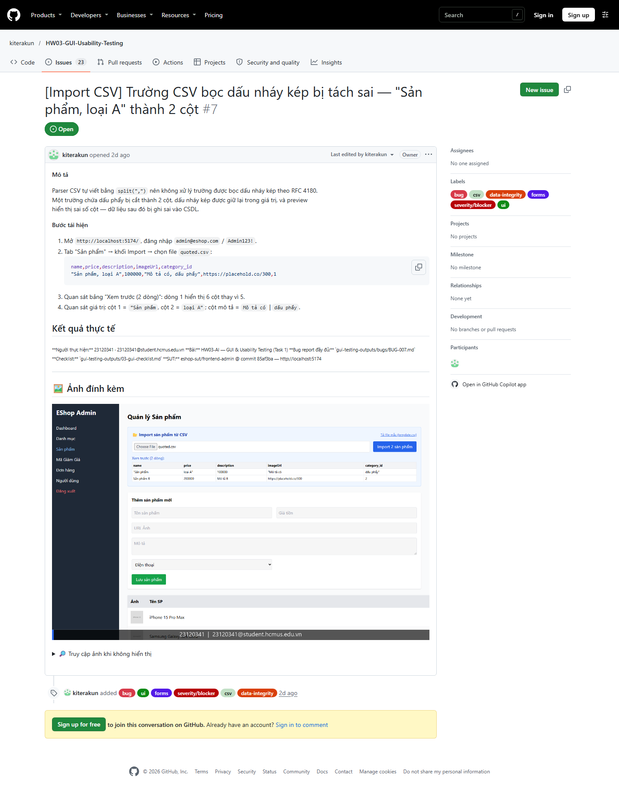

> *Trang GitHub Issues #7 — ảnh chụp toàn bộ nội dung issue kèm các ảnh bằng chứng đính kèm (có overlay email sinh viên `23120341 · 23120341@student.hcmus.edu.vn`).*

## 9. Checklist chất lượng (tự kiểm trước khi chốt)

- [x] Người khác tái hiện được lỗi chỉ bằng "Bước tái hiện"
- [x] Có ≥ 1 ảnh bằng chứng
- [x] Actual và Expected khác nhau và cụ thể
- [x] Gắn đúng mã IA/FR và mục checklist
- [x] Mức độ có lập luận dựa trên tác động người dùng
- [x] Không trùng nguyên nhân gốc với bug khác (đã gộp rồi)
- [x] Không phải vấn đề ưu tiên thẩm mỹ / đề xuất cải tiến

---

### 2.8. BUG-008 — BUG-008 — Ứng dụng không có routing: mất deep-link, F5 mất tab, không có trang 404


| Trường | Nội dung |
|---|---|
| **ID** | BUG-008 |
| **Mức độ** | Blocker |
| **Trạng thái** | Open |
| **Ngày phát hiện** | 2026-11-12 |
| **Người phát hiện** | 23120341 (23120341@student.hcmus.edu.vn) |
| **Người xác nhận** | 23120341 |
| **Màn hình / Route** | Toàn bộ Web Admin (`/`) — Sidebar chuyển giữa các tab |
| **Môi trường** | Chrome 157 / Windows 11 · viewport 1440×900 · `http://localhost:5174` (API `:3000`) · `admin@eshop.com` / `Admin123!` |
| **Đặc tả liên quan** | IA-03 (Navigation) |
| **Mục checklist liên quan** | GUI-IA03-001, GUI-IA03-002, GUI-IA03-005 |
| **Nguyên nhân gốc (phân tích)** | `RC-IMP` — không có lớp định tuyến; toàn bộ app là 1 component với state `activeTab` |
| **Tần suất** | Luôn (100% lượt thử) |

## 1. Mô tả

Toàn bộ Web Admin được viết trong **một component duy nhất** (`src/App.jsx`, 922 dòng), chuyển màn hình
bằng state `activeTab` (`App.jsx:10`). Không có router, không có URL riêng cho từng màn hình. Ba hệ
quả trực tiếp:

1. **Không deep-link**: URL luôn là `http://localhost:5174/` dù đang ở màn hình nào. Mở trực tiếp
   `http://localhost:5174/san-pham` vẫn ra màn Dashboard.
2. **F5 mất trạng thái**: đang ở tab "Danh mục" thì nhấn F5 → quay về tab Dashboard.
3. **Không có trang 404**: `http://localhost:5174/khong-ton-tai` trả HTTP 200 (SPA fallback của Vite
   trả `index.html`) → hiện màn Login bình thường, không có thông báo "không tìm thấy" và không có
   nút quay về trang chủ.

## 2. Bước tái hiện

**Kịch bản A — mất deep-link**
1. Mở `http://localhost:5174/`, đăng nhập `admin@eshop.com` / `Admin123!`.
2. Click lần lượt các mục "Dashboard", "Danh mục", "Sản phẩm", "Mã Giảm Giá", "Đơn hàng",
   "Người dùng" → quan sát thanh địa chỉ: **luôn giữ nguyên** `http://localhost:5174/`.
3. Copy URL của tab "Sản phẩm" (vẫn là `/`), dán vào một tab trình duyệt mới → mở trực tiếp
   `http://localhost:5174/san-pham` → ứng dụng vẫn hiện màn **Dashboard**, mục active là Dashboard.

**Kịch bản B — F5 mất tab**
4. Đang ở tab "Danh mục" → nhấn F5 → sau khi tải lại, màn hiện là "Dashboard".

**Kịch bản C — không có trang 404**
5. Dán `http://localhost:5174/khong-ton-tai` vào thanh địa chỉ → Enter.
6. Quan sát: trả HTTP 200, hiện màn Login, không có thông báo lỗi 404, không có nút quay về.

## 3. Kết quả thực tế

| Tình huống | Kết quả thực tế | Kỳ vọng |
|---|---|---|
| Đổi tab | URL luôn `http://localhost:5174/` | Mỗi tab có URL riêng (`/products`, `/categories`…) |
| Mở URL sâu | `/san-pham` → hiện **Dashboard** | Mở đúng màn "Quản lý Sản phẩm" |
| F5 | Từ "Danh mục" → về **Dashboard** | Giữ nguyên tab đang xem |
| URL sai | HTTP 200, hiện màn Login, không có thông báo | Trang 404 có nút quay về trang chủ |

## 4. Kết quả mong đợi

- Mỗi màn hình có URL riêng, có thể bookmark, chia sẻ, mở trực tiếp (deep-link).
- Tải lại trang giữ nguyên màn hình đang xem.
- URL không tồn tại trả trang lỗi 404 với thông điệp rõ ràng và nút quay về trang chủ.
- Nút Back / Forward của trình duyệt hoạt động đúng với lịch sử điều hướng.

Đây là yêu cầu cốt lõi của **IA-03 (Navigation)**.

## 5. Bằng chứng

| Loại | Đường dẫn / mô tả |
|---|---|
| Ảnh chụp 1 | `screenshots/GUI-IA03-001.png` — URL không đổi khi đổi tab |
| Ảnh chụp 2 | `screenshots/GUI-IA03-001-deeplink.png` — mở `/san-pham` vẫn ra Dashboard |
| Ảnh chụp 3 | `screenshots/GUI-IA03-002.png` — F5 từ tab "Danh mục" → Dashboard |
| Ảnh chụp 4 | `screenshots/GUI-IA03-005.png` — `/khong-ton-tai` trả 200, không có trang lỗi |
| Video | Không có |

## 6. Tác động lên người dùng

- **Không chia sẻ được**: quản trị viên muốn gửi đồng nghiệp link tới màn "Quản lý Sản phẩm" sẽ gửi
  link Dashboard — người nhận phải tự tìm và click lại đúng tab.
- **Không bookmark được**: mỗi lần muốn vào màn Sản phẩm phải đăng nhập rồi click 2 lần.
- **F5 mất trạng thái**: đang lọc/xem một màn thì tải lại trang bị đưa về Dashboard, mất ngữ cảnh
  công việc.
- **Không phân biệt được URL sai**: gõ nhầm địa chỉ ra màn Login bình thường, không có tín hiệu nào cho
  biết đường dẫn không tồn tại → dễ tưởng hệ thống bị lỗi.
- Với các tab ngoài phạm vi kiểm thử (Mã Giảm Giá, Đơn hàng, Người dùng) tình trạng y hệt.

## 7. Ghi chú kỹ thuật

- `frontend-admin/src/App.jsx:10` — `const [activeTab, setActiveTab] = useState("dashboard")`.
- Các mục sidebar chỉ gọi `setActiveTab(...)` (`App.jsx:229, 235, 241, 247, 253, 259`), **không** gọi
  `history.pushState` / `navigate()`.
- `frontend-admin/package.json:26` — `react-router-dom@^7.15.0` **đã được cài** nhưng **không được
  import** ở bất kỳ đâu trong mã nguồn → có thể dùng lại thư viện sẵn có.
- Cách sửa gợi ý: bọc app trong `<BrowserRouter>`, mỗi tab là một `<Route path="...">`, đọc trạng thái
  ban đầu từ `useLocation()`. Thêm `<Route path="*">` cho trang 404.
- **Lưu ý khi sửa**: mục GUI-IA03-003 (logout → nút Back không vào lại được vùng đã đăng nhập) hiện
  **PASS** chỉ vì ứng dụng chưa tạo lịch sử trình duyệt. Khi thêm routing, phải bảo đảm sau khi
  logout thì Back **không** vào lại được vùng đã đăng nhập — và phải kiểm thử lại mục này.

---

**GitHub Issue:** [#8](https://github.com/kiterakun/HW03-GUI-Usability-Testing/issues/8) — https://github.com/kiterakun/HW03-GUI-Usability-Testing/issues/8

**Ảnh chụp trang GitHub Issues:**

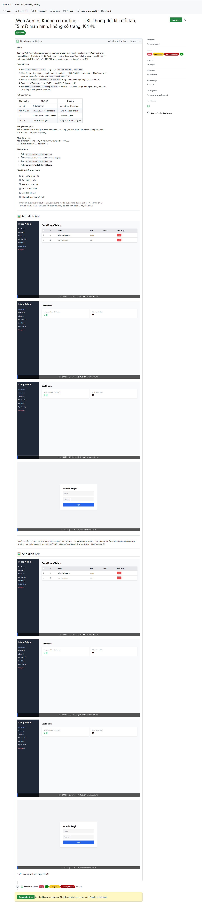

> *Trang GitHub Issues #8 — ảnh chụp toàn bộ nội dung issue kèm các ảnh bằng chứng đính kèm (có overlay email sinh viên `23120341 · 23120341@student.hcmus.edu.vn`).*

## 9. Checklist chất lượng (tự kiểm trước khi chốt)

- [x] Người khác tái hiện được lỗi chỉ bằng "Bước tái hiện"
- [x] Có ≥ 1 ảnh bằng chứng
- [x] Actual và Expected khác nhau và cụ thể
- [x] Gắn đúng mã IA và mục checklist
- [x] Mức độ có lập luận dựa trên tác động người dùng
- [x] Không trùng nguyên nhân gốc với bug khác (đã gộp rồi)
- [x] Không phải vấn đề ưu tiên thẩm mỹ / đề xuất cải tiến

---

### 2.9. BUG-009 — BUG-009 — Hệ thống báo lỗi dùng `alert()` native: không phân biệt nguyên nhân, lộ lỗi kỹ thuật, nuốt lỗi tải trang


| Trường | Nội dung |
|---|---|
| **ID** | BUG-009 |
| **Mức độ** | Blocker |
| **Trạng thái** | Open |
| **Ngày phát hiện** | 2026-11-12 |
| **Người phát hiện** | 23120341 (23120341@student.hcmus.edu.vn) |
| **Người xác nhận** | 23120341 |
| **Màn hình / Route** | Toàn bộ Web Admin (`/`) — đặc biệt Admin Login, Quản lý Danh mục, Quản lý Sản phẩm |
| **Môi trường** | Chrome 157 / Windows 11 · viewport 1440×900 · `http://localhost:5174` (API `:3000`) · `admin@eshop.com` / `Admin123!` |
| **Đặc tả liên quan** | IA-04 (Feedback / State) · đặc tả SRS FR-22, FR-24 |
| **Mục checklist liên quan** | GUI-IA04-001, GUI-IA04-002, GUI-IA04-007 |
| **Nguyên nhân gốc (phân tích)** | `RC-IMP` — không có lớp quản lý lỗi trên UI; mọi lỗi đi qua `window.alert()` rời rạc tại 5 call-site |
| **Tần suất** | Luôn (100% lượt thử) |

## 1. Mô tả

Ứng dụng không có hệ thống hiển thị lỗi. Mọi lỗi được báo bằng `window.alert()` của trình duyệt, dẫn
đến ba vấn đề riêng biệt:

1. **Không phân biệt được nguyên nhân.** Bốn tình huống lỗi đăng nhập khác nhau chỉ cho **2** thông báo:
   - sai mật khẩu → "Đăng nhập thất bại"
   - tài khoản bị khoá (sai ≥2 lần) → "Đăng nhập thất bại" *(server trả HTTP 403 kèm thông báo
     "Tài khoản đã bị khóa. Vui lòng thử lại sau." nhưng UI không hiển thị)*
   - không phải admin → "Bạn không phải là admin!"
   - lỗi mạng (tắt backend) → "Đăng nhập thất bại"
   Không thông báo nào nêu **cách xử lý**.
2. **Hộp thoại native chặn toàn bộ giao diện** và không nằm trên nút submit. Trong DOM **không có phần
   tử lỗi nào** được render cạnh nút Login.
3. **Lộ chuỗi kỹ thuật và nuốt lỗi.** Khi thao tác ghi với backend đã tắt, hộp thoại hiện
   "Lỗi lưu sản phẩm: Network Error" / "Lỗi thêm DM: Network Error" — không phải thông báo thân
   thiện, không có nút thử lại. Ngược lại, lỗi mạng lúc **tải trang** bị nuốt hoàn toàn: 0 thông báo,
   0 vùng lỗi trong DOM.

## 2. Bước tái hiện

**Kịch bản A — không phân biệt nguyên nhân**
1. Mở `http://localhost:5174/`.
2. Nhập email sai và mật khẩu sai → bấm "Login" → ghi lại thông báo.
3. Nhập lại sai mật khẩu (lần 2) → bấm "Login" → ghi lại thông báo (trường hợp bị khoá).
4. Nhập `test@eshop.com` / `Test1234!` (tài khoản user, không phải admin) → bấm "Login" → ghi lại.
5. Tắt backend (`Ctrl+C` ở terminal server) → nhập thông tin đúng → bấm "Login" → ghi lại.
6. So sánh 4 thông báo.

**Kịch bản B — hộp thoại native chặn UI**
7. Với trường hợp sai mật khẩu, quan sát hộp thoại: `type=alert`, phải bấm OK mới thao tác tiếp được.
8. DevTools → Console → kiểm tra số phần tử lỗi render cạnh nút: `document.querySelectorAll('[role=alert], .text-red-500, .text-red-600, .text-red-700').length` → `0`.

**Kịch bản C — lộ lỗi kỹ thuật & nuốt lỗi tải trang**
9. Với backend đã tắt → tải lại trang → quan sát: màn trắng, **không** có thông báo lỗi nào.
10. Vào tab "Sản phẩm" → nhập tên + giá → bấm "Lưu sản phẩm" → quan sát hộp thoại
    "Lỗi lưu sản phẩm: Network Error".

## 3. Kết quả thực tế

| Tình huống | Thông báo thực tế | Kỳ vọng |
|---|---|---|
| Sai mật khẩu | "Đăng nhập thất bại" | "Email hoặc mật khẩu không đúng" |
| Tài khoản bị khoá | "Đăng nhập thất bại" | "Tài khoản đã bị khoá, thử lại sau 30 giây" |
| Không phải admin | "Bạn không phải là admin!" | "Tài khoản này không có quyền truy cập trang quản trị" |
| Lỗi mạng | "Đăng nhập thất bại" | "Không kết nối được máy chủ. Kiểm tra mạng rồi thử lại" + nút Thử lại |
| Lỗi khi lưu sản phẩm | "Lỗi lưu sản phẩm: Network Error" | "Không lưu được sản phẩm. Thử lại sau." |
| Lỗi mạng lúc tải trang | *(không có gì)* | "Không tải được dữ liệu" + nút Thử lại |

Ngoài ra: hộp thoại `alert` chặn toàn bộ giao diện, không nằm trên nút submit, và không có phần tử
lỗi nào trong DOM (0 phần tử `[role=alert]`).

## 4. Kết quả mong đợi

- Thông báo lỗi phải **phân biệt từng nguyên nhân** và nêu **cách xử lý**.
- Thông báo lỗi hiển thị **trên nút submit** (đặc tả SRS FR-22), không phải hộp thoại native chặn UI.
- Lỗi phải bằng tiếng Việt, thân thiện, **không** lộ chuỗi kỹ thuật ("Network Error") hay stack trace.
- Lỗi tải trang phải hiển thị, kèm nút "Thử lại".
- Yêu cầu này thuộc **IA-04 (Feedback / State)**.

## 5. Bằng chứng

| Loại | Đường dẫn / mô tả |
|---|---|
| Ảnh chụp 1 | `screenshots/GUI-IA04-001.png` — thông báo khi sai mật khẩu |
| Ảnh chụp 2 | `screenshots/GUI-IA04-001-network.png` — thông báo khi lỗi mạng (trùng với sai mật khẩu) |
| Ảnh chụp 3 | `screenshots/GUI-IA04-002.png` — hộp thoại native `alert` chặn toàn bộ UI |
| Ảnh chụp 4 | `screenshots/GUI-IA04-007.png` — "Lỗi lưu sản phẩm: Network Error" |
| Ảnh chụp 5 | `screenshots/GUI-IA04-007-load.png` — lỗi mạng lúc tải trang bị nuốt |
| Video | Không có |

## 6. Tác động lên người dùng

- Người dùng nhập sai mật khẩu 2 lần liên tiếp sẽ bị khoá tài khoản 30 giây (thực tế 3 phút) nhưng
  thông báo vẫn là "Đăng nhập thất bại" → **không hiểu nguyên nhân, không biết phải chờ**.
- Khi backend tạm sập, người dùng thấy màn trắng trống không, tưởng ứng dụng hỏng hoàn toàn.
- Thông báo "Network Error" khiến người dùng không phải người kỹ thuật hoàn toàn không hiểu phải làm gì.
- Hộp thoại native buộc dừng mọi thao tác, kể cả khi người dùng chỉ muốn sửa lại một ô.

## 7. Ghi chú kỹ thuật

- 5 call-site `alert()`: `App.jsx:72` (login), `:81` (xoá user), `:91` (đổi trạng thái đơn), `:129`
  (lưu sản phẩm), `:137` (xoá sản phẩm), `:149` (thêm danh mục), `:156` (xoá danh mục),
  `:630` (tạo coupon).
- `App.jsx:53-58` — `catch` trong `fetchData()` chỉ xử lý 401/403 (reset token), **nuốt mọi lỗi khác**
  → không có trạng thái lỗi khi tải trang.
- `App.jsx:71-73` — `catch` của login không đọc `err.response?.data?.error`, nên thông báo cụ thể từ
  server (403 "Tài khoản đã bị khóa") bị bỏ qua.
- Cách sửa: thêm một component thông báo/toast dùng chung + một component inline error; chuẩn hoá
  thông điệp theo mã lỗi từ server; thêm nút "Thử lại" cho các lỗi mạng.

---

**GitHub Issue:** [#9](https://github.com/kiterakun/HW03-GUI-Usability-Testing/issues/9) — https://github.com/kiterakun/HW03-GUI-Usability-Testing/issues/9

**Ảnh chụp trang GitHub Issues:**

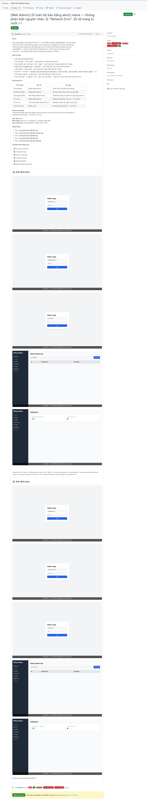

> *Trang GitHub Issues #9 — ảnh chụp toàn bộ nội dung issue kèm các ảnh bằng chứng đính kèm (có overlay email sinh viên `23120341 · 23120341@student.hcmus.edu.vn`).*

## 9. Checklist chất lượng (tự kiểm trước khi chốt)

- [x] Người khác tái hiện được lỗi chỉ bằng "Bước tái hiện"
- [x] Có ≥ 1 ảnh bằng chứng
- [x] Actual và Expected khác nhau và cụ thể
- [x] Gắn đúng mã IA/FR và mục checklist
- [x] Mức độ có lập luận dựa trên tác động người dùng
- [x] Không trùng nguyên nhân gốc với bug khác (đã gộp rồi)
- [x] Không phải vấn đề ưu tiên thẩm mỹ / đề xuất cải tiến

---

### 2.10. BUG-010 — BUG-010 — Menu sidebar không dùng được bằng bàn phím, thiếu landmark, mục active chỉ phân biệt bằng màu


| Trường | Nội dung |
|---|---|
| **ID** | BUG-010 |
| **Mức độ** | Blocker |
| **Trạng thái** | Open |
| **Ngày phát hiện** | 2026-11-12 |
| **Người phát hiện** | 23120341 (23120341@student.hcmus.edu.vn) |
| **Người xác nhận** | 23120341 |
| **Màn hình / Route** | Khung chung — Sidebar (`/`, mọi màn hình sau đăng nhập) |
| **Môi trường** | Chrome 157 / Windows 11 · viewport 1440×900 · `http://localhost:5174` (API `:3000`) · `admin@eshop.com` / `Admin123!` |
| **Đặc tả liên quan** | IA-01 (General UI Standards) · đặc tả SRS FR-21, FR-23 |
| **Mục checklist liên quan** | GUI-IA01-005, GUI-IA01-006 |
| **Nguyên nhân gốc (phân tích)** | `RC-A11Y` — menu được xây bằng `<li onClick>` thay vì phần tử điều hướng có ngữ nghĩa (`<button>`/`<a>`) |
| **Tần suất** | Luôn (100% lượt thử) |

## 1. Mô tả

Bảy mục menu (Dashboard, Danh mục, Sản phẩm, Mã Giảm Giá, Đơn hàng, Người dùng, Đăng xuất) được xây
dựng bằng `<li onClick={...}>` trong một `<ul>`. Chúng:

- **không nhận focus bằng phím `Tab`** (`tabIndex` = −1) → **0/7** mục dừng focus;
- **không kích hoạt được bằng `Enter`** → không thao tác được hoàn toàn bằng bàn phím;
- **không có landmark điều hướng** (`document.querySelectorAll('nav').length` = **0**);
- không có thuộc tính `aria-current` để đánh dấu mục đang active.

Ngoài ra mục active chỉ khác mục thường bằng **màu chữ** (`rgb(147,197,253)` so với `rgb(255,255,255)`);
`font-weight` giống nhau (400), không gạch chân, không đổi nền → tín hiệu chỉ dựa vào màu, không phân
biệt được với người mù màu.

## 2. Bước tái hiện

1. Mở `http://localhost:5174/`, đăng nhập `admin@eshop.com` / `Admin123!`.
2. DevTools → Console → `document.querySelectorAll('nav').length` → `0`.
3. DevTools → Console → `document.querySelectorAll('li[tabindex], li button').length` → `0`.
4. Click vào vùng nền sidebar → nhấn `Tab` liên tục và đếm các điểm dừng focus.
   Chuỗi điểm dừng thực tế: `INPUT(Tên danh mục mới) → BUTTON → BUTTON → BUTTON → BUTTON → BODY` —
   **không đi qua mục menu nào**.
5. Đặt focus vào một mục menu rồi nhấn `Enter` → mục không kích hoạt.
6. Click lần lượt từng mục sidebar, quan sát mục active:
   - màu chữ khác (`text-blue-400` vs `text-white`);
   - `font-weight` giống hệt (400);
   - không gạch chân, không nền khác, không có `aria-current`.
7. DevTools → Console → `document.querySelectorAll('[aria-current]').length` → `0`.

## 3. Kết quả thực tế

| Kiểm tra | Kết quả | Kỳ vọng |
|---|---|---|
| Landmark điều hướng | `nav` = 0 | ≥ 1 |
| Mục menu focus được bằng Tab | 0 / 7 | 7 / 7 |
| Mục menu kích hoạt được bằng Enter | 0 / 7 | 7 / 7 |
| `aria-current` trên mục active | 0 phần tử | ≥ 1 |
| Tín hiệu phân biệt mục active | 1 (chỉ màu chữ) | ≥ 2 (không chỉ màu) |

Chuỗi điểm dừng focus ghi nhận được:
`INPUT(Tên danh mục mới) → BUTTON → BUTTON → BUTTON → BUTTON → BODY` — 5 điểm dừng cho cả ứng dụng,
và **không mục menu nào** nằm trong chuỗi đó.

## 4. Kết quả mong đợi

- Menu là một landmark điều hướng (`<nav>`) và mỗi mục là phần tử có thể focus + kích hoạt được bằng
  bàn phím (`<button>` hoặc `<a>`), đồng thời có thể truy cập bằng trình đọc màn hình.
- Mục đang active được đánh dấu bằng `aria-current="page"` và có ít nhất 2 tín hiệu phân biệt không
  phải màu (ví dụ đậm + gạch chân / nền khác).
- Đặc tả SRS FR-21 yêu cầu tab order từ trên xuống dưới, trái sang phải; FR-23 yêu cầu thanh điều
  hướng highlight trang đang chọn.

## 5. Bằng chứng

| Loại | Đường dẫn / mô tả |
|---|---|
| Ảnh chụp 1 | `screenshots/GUI-IA01-005.png` — không có landmark `nav`, 0/7 mục dừng focus |
| Ảnh chụp 2 | `screenshots/GUI-IA01-006.png` — mục active chỉ khác bằng màu chữ |
| Video | Không có |

## 6. Tác động lên người dùng

Người dùng điều hướng bằng bàn phím **không thể dùng ứng dụng**: không có cách nào chuyển sang màn
"Sản phẩm", "Đơn hàng" hay **thoát đăng nhập** — nút "Đăng xuất" cũng là một `<li>` không focus được.
Người dùng mù màu không phân biệt được mục menu nào đang mở. Với trình đọc màn hình, toàn bộ menu
đọc ra như một danh sách văn bản không có vai trò điều hướng → người dùng screen reader không biết
đó là menu.

## 7. Ghi chú kỹ thuật

- `frontend-admin/src/App.jsx:224-272` — sidebar là `<div className="w-64 bg-gray-800 ...">` chứa
  `<ul className="space-y-4">`, mỗi mục là `<li className="cursor-pointer ..." onClick={...}>`.
- Sửa: bọc menu trong `<nav aria-label="Menu quản trị">`, đổi mỗi `<li>` thành `<li><button …>`
  hoặc dùng `react-router-dom` với `<NavLink>` (đã cài sẵn, xem BUG-008).
- Màu active hiện tại (`text-blue-400` trên nền `bg-gray-800`) đạt tương phản 5,77:1 — vấn đề không
  nằm ở độ tương phản mà nằm ở việc **chỉ** có màu làm tín hiệu.
- Lưu ý: mục "Đăng xuất" dùng màu đỏ `text-red-400` và có `mt-8` để tách nhóm — khi chuyển sang
  `<button>` cần giữ phân cách nhóm này.

---

**GitHub Issue:** [#10](https://github.com/kiterakun/HW03-GUI-Usability-Testing/issues/10) — https://github.com/kiterakun/HW03-GUI-Usability-Testing/issues/10

**Ảnh chụp trang GitHub Issues:**

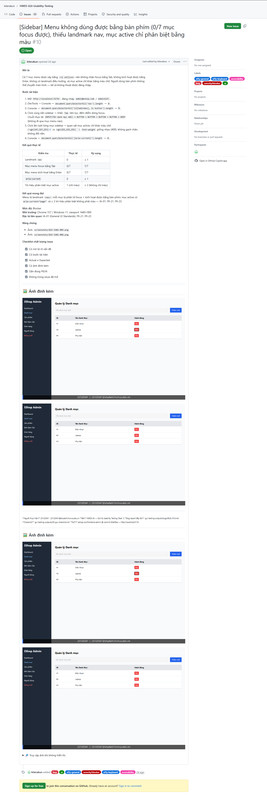

> *Trang GitHub Issues #10 — ảnh chụp toàn bộ nội dung issue kèm các ảnh bằng chứng đính kèm (có overlay email sinh viên `23120341 · 23120341@student.hcmus.edu.vn`).*

## 9. Checklist chất lượng (tự kiểm trước khi chốt)

- [x] Người khác tái hiện được lỗi chỉ bằng "Bước tái hiện"
- [x] Có ≥ 1 ảnh bằng chứng
- [x] Actual và Expected khác nhau và cụ thể
- [x] Gắn đúng mã IA/FR và mục checklist
- [x] Mức độ có lập luận dựa trên tác động người dùng
- [x] Không trùng nguyên nhân gốc với bug khác (đã gộp rồi)
- [x] Không phải vấn đề ưu tiên thẩm mỹ / đề xuất cải tiến

---

### 2.11. BUG-011 — BUG-011 — Form đăng nhập không validate ở client: email sai định dạng và submit rỗng vẫn gửi request


| Trường | Nội dung |
|---|---|
| **ID** | BUG-011 |
| **Mức độ** | Major |
| **Trạng thái** | Open |
| **Ngày phát hiện** | 2026-11-12 |
| **Người phát hiện** | 23120341 (23120341@student.hcmus.edu.vn) |
| **Người xác nhận** | 23120341 |
| **Màn hình / Route** | Admin Login (`/`) |
| **Môi trường** | Chrome 157 / Windows 11 · viewport 1440×900 · `http://localhost:5174` (API `:3000`) · `admin@eshop.com` / `Admin123!` |
| **Đặc tả liên quan** | IA-02 (Forms) · đặc tả SRS FR-22 |
| **Mục checklist liên quan** | GUI-IA02-003, GUI-IA02-004 |
| **Nguyên nhân gốc (phân tích)** | `RC-IMP` — form không khai báo ràng buộc HTML5, không validate trước khi submit |
| **Tần suất** | Luôn (100% lượt thử) |

## 1. Mô tả

Form đăng nhập không có bất kỳ validate phía trình duyệt nào:

- Ô email **không dùng `type="email"`** (đo được `type="text"`), nên trình duyệt không chặn định dạng
  sai. Nhập `abc` rồi bấm "Login" vẫn gửi 1 request `POST /api/login`.
- **Không field nào có thuộc tính `required`** → bấm "Login" với form hoàn toàn rỗng vẫn gửi 1 request
  `POST /api/login`, và hộp thoại báo "Đăng nhập thất bại" thay vì chặn ở client.

## 2. Bước tái hiện

**Trường hợp A — email sai định dạng**
1. Mở `http://localhost:5174/`.
2. DevTools → Console → `document.querySelector('input').type` → `text` (không phải `email`).
3. DevTools → tab Network.
4. Nhập email `abc`, mật khẩu bất kỳ → bấm "Login".
5. Quan sát Network: có `POST http://localhost:3000/api/login` được gửi đi.

**Trường hợp B — submit form rỗng**
6. Tải lại trang (F5) → bỏ trống cả 2 ô → bấm "Login".
7. Quan sát Network: vẫn có `POST http://localhost:3000/api/login`; hộp thoại "Đăng nhập thất bại"
   hiện ra thay vì thông báo lỗi cạnh ô.

## 3. Kết quả thực tế

| Trường hợp | Kết quả thực tế | Kỳ vọng |
|---|---|---|
| Email `abc` | 1 request `POST /api/login` được gửi | Trình duyệt báo "email không hợp lệ", **không** gửi request |
| Form rỗng | 1 request `POST /api/login` được gửi + hộp thoại "Đăng nhập thất bại" | Form bị chặn, không gửi request, báo lỗi cạnh ô |

## 4. Kết quả mong đợi

Đặc tả SRS FR-22: "Trường Email phải dùng `type="email"` (có validate HTML5 format)." Đồng thời form
phải khai báo trường bắt buộc và chặn submit khi dữ liệu không hợp lệ, hiển thị thông báo lỗi ngay
tại ô tương ứng.

## 5. Bằng chứng

| Loại | Đường dẫn / mô tả |
|---|---|
| Ảnh chụp 1 | `screenshots/GUI-IA02-003.png` — ô email `type="text"`, vẫn gửi request khi nhập `abc` |
| Ảnh chụp 2 | `screenshots/GUI-IA02-004.png` — submit form rỗng vẫn gửi request + hiện alert |
| Video | Không có |

## 6. Tác động lên người dùng

Quản trị viên gõ nhầm email (thiếu `@`, thừa khoảng trắng) phải chờ round-trip mạng rồi mới biết sai,
thay vì được trình duyệt báo ngay khi gõ. Với form rỗng, người dùng nhận thông báo "Đăng nhập thất
bại" — một thông báo gây hiểu nhầm (xem BUG-009), khiến họ tưởng tài khoản bị sai chứ không phải do
chưa nhập gì. Lượng request thừa cũng làm tăng khả năng bị khoá tài khoản do nhập rỗng nhiều lần.

## 7. Ghi chú kỹ thuật

- `frontend-admin/src/App.jsx:196-207` — cả 2 input chỉ có `placeholder` + `value`/`onChange`,
  **không** có `type="email"`, `required`, `pattern`, `minLength`.
- `frontend-admin/src/App.jsx:61-74` — `handleLogin` gọi `axios.post` vô điều kiện, không kiểm tra
  `email`/`password` trước khi gửi.
- Sửa tối thiểu: thêm `type="email"`, `autoComplete="username"`, `required` cho 2 input → trình duyệt
  chặn submit rỗng và email sai định dạng ngay, không cần JavaScript.
- Lưu ý: đặc tả SRS FR-02 quy định sau 3 lần sai tài khoản bị khoá — **hiện backend tăng bộ đếm
  `+2` mỗi lần sai và khoá 3 phút thay vì 30 giây**. Vấn đề này thuộc phạm vi kiểm thử chức năng
  (Task 1 tập trung GUI) nhưng liên quan trực tiếp đến trải nghiệm đăng nhập.

---

**GitHub Issue:** [#11](https://github.com/kiterakun/HW03-GUI-Usability-Testing/issues/11) — https://github.com/kiterakun/HW03-GUI-Usability-Testing/issues/11

**Ảnh chụp trang GitHub Issues:**

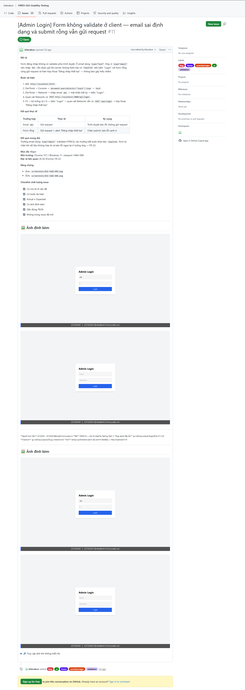

> *Trang GitHub Issues #11 — ảnh chụp toàn bộ nội dung issue kèm các ảnh bằng chứng đính kèm (có overlay email sinh viên `23120341 · 23120341@student.hcmus.edu.vn`).*

## 9. Checklist chất lượng (tự kiểm trước khi chốt)

- [x] Người khác tái hiện được lỗi chỉ bằng "Bước tái hiện"
- [x] Có ≥ 1 ảnh bằng chứng
- [x] Actual và Expected khác nhau và cụ thể
- [x] Gắn đúng mã IA/FR và mục checklist
- [x] Mức độ có lập luận dựa trên tác động người dùng
- [x] Không trùng nguyên nhân gốc với bug khác (đã gộp rồi)
- [x] Không phải vấn đề ưu tiên thẩm mỹ / đề xuất cải tiến

---

### 2.12. BUG-012 — BUG-012 — Trường bắt buộc không được đánh dấu `*` và không nêu giới hạn 255 ký tự


| Trường | Nội dung |
|---|---|
| **ID** | BUG-012 |
| **Mức độ** | Major |
| **Trạng thái** | Open |
| **Ngày phát hiện** | 2026-11-12 |
| **Người phát hiện** | 23120341 (23120341@student.hcmus.edu.vn) |
| **Người xác nhận** | 23120341 |
| **Màn hình / Route** | Toàn bộ Web Admin (`/`) — form Login, Danh mục, Sản phẩm |
| **Môi trường** | Chrome 157 / Windows 11 · viewport 1440×900 · `http://localhost:5174` (API `:3000`) · `admin@eshop.com` / `Admin123!` |
| **Đặc tả liên quan** | IA-02 (Forms) · đặc tả SRS FR-15, FR-22 |
| **Mục checklist liên quan** | GUI-IA02-002, GUI-IA02-006 |
| **Nguyên nhân gốc (phân tích)** | `RC-IMP` — ràng buộc dữ liệu không được khai báo cho người dùng biết |
| **Tần suất** | Luôn (100% lượt thử) |

## 1. Mô tả

Người dùng không có cách nào biết ô nào bắt buộc và ô nào có giới hạn độ dài:

- **0 ký hiệu `*`** trên toàn bộ 4 form. Ô "Giá tiền" thậm chí không được đánh dấu bắt buộc dù theo đặc
  tả giá là bắt buộc. Chỉ ô "Tên sản phẩm" có thuộc tính HTML `required` — nhưng không có thông báo
  nào nói rõ điều kiện.
- Ô "Tên sản phẩm" **không giới hạn 255 ký tự**: `maxLength` = −1. Dán 256 ký tự → form vẫn gửi
  1 request `POST /api/products` với toàn bộ 256 ký tự.

## 2. Bước tái hiện

**Trường hợp A — thiếu ký hiệu bắt buộc**
1. Mở `http://localhost:5174/`, đăng nhập `admin@eshop.com` / `Admin123!`.
2. Quan sát form Login: không có ký hiệu `*` nào cạnh ô Email / Password.
3. Vào tab "Danh mục" và tab "Sản phẩm" → quan sát: không có ký hiệu `*` nào ở bất kỳ form nào.
4. Quan sát ô "Giá tiền" — không có dấu hiệu bắt buộc, dù giá là bắt buộc theo đặc tả.

**Trường hợp B — không giới hạn độ dài tên**
5. Tab "Sản phẩm" → DevTools → Console → `document.querySelector('input[placeholder="Tên sản phẩm"]').maxLength` → `-1`.
6. Dán một chuỗi **256 ký tự** vào ô "Tên sản phẩm".
7. Bấm "Lưu sản phẩm".
8. Quan sát Network: `POST /api/products` được gửi với toàn bộ 256 ký tự; không có thông báo nào
   về giới hạn 255 ký tự.

## 3. Kết quả thực tế

| Kiểm tra | Kết quả thực tế | Kỳ vọng |
|---|---|---|
| Ký hiệu `*` trên 4 form | 0 ký hiệu | Có `*` cạnh mọi trường bắt buộc |
| Ô "Giá tiền" đánh dấu bắt buộc | Không | Có (FR-15: giá là bắt buộc) |
| `maxLength` của "Tên sản phẩm" | `-1` (không giới hạn) | `255` |
| Hành vi khi nhập 256 ký tự | Gửi request với 256 ký tự, không cảnh báo | Chặn hoặc cảnh báo "tối đa 255 ký tự" |

## 4. Kết quả mong đợi

- Đặc tả SRS FR-22: "Tất cả trường bắt buộc phải có ký hiệu `*` bên cạnh nhãn."
- Đặc tả SRS FR-15: "Tên sản phẩm: bắt buộc, tối đa 255 ký tự" → phải có thuộc tính `maxLength={255}`
  và thông báo rõ giới hạn khi vượt quá.
- Quy tắc thuộc **IA-02 (Forms)**: nhãn, ký hiệu bắt buộc và quy tắc ràng buộc phải hiển thị.

## 5. Bằng chứng

| Loại | Đường dẫn / mô tả |
|---|---|
| Ảnh chụp 1 | `screenshots/GUI-IA02-002.png` — 0 ký hiệu `*` trên cả 4 form |
| Ảnh chụp 2 | `screenshots/GUI-IA02-006.png` — `maxLength = -1`, 256 ký tự vẫn gửi đi |
| Video | Không có |

## 6. Tác động lên người dùng

Quản trị viên không biết ô "Giá tiền" có bắt buộc hay không, nên có thể bỏ trống và tạo sản phẩm giá
rỗng (xem BUG-002). Với tên sản phẩm, một nội dung dài bất thường (ví dụ mô tả nhầm vào ô tên) được
gửi thẳng lên server và lưu vào CSDL — gây dữ liệu bẩn mà không có cảnh báo nào. Người dùng cũng
không biết trước giới hạn 255 ký tự nên phải phát hiện lỗi sau khi lưu.

## 7. Ghi chú kỹ thuật

- `frontend-admin/src/App.jsx:491-499` — ô "Tên sản phẩm" có `required` nhưng **không** có `maxLength`.
- `frontend-admin/src/App.jsx:500-508` — ô "Giá tiền": `type="number"`, **không** `required`, **không** `min`.
- `frontend-admin/src/App.jsx:298-304` — ô "Tên danh mục": **không** `required`.
- Không form nào có nhãn `<label>` để gắn ký hiệu `*` vào → cần sửa đồng thời với BUG-001.
- Nên khai báo giới hạn ở **cả** client (`maxLength`) và server (`server.js:167-177` chưa kiểm tra độ
  dài tên) để không ghi dữ liệu quá dài qua bất kỳ đường gọi nào.

---

**GitHub Issue:** [#12](https://github.com/kiterakun/HW03-GUI-Usability-Testing/issues/12) — https://github.com/kiterakun/HW03-GUI-Usability-Testing/issues/12

**Ảnh chụp trang GitHub Issues:**

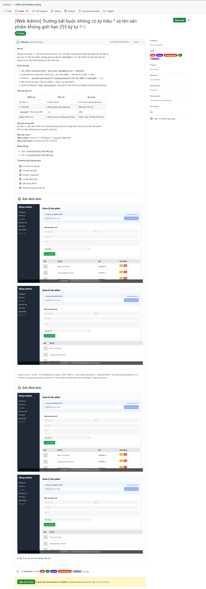

> *Trang GitHub Issues #12 — ảnh chụp toàn bộ nội dung issue kèm các ảnh bằng chứng đính kèm (có overlay email sinh viên `23120341 · 23120341@student.hcmus.edu.vn`).*

## 9. Checklist chất lượng (tự kiểm trước khi chốt)

- [x] Người khác tái hiện được lỗi chỉ bằng "Bước tái hiện"
- [x] Có ≥ 1 ảnh bằng chứng
- [x] Actual và Expected khác nhau và cụ thể
- [x] Gắn đúng mã IA/FR và mục checklist
- [x] Mức độ có lập luận dựa trên tác động người dùng
- [x] Không trùng nguyên nhân gốc với bug khác (đã gộp rồi)
- [x] Không phải vấn đề ưu tiên thẩm mỹ / đề xuất cải tiến

---

### 2.13. BUG-013 — BUG-013 — Import CSV không kiểm tra đuôi file và không cảnh báo dòng lỗi


| Trường | Nội dung |
|---|---|
| **ID** | BUG-013 |
| **Mức độ** | Major |
| **Trạng thái** | Open |
| **Ngày phát hiện** | 2026-11-12 |
| **Người phát hiện** | 23120341 (23120341@student.hcmus.edu.vn) |
| **Người xác nhận** | 23120341 |
| **Màn hình / Route** | Import sản phẩm từ CSV (`/`, tab "Sản phẩm" → khối "📂 Import sản phẩm từ CSV") |
| **Môi trường** | Chrome 157 / Windows 11 · viewport 1440×900 · `http://localhost:5174` (API `:3000`) · `admin@eshop.com` / `Admin123!` |
| **Đặc tả liên quan** | IA-02 (Forms) · đặc tả SRS FR-16 |
| **Mục checklist liên quan** | GUI-IA02-010, GUI-IA02-011 |
| **Nguyên nhân gốc (phân tích)** | `RC-IMP` — không validate input của form import ở client lẫn server |
| **Tần suất** | Luôn (100% lượt thử) |

## 1. Mô tả

Form import CSV không kiểm tra bất kỳ điều gì trước khi cho phép gửi dữ liệu lên server:

- **Không kiểm tra đuôi file.** Chọn file `sanpham.txt` (cùng nội dung CSV) → vẫn được parse, nút hiện
  "Import 1 sản phẩm" và **không** bị disable. Đặc tả SRS FR-16 yêu cầu đuôi file phải là `.csv`.
- **Không cảnh báo dòng lỗi.** Chọn file `invalid.csv` (dòng 2 có `name` rỗng, dòng 3 có
  `price = -500`) → preview hiển thị 2 dòng bình thường, không đánh dấu dòng nào lỗi, nút
  "Import 2 sản phẩm" vẫn bật.
- **File rỗng hoặc chỉ có header** → preview 0 dòng, nút bị disable nhưng **không có thông báo lỗi**
  nào nói rõ thiếu gì (chỉ hiện nút mờ "Import 0 sản phẩm").

## 2. Bước tái hiện

**Trường hợp A — file sai đuôi**
1. Mở `http://localhost:5174/`, đăng nhập `admin@eshop.com` / `Admin123!`.
2. Tab "Sản phẩm" → khối Import → chọn `gui-testing-outputs/assets/sanpham.txt`.
3. Quan sát: preview hiển thị 1 dòng; nút hiện "Import 1 sản phẩm" và **không** bị disable.

**Trường hợp B — dữ liệu dòng lỗi không được cảnh báo**
4. Chọn `gui-testing-outputs/assets/invalid.csv` (dòng 2 `name` rỗng, dòng 3 `price = -500`).
5. Quan sát preview: 2 dòng hiển thị bình thường — dòng 2 có ô trống, dòng 3 hiện nguyên `-500`.
   Không có cảnh báo dòng nào lỗi; nút "Import 2 sản phẩm" vẫn bật.

**Trường hợp C — file rỗng / thiếu cột**
6. Chọn một file rỗng → preview 0 dòng, nút disable, **không có thông báo lỗi**.
7. Chọn file chỉ có header `name,price,description,imageUrl,category_id` → kết quả tương tự.

## 3. Kết quả thực tế

| Trường hợp | Kết quả thực tế | Kỳ vọng |
|---|---|---|
| File `.txt` | Được chấp nhận, nút "Import 1 sản phẩm" bật | Bị từ chối kèm thông báo, nút không bật |
| File có dòng lỗi | Preview bình thường, nút Import vẫn bật | Đánh dấu dòng lỗi + thông báo lý do |
| File rỗng / chỉ có header | Nút disable, **không có thông báo** | Thông báo nêu rõ file lỗi ở đâu |

Đặc tả SRS FR-16 yêu cầu rõ: "Đuôi file phải là `.csv`" và "Validation trước khi import: `name` không
được rỗng. `price` phải là số dương."

## 4. Kết quả mong đợi

- Chỉ nhận file `.csv`; file sai đuôi bị từ chối kèm thông báo nêu rõ lý do.
- Trước khi cho phép import, **mọi dòng** phải được validate: `name` không rỗng, `price` là số dương;
  dòng lỗi phải được đánh dấu kèm lý do cụ thể trong preview hoặc trong thông báo.
- File rỗng / thiếu cột bắt buộc phải báo rõ thiếu gì, không chỉ disable nút.

## 5. Bằng chứng

| Loại | Đường dẫn / mô tả |
|---|---|
| Ảnh chụp 1 | `screenshots/GUI-IA02-010-txt.png` — file `.txt` vẫn được chấp nhận |
| Ảnh chụp 2 | `screenshots/GUI-IA02-010-empty.png` — file rỗng, nút disable nhưng không có thông báo lỗi |
| Ảnh chụp 3 | `screenshots/GUI-IA02-010-header.png` — file chỉ có header, không có thông báo lỗi |
| Ảnh chụp 4 | `screenshots/GUI-IA02-011.png` — preview `invalid.csv` không cảnh báo dòng lỗi |
| File test | `gui-testing-outputs/assets/sanpham.txt`, `invalid.csv` |
| Video | Không có |

## 6. Tác động lên người dùng

Quản trị viên không có cơ hội phát hiện file của mình có dữ liệu sai trước khi import — preview
trông "bình thường" nên họ tin là đã kiểm tra. Hậu quả là dữ liệu rác (tên rỗng, giá âm) được ghi
thẳng vào CSDL. Với file rỗng hoặc sai cấu trúc, giao diện chỉ vô hiệu hoá nút mà không nói lý do →
người dùng phải tự đoán (file sai định dạng? thiếu cột? sai encoding?) mà không có manh mối nào.

## 7. Ghi chú kỹ thuật

- `frontend-admin/src/App.jsx:356-384` — `onChange` của `<input type="file">` lấy file rồi đọc bằng
  `FileReader`, **không** kiểm tra `file.name` / `file.type`.
- `frontend-admin/src/App.jsx:390-403` — khi build payload, `name` lấy `row["name"] || ""` và `price`
  lấy `row["price"] || 0` → giá âm vẫn giữ nguyên, tên rỗng thành chuỗi rỗng, **không** có bước
  kiểm tra.
- `backend/server.js:213-217` — server chỉ kiểm tra `!row.name` **sau khi** đã bắt đầu insert các
  dòng trước đó (xem BUG-006).
- Thứ tự sửa đúng: (1) validate file đầu vào, (2) validate toàn bộ nội dung, (3) chỉ khi mọi thứ hợp
  lệ mới gọi API.

---

**GitHub Issue:** [#13](https://github.com/kiterakun/HW03-GUI-Usability-Testing/issues/13) — https://github.com/kiterakun/HW03-GUI-Usability-Testing/issues/13

**Ảnh chụp trang GitHub Issues:**

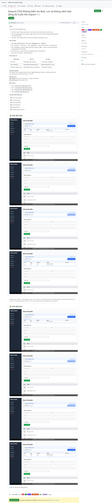

> *Trang GitHub Issues #13 — ảnh chụp toàn bộ nội dung issue kèm các ảnh bằng chứng đính kèm (có overlay email sinh viên `23120341 · 23120341@student.hcmus.edu.vn`).*

## 9. Checklist chất lượng (tự kiểm trước khi chốt)

- [x] Người khác tái hiện được lỗi chỉ bằng "Bước tái hiện"
- [x] Có ≥ 1 ảnh bằng chứng
- [x] Actual và Expected khác nhau và cụ thể
- [x] Gắn đúng mã IA/FR và mục checklist
- [x] Mức độ có lập luận dựa trên tác động người dùng
- [x] Không trùng nguyên nhân gốc với bug khác (đã gộp rồi)
- [x] Không phải vấn đề ưu tiên thẩm mỹ / đề xuất cải tiến

---

### 2.14. BUG-014 — BUG-014 — Báo cáo kết quả import thiếu số dòng lỗi và không đánh dấu lỗi giá âm


| Trường | Nội dung |
|---|---|
| **ID** | BUG-014 |
| **Mức độ** | Major |
| **Trạng thái** | Open |
| **Ngày phát hiện** | 2026-11-12 |
| **Người phát hiện** | 23120341 (23120341@student.hcmus.edu.vn) |
| **Người xác nhận** | 23120341 |
| **Màn hình / Route** | Import sản phẩm từ CSV (`/`, tab "Sản phẩm" → khối "📂 Import sản phẩm từ CSV") |
| **Môi trường** | Chrome 157 / Windows 11 · viewport 1440×900 · `http://localhost:5174` (API `:3000`) · `admin@eshop.com` / `Admin123!` |
| **Đặc tả liên quan** | IA-04 (Feedback / State) · đặc tả SRS FR-16 |
| **Mục checklist liên quan** | GUI-IA04-013 |
| **Nguyên nhân gốc (phân tích)** | `RC-IMP` — báo cáo kết quả import thiếu thông tin; không validate `price` nên lỗi giá âm không bị phát hiện |
| **Tần suất** | Luôn (100% lượt thử) |

## 1. Mô tả

Sau khi import, ô kết quả hiển thị "✅ Import hoàn tất: 1/2 sản phẩm được thêm" kèm một dòng lý do
lỗi duy nhất ("Hàng 2: Thiếu tên sản phẩm"). Báo cáo này **không đủ 3 thông tin** theo yêu cầu:

1. **Không nêu số dòng lỗi** (biết có 1/2 lỗi nhưng không có con số tổng số dòng lỗi).
2. **Không đánh dấu dòng lỗi `price = -500`** — dòng này bị coi là hợp lệ và được ghi vào CSDL vì
   backend **không kiểm tra giá dương** (`server.js:213-217` chỉ kiểm tra `!row.name`).
3. Màu xanh lá của ô kết quả truyền thông điệp "thành công" dù có dòng lỗi.

Đặc tả SRS FR-16 yêu cầu: "Hệ thống hiển thị báo cáo rõ ràng: bao nhiêu dòng thành công, bao nhiêu
dòng lỗi và lý do."

## 2. Bước tái hiện

1. Mở `http://localhost:5174/`, đăng nhập `admin@eshop.com` / `Admin123!`.
2. Tab "Sản phẩm" → khối Import → chọn `gui-testing-outputs/assets/invalid.csv`:
   - dòng 2: `name` rỗng
   - dòng 3: `name` = "Tên OK", `price` = `-500`
3. Bấm nút "Import 2 sản phẩm".
4. Đọc ô kết quả bên dưới.

## 3. Kết quả thực tế

```
✅ Import hoàn tất: 1/2 sản phẩm được thêm
   • Hàng 2: Thiếu tên sản phẩm
```

| Thông tin bắt buộc | Có trong báo cáo? |
|---|---|
| Số dòng thành công | ✅ ("1/2") |
| **Số dòng lỗi** | ❌ không có con số tổng |
| Lý do của **từng** dòng lỗi | ❌ chỉ có dòng 2; dòng 3 (giá âm) không bị đánh dấu là lỗi |

Ngoài ra: ô kết quả có **nền xanh** (`bg-green-100 text-green-800`) dù có dòng lỗi, nên báo "thành công".

## 4. Kết quả mong đợi

Báo cáo import phải nêu đủ: **số dòng thành công**, **số dòng lỗi**, và **lý do lỗi của từng dòng**
(ví dụ "Hàng 3: Giá phải là số dương (> 0)"). Ô kết quả nên dùng màu cảnh báo (vàng/đỏ) khi có dòng
lỗi, không phải xanh lá "hoàn tất".

## 5. Bằng chứng

| Loại | Đường dẫn / mô tả |
|---|---|
| Ảnh chụp 1 | `screenshots/GUI-IA04-013.png` — báo cáo "1/2 sản phẩm được thêm", không có số dòng lỗi, dòng giá âm không bị đánh dấu |
| File test | `gui-testing-outputs/assets/invalid.csv` |
| Video | Không có |

## 6. Tác động lên người dùng

Quản trị viên đọc "Import hoàn tất" với nền xanh và hiểu là xong. Thực tế 1 dòng trong file đã bị
ghi sai vào CSDL mà báo cáo **không hề nhắc tới** → người dùng không biết cần sửa dòng nào. Với file
hàng trăm dòng, việc dò thủ công đối chiếu từng dòng để tìm lỗi là bất khả thi, và quy trình nhập
hàng sẽ dần bị bỏ qua.

## 7. Ghi chú kỹ thuật

- `backend/server.js:213-232` — vòng lặp chỉ push lỗi khi `!row.name`; **không** kiểm tra `price`.
- `backend/server.js:234-240` — `res.json({ message, inserted, errors })`: có `inserted` và `errors`
  nhưng thiếu trường `errorCount` / `total`.
- `frontend-admin/src/App.jsx:459-480` — render `importResult.message` và `importResult.errors`;
  không hiển thị số dòng lỗi, và chọn màu xanh khi `importResult.error` là falsy → **mọi lần import
  có lỗi đều hiện màu xanh "thành công"**.
- Cách sửa: thêm validate `price > 0` ở server, trả về `total` + `inserted` + `errors`, và ở client
  chọn màu cảnh báo khi `errors.length > 0`.

---

**GitHub Issue:** [#14](https://github.com/kiterakun/HW03-GUI-Usability-Testing/issues/14) — https://github.com/kiterakun/HW03-GUI-Usability-Testing/issues/14

**Ảnh chụp trang GitHub Issues:**

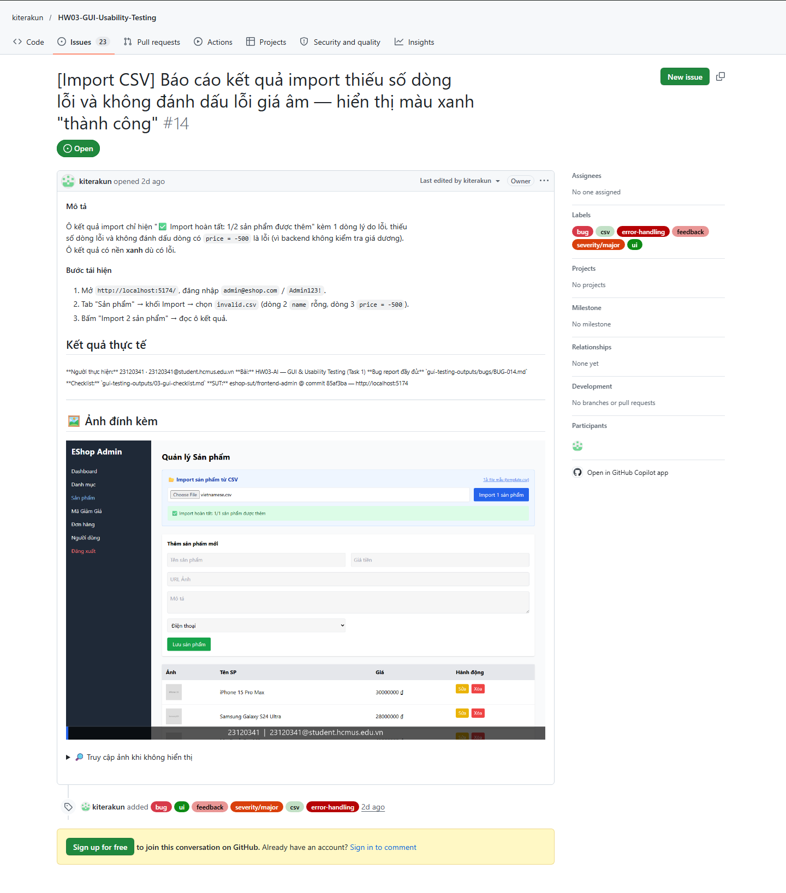

> *Trang GitHub Issues #14 — ảnh chụp toàn bộ nội dung issue kèm các ảnh bằng chứng đính kèm (có overlay email sinh viên `23120341 · 23120341@student.hcmus.edu.vn`).*

## 9. Checklist chất lượng (tự kiểm trước khi chốt)

- [x] Người khác tái hiện được lỗi chỉ bằng "Bước tái hiện"
- [x] Có ≥ 1 ảnh bằng chứng
- [x] Actual và Expected khác nhau và cụ thể
- [x] Gắn đúng mã IA/FR và mục checklist
- [x] Mức độ có lập luận dựa trên tác động người dùng
- [x] Không trùng nguyên nhân gốc với bug khác (đã gộp rồi)
- [x] Không phải vấn đề ưu tiên thẩm mỹ / đề xuất cải tiến

---

### 2.15. BUG-015 — BUG-015 — Dashboard thiếu trạng thái loading và empty state


| Trường | Nội dung |
|---|---|
| **ID** | BUG-015 |
| **Mức độ** | Major |
| **Trạng thái** | Open |
| **Ngày phát hiện** | 2026-11-12 |
| **Người phát hiện** | 23120341 (23120341@student.hcmus.edu.vn) |
| **Người xác nhận** | 23120341 |
| **Màn hình / Route** | Admin Dashboard (`/`, tab "Dashboard") |
| **Môi trường** | Chrome 157 / Windows 11 · viewport 1440×900 · `http://localhost:5174` (API `:3000`) · `admin@eshop.com` / `Admin123!` |
| **Đặc tả liên quan** | IA-04 (Feedback / State) · đặc tả SRS FR-13, FR-24 |
| **Mục checklist liên quan** | GUI-IA04-004, GUI-IA04-005 |
| **Nguyên nhân gốc (phân tích)** | `RC-PERF` — không có cờ trạng thái tải dữ liệu; không có nhánh render cho dữ liệu rỗng |
| **Tần suất** | Luôn (100% lượt thử) |

## 1. Mô tả

Dashboard không phân biệt "đang tải" với "không có dữ liệu":

1. **Không có trạng thái loading.** Trong lúc tải 5 request, vùng nội dung hiển thị luôn khung
   Dashboard với giá trị `0` — không có skeleton, không có spinner. Trang **nháy trắng** rồi hiện số 0.
2. **Không có empty state.** Khi chưa có đơn hàng nào, 2 thẻ KPI hiển thị trần "0 ₫" và "0" mà
   không có thông điệp giải thích (ví dụ "Chưa có đơn hàng nào"). Người dùng không phân biệt được
   "chưa bán được gì" với "hệ thống chưa tải xong".

## 2. Bước tái hiện

**Trường hợp A — thiếu loading**
1. Mở `http://localhost:5174/`, đăng nhập `admin@eshop.com` / `Admin123!`.
2. DevTools → Network → chặn (block) hoặc thêm độ trễ ~2,5s cho `GET /api/admin/orders`.
3. Quan sát vùng nội dung trong lúc chờ: không có skeleton/spinner; khung Dashboard hiện luôn với
   giá trị `0`; trang nháy trắng.

**Trường hợp B — thiếu empty state**
4. Với dữ liệu seed hiện tại (chưa có đơn hàng), vào tab "Dashboard".
5. Quan sát 2 thẻ KPI:
   - "Tổng doanh thu (Delivered)" → `0 ₫`
   - "Tổng số đơn hàng" → `0`
   Không có thông điệp thân thiện nào kiểu "Chưa có đơn hàng nào".

## 3. Kết quả thực tế

| Tình huống | Kết quả thực tế | Kỳ vọng |
|---|---|---|
| Đang tải | Vùng nội dung có 1 phần tử, hiện luôn khung Dashboard với giá trị 0; trang nháy trắng | Skeleton/spinner giữ đúng khung layout, không nháy trắng |
| Không có đơn hàng | `0 ₫` và `0` trần trụi | Thông điệp thân thiện (vd "Chưa có đơn hàng nào") |

Đáng chú ý: `fetchData()` (`App.jsx:41-59`) gọi **5 request nối tiếp** (mỗi `await` trong vòng lặp
đều chờ trước khi gọi request kế tiếp) → tổng thời gian chờ = tổng 5 round-trip, khuếch đại triệu
chứng của việc không có loading state.

## 4. Kết quả mong đợi

- Trong lúc tải dữ liệu phải có skeleton hoặc spinner giữ nguyên khung layout (chống layout shift),
  không để màn trắng.
- Khi danh sách rỗng phải có empty state với thông điệp thân thiện, không phải con số 0 trần.
- Đây là yêu cầu của **IA-04** (Loading, Empty state) và đặc tả SRS FR-24.

## 5. Bằng chứng

| Loại | Đường dẫn / mô tả |
|---|---|
| Ảnh chụp 1 | `screenshots/GUI-IA04-004.png` — không có skeleton/spinner khi tải |
| Ảnh chụp 2 | `screenshots/GUI-IA04-005.png` — KPI chỉ hiện `0 ₫` và `0`, không có thông điệp |
| Video | Không có |

## 6. Tác động lên người dùng

Quản trị viên vừa đăng nhập thấy màn Dashboard trắng rồi hiện "0 ₫ / 0 đơn" — không biết hệ thống
đang tải hay thật sự không có đơn hàng. Nhiều người sẽ **đăng nhập lại** hoặc tưởng dữ liệu bị mất.
Khi hệ thống chậm (mạng công ty, VPN), khoảng chờ 5 request nối tiếp khiến màn hình trắng khá lâu mà
không có bất kỳ tín hiệu nào. Ngược lại, khi đã có đơn hàng nhưng bộ lọc chưa có kết quả, con số 0
trần cũng dễ bị hiểu nhầm là doanh số bằng 0.

## 7. Ghi chú kỹ thuật

- `frontend-admin/src/App.jsx:41-59` — `fetchData()` không có state `loading`; `setUsers/setOrders/...`
  được gọi tuần tự sau mỗi response.
- `frontend-admin/src/App.jsx:276-292` — phần render Dashboard không có nhánh nào cho trạng thái
  đang tải hoặc rỗng; chỉ có 2 thẻ KPI.
- Cách sửa: thêm `const [loading, setLoading] = useState(false)` và `try/finally` trong `fetchData()`;
  render skeleton khi `loading`; render empty state khi `orders.length === 0`.
- Nên cân nhắc dùng `Promise.all` cho 5 request để giảm tổng thời gian chờ xuống còn 1 round-trip.
- Cùng kiểu thiếu empty state xuất hiện ở bảng "Đơn hàng" (tbody rỗng hoàn toàn, chỉ còn hàng tiêu đề
  cột) — nằm ngoài phạm vi màn hình đã test nhưng nên sửa cùng lúc.

---

**GitHub Issue:** [#15](https://github.com/kiterakun/HW03-GUI-Usability-Testing/issues/15) — https://github.com/kiterakun/HW03-GUI-Usability-Testing/issues/15

**Ảnh chụp trang GitHub Issues:**

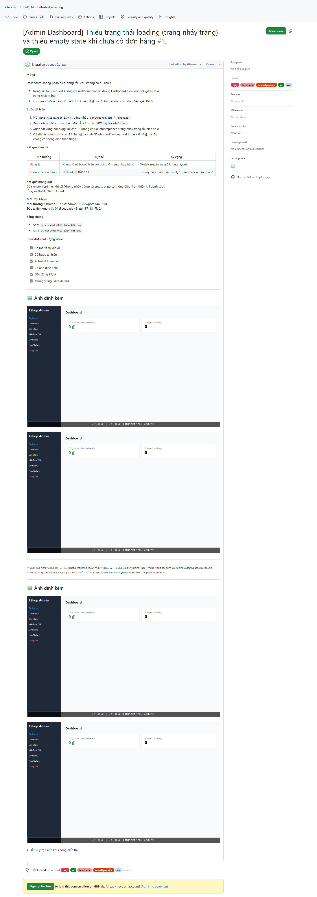

> *Trang GitHub Issues #15 — ảnh chụp toàn bộ nội dung issue kèm các ảnh bằng chứng đính kèm (có overlay email sinh viên `23120341 · 23120341@student.hcmus.edu.vn`).*

## 9. Checklist chất lượng (tự kiểm trước khi chốt)

- [x] Người khác tái hiện được lỗi chỉ bằng "Bước tái hiện"
- [x] Có ≥ 1 ảnh bằng chứng
- [x] Actual và Expected khác nhau và cụ thể
- [x] Gắn đúng mã IA/FR và mục checklist
- [x] Mức độ có lập luận dựa trên tác động người dùng
- [x] Không trùng nguyên nhân gốc với bug khác (đã gộp rồi)
- [x] Không phải vấn đề ưu tiên thẩm mỹ / đề xuất cải tiến

---

### 2.16. BUG-016 — BUG-016 — Thao tác ghi thành công không có bất kỳ thông báo xác nhận nào


| Trường | Nội dung |
|---|---|
| **ID** | BUG-016 |
| **Mức độ** | Major |
| **Trạng thái** | Open |
| **Ngày phát hiện** | 2026-11-12 |
| **Người phát hiện** | 23120341 (23120341@student.hcmus.edu.vn) |
| **Người xác nhận** | 23120341 |
| **Màn hình / Route** | Quản lý Danh mục (`/`, tab "Danh mục") · Quản lý Sản phẩm (`/`, tab "Sản phẩm") |
| **Môi trường** | Chrome 157 / Windows 11 · viewport 1440×900 · `http://localhost:5174` (API `:3000`) · `admin@eshop.com` / `Admin123!` |
| **Đặc tả liên quan** | IA-04 (Feedback / State) · đặc tả SRS FR-24 |
| **Mục checklist liên quan** | GUI-IA04-006 |
| **Nguyên nhân gốc (phân tích)** | `RC-IMP` — không có thông báo thành công trong các nhánh ghi dữ liệu |
| **Tần suất** | Luôn (100% lượt thử) |

## 1. Mô tả

Các thao tác ghi dữ liệu (thêm danh mục, thêm sản phẩm, xoá) **không có bất kỳ thông báo xác nhận
nào**. Người dùng chỉ thấy bảng thay đổi và ô nhập được xoá trong im lặng. Đo bằng DevTools sau khi
thêm danh mục "QA Thông Báo Test": **0 vùng thông báo** trong DOM.

Trường hợp duy nhất có phản hồi là nhánh **sửa** sản phẩm, và thông báo đó là hộp thoại native
`alert("Cập nhật thành công!")` — chung chung, không nêu **đã làm gì** với **đối tượng nào**.

## 2. Bước tái hiện

**Trường hợp A — thêm danh mục**
1. Mở `http://localhost:5174/`, đăng nhập `admin@eshop.com` / `Admin123!`.
2. Vào tab "Danh mục" → nhập "QA Thông Báo Test" vào ô "Tên danh mục mới".
3. Bấm "Thêm mới".
4. Quan sát: bảng cập nhật thêm dòng mới, ô nhập được xoá — **không có gì hiện ra**.
5. DevTools → Console → kiểm tra số vùng thông báo:
   `document.querySelectorAll('[role=alert], [role=status], .toast, [class*="toast"]').length` → `0`.

**Trường hợp B — thêm sản phẩm**
6. Vào tab "Sản phẩm" → nhập tên "QA Thông Báo SP", giá `123000` → bấm "Lưu sản phẩm".
7. Quan sát: bảng cập nhật, form reset — không có thông báo.

**Trường hợp C — sửa sản phẩm (thông báo chung chung)**
8. Bấm "Sửa" ở một dòng → đổi tên → bấm "Lưu sản phẩm".
9. Quan sát hộp thoại native: "Cập nhật thành công!" — không nêu tên sản phẩm đã sửa.

## 3. Kết quả thực tế

| Thao tác | Kết quả thực tế | Kỳ vọng |
|---|---|---|
| Thêm danh mục | Không có thông báo (0 vùng thông báo trong DOM) | "Đã thêm danh mục 'QA Thông Báo Test'" |
| Thêm sản phẩm | Không có thông báo | "Đã thêm sản phẩm 'QA Thông Báo SP'" |
| Sửa sản phẩm | `alert("Cập nhật thành công!")` — native, chung chung | Toast nêu rõ tên sản phẩm đã cập nhật |
| Xoá danh mục / sản phẩm | Không có thông báo | "Đã xoá …" |

## 4. Kết quả mong đợi

Sau mỗi thao tác ghi thành công phải có thông báo xác nhận **cụ thể** nêu rõ đã làm gì với đối tượng
nào (vd "Đã thêm danh mục 'QA Thông Báo Test'"), tự ẩn sau khoảng 5 giây hoặc có nút đóng, và không
che khuất nội dung bên dưới. Đây là yêu cầu của **IA-04 (Success)** và đặc tả SRS FR-24.

## 5. Bằng chứng

| Loại | Đường dẫn / mô tả |
|---|---|
| Ảnh chụp 1 | `screenshots/GUI-IA04-006.png` — thêm danh mục, 0 vùng thông báo |
| Ảnh chụp 2 | `screenshots/GUI-IA04-006-products.png` — thêm sản phẩm, cũng không có thông báo |
| Video | Không có |

## 6. Tác động lên người dùng

Quản trị viên không có tín hiệu xác nhận thao tác đã thành công → dễ bấm "Thêm mới" nhiều lần để
"chắc chắn", tạo ra danh mục trùng lặp. Ngược lại, khi mạng chậm, người dùng không biết thao tác đang
chạy hay đã thất bại, dẫn tới gõ lại và tạo bản ghi trùng. Với một ứng dụng quản trị nơi mỗi thao
tác ghi đều ảnh hưởng dữ liệu, việc không có phản hồi làm giảm niềm tin vào hệ thống.

## 7. Ghi chú kỹ thuật

- `frontend-admin/src/App.jsx:142-151` (`handleCategorySubmit`) — sau khi POST thành công chỉ gọi
  `setCategoryName("")` rồi `fetchData()`, không có phần tử thông báo nào.
- `frontend-admin/src/App.jsx:105-131` (`handleProductSubmit`) — nhánh thêm mới cũng chỉ reset form;
  nhánh sửa mới có `alert("Cập nhật thành công!")` (`:115`).
- `frontend-admin/src/App.jsx:76-83`, `:133-141`, `:153-161` — các nhánh xoá cũng không thông báo.
- Không có thư viện toast nào được cài (`package.json` không có `react-hot-toast`, `sonner`, `notistack`).
- Cách sửa: dùng chung một component thông báo/toast cho toàn app — cũng giải quyết một phần
  BUG-009 (thay `alert()` native bằng toast không chặn UI).

---

**GitHub Issue:** [#16](https://github.com/kiterakun/HW03-GUI-Usability-Testing/issues/16) — https://github.com/kiterakun/HW03-GUI-Usability-Testing/issues/16

**Ảnh chụp trang GitHub Issues:**

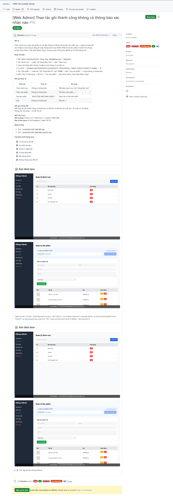

> *Trang GitHub Issues #16 — ảnh chụp toàn bộ nội dung issue kèm các ảnh bằng chứng đính kèm (có overlay email sinh viên `23120341 · 23120341@student.hcmus.edu.vn`).*

## 9. Checklist chất lượng (tự kiểm trước khi chốt)

- [x] Người khác tái hiện được lỗi chỉ bằng "Bước tái hiện"
- [x] Có ≥ 1 ảnh bằng chứng
- [x] Actual và Expected khác nhau và cụ thể
- [x] Gắn đúng mã IA/FR và mục checklist
- [x] Mức độ có lập luận dựa trên tác động người dùng
- [x] Không trùng nguyên nhân gốc với bug khác (đã gộp rồi)
- [x] Không phải vấn đề ưu tiên thẩm mỹ / đề xuất cải tiến

---

### 2.17. BUG-017 — BUG-017 — Nút Login không bị disable và không có chỉ báo khi đang gửi request


| Trường | Nội dung |
|---|---|
| **ID** | BUG-017 |
| **Mức độ** | Major |
| **Trạng thái** | Open |
| **Ngày phát hiện** | 2026-11-12 |
| **Người phát hiện** | 23120341 (23120341@student.hcmus.edu.vn) |
| **Người xác nhận** | 23120341 |
| **Màn hình / Route** | Admin Login (`/`) |
| **Môi trường** | Chrome 157 / Windows 11 · viewport 1440×900 · `http://localhost:5174` (API `:3000`) · `admin@eshop.com` / `Admin123!` |
| **Đặc tả liên quan** | IA-04 (Feedback / State) |
| **Mục checklist liên quan** | GUI-IA04-003 |
| **Nguyên nhân gốc (phân tích)** | `RC-IMP` — không có trạng thái "đang gửi" trong `handleLogin` |
| **Tần suất** | Luôn (100% lượt thử) |

## 1. Mô tả

Trong lúc gửi `POST /api/login`, nút "Login" **không** bị disable và nhãn **không** đổi — không có
spinner, không có chữ "Đang đăng nhập…", không có bất kỳ tín hiệu trực quan nào. Người dùng không
biết hệ thống đang xử lý hay đã treo.

Đo với độ trễ 2s: nút vẫn `disabled = false`, nhãn giữ nguyên "Login".

## 2. Bước tái hiện

1. Mở `http://localhost:5174/`.
2. DevTools → Network → thêm độ trễ khoảng 2 giây cho `POST /api/login`.
3. Nhập `admin@eshop.com` / `Admin123!` → bấm "Login".
4. Ngay khi bấm, quan sát nút: vẫn có nền xanh sáng, **không** bị mờ đi, nhãn vẫn là "Login".
5. Trong khoảng 2 giây đó, bấm "Login" lần nữa → quan sát Network: một request thứ hai được gửi đi.

## 3. Kết quả thực tế

- Trong lúc chờ: nút `disabled` = **false**, nhãn = **"Login"** (không đổi), không có spinner.
- Bấm "Login" lần nữa trong lúc request đầu đang chạy → request thứ hai vẫn được gửi (double submit).

## 4. Kết quả mong đợi

Trong lúc request đang chạy:
- nút Login bị **disable** để không thể bấm lại;
- nhãn đổi thành trạng thái đang xử lý (vd "Đang đăng nhập…") kèm spinner;
- phản hồi UI trong **< 1 giây** (đây là ngưỡng của IA-04 cho phản hồi sau click).

Đây là yêu cầu chống **double-submit** trong IA-02 và hiển thị trạng thái đang xử lý trong IA-04.

## 5. Bằng chứng

| Loại | Đường dẫn / mô tả |
|---|---|
| Ảnh chụp 1 | `screenshots/GUI-IA04-003.png` — nút không disable, nhãn không đổi khi đang gửi |
| Video | Không có |

## 6. Tác động lên người dùng

Người dùng thấy nút "Login" sáng và bấm lại nhiều lần khi mạng chậm → gửi nhiều request đăng nhập
cùng lúc. Với tài khoản đã bị khoá, điều này làm tăng số lần đếm sai và có thể gia hạn thời gian
khoá. Người dùng cũng dễ nghĩ hệ thống bị treo và chuyển sang tab khác rồi quay lại, mất thông tin
đã nhập.

## 7. Ghi chú kỹ thuật

- `frontend-admin/src/App.jsx:61-74` — `handleLogin` không có state `loading`; nút Login
  (`App.jsx:209-211`) không có thuộc tính `disabled`.
- Cùng kiểu thiếu trạng thái này ở:
  - nút "Lưu sản phẩm" (`App.jsx:545-547`),
  - nút "Thêm mới" danh mục (`App.jsx:305-307`),
  - nút "Tạo mã" coupon (`App.jsx:712-714`).
- Ngược lại, nút Import CSV **có** xử lý đúng (`App.jsx:386-424`: `disabled={importing || …}` và
  đổi nhãn thành "Đang import...") → cho thấy nhà phát triển đã biết pattern nhưng chưa áp dụng
  đồng nhất. **Đây là mâu thuẫn trong cùng một ứng dụng** (xem `02-ui-analysis.md` §5).

---

**GitHub Issue:** [#17](https://github.com/kiterakun/HW03-GUI-Usability-Testing/issues/17) — https://github.com/kiterakun/HW03-GUI-Usability-Testing/issues/17

**Ảnh chụp trang GitHub Issues:**

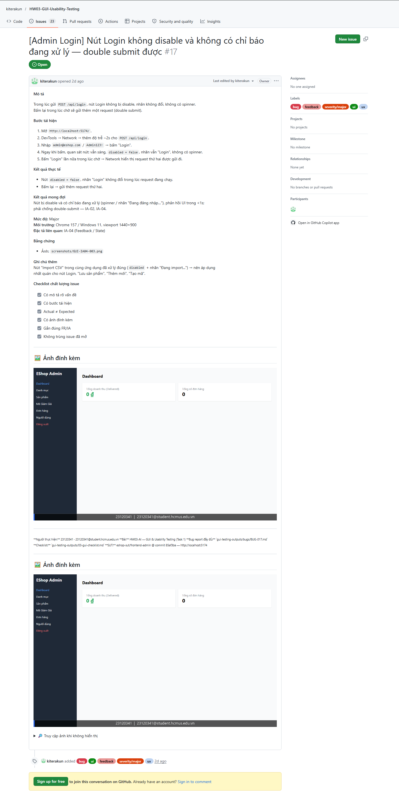

> *Trang GitHub Issues #17 — ảnh chụp toàn bộ nội dung issue kèm các ảnh bằng chứng đính kèm (có overlay email sinh viên `23120341 · 23120341@student.hcmus.edu.vn`).*

## 9. Checklist chất lượng (tự kiểm trước khi chốt)

- [x] Người khác tái hiện được lỗi chỉ bằng "Bước tái hiện"
- [x] Có ≥ 1 ảnh bằng chứng
- [x] Actual và Expected khác nhau và cụ thể
- [x] Gắn đúng mã IA/FR và mục checklist
- [x] Mức độ có lập luận dựa trên tác động người dùng
- [x] Không trùng nguyên nhân gốc với bug khác (đã gộp rồi)
- [x] Không phải vấn đề ưu tiên thẩm mỹ / đề xuất cải tiến

---

### 2.18. BUG-018 — BUG-018 — Tương phản chữ dưới WCAG AA ở 4 thành phần (1,92:1 – 3,76:1)


| Trường | Nội dung |
|---|---|
| **ID** | BUG-018 |
| **Mức độ** | Major |
| **Trạng thái** | Open |
| **Ngày phát hiện** | 2026-11-12 |
| **Người phát hiện** | 23120341 (23120341@student.hcmus.edu.vn) |
| **Người xác nhận** | 23120341 |
| **Màn hình / Route** | Admin Login (`/`) · Quản lý Sản phẩm (`/`, tab "Sản phẩm") |
| **Môi trường** | Chrome 157 / Windows 11 · viewport 1440×900 · `http://localhost:5174` (API `:3000`) · `admin@eshop.com` / `Admin123!` |
| **Đặc tả liên quan** | IA-01 (General UI Standards) |
| **Mục checklist liên quan** | GUI-IA01-001, GUI-IA01-011 |
| **Nguyên nhân gốc (phân tích)** | `RC-VIS` — dùng chữ trắng trên các nền Tailwind `yellow-500`/`red-500`/`green-600`/`gray-400` không đạt tương phản |
| **Tần suất** | Luôn (100% lượt thử) |

## 1. Mô tả

Bốn thành phần có tương phản chữ dưới ngưỡng WCAG 2.2 AA (≥ 4,5:1 cho chữ thường):

| Thành phần | Màn hình | Màu chữ | Màu nền | Contrast | Yêu cầu |
|---|---|---|---|---|---|
| Placeholder "Email" / "Password" | Admin Login | `rgb(156,163,175)` | `rgb(246,246,246)` | **2,35:1** | ≥ 4,5:1 |
| Nút "Sửa" | Quản lý Sản phẩm | trắng | `rgb(234,179,8)` (yellow-500) | **1,92:1** | ≥ 4,5:1 |
| Nút "Xóa" | Quản lý Sản phẩm | trắng | `rgb(239,68,68)` (red-500) | **3,76:1** | ≥ 4,5:1 |
| Nút "Lưu sản phẩm" | Quản lý Sản phẩm | trắng | `rgb(22,163,74)` (green-600) | **3,30:1** | ≥ 4,5:1 |

Nút "Sửa" ở mức 1,92:1 là nổi bật nhất: chữ trắng gần như không đọc được trên nền vàng, và nút này
xuất hiện ở **mọi dòng** của bảng sản phẩm.

## 2. Bước tái hiện

1. Mở `http://localhost:5174/`.
2. DevTools → chọn ô Email → Computed → đọc `color` (ô `::placeholder`) và `background-color` →
   dùng công cụ "Show Contrast Issues" → **2,35:1**.
3. Đăng nhập `admin@eshop.com` / `Admin123!` → tab "Sản phẩm".
4. Chọn nút "Sửa" → Computed → `color` = trắng, `background-color` = `rgb(234,179,8)` → **1,92:1**.
5. Chọn nút "Xóa" → `rgb(239,68,68)` → **3,76:1**.
6. Chọn nút "Lưu sản phẩm" → `rgb(22,163,74)` → **3,30:1**.

## 3. Kết quả thực tế

| Thành phần | Contrast đo được | Ngưỡng WCAG AA | Chênh lệch |
|---|---|---|---|
| Placeholder Email/Password | 2,35:1 | 4,5:1 | −2,15 |
| Nút "Sửa" | 1,92:1 | 4,5:1 | −2,58 |
| Nút "Xóa" | 3,76:1 | 4,5:1 | −0,74 |
| Nút "Lưu sản phẩm" | 3,30:1 | 4,5:1 | −1,20 |

Để đối chiếu, các thành phần khác đều **đạt**: nút "Login" (`rgb(37,99,235)`) 5,17:1 · nút "Import"
5,17:1 · tiêu đề cột bảng (`rgb(229,231,235)`) 16,96:1 · menu thường 14,68:1 · menu active 5,77:1 ·
"Đăng xuất" 5,31:1 · ô giá 21:1.

## 4. Kết quả mong đợi

Mọi chữ trên giao diện đạt WCAG 2.2 AA: **≥ 4,5:1** cho chữ thường, **≥ 3:1** cho chữ lớn
(≥ 18pt đậm hoặc ≥ 24pt). Riêng placeholder là chữ thường nên cần **≥ 4,5:1** — hiện đang ở 2,35:1.
Đây là yêu cầu thuộc **IA-01 (Màu sắc & tương phản)**.

## 5. Bằng chứng

| Loại | Đường dẫn / mô tả |
|---|---|
| Ảnh chụp 1 | `screenshots/GUI-IA01-001.png` — placeholder 2,35:1 |
| Ảnh chụp 2 | `screenshots/GUI-IA01-011.png` — nút Sửa/Xóa/Lưu dưới ngưỡng |
| Video | Không có |

## 6. Tác động lên người dùng

- Placeholder là **nhãn duy nhất** của các ô nhập (xem BUG-001) → vừa mờ vừa biến mất khi nhập: người
  dùng gần như không đọc được ô đang điền email hay mật khẩu.
- Nút "Sửa" mờ gần như vô hình về mặt chữ, trong khi chính nó là nút **ít nguy hiểm nhất** trong bảng
  → quản trị viên không nhận ra mình có thể sửa, và dễ bỏ qua.
- Nút "Xóa" và "Lưu sản phẩm" cũng dưới ngưỡng → khó đọc hành động khi đang làm việc nhanh hoặc
  trên màn hình laptop sáng.

## 7. Ghi chú kỹ thuật

- Nguồn gốc: dùng chữ `text-white` trên các nền Tailwind mặc định.
  - `bg-yellow-500` (`#eab308`) — sáng, không dành cho chữ trắng.
  - `bg-red-500` (`#ef4444`) — đạt 3,76:1, cần `red-600` (`#dc2626`, 4,83:1) hoặc `red-700`.
  - `bg-green-600` (`#16a34a`) — đạt 3,30:1, cần `green-700` (`#15803d`, 5,02:1).
  - `bg-blue-600` (`#2563eb`) — 5,17:1 → **đạt**.
- Placeholder: màu `rgb(156,163,175)` là `gray-400` của Tailwind preflight; cần `gray-600`
  (`#4b5563`, 7,0:1) hoặc `gray-500`.
- Cách sửa: đổi shade nền các nút, hoặc đặt lại màu chữ theo đúng tỷ lệ (nút vàng nên dùng chữ
  `text-gray-900` thay vì trắng).

---

**GitHub Issue:** [#18](https://github.com/kiterakun/HW03-GUI-Usability-Testing/issues/18) — https://github.com/kiterakun/HW03-GUI-Usability-Testing/issues/18

**Ảnh chụp trang GitHub Issues:**

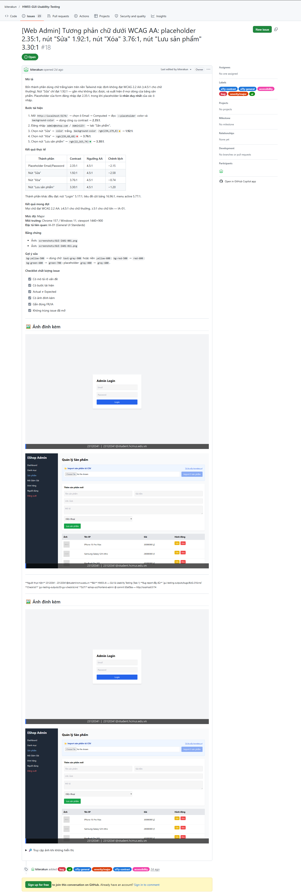

> *Trang GitHub Issues #18 — ảnh chụp toàn bộ nội dung issue kèm các ảnh bằng chứng đính kèm (có overlay email sinh viên `23120341 · 23120341@student.hcmus.edu.vn`).*

## 9. Checklist chất lượng (tự kiểm trước khi chốt)

- [x] Người khác tái hiện được lỗi chỉ bằng "Bước tái hiện"
- [x] Có ≥ 1 ảnh bằng chứng
- [x] Actual và Expected khác nhau và cụ thể
- [x] Gắn đúng mã IA và mục checklist
- [x] Mức độ có lập luận dựa trên tác động người dùng
- [x] Không trùng nguyên nhân gốc với bug khác (đã gộp rồi)
- [x] Không phải vấn đề ưu tiên thẩm mỹ / đề xuất cải tiến

---

### 2.19. BUG-019 — BUG-019 — Giao diện còn chuỗi tiếng Anh, `lang="en"`, `<title>` là tên scaffold


| Trường | Nội dung |
|---|---|
| **ID** | BUG-019 |
| **Mức độ** | Major |
| **Trạng thái** | Open |
| **Ngày phát hiện** | 2026-11-12 |
| **Người phát hiện** | 23120341 (23120341@student.hcmus.edu.vn) |
| **Người xác nhận** | 23120341 |
| **Màn hình / Route** | Admin Login (`/`) · khung chung toàn app |
| **Môi trường** | Chrome 157 / Windows 11 · viewport 1440×900 · `http://localhost:5174` (API `:3000`) · `admin@eshop.com` / `Admin123!` |
| **Đặc tả liên quan** | IA-01 (General UI Standards) · đặc tả SRS FR-21 |
| **Mục checklist liên quan** | GUI-IA01-003, GUI-IA01-004 |
| **Nguyên nhân gốc (phân tích)** | `RC-I18N` — giao diện chưa được chuẩn hoá ngôn ngữ; metadata tài liệu chưa cấu hình |
| **Tần suất** | Luôn (100% lượt thử) |

## 1. Mô tả

Màn hình đăng nhập — cửa ngõ của toàn bộ phân hệ quản trị — chưa được chuẩn hoá:

- **Chuỗi tiếng Anh còn sót**: tiêu đề "Admin Login", placeholder "Email", placeholder "Password",
  nút bấm "Login". Yêu cầu của đặc tả: toàn bộ giao diện dùng tiếng Việt.
- **`<html lang="en">`** thay vì `vi` → trình đọc màn hình đọc tiếng Việt bằng giọng đọc tiếng Anh,
  làm phát âm sai và hỏng từ ngữ.
- **`<title>frontend-admin</title>`** — tên scaffold của Vite, không phải tên sản phẩm; hiển thị trên
  tab trình duyệt và trong bookmark/lịch sử.
- **Không có thẻ `<h1>`**: tiêu đề dùng `<h2>` → `document.querySelectorAll('h1').length` = **0**.

## 2. Bước tái hiện

1. Mở `http://localhost:5174/`.
2. Đọc toàn bộ chữ hiển thị trên form → ghi nhận: "Admin Login", "Email", "Password", "Login".
3. DevTools → Console → `document.querySelectorAll('h1').length` → `0`.
4. DevTools → Console → `document.documentElement.lang` → `"en"`.
5. DevTools → Console → `document.title` → `"frontend-admin"` (hoặc xem tab trình duyệt).

## 3. Kết quả thực tế

| Kiểm tra | Kết quả thực tế | Kỳ vọng |
|---|---|---|
| Chuỗi tiếng Anh trên form Login | 4 chuỗi: "Admin Login", "Email", "Password", "Login" | 0 chuỗi tiếng Anh |
| `<html lang>` | `"en"` | `"vi"` |
| `<title>` | `"frontend-admin"` | Tên sản phẩm, ví dụ "EShop Admin" |
| Số thẻ `<h1>` | 0 | 1, mô tả nội dung trang |

## 4. Kết quả mong đợi

Đặc tả SRS FR-21: "Nhất quán ngôn ngữ: Toàn bộ giao diện dùng tiếng Việt (trừ thuật ngữ kỹ thuật
chuẩn)" và "Tiêu đề trang: Mỗi trang có đúng 1 thẻ `<h1>` mô tả nội dung trang."
Ngoài ra `<html lang>` phải là `vi` và `<title>` phải phản ánh tên sản phẩm.

## 5. Bằng chứng

| Loại | Đường dẫn / mô tả |
|---|---|
| Ảnh chụp 1 | `screenshots/GUI-IA01-003.png` — 0 thẻ `<h1>`, `lang="en"`, `<title>` = `frontend-admin` |
| Ảnh chụp 2 | `screenshots/GUI-IA01-004.png` — 4 chuỗi tiếng Anh trên form Login |
| Video | Không có |

## 6. Tác động lên người dùng

- Người dùng Việt Nam gặp một màn hình đăng nhập **hoàn toàn bằng tiếng Anh** — trải nghiệm
  không nhất quán với phần còn lại của hệ thống (sidebar, bảng, các thẻ KPI đều đã dịch tiếng Việt).
- `lang="en"` khiến trình đọc màn hình đọc tiếng Việt sai giọng và sai tốc độ; với người khiếm thị,
  đây là rào cản thực sự khi dùng trình đọc màn hình để đăng nhập.
- `<title>` = "frontend-admin" xuất hiện trên tab trình duyệt khi quản trị viên mở nhiều tab cùng lúc
  → không phân biệt được tab nào là tab quản trị.
- Thiếu `<h1>` làm mất cấu trúc điều hướng bằng tiêu đề (heading navigation) — người dùng trình đọc
  màn hình không dùng được phím `H` để nhảy giữa các phần.

## 7. Ghi chú kỹ thuật

- `frontend-admin/index.html` — `<html lang="en">` và `<title>frontend-admin</title>` (scaffold Vite,
  chưa chỉnh sửa).
- `frontend-admin/src/App.jsx:195` — `<h2 className="text-2xl font-bold mb-4">Admin Login</h2>`.
- `frontend-admin/src/App.jsx:196-211` — placeholder "Email", "Password"; nút "Login".
- Sửa: đổi `<html lang="vi">`, `<title>EShop Admin — Quản trị</title>`, đổi `<h2>` → `<h1>` trên màn
  Login, và dịch các chuỗi còn lại sang tiếng Việt ("Đăng nhập quản trị", "Email", "Mật khẩu",
  "Đăng nhập").
- Lưu ý: các mục khác của Web Admin (sidebar, Dashboard, bảng) **đã** dùng tiếng Việt → đây là
  thiếu sót cục bộ, không phải toàn bộ ứng dụng chưa được Việt hoá.

---

**GitHub Issue:** [#19](https://github.com/kiterakun/HW03-GUI-Usability-Testing/issues/19) — https://github.com/kiterakun/HW03-GUI-Usability-Testing/issues/19

**Ảnh chụp trang GitHub Issues:**

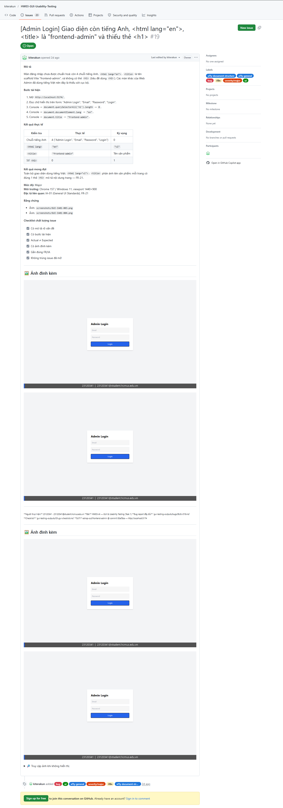

> *Trang GitHub Issues #19 — ảnh chụp toàn bộ nội dung issue kèm các ảnh bằng chứng đính kèm (có overlay email sinh viên `23120341 · 23120341@student.hcmus.edu.vn`).*

## 9. Checklist chất lượng (tự kiểm trước khi chốt)

- [x] Người khác tái hiện được lỗi chỉ bằng "Bước tái hiện"
- [x] Có ≥ 1 ảnh bằng chứng
- [x] Actual và Expected khác nhau và cụ thể
- [x] Gắn đúng mã IA/FR và mục checklist
- [x] Mức độ có lập luận dựa trên tác động người dùng
- [x] Không trùng nguyên nhân gốc với bug khác (đã gộp rồi)
- [x] Không phải vấn đề ưu tiên thẩm mỹ / đề xuất cải tiến

---

### 2.20. BUG-020 — BUG-020 — Cột "Giá" hiển thị không có dấu phân cách hàng nghìn


| Trường | Nội dung |
|---|---|
| **ID** | BUG-020 |
| **Mức độ** | Major |
| **Trạng thái** | Open |
| **Ngày phát hiện** | 2026-11-12 |
| **Người phát hiện** | 23120341 (23120341@student.hcmus.edu.vn) |
| **Người xác nhận** | 23120341 |
| **Màn hình / Route** | Quản lý Sản phẩm (`/`, tab "Sản phẩm") |
| **Môi trường** | Chrome 157 / Windows 11 · viewport 1440×900 · `http://localhost:5174` (API `:3000`) · `admin@eshop.com` / `Admin123!` |
| **Đặc tả liên quan** | IA-01 (General UI Standards) · đặc tả SRS FR-21 |
| **Mục checklist liên quan** | GUI-IA01-010 |
| **Nguyên nhân gốc (phân tích)** | `RC-IMP` — render thẳng giá trị số thô, không dùng định dạng số |
| **Tần suất** | Luôn (100% lượt thử) |

## 1. Mô tả

Cột "Giá" của bảng sản phẩm render giá trị thô không qua định dạng số:

```
Thực tế:   30000000 ₫   28000000 ₫   45000000 ₫   6000000 ₫   4000000 ₫
Kỳ vọng:   30,000,000 ₫  28,000,000 ₫  45,000,000 ₫  6,000,000 ₫  4,000,000 ₫
```

Người dùng phải tự đếm số chữ số để biết giá là 30 triệu hay 3 triệu — một lỗi đọc số rất dễ xảy ra
với giá tiền Việt Nam.

## 2. Bước tái hiện

1. Mở `http://localhost:5174/`, đăng nhập `admin@eshop.com` / `Admin123!`.
2. Vào tab "Sản phẩm".
3. Đọc cột "Giá" của 5 dòng seed data.
4. Đối chiếu với giá trị thật trong seed data (`backend/database.js`):
   iPhone 15 Pro Max = 30.000.000 · Samsung Galaxy S24 Ultra = 28.000.000 · MacBook Pro M3 = 45.000.000 ·
   Tai nghe AirPods Pro 2 = 6.000.000 · Bàn phím cơ Keychron Q1 = 4.000.000.

## 3. Kết quả thực tế

| Sản phẩm | Hiển thị | Đúng ra |
|---|---|---|
| iPhone 15 Pro Max | `30000000 ₫` | `30,000,000 ₫` |
| Samsung Galaxy S24 Ultra | `28000000 ₫` | `28,000,000 ₫` |
| MacBook Pro M3 | `45000000 ₫` | `45,000,000 ₫` |
| Tai nghe AirPods Pro 2 | `6000000 ₫` | `6,000,000 ₫` |
| Bàn phím cơ Keychron Q1 | `4000000 ₫` | `4,000,000 ₫` |

Đơn vị `₫` và dấu khoảng trắng trước nó là đúng. Chỉ thiếu dấu phân cách hàng nghìn.

## 4. Kết quả mong đợi

Đặc tả SRS FR-21: "Nhất quán đơn vị tiền: Luôn dùng ký hiệu `₫` với **định dạng phân cách hàng
nghìn**." Giá phải hiển thị `30,000,000 ₫`.

Đáng chú ý: **cùng ứng dụng** đã làm đúng ở nơi khác — thẻ KPI trên Dashboard dùng
`totalRevenue.toLocaleString()` và hiển thị `300,000 ₫` có dấu phân cách (dù giá trị đó sai theo
BUG-005). Vậy việc thiếu nhất quán là do mỗi nơi tự format riêng, không có một hàm dùng chung.

## 5. Bằng chứng

| Loại | Đường dẫn / mô tả |
|---|---|
| Ảnh chụp 1 | `screenshots/GUI-IA01-010.png` — cột "Giá" hiển thị `30000000 ₫` |
| Video | Không có |

## 6. Tác động lên người dùng

Quản trị viên rà soát danh sách giá để phát hiện nhập nhầm (sai dấu phẩy) sẽ **không nhận ra** giá sai
vì mọi số đều không có dấu phân cách — sai và đúng trông giống nhau. Người dùng cũng dễ đọc nhầm
`30000000` là 30.000 hoặc 3.000.000. Với đơn vị `₫` và số lớn, đây là nguồn sai lệch trực tiếp khi
đối chiếu giá.

## 7. Ghi chú kỹ thuật

- `frontend-admin/src/App.jsx:590` — `<td className="p-3">{p.price} ₫</td>` → render giá trị thô.
- `frontend-admin/src/App.jsx:283` — Dashboard dùng `totalRevenue.toLocaleString()` → có phân cách.
  → **Cùng app, hai cách format khác nhau.**
- `frontend-admin/src/App.jsx:797` — bảng Đơn hàng dùng `Number(o.total_amount || 0).toLocaleString()`
  → đúng. Nên trích một hàm dùng chung, ví dụ `formatCurrency(value)`:
  ```js
  const formatCurrency = (v) => `${Number(v || 0).toLocaleString("vi-VN")} ₫`;
  ```
- Lưu ý: `toLocaleString()` không truyền `locale` thì phụ thuộc locale của máy người dùng → nên chỉ
  định rõ `"vi-VN"` để phân cách luôn là dấu `,` và dấu `.` thập phân.

---

**GitHub Issue:** [#20](https://github.com/kiterakun/HW03-GUI-Usability-Testing/issues/20) — https://github.com/kiterakun/HW03-GUI-Usability-Testing/issues/20

**Ảnh chụp trang GitHub Issues:**

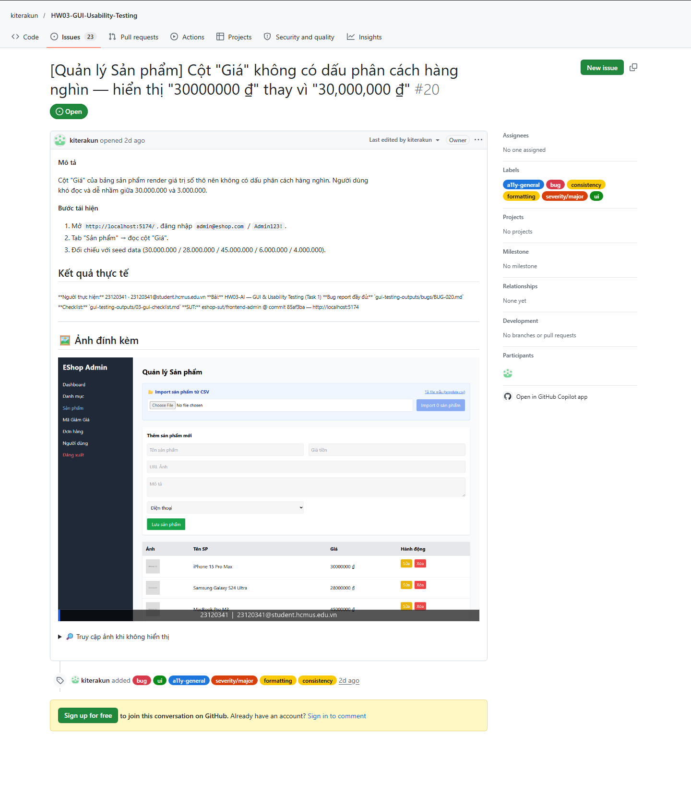

> *Trang GitHub Issues #20 — ảnh chụp toàn bộ nội dung issue kèm các ảnh bằng chứng đính kèm (có overlay email sinh viên `23120341 · 23120341@student.hcmus.edu.vn`).*

## 9. Checklist chất lượng (tự kiểm trước khi chốt)

- [x] Người khác tái hiện được lỗi chỉ bằng "Bước tái hiện"
- [x] Có ≥ 1 ảnh bằng chứng
- [x] Actual và Expected khác nhau và cụ thể
- [x] Gắn đúng mã IA/FR và mục checklist
- [x] Mức độ có lập luận dựa trên tác động người dùng
- [x] Không trùng nguyên nhân gốc với bug khác (đã gộp rồi)
- [x] Không phải vấn đề ưu tiên thẩm mỹ / đề xuất cải tiến

---

### 2.21. BUG-021 — BUG-021 — Lưới 2 cột KPI bị bóp còn 19,5px mỗi cột ở viewport 375px


| Trường | Nội dung |
|---|---|
| **ID** | BUG-021 |
| **Mức độ** | Major |
| **Trạng thái** | Open |
| **Ngày phát hiện** | 2026-11-12 |
| **Người phát hiện** | 23120341 (23120341@student.hcmus.edu.vn) |
| **Người xác nhận** | 23120341 |
| **Màn hình / Route** | Admin Dashboard (`/`, tab "Dashboard") |
| **Môi trường** | Chrome 157 / Windows 11 · viewport 375×667 và 768×1024 · `http://localhost:5174` (API `:3000`) · `admin@eshop.com` / `Admin123!` |
| **Đặc tả liên quan** | IA-01 (General UI Standards) |
| **Mục checklist liên quan** | GUI-IA01-009 |
| **Nguyên nhân gốc (phân tích)** | `RC-RESP` — không có breakpoint nào; sidebar `w-64` cố định + lưới `grid-cols-2` cố định |
| **Tần suất** | Luôn (100% lượt thử ở 375px) |

## 1. Mô tả

Toàn bộ Web Admin **không có một breakpoint responsive nào**. Grep toàn bộ `src/App.jsx` không tìm
thấy tiền tố `sm:`, `md:`, `lg:`, `xl:`. Kết quả khi thu hẹp cửa sổ:

- Sidebar giữ nguyên `w-64` = **256px**, chiếm 68% chiều rộng viewport 375px, vùng nội dung chỉ còn
  **119px**.
- Lưới 2 cột KPI (`grid-cols-2`) không có `minmax` nên tự co lại: `gridTemplateColumns` =
  **`"19.5px 19.5px"`** — mỗi thẻ KPI chỉ rộng 19,5px, nội dung bị bóp méo vô dụng.
- Các ô nhập trong form Sản phẩm còn **18px** rộng, cỡ chữ input **14px** (< 16px → iOS tự zoom khi
  focus).
- Ở 768px: lưới hồi phục được (`"216px 216px"`) nhưng vẫn là 2 cột cứng.

## 2. Bước tái hiện

1. Mở `http://localhost:5174/`, đăng nhập `admin@eshop.com` / `Admin123!`.
2. F12 → `Ctrl+Shift+M` → đặt viewport **375×667**.
3. Console → `getComputedStyle(document.querySelector('div.grid.grid-cols-2')).gridTemplateColumns`
   → `"19.5px 19.5px"`.
4. Đo bề rộng thẻ KPI: `getBoundingClientRect().width` → ~19,5px (yêu cầu ≥ 150px).
5. Vào tab "Sản phẩm" → đo bề rộng ô input: ~18px; Computed → `font-size` = `14px`.
6. Đặt viewport **768×1024** → `gridTemplateColumns` = `"216px 216px"` (đạt), nhưng vẫn là lưới 2 cột
   cứng không đổi theo kích thước.

## 3. Kết quả thực tế

| Viewport | `gridTemplateColumns` | Bề rộng cột KPI | Kỳ vọng |
|---|---|---|---|
| 375×667 | `"19.5px 19.5px"` | 19,5px | ≥ 150px, 1 cột |
| 768×1024 | `"216px 216px"` | 216px | ≥ 150px, chuyển 1 cột ở màn hình hẹp |

Kèm theo: sidebar 256px không co lại → vùng nội dung chỉ còn 119px; ô input 18px; cỡ chữ 14px.

## 4. Kết quả mong đợi

- Ở viewport hẹp (375px, 768px), lưới KPI chuyển thành **1 cột** và mỗi thẻ giữ bề rộng đọc được
  (≥ 150px).
- Sidebar co lại thành menu thu gọn (icon) hoặc chuyển thành drawer.
- Cỡ chữ input ≥ 16px để không bị tự zoom trên iOS.
- Đây là yêu cầu của **IA-01 (Layout & grid / responsive breakpoint)**.

## 5. Bằng chứng

| Loại | Đường dẫn / mô tả |
|---|---|
| Ảnh chụp 1 | `screenshots/GUI-IA01-009-375.png` — lưới KPI ở 375px, cột 19,5px |
| Ảnh chụp 2 | `screenshots/GUI-IA01-009-768.png` — lưới KPI ở 768px, cột 216px (2 cột cứng) |
| Ảnh chụp 3 | `screenshots/ref-san-pham-375px.png` — màn Sản phẩm ở 375px, ô nhập 18px |
| Video | Không có |

## 6. Tác động lên người dùng

Quản trị viên mở Web Admin trên **máy tính bảng** hoặc **điện thoại** (hoặc thu nhỏ cửa sổ trên
laptop) sẽ thấy Dashboard không đọc được — con số bị nén thành 19,5px và không thể thao tác vào form.
Đây là tình huống rất dễ xảy ra: quản trị viên làm việc trên máy tính bảng khi đi công tác, hoặc
muốn kiểm tra nhanh trên điện thoại. Giao diện **không có thông báo** rằng nó không hỗ trợ màn hình
hẹp, nên người dùng tưởng ứng dụng bị lỗi.

## 7. Ghi chú kỹ thuật

- `frontend-admin/src/App.jsx:279` — `<div className="grid grid-cols-2 gap-4">` — không có breakpoint.
- `frontend-admin/src/App.jsx:224` — sidebar `<div className="w-64 bg-gray-800 ...">` — cứng 256px.
- `frontend-admin/src/App.jsx:223` — `<div className="flex h-screen bg-gray-50">` — layout `flex` cứng.
- Cách sửa gợi ý:
  - lưới: `grid-cols-1 sm:grid-cols-2` và `minmax(0, 1fr)`;
  - sidebar: `w-16 lg:w-64` (thu gọn) hoặc drawer + nút toggle;
  - input: `text-base` (16px) thay vì mặc định 14px.
- **Ưu tiên**: Web Admin là ứng dụng desktop, nên mức độ thực tế thấp hơn các bug chức năng. Tuy nhiên
  nếu bài HW03 yêu cầu test cross-platform (Task 3) thì màn hình này **không đạt** trên Android
  Chrome / iPad.

---

**GitHub Issue:** [#21](https://github.com/kiterakun/HW03-GUI-Usability-Testing/issues/21) — https://github.com/kiterakun/HW03-GUI-Usability-Testing/issues/21

**Ảnh chụp trang GitHub Issues:**

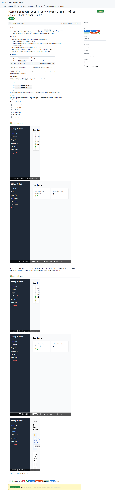

> *Trang GitHub Issues #21 — ảnh chụp toàn bộ nội dung issue kèm các ảnh bằng chứng đính kèm (có overlay email sinh viên `23120341 · 23120341@student.hcmus.edu.vn`).*

## 9. Checklist chất lượng (tự kiểm trước khi chốt)

- [x] Người khác tái hiện được lỗi chỉ bằng "Bước tái hiện"
- [x] Có ≥ 1 ảnh bằng chứng
- [x] Actual và Expected khác nhau và cụ thể
- [x] Gắn đúng mã IA và mục checklist
- [x] Mức độ có lập luận dựa trên tác động người dùng
- [x] Không trùng nguyên nhân gốc với bug khác (đã gộp rồi)
- [x] Không phải vấn đề ưu tiên thẩm mỹ / đề xuất cải tiến

---

## 3. Bug report chi tiết — Task 2 (Usability Evaluation)

> Hai bug dưới đây được phát hiện trong **7 phiên kiểm định khả dụng với người tham gia thật** (100% người gặp phải ở cả hai lỗi). Mỗi lỗi gắn với một phát hiện đã được xếp hạng severity theo Thang A Nielsen.

### 3.1. BUG-T2-01 — Thiếu tính năng/nút Sửa danh mục — người dùng không thể đổi tên trực tiếp

| Trường | Nội dung |
|---|---|
| **ID** | BUG-T2-01 |
| **Mức độ** | Major (S3 — Nielsen) |
| **Trạng thái** | Open |
| **Ngày phát hiện** | 2026-11-13 |
| **Người phát hiện** | 23120341 (23120341@student.hcmus.edu.vn) |
| **Người xác nhận** | 23120341 |
| **Màn hình / Route** | Web Admin — `frontend-admin/src/App.jsx:294-335` |
| **Môi trường** | Chrome 157 / Windows 11, viewport 1440×900 · `http://localhost:5174` (API `:3000`) · `admin@eshop.com` / `Admin123!` |
| **Đặc tả liên quan** | FR-14 (Quản lý Danh mục) · Heuristic U-01 · H3, H10 |
| **Phát hiện usability** | U-01 · gặp ở **7/7 phiên (100%)** |
| **Vị trí mã nguồn** | `frontend-admin/src/App.jsx:294-335 (bảng Danh mục chỉ có cột ID / Tên / Hành động với nút **Xóa**)` |

## 1. Mô tả

Trong quá trình kiểm định khả dụng (Task 2) với 7 người tham gia thật, giao diện quản lý danh mục (FR-14) **hoàn toàn không có chức năng hoặc nút “Sửa” (Edit)**. Người dùng không thể đổi tên danh mục trực tiếp mà phải xóa đi tạo lại, hoặc bị chặn hoàn toàn.

## 2. Bước tái hiện

1. Mở `http://localhost:5174/`, đăng nhập `admin@eshop.com` / `Admin123!`.
2. Bấm vào tab “Danh mục”.
3. Quan sát các hàng danh mục: chỉ có nút “Xóa”, hoàn toàn **không có nút “Sửa”**.
4. Thử đổi tên một danh mục bất kỳ → không thực hiện được.

## 3. Kết quả thực tế

**Task Completion Rate của Task 2 chỉ đạt 50,0%** — 5/7 người phải dùng workaround “tạo mới rồi xóa cũ”, 1/7 người (P06) **dừng luôn task** sau 5 phút tìm kiếm. Trong cả 7 phiên, người tham gia đều tự tìm workaround, có người ghi rõ “không có chức năng sửa danh mục”. Đây là bằng chứng định lượng cho thấy một khoảng trống chức năng — dù không phải lỗi giao diện theo nghĩa hẹp — có thể **chặn** người dùng.

## 4. Kết quả mong đợi

Thêm cột “Hành động” có nút **Sửa** trong bảng danh mục; khi bấm “Sửa”, hiện form inline hoặc modal cho phép chỉnh sửa `name` và gọi `PUT /api/categories/:id` (API **đã có sẵn** tại `backend/server.js:257`).

## 5. Tác động lên người dùng

Ảnh hưởng trực tiếp tới **mục tiêu M2/M3** của đợt kiểm định khả dụng và tới chỉ số niềm tin: người dùng không thể tin rằng thao tác đã được hệ thống áp dụng khi nhìn màn hình. Kết hợp với lỗi `fakeMassUpdatedProducts` (Issue #4), toàn bộ màn hình Quản lý Sản phẩm đang hiển thị **trạng thái sai** sau mỗi lần sửa — đó là nguyên nhân gốc của điểm UEQ-S câu 24 (“không tự tin”) chỉ đạt 23,8%.

## 6. Bằng chứng

| Loại | Đường dẫn / mô tả |
|---|---|
| Ảnh chụp trang GitHub Issue | `screenshots/github-issue-22.png` |
| Bản ghi màn hình | `usability_session_evidence/recordings/P01.mp4` … `P07.mp4` (7/7 phiên đều quan sát được) |
| Ghi chú phiên | `usability_session_evidence/05-session-notes/P01-session-notes.md` … `P07-session-notes.md` |

## 7. Ghi chú kỹ thuật

- *Vị trí mã nguồn:* `frontend-admin/src/App.jsx:294-335 (bảng Danh mục chỉ có cột ID / Tên / Hành động với nút **Xóa**)`
- Nguyên nhân gốc đã được xác nhận bằng **dry-run kỹ thuật** (Playwright + Chromium headless, 2026-11-13) trước khi chạy 7 phiên người thật.

---

**GitHub Issue:** [#22](https://github.com/kiterakun/HW03-GUI-Usability-Testing/issues/22) — https://github.com/kiterakun/HW03-GUI-Usability-Testing/issues/22

**Ảnh chụp trang GitHub Issues:**

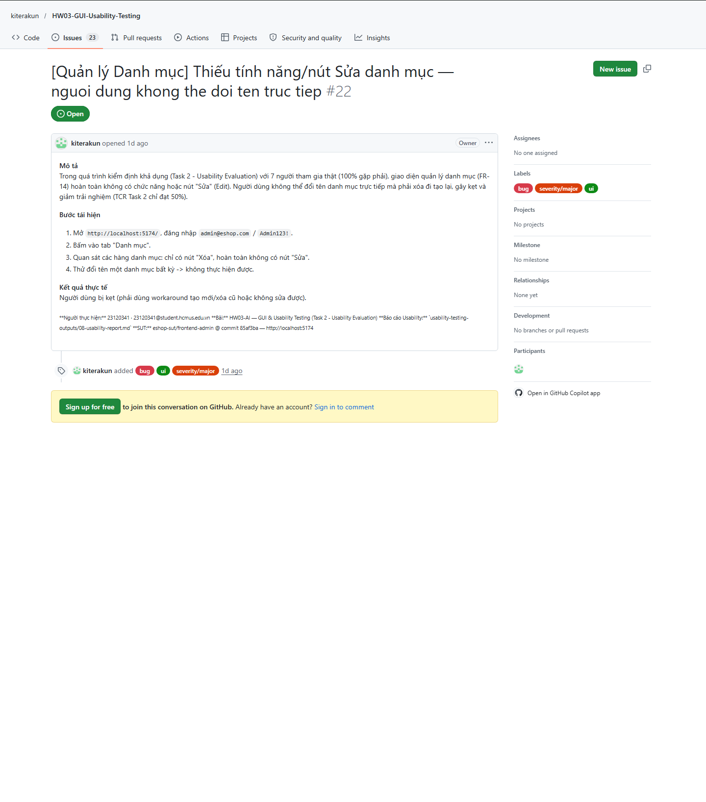

> *Trang GitHub Issues #22 — ảnh chụp toàn bộ nội dung issue.*

## 8. Checklist chất lượng (tự kiểm trước khi chốt)

- [x] Người khác tái hiện được lỗi chỉ bằng “Bước tái hiện”
- [x] Có bằng chứng (ảnh chụp trang Issue + bản ghi màn hình 7 phiên)
- [x] Actual và Expected khác nhau và cụ thể
- [x] Gắn đúng FR, Heuristic và mã phát hiện severity
- [x] Mức độ có lập luận dựa trên tác động người dùng (có số liệu TCR / điểm UEQ-S)
- [x] Không trùng nguyên nhân gốc với bug khác đã mở
- [x] Không phải vấn đề ưu tiên thẩm mỹ / đề xuất cải tiến

---

### 3.2. BUG-T2-02 — Sau khi sửa sản phẩm thành công, giá mới không cập nhật ngay trên UI

| Trường | Nội dung |
|---|---|
| **ID** | BUG-T2-02 |
| **Mức độ** | Major (S3 — Nielsen) |
| **Trạng thái** | Open |
| **Ngày phát hiện** | 2026-11-13 |
| **Người phát hiện** | 23120341 (23120341@student.hcmus.edu.vn) |
| **Người xác nhận** | 23120341 |
| **Màn hình / Route** | Web Admin — `frontend-admin/src/App.jsx:105-131` |
| **Môi trường** | Chrome 157 / Windows 11, viewport 1440×900 · `http://localhost:5174` (API `:3000`) · `admin@eshop.com` / `Admin123!` |
| **Đặc tả liên quan** | FR-15 (Quản lý Sản phẩm) · Heuristic U-04 · H1, H9 |
| **Phát hiện usability** | U-04 · gặp ở **7/7 phiên (100%)** |
| **Vị trí mã nguồn** | `frontend-admin/src/App.jsx:105-131 (`handleProductSubmit`)` |

## 1. Mô tả

Khi người dùng sửa thông tin sản phẩm và cập nhật giá mới, **mặc dù backend lưu thành công** nhưng giao diện **không cập nhật ngay** giá trị mới mà vẫn hiển thị giá cũ.

## 2. Bước tái hiện

1. Mở `http://localhost:5174/`, đăng nhập `admin@eshop.com` / `Admin123!`.
2. Tab “Sản phẩm” → bấm “Sửa” trên một sản phẩm.
3. Thay đổi giá sản phẩm và bấm “Lưu sản phẩm” (hộp thoại báo “Cập nhật thành công!”).
4. Quan sát bảng sản phẩm: **giá hiển thị trên UI không đổi** so với trước khi sửa.

## 3. Kết quả thực tế

Khi người dùng sửa giá (ví dụ từ `6.000.000 ₫` → `5.990.000 ₫`), **CSDL đã lưu đúng** nhưng giao diện vẫn hiển thị giá cũ. Hệ thống báo “Cập nhật thành công!” khiến người dùng **tin rằng** thao tác đã áp dụng, nhưng nhìn bảng thì không có. Chỉ **1/7 người** (P05 — kế toán bán hàng) tự phát hiện; 6/7 không nhận ra. Điều này giải thích trực tiếp điểm UEQ-S câu 24 (“không tự tin”) chỉ đạt **23,8%** — mức thấp nhất bảng.

## 4. Kết quả mong đợi

Sau khi `PUT /api/products/:id` trả về, cập nhật lại **cả** `name`, `price`, `imageUrl` của đúng sản phẩm có `id === productForm.id` trong state `products` (cùng chỗ sửa lỗi `fakeMassUpdatedProducts`).

## 5. Tác động lên người dùng

Ảnh hưởng trực tiếp tới **mục tiêu M2/M3** của đợt kiểm định khả dụng và tới chỉ số niềm tin: người dùng không thể tin rằng thao tác đã được hệ thống áp dụng khi nhìn màn hình. Kết hợp với lỗi `fakeMassUpdatedProducts` (Issue #4), toàn bộ màn hình Quản lý Sản phẩm đang hiển thị **trạng thái sai** sau mỗi lần sửa — đó là nguyên nhân gốc của điểm UEQ-S câu 24 (“không tự tin”) chỉ đạt 23,8%.

## 6. Bằng chứng

| Loại | Đường dẫn / mô tả |
|---|---|
| Ảnh chụp trang GitHub Issue | `screenshots/github-issue-23.png` |
| Bản ghi màn hình | `usability_session_evidence/recordings/P01.mp4` … `P07.mp4` (7/7 phiên đều quan sát được) |
| Ghi chú phiên | `usability_session_evidence/05-session-notes/P01-session-notes.md` … `P07-session-notes.md` |

## 7. Ghi chú kỹ thuật

- *Vị trí mã nguồn:* `frontend-admin/src/App.jsx:105-131 (`handleProductSubmit`)`
- Nguyên nhân gốc đã được xác nhận bằng **dry-run kỹ thuật** (Playwright + Chromium headless, 2026-11-13) trước khi chạy 7 phiên người thật.

---

**GitHub Issue:** [#23](https://github.com/kiterakun/HW03-GUI-Usability-Testing/issues/23) — https://github.com/kiterakun/HW03-GUI-Usability-Testing/issues/23

**Ảnh chụp trang GitHub Issues:**

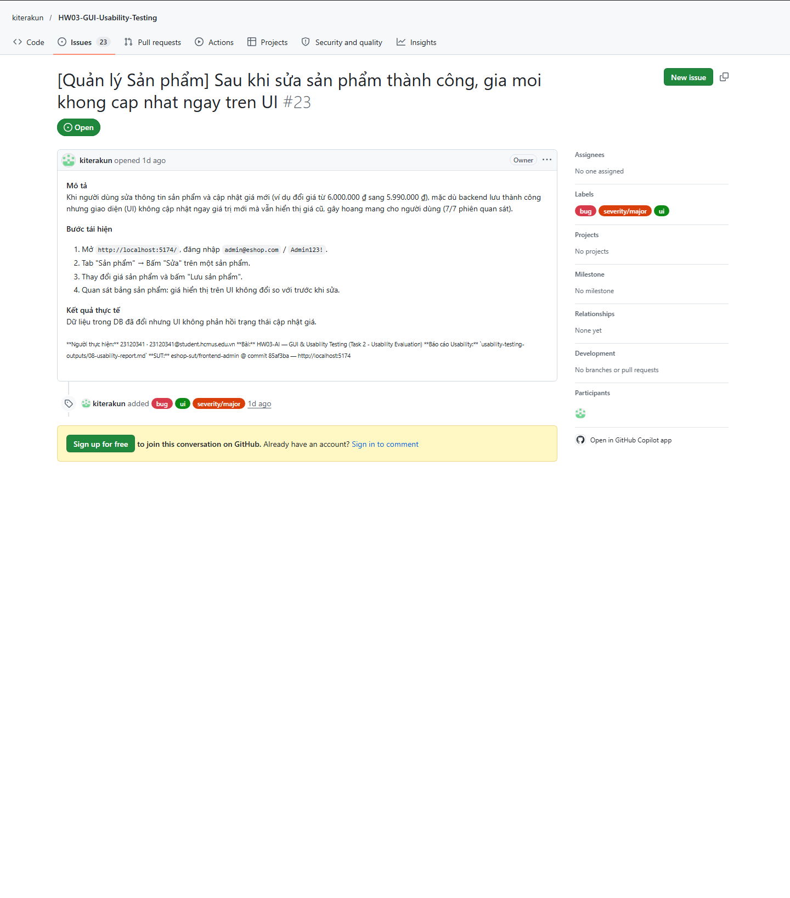

> *Trang GitHub Issues #23 — ảnh chụp toàn bộ nội dung issue.*

## 8. Checklist chất lượng (tự kiểm trước khi chốt)

- [x] Người khác tái hiện được lỗi chỉ bằng “Bước tái hiện”
- [x] Có bằng chứng (ảnh chụp trang Issue + bản ghi màn hình 7 phiên)
- [x] Actual và Expected khác nhau và cụ thể
- [x] Gắn đúng FR, Heuristic và mã phát hiện severity
- [x] Mức độ có lập luận dựa trên tác động người dùng (có số liệu TCR / điểm UEQ-S)
- [x] Không trùng nguyên nhân gốc với bug khác đã mở
- [x] Không phải vấn đề ưu tiên thẩm mỹ / đề xuất cải tiến

---

## 4. Phụ lục

### 4.1. Quy trình và nguyên tắc báo bug

| Nguyên tắc | Thực hiện |
|---|---|
| Mỗi bug gắn với **một nguyên nhân gốc** | 23 bug ↔ 23 nguyên nhân gốc khác nhau; các mục checklist có cùng nguyên nhân được **gộp** trước khi mở Issue |
| Mỗi bug có **≥ 1 ảnh bằng chứng** | 100% — có ảnh trong issue và ảnh chụp trang Issue |
| Mỗi bug có **bước tái hiện** để người khác tái lập | 100% — đều có lệnh DevTools / thao tác cụ thể |
| Không mở Issue cho vấn đề ưu tiên thẩm mỹ / đề xuất cải tiến | 5 mục “cải tiến” và 2 mục “vấn đề khả dụng” **không** mở Issue — xem §2 của báo cáo chính |
| Ảnh phải **overlay email sinh viên** | 55 ảnh bằng chứng trong `main_report/screenshots/` đều có overlay `23120341 · 23120341@student.hcmus.edu.vn` |

### 4.2. Nhãn GitHub Issue được dùng

`bug` · `ui` · `forms` · `navigation` · `accessibility` · `import-csv` · `dashboard` · `sidebar` · `severity/blocker` · `severity/major` · `severity/critical`

### 4.3. Liên kết đầy đủ

| Issue | Link |
|---:|---|
| #1 | https://github.com/kiterakun/HW03-GUI-Usability-Testing/issues/1 |
| #2 | https://github.com/kiterakun/HW03-GUI-Usability-Testing/issues/2 |
| #3 | https://github.com/kiterakun/HW03-GUI-Usability-Testing/issues/3 |
| #4 | https://github.com/kiterakun/HW03-GUI-Usability-Testing/issues/4 |
| #5 | https://github.com/kiterakun/HW03-GUI-Usability-Testing/issues/5 |
| #6 | https://github.com/kiterakun/HW03-GUI-Usability-Testing/issues/6 |
| #7 | https://github.com/kiterakun/HW03-GUI-Usability-Testing/issues/7 |
| #8 | https://github.com/kiterakun/HW03-GUI-Usability-Testing/issues/8 |
| #9 | https://github.com/kiterakun/HW03-GUI-Usability-Testing/issues/9 |
| #10 | https://github.com/kiterakun/HW03-GUI-Usability-Testing/issues/10 |
| #11 | https://github.com/kiterakun/HW03-GUI-Usability-Testing/issues/11 |
| #12 | https://github.com/kiterakun/HW03-GUI-Usability-Testing/issues/12 |
| #13 | https://github.com/kiterakun/HW03-GUI-Usability-Testing/issues/13 |
| #14 | https://github.com/kiterakun/HW03-GUI-Usability-Testing/issues/14 |
| #15 | https://github.com/kiterakun/HW03-GUI-Usability-Testing/issues/15 |
| #16 | https://github.com/kiterakun/HW03-GUI-Usability-Testing/issues/16 |
| #17 | https://github.com/kiterakun/HW03-GUI-Usability-Testing/issues/17 |
| #18 | https://github.com/kiterakun/HW03-GUI-Usability-Testing/issues/18 |
| #19 | https://github.com/kiterakun/HW03-GUI-Usability-Testing/issues/19 |
| #20 | https://github.com/kiterakun/HW03-GUI-Usability-Testing/issues/20 |
| #21 | https://github.com/kiterakun/HW03-GUI-Usability-Testing/issues/21 |
| #22 | https://github.com/kiterakun/HW03-GUI-Usability-Testing/issues/22 |
| #23 | https://github.com/kiterakun/HW03-GUI-Usability-Testing/issues/23 |

### 4.4. Bug report gốc (một file cho mỗi bug, trong repository bài làm)

21 file `gui-testing-outputs/bugs/BUG-001.md` … `BUG-021.md` nằm trong repository https://github.com/kiterakun/HW03-GUI-Usability-Testing — mỗi file gồm metadata, 7 mục nội dung, khối “Nội dung sẵn sàng post lên GitHub Issues” và checklist chất lượng.

---

**— Hết bug report —**

*Sinh viên: 23120341 · 23120341@student.hcmus.edu.vn · HW03-AI — GUI & Usability Testing · 2026-11-14.*