# HW03 — GUI & Usability Testing — EShop Web Admin

## Báo cáo chính (Main Report) — Task 1: GUI Checklist · Task 2: Usability Evaluation

| Trường | Nội dung |
|---|---|
| **Bài tập** | HW03-AI — GUI & Usability (cá nhân) |
| **Sinh viên** | **23120341** — 23120341@student.hcmus.edu.vn |
| **SUT** | EShop — phân hệ **Web Admin** (`eshop-sut/frontend-admin`) — https://github.com/ttbhanh/eshop-sut |
| **Phiên bản SUT** | commit `85af3ba` (“first upload”) — React 19.2 + Vite 8 + Tailwind 3.4 |
| **Repository bài làm** | https://github.com/kiterakun/HW03-GUI-Usability-Testing |
| **Trình duyệt / nền tảng kiểm thử** | Chrome 157 & Edge — desktop, viewport 1440×900 (thêm 375×667, 768×1024) |
| **Môi trường** | Admin `http://localhost:5174` · API `http://localhost:3000` · CSDL SQLite |
| **Tài khoản test** | `admin@eshop.com` / `Admin123!` · `test@eshop.com` / `Test1234!` |
| **Thời gian thực hiện** | 2026-11-11 → 2026-11-14 |
| **AI tools đã dùng** | OpenCode + MiniMax M3.1 Flash Free — khai báo đầy đủ ở [AI Audit Report](../ai_audit_report/HW03_AI_Audit_Report.md) |
| **Phạm vi nộp** | Task 1 ✅ · Task 2 ✅ · Task 3 ❌ (bỏ qua — xem §7.6) |

---

## Mục lục

| § | Nội dung |
|---|---|
| [§0](#0-tóm-tắt-điều-hành) | Tóm tắt điều hành (Executive Summary) |
| [§1](#1-giới-thiệu-bài-toán) | Giới thiệu bài toán — SUT, phạm vi, môi trường, vai trò của AI |
| [§2](#2-quy-trình-thực-hiện) | Quy trình thực hiện end-to-end (Task 1 & Task 2) |
| [§3](#3-task-1--gui-checklist) | **Task 1 — GUI Checklist**: phân tích phạm vi → thiết kế → review → thực thi → bug |
| [§4](#4-task-2--usability-evaluation) | **Task 2 — Usability Evaluation**: kế hoạch → 7 phiên thật → phân tích → severity |
| [§5](#5-tổng-hợp-chung--kết-luận) | Tổng hợp chung, đối chiếu chéo Task 1 ↔ Task 2, kết luận |
| [§6](#6-khai-báo-ai--ai-audit--ai-critique) | Khai báo AI, AI Audit Report và AI Critique |
| [§7](#7-phụ-lục) | Phụ lục — danh mục hồ sơ, GitHub Issues, Excel checklist, git log, Agent Skills, hạn chế |

---

## 0. Tóm tắt điều hành

Bài báo cáo trình bày hai nhiệm vụ của HW03-AI trên cùng một đối tượng kiểm thử: phân hệ **Web Admin của EShop**. Task 1 là kiểm thử giao diện theo **checklist 4 Interface Aspects**; Task 2 là **kiểm định khả dụng** với 7 người tham gia thật trên một luồng end-to-end. Hai hướng kiểm thử độc lập này cùng chỉ ra **cùng một nhóm điểm yếu cốt lõi**, khiến kết luận trong báo cáo có độ tin cậy cao hơn một lần kiểm thử đơn lẻ.

### 0.1. Các con số chính

| Chỉ số | Task 1 — GUI Checklist | Task 2 — Usability Evaluation |
|---|---|---|
| Đối tượng kiểm thử | 5 màn hình + 2 nhóm khung chung của Web Admin | 1 end-to-end flow (4 task) trên Web Admin |
| Số mục thiết kế | **47 mục** (IA-01: 13 · IA-02: 12 · IA-03: 9 · IA-04: 13) | 4 task, 4 mục tiêu đánh giá (M1–M4), 3 thang đo |
| Số mục thực thi | **47 / 47 (100%)** — 7 Passed, **40 Failed** (pass rate **14,9%**) | 7 phiên / 7 người tham gia thật |
| Task Completion Rate | — | **85,7%** (T4 100% · T1 92,9% · T2 50,0% · T3 100%) |
| Điểm định lượng | — | **SUS = 6,8/100** (hạng **F**) · **UEQ-S = 3,99/7** (49,9%) |
| Bug tìm được | **21 bug** (10 Blocker, 11 Major) → GitHub Issues #1–#21 | **2 bug** → GitHub Issues #22–#23 |
| Vấn đề phi-hành-vi | 2 vấn đề khả dụng + 5 đề xuất cải tiến | 6 vấn đề hệ thống (7/7 phiên), **0 lỗi lẻ** |
| Bằng chứng | **55 ảnh** cho 40 mục Failed | 7 bản ghi màn hình (P01–P07) + 7 file ghi chú phiên |
| AI sử dụng | OpenCode + MiniMax M3.1 Flash — sinh checklist, phân tích runtime, chuẩn hoá bug | Cùng — tổng hợp số liệu, heuristic, severity, báo cáo |

### 0.2. Năm kết luận quan trọng nhất

1. **Web Admin không có hệ thống quản lý trạng thái giao diện.** IA-04 (Feedback / State) **fail 100% (13/13)**. Mọi phản hồi đi qua `window.alert()` tại 5 call-site: không có loading state, không có empty state, không có success toast, không có lỗi inline, không có bước xác nhận trước khi xóa. Đây **không phải 13 lỗi lẻ** mà là **một thiếu hụt kiến trúc** — cần một lớp quản lý trạng thái + một component thông báo, không phải vá từng mục.
2. **Không một form nào khai báo ràng buộc dữ liệu.** 10/11 mục IA-02 fail cùng một nguyên nhân: không `<label>`, không ký hiệu `*`, không `type="email"`, không `maxlength`, không chặn giá ≤ 0, không chặn tên rỗng, không `autocomplete`. Biểu hiện bên ngoài khác nhau, cùng một gốc.
3. **Ba lỗi làm sai dữ liệu thật, không chỉ sai giao diện** — và cả ba đều ở tầng JSX: sửa 1 sản phẩm làm **đổi tên toàn bộ bảng** (`fakeMassUpdatedProducts`), **giá mới không hiển thị** sau khi lưu, và Dashboard **nhân đôi doanh thu** (`total_amount * 2`). Trong 7 phiên usability, **7/7 người** gặp phải hai lỗi đầu và **1/7 người tự phát hiện** lỗi thứ ba.
4. **Một khoảng trống chức năng làm TCR của Task Danh mục tụt xuống 50%.** UI Danh mục **không có nút Sửa** (FR-14 chỉ yêu cầu Thêm/Xem/Xóa). 5/7 người phải dùng workaround “tạo mới rồi xóa cũ”, 1/7 người **dừng luôn task**. Đây là bằng chứng định lượng rõ nhất về việc một khoảng trống UI có thể chặn người dùng, không chỉ làm họ khó chịu.
5. **Điểm SUS 6,8/100 (hạng F) là hệ quả có hệ thống, không phải tai nạn.** Nguyên nhân trực tiếp: hành động phá huỷ không cần xác nhận, trạng thái hiển thị sai lệch, form không nhãn, lỗi báo bằng `alert()` chung chung, và một chức năng cốt lõi bị thiếu. Cả 5 đề xuất cải tiến (IM-01…IM-05) đều là sửa ở tầng kiến trúc, không phải sửa giao diện bề mặt.

### 0.3. Kết luận về mức độ sẵn sàng của sản phẩm

Với điểm SUS trung bình 6,8/100 (Bottom 15% — “Không chấp nhận được”) và UEQ-S 3,99/7 (thấp hơn ngưỡng trung bình ngành 4,25), **Web Admin hiện trạng không nên đưa vào sử dụng thật** cho đội quản trị cửa hàng cho tới khi 3 đề xuất P1 (IM-01, IM-02, IM-03) được triển khai. Ba lỗi P1 này đều gây mất hoặc sai lệch dữ liệu quản lý sản phẩm — tức là tổn thất trực tiếp cho người dùng, không phải bất tiện giao diện.

---

## 1. Giới thiệu bài toán

### 1.1. Bối cảnh và mục tiêu học tập

HW03-AI yêu cầu sinh viên **tự thiết kế một GUI checklist (>40 mục)** phủ 4 interface aspect, **tự thực thi** checklist đó trên SUT thật, và **tự tổ chức một đợt kiểm định khả dụng** với 7 người tham gia thật trên một luồng end-to-end. Bài toán đo hai năng lực Bloom-AI: **G9.3 (Analyse)** — phân tích UI bằng checklist và phân tích dữ liệu người dùng; và **G9.4 (Collaborate)** — điều hướng AI qua từng bước của phương pháp thay vì dùng AI như một hộp đen.

Bốn mục tiêu học tập được đề bài nêu và cách báo cáo này đáp ứng:

| Mục tiêu học tập | Thực hiện ở đâu trong báo cáo |
|---|---|
| Thiết kế & áp dụng GUI checklist dựa trên yêu cầu giao diện của SUT | §3.1–§3.6 (47 mục, thực thi 47/47) |
| Thu thập & phân tích phản hồi khả dụng từ người dùng thật | §4.7–§4.11 (7 phiên, SUS/UEQ-S, heuristic, severity) |
| Kiểm thử chéo trình duyệt / nền tảng | **Không thực hiện (Task 3)** — nêu rõ lý do ở §7.6 |
| Thể hiện Bloom-AI G9.3 & G9.4 | §2 (quy trình có Gate, human review), §6 (AI Audit) |

### 1.2. System Under Test

| Thuộc tính | Giá trị |
|---|---|
| Tên | EShop — hệ thống thương mại điện tử demo dùng để luyện tập kiểm thử |
| Repository | https://github.com/ttbhanh/eshop-sut |
| Phân hệ được chọn | **Web Admin** (`frontend-admin`) — React 19.2 + Vite 8 + Tailwind 3.4, toàn bộ nằm trong một component `src/App.jsx` (922 dòng) |
| Backend | Node.js + Express + SQLite (`backend/server.js`, `backend/database.js`) |
| URL kiểm thử | Admin `http://localhost:5174` · API `http://localhost:3000` |
| Tài khoản | `admin@eshop.com` / `Admin123!` (quản trị) · `test@eshop.com` / `Test1234!` (user thường, dùng cho FR-12) |
| Commit | `85af3ba` — test trên bản gốc, **không sửa mã nguồn SUT** trong suốt quá trình kiểm thử |

> **Ghi chú về mâu thuẫn tài liệu SUT:** `README.md:23` ghi mật khẩu `Admin123!` còn `setup_guide.md:105` ghi `admin123`. Mâu thuẫn này được **ghi nhận và hỏi người dùng** ở Gate A chứ không tự kết luận; kết quả chốt là `Admin123!`.

### 1.3. Phạm vi đã chọn

#### Task 1 — GUI Checklist: 5 màn hình + 2 nhóm khung chung

Đề bài cho phép chọn một hay nhiều màn hình, khuyến nghị chọn nhiều màn hình để có đủ độ phủ (một màn hình khó cho ra 40 mục có ý nghĩa). Phạm vi cuối cùng do **người dùng chốt** tại Gate A:

| # | Màn hình / vùng kiểm thử | Nội dung kiểm thử chính | Rủi ro UI |
|---|---|---|---|
| 1 | **Admin Login** | Nhập email / mật khẩu, submit, xử lý 4 nhánh lỗi (rỗng, sai format, sai credential, không phải admin) | **Cao** |
| 2 | **Dashboard Admin** | 2 thẻ KPI doanh thu / tổng đơn; trạng thái loading, rỗng, lỗi API | Trung bình |
| 3 | **Quản lý Danh mục** | Thêm / xem / xóa danh mục; validate tên rỗng; xác nhận trước khi xóa | **Cao** |
| 4 | **Quản lý Sản phẩm (CRUD)** | Thêm / sửa / xóa sản phẩm; validate giá; trạng thái sau khi sửa | **Cao** |
| 5 | **Import sản phẩm từ CSV** | Chọn file → preview → import; định dạng file, dòng lỗi, rollback, báo cáo kết quả | **Cao** |
| 6 | *Khung chung – Sidebar* | 7 mục menu, mục active, điều hướng bằng bàn phím, đăng xuất | **Cao** |
| 7 | *Khung chung – Các form* | 4 form dùng chung: Login, Danh mục, Sản phẩm, Import CSV | **Cao** |

#### Task 2 — Usability Evaluation: 1 end-to-end flow, 4 task

| Mã | Task | FR | Mục tiêu người dùng | Ước lượng thời gian |
|---|---|---|---|---|
| **T4** | Đăng nhập vào trang quản trị | FR-12 | Đăng nhập bằng tài khoản admin, hiểu vì sao 2 lần thử trước bị từ chối | ≤ 4 phút |
| **T1** | Hiểu Dashboard | FR-13 | Nói được Dashboard hiển thị gì và con số nào là doanh thu | ≤ 4 phút |
| **T2** | Quản lý vòng đời Danh mục | FR-14 | Tạo `Giày dép` → đổi tên `Giày dép & Dép` → xóa | ≤ 6 phút |
| **T3** | Tạo & cập nhật Sản phẩm | FR-15 | Tạo `Áo khoác dạ` (450000 ₫, Phụ kiện) → sửa `Tai nghe AirPods Pro 2` | ≤ 8 phút |

> **Thứ tự thực hiện:** T4 → T1 → T2 → T3 — đúng trình tự tự nhiên của ứng dụng (vào trang quản trị → đăng nhập → thấy Dashboard).

#### Ngoài phạm vi (nêu rõ, không báo cáo là đã cover)

- Frontend Web khách hàng (`frontend-web`, :5173): Home, Login, Register, Product Detail, Cart, Checkout, Profile, ForgotPassword.
- Mobile app (`frontend-mobile`, React Native / Expo).
- 3 tab còn lại của Web Admin: **Mã Giảm Giá**, **Đơn hàng**, **Người dùng** — hiện diện trong `App.jsx` (dòng 612, 777, 879), được khảo sát đầy đủ trong phân tích giao diện nhưng **không sinh mục checklist nào**.
- Kiểm thử backend/API, SQL injection, XSS — ngoài phạm vi GUI. Nghi vấn bảo mật phát hiện khi đọc mã nguồn (`/api/admin/*` không kiểm tra `role` tại `server.js:494,504,510,525`) được **ghi nhận trong phụ lục**, không mở thành mục GUI và không tính vào điểm SUS.
- Task 3 — cross-browser / cross-platform (≥ 3 nền tảng): **không thực hiện**, xem §7.6.

### 1.4. Môi trường kiểm thử và công cụ

| Hạng mục | Cụ thể |
|---|---|
| Trình duyệt | Chrome 157 (Windows 11) — cho checklist & phần lớn phiên usability; Edge — 2 phiên (P02, P05) |
| Viewport | 1440×900 (chuẩn) · 375×667 và 768×1024 (responsive) · 720×450 (mô phỏng zoom 200%) |
| Công cụ đo runtime | Chrome DevTools Protocol (headless) — đo contrast ratio theo WCAG 2.x, đọc computed style, đếm phần tử DOM, kiểm tra focus order bằng phím `Tab` |
| Công cụ mô phỏng độ trễ | DevTools → Network → Slow 3G (2–2,5 s) để quan sát trạng thái loading |
| Công cụ tự động hoá | Playwright + Chromium headless (dùng cho dry-run kỹ thuật của kịch bản Task 2) |
| CSDL | SQLite (`backend/database.sqlite`) — reset & seed lại **giữa mỗi phiên** (xem §4.6) |
| Công cụ quản lý lỗi | GitHub Issues — https://github.com/kiterakun/HW03-GUI-Usability-Testing/issues |
| Công cụ AI | OpenCode + MiniMax M3.1 Flash Free, điều hướng qua 3 Agent Skill (`gui-testing`, `usability-testing`, `ai-audit`) |

### 1.5. Vai trò của AI và nguyên tắc human review

AI được dùng theo chiến lược **AI-First có kiểm duyệt của con người**, đúng tinh thần §2 của đề bài. Ranh giới trách nhiệm được vạch rõ như sau:

| Việc | AI thực hiện | Sinh viên thực hiện (chịu trách nhiệm) |
|---|---|---|
| Chốt phạm vi kiểm thử | Đặt câu hỏi Gate A, ghi lại câu trả lời | **Quyết định** màn hình, luồng, credential, tiêu chuẩn phân loại |
| Phân tích giao diện | Đọc `App.jsx` + khảo sát runtime bằng CDP | Đối chiếu kết quả đo với hành vi quan sát được |
| Thiết kế checklist | Sinh v1 (67) → v2 (77) → v3 (47), tự review theo 5 lăng kính | **Yêu cầu bỏ FR-21..24 và rút gọn 77 → 47 mục** |
| Thực thi checklist | **Không** đánh dấu Pass/Fail | **Tự thực thi 47/47 mục**, chụp ảnh bằng chứng |
| Phân tích kết quả | Gom nhóm nguyên nhân gốc, phân loại bug | Duyệt lại phân loại, quyết định mục nào mở Issue |
| Viết bug report | Chuẩn hoá 21 + 2 bug report Markdown | Duyệt nội dung, mở & gán nhãn GitHub Issues |
| Thiết kế kịch bản usability | Sinh 4 task, bảng hỏi SUS/UEQ-S/probe | **Duyệt & sửa 8 điều chỉnh sau dry-run** |
| Thu thập dữ liệu phiên | — | **Tuyển 7 người thật, hướng dẫn, thu bản ghi & bảng hỏi** |
| Tổng hợp số liệu | Tính TCR/SUS/UEQ-S từ `responses.csv`, gắn heuristic, xếp severity | **Kiểm chứng lại toàn bộ con số** |
| Viết báo cáo | Soạn thảo các artifact | **Đọc lại, sửa, bổ sung bằng chứng, chịu trách nhiệm cuối cùng** |

> **Nguyên tắc bất di bất dịch trong toàn bộ bài làm:** AI **không** được bịa dữ liệu người tham gia, **không** tự đánh dấu Pass/Fail trong checklist, và **không** tự quyết định mục nào là bug. Mọi con số trong báo cáo đều truy được về một file nguồn được nêu tên.

### 1.6. Cấu trúc bộ hồ sơ nộp

```
Submit/
├── README.md                          ← tự đánh giá + test summary (HW03 §14)
├── main_report/                       ← BÁO CÁO CHÍNH (Markdown + PDF)
│   ├── HW03_GUI_Usability_Main_Report.md
│   ├── HW03_GUI_Usability_Main_Report.pdf
│   └── screenshots/                   ← 55 ảnh bằng chứng cho checklist
├── bug_report/                        ← BUG REPORT (Markdown + ảnh GitHub Issues)
│   ├── HW03_Bug_Report.md
│   └── screenshots/                   ← 23 ảnh chụp trang GitHub Issues
├── ai_audit_report/                   ← AI AUDIT REPORT + AI CRITIQUE (MD + PDF)
├── usability_session_evidence/       ← BẰNG CHỨNG 7 PHIÊN USABILITY
├── checklist/                         ← Excel checklist + test summary
└── git-commit-log.txt                 ← nhật ký commit (HW03 §12)
```

---

## 2. Quy trình thực hiện

### 2.1. Task 1 — GUI Checklist (7 bước)

| Bước | Hoạt động | Artefact sinh ra | Gate / kiểm soát của con người |
|---|---|---|---|
| 1 | **Phân tích phạm vi** — liệt kê màn hình, phân tích rủi ro UI, phân bổ IA | `01-scope-analysis.md` | **Gate A**: 6 câu hỏi, người dùng chốt màn hình, credential, tiêu chuẩn, số bước của skill |
| 2 | **Phân tích giao diện** — đọc `App.jsx` (922 dòng) + khảo sát runtime bằng CDP | `02-ui-analysis.md` | Kiểm tra số đo contrast / DOM đối chiếu với hành vi quan sát được |
| 3 | **Sinh checklist** | `03-gui-checklist.md` (v1 = 67 mục) | Kiểm bằng script: 0 mục trùng, 100% cột Kết quả còn trống |
| 4 | **Review checklist** — 5 lăng kính phản biện | `04-checklist-review.md` (v2 = 77 → **v3 = 47**) | **Gate B**: người dùng yêu cầu bỏ FR-21..24 và rút gọn |
| 5 | **Thực thi checklist trên SUT thật** | `03-gui-checklist.md` (cột Kết quả / Bằng chứng / Ghi chú) | **AI không tự đánh dấu** — người dùng tự thực thi 47/47 mục |
| 6 | **Phân tích kết quả & chuẩn hoá bug** | `05-test-results.md`, `bugs/BUG-001..021.md` | Người dùng duyệt phân loại bug / usability / cải tiến |
| 7 | **Tổng hợp báo cáo GUI** | `07-gui-test-report.md` | — |

### 2.2. Task 2 — Usability Evaluation (3 phase, 8 module)

| Phase | Module | Hoạt động | Artefact |
|---|---|---|---|
| **1 — Plan & prepare** | 1. Evaluation Planner | Chốt mục tiêu M1–M4, hồ sơ người tham gia, hình thức, dụng cụ | `01-evaluation-plan.md` |
| | 2. Scenario Generator | Viết kịch bản 4 task + tiêu chí thành công + chỉ số phụ | `02-task-scenarios.md` |
| | 3. Questionnaire Generator | SUS (10) + UEQ-S (26) + F1–F6 + probe E1–E11 + TCR | `03-questionnaire.md`, `responses.csv` |
| | 4. Observation Analyzer | Tổng hợp 7 phiên từ `responses.csv` + ghi chú phiên | `04-usability-results-consolidation.md`, `04-participant-notes/` |
| **2 — Conduct & analyse** | 5. Heuristic Evaluator | Gán nhãn 10 Heuristics của Nielsen cho 8 phát hiện | `05-heuristic-findings.md` |
| | 6. Severity Assessor | Xếp hạng Thang A Nielsen (0–4), tách 4 bug chức năng | `06-severity-assessment.md` |
| | 7. Improvement Recommender | 5 đề xuất P1/P2 kèm re-test plan | `07-improvements.md` |
| **3 — Report** | 8. Usability Report Generator | Báo cáo tổng kết kiểm định khả dụng | `08-usability-report.md` |

### 2.3. Các quyết định điều chỉnh của sinh viên trong quá trình làm (bằng chứng human review)

Đây là phần chứng minh “AI-First **có kiểm duyệt**”, là điểm HW03 chấm trực tiếp:

| # | Ngày | Người dùng yêu cầu | Kết quả áp dụng |
|---|---|---|---|
| 1 | 2026-11-11 | Chốt SUT = `frontend-admin` @ :5174 + backend :3000; credential `admin@eshop.com` / `Admin123!` | Ghi vào `01-scope-analysis.md` §1; mâu thuẫn `README.md` vs `setup_guide.md` được hỏi thay vì tự kết luận |
| 2 | 2026-11-11 | Tách “Import CSV” thành luồng/màn hình riêng | Phạm vi chốt 5 luồng + 2 nhóm khung chung |
| 3 | 2026-11-11 | Chỉ chạy Phase 01, dừng sau bước 4 để **người dùng tự thực thi** | Skill dừng ở Gate B; AI không tự đánh dấu Pass/Fail |
| 4 | 2026-11-12 | **“Bỏ đi FR-21..24, chỉ cần 4 IA thôi”** | Xóa toàn bộ mã FR-xx khỏi cột tiêu chí; các tham chiếu FR-21..24 trong phân tích giao diện đổi thành “đặc tả SRS §8” + ghi chú chỉ là ngữ cảnh |
| 5 | 2026-11-12 | **“Giảm bớt checklist, 77 là quá nhiều và dư thừa”** | Rút gọn 77 → **47 mục** (−39%) bằng cách gộp 8 nhóm mục trùng lặp (~23 mục → 8) và bỏ 7 mục giá trị thấp |
| 6 | 2026-11-13 | **Bỏ hoàn toàn ghi âm** — chỉ dùng bản ghi màn hình, probe trả lời bằng chữ | Cập nhật đồng bộ 8 file của bộ kịch bản, bảng hỏi, consent form, template ghi chú |
| 7 | 2026-11-13 | **Chạy pilot để kiểm lại kịch bản** | Dry-run kỹ thuật phát hiện **3 lỗi kịch bản + 1 lỗi môi trường**; áp dụng **8 điều chỉnh** |
| 8 | 2026-11-13 | Tách bạch “khoảng trống chức năng” với “TCR của người dùng” | T2 tách tiêu chí TCR (tạo + xóa) khỏi chỉ số phụ (đổi tên); T3 bỏ 2 tiêu chí không thể đạt được |

---

## 3. Task 1 — GUI Checklist

### 3.1. Phân tích phạm vi

#### 3.1.1. Phân tích rủi ro theo màn hình

Rủi ro được chấm theo 5 tiêu chí: số form nhập liệu, số trạng thái động (loading / empty / error), số bước trong flow, phụ thuộc mạng, và phân quyền.

| Màn hình | Số form | Số trạng thái động | Số bước | Phụ thuộc mạng | Phân quyền | Nghi vấn UI chính |
|---|---|---|---|---|---|---|
| Admin Login | 1 (2 field) | 4–5 | 1 | Có (`POST /api/login`) | Có (role=admin) | `alert()` thay vì lỗi inline; không `type="email"`; thiếu label; không trạng thái loading |
| Dashboard Admin | 0 | 3 | 1 | Có (5 request song song) | Có | Không skeleton/spinner; `totalRevenue` nhân `*2`; `toLocaleString()` không định dạng VN |
| Quản lý Danh mục | 1 (1 field) | 4 | 1–2 | Có | Có | Không validate tên rỗng ở client; xóa không có dialog xác nhận; không empty state |
| Quản lý Sản phẩm | 1 (5 field) + file input | 5 | 2–3 | Có | Có | Thiếu label + `*`; `price` không validate > 0; `fakeMassUpdatedProducts` sửa tên **mọi** sản phẩm |
| Import CSV | 2 (file input + nút) | 6 | 3 | Có | Có | Nút Import `disabled` không có lý do; không validate đuôi `.csv`; parse CSV bằng `split(",")`; không có thanh tiến trình |

> **Phát hiện kiến trúc quan trọng:** 5 màn hình trên **không tách theo URL**. Toàn bộ `frontend-admin` là một component duy nhất điều khiển bằng state `activeTab` (`App.jsx:10`). Không có `react-router-dom` được dùng, không có route, không có URL thay đổi khi chuyển tab. Đây là nguồn gốc của hàng loạt nghi vấn IA-03 (deep-link, refresh giữ state, browser Back) và được kiểm chứng lại bằng runtime thật ở §3.6.

#### 3.1.2. Phân bổ Interface Aspect dự kiến và thực tế

| IA | Số mục dự kiến | Số mục thực tế (v3) | Lý do chọn tỷ lệ |
|---|---|---|---|
| IA-01 General UI Standards | 13 | **13** | Layout/typography/contrast trên 5 màn hình + 4 mục accessibility + 1 RTL + 1 dark mode + 2 responsive/zoom |
| IA-02 Forms | 12 | **12** | 4 form thật + 2 mục áp dụng chung + input type / validate / giữ dữ liệu / file CSV |
| IA-03 Navigation | 9 | **9** | Không router → deep-link, refresh, Back, breadcrumb, 404, focus sau điều hướng |
| IA-04 Feedback / State | 13 | **13** | 5 call-site `alert()`, loading, empty, success, xác nhận xóa, xử lý lỗi mạng, tiến trình import |
| **Tổng** | 47 | **47** | > 40 theo yêu cầu đề bài; mỗi IA ≥ 8 |

### 3.2. Phân tích giao diện

Phân tích giao diện kết hợp **hai nguồn**: đọc mã nguồn `src/App.jsx` (922 dòng) để xác định cấu trúc thành phần, và **khảo sát runtime** bằng Chrome DevTools Protocol để đo những thứ không đọc được từ mã (tương phản thực tế, thứ tự focus, kích thước vùng bấm, hành vi khi đặt `dir="rtl"`, hành vi khi emulate `prefers-color-scheme: dark`).

#### 3.2.1. Bảng tương phản đo được (runtime, WCAG 2.x)

| Thành phần | Màu chữ | Màu nền | Tương phản | Ngưỡng AA | Kết luận |
|---|---|---|---|---|---|
| Placeholder ô Email (Login) | `rgb(156,163,175)` | `rgb(246,246,246)` | **2,35:1** | 4,5:1 | ❌ FAIL |
| Nút “Sửa” | trắng | `rgb(234,179,8)` | **1,92:1** | 4,5:1 | ❌ FAIL (nặng nhất) |
| Nút “Xóa” | trắng | `rgb(239,68,68)` | **3,76:1** | 4,5:1 | ❌ FAIL |
| Nút “Lưu sản phẩm” | trắng | `rgb(22,163,74)` | **3,30:1** | 4,5:1 | ❌ FAIL |
| Mục sidebar active | `rgb(147,197,253)` | `rgb(31,41,55)` | 5,72:1 | 4,5:1 | ✅ Đạt (nhưng chỉ khác bằng **một** tín hiệu màu) |
| Giá trị KPI (Dashboard) | — | — | **3,30:1** | 4,5:1 | ❌ FAIL |
| Viền focus trên input | `outline: rgb(0,0,0) none 3px` | — | — | ≥ 2px hoặc đổi nền | ❌ Không có viền focus tùy chỉnh |

> Nguồn: `02-ui-analysis.md` §7. Các giá trị này được **ghi sẵn vào cột “Kết quả mong đợi”** của checklist để người thực thi có thể tái lập mà không cần đo lại — một trong các biện pháp giữ cho kết quả chấm điểm **khách quan và lặp lại được**.

#### 3.2.2. Các thành phần dùng chung

| Thành phần | Vị trí | Đặc điểm ảnh hưởng kiểm thử |
|---|---|---|
| Sidebar 7 mục | `App.jsx` (render từ `menuItems`) | Dùng `<li onClick>` thay vì `<button>`/`<a>` → không có landmark `nav`, không focus được, không kích hoạt được bằng `Enter` |
| Form Login | `App.jsx:192-213` | 2 input, **tiếng Anh**, không `<label>`, không `type="email"`, không `autocomplete` |
| Form Danh mục | `App.jsx:298-303` | 1 input, không validate rỗng, không thông báo lỗi |
| Form Sản phẩm | `App.jsx:500-535` | 4 input + 1 select, 0 `<label>`, 1 field `required`, 0 ký hiệu `*` |
| Khối Import CSV | `App.jsx:342-481` | Tự parse CSV bằng `split(",")` ở frontend rồi gửi JSON; không kiểm tra đuôi file |
| Thông báo | `App.jsx:72, 81, 91, 128, 150` | 5 call-site `alert()` native — không có lớp quản lý trạng thái |
| Hiển thị giá | `App.jsx:590` | `{p.price} ₫` — giá trị thô, không phân cách nghìn |
| Tính doanh thu | `App.jsx:217-220` | `sum + o.total_amount * 2` — nhân đôi |
| Điều hướng | `App.jsx:10` | State `activeTab`, không router → URL không đổi |

### 3.3. Thiết kế checklist

#### 3.3.1. Vòng đời 3 phiên bản

| Phiên bản | Ngày | Nội dung | Tổng mục | IA-01 | IA-02 | IA-03 | IA-04 |
|---|---|---|---:|---:|---:|---:|---:|
| v1 | 2026-11-11 | Sinh lần đầu từ phân tích giao diện | 67 | 21 | 18 | 9 | 19 |
| v2 | 2026-11-11 | Tự review theo 5 lăng kính: **thêm 10 mục**, viết lại 5 mục | 77 | 25 | 20 | 11 | 21 |
| **v3** | **2026-11-12** | Theo yêu cầu người dùng: bỏ FR-21..24; gộp 8 nhóm trùng lặp; bỏ 7 mục giá trị thấp | **47** | **13** | **12** | **9** | **13** |

#### 3.3.2. Bốn quy tắc thiết kế áp dụng

1. **Mỗi mục thuộc đúng 1 Interface Aspect.** Không có mã FR-xx trong cột tiêu chí kiểm chứng (đặc tả SRS chỉ dùng làm ngữ cảnh xác định hành vi đúng).
2. **Mỗi mục có một tiêu chí kiểm chứng quan sát được bằng mắt trong ≤ 2 phút**, kèm ngưỡng đo định lượng (px, giây, tỷ lệ, số lượng) — không dùng từ mơ hồ (“dễ”, “đẹp”, “hợp lý”).
3. **Không trùng tiêu chí + màn hình.** Kiểm bằng script cho toàn bộ danh sách → 0 cặp trùng.
4. **Cột Kết quả / Bằng chứng / Ghi chú để trống** khi giao checklist cho tester — AI không được gợi ý trước kết quả.

#### 3.3.3. Kiểm tra chất lượng checklist

| Tiêu chí | Yêu cầu | Thực tế | Đạt |
|---|---|---|---|
| Tổng số mục | > 40 | 47 | ✅ |
| Mỗi IA có ≥ 8 mục | 4 IA | 13 / 12 / 9 / 13 | ✅ |
| Số màn hình / vùng cover | ≥ 2 | 5 màn hình + 2 nhóm khung chung = 7 vùng | ✅ |
| Có mục accessibility | ≥ 2 | 6 mục (bàn phím, landmark, focus ring, tín hiệu không phải màu, focus order, tên truy cập) | ✅ |
| Có mục RTL layout | ≥ 1 | 1 (GUI-IA01-007) | ✅ |
| Có mục dark mode | ≥ 1 | 1 (GUI-IA01-008) | ✅ |
| Có mục responsive | ≥ 2 | 2 (lưới KPI 375px, zoom 200%) | ✅ |
| Không trùng tiêu chí + màn hình | 0 | 0 (kiểm bằng script) | ✅ |
| Mọi mục có cách kiểm chứng cụ thể | 100% | 47/47 | ✅ |
| Ghi lý do AI bỏ sót cho mục bổ sung | ≥ 5 | 10 mục, 6 mã lý do | ✅ |

### 3.4. Review checklist — những gì AI bỏ sót và người dùng bổ sung

Đề bài yêu cầu: *“Critically review the AI-generated items and **add to your checklist any items the AI missed**. For each item you add, explain **why the AI missed it**.”*

#### 3.4.1. Tự review bằng 5 lăng kính phản biện

| Lăng kính | Số vấn đề phát hiện | Xử lý |
|---|---:|---|
| Khách quan | 3 | Viết lại 3 mục, bổ sung điều kiện tiên quyết và lệnh DevTools cụ thể |
| Kiểm chứng được | 2 | Viết lại 2 mục |
| Phủ sóng | 8 | **Thêm 10 mục** ở v2 (focus order, tên truy cập screen reader, màu nút theo vai trò, tên dài, Enter-to-submit, nút Reset, trang 404, focus sau điều hướng, ESC/focus-trap, reset preview) |
| Độc lập | 2 | Bổ sung ghi chú tiên quyết vào cột “Cách kiểm chứng” để mục tự chứa |
| Khác biệt (không trùng lặp) | 12 | **Gộp** 8 nhóm mục trùng lặp ở v3 |
| Ưu tiên | 4 | Giữ nguyên Blocker, đưa 14 mục Blocker lên đầu danh sách ưu tiên |

#### 3.4.2. 10 mục AI bỏ sót ở bản v1 — và lý do cụ thể

Đây là phần HW03 chấm điểm trực tiếp. Mỗi mục gắn một **mã lý do** giải thích cơ chế bỏ sót:

| Mã lý do | Ý nghĩa |
|---|---|
| `PROMPT` | Chất lượng câu lệnh đầu vào khiến AI thiếu ngữ cảnh cần thiết |
| `MODEL` | Giới hạn của mô hình — mặc định sinh theo khuôn mẫu phổ biến, bỏ qua biến thể hiếm |
| `APP-CHAR` | Đặc thù kiến trúc của SUT khiến AI dịch sai đặc điểm thành hành vi kiểm chứng được |
| `DOMAIN` | Kiến thức chuyên môn về domain (design system, quản trị) không nằm trong UI chung |
| `HIDDEN` | Vấn đề chỉ lộ ra trong điều kiện dữ liệu / thao tác cụ thể, nhìn bằng mắt thường không thấy |
| `ACCESS` | Kênh tiếp cận riêng (screen reader, thứ tự focus) khó kiểm chứng bằng mắt |

| ID v2 | IA | Màn hình | Tiêu chí kiểm chứng | Mã lý do | Giải thích cụ thể — vì sao AI bỏ sót | Trạng thái v3 |
|---|---|---|---|---|---|---|
| GUI-IA01-022 | IA-01 | Sidebar | Thứ tự focus theo phím `Tab` đi từ trên xuống dưới, trái sang phải | `ACCESS` | V1 chỉ kiểm tra **“điều hướng được bằng bàn phím”** mà bỏ **“thứ tự focus”**. Với menu 7 mục, ngay cả khi các mục focus được thì thứ tự `Tab` vẫn có thể sai. | ✅ giữ → **GUI-IA03-009** |
| GUI-IA01-023 | IA-01 | Admin Login | Mỗi control có tên truy cập được bằng trình đọc màn hình | `ACCESS` | V1 kiểm tra “có `<label>`” (mắt thường thấy) nhưng **không kiểm tra tên truy cập** — hai thứ khác nhau: control có thể không có `<label>` hiển thị nhưng vẫn có `aria-label`. Screen reader là kênh tiếp cận riêng, khó kiểm chứng bằng mắt nên hay bị bỏ sót. | ⚠️ gộp vào GUI-IA02-001 |
| GUI-IA01-024 | IA-01 | Sản phẩm | Màu nút nhất quán theo vai trò (tích cực = xanh dương, nguy hiểm = đỏ) | `DOMAIN` | V1 chỉ kiểm tra **tương phản** màu, không kiểm tra **ý nghĩa ngữ nghĩa của màu** — quy tắc thiết kế màu theo vai trò là kiến thức chuyên môn về design system, không phải kiến thức UI chung mà mô hình mặc định áp dụng. | ❌ bỏ ở v3 |
| GUI-IA01-025 | IA-01 | Sản phẩm | Tên sản phẩm dài (≥ 60 ký tự) không làm vỡ bảng | `HIDDEN` | Chỉ xuất hiện khi **có dữ liệu dài** — seed data hiện tại có tên ngắn nên nhìn bằng mắt không thấy vấn đề. | ❌ bỏ ở v3 |
| GUI-IA02-019 | IA-02 | Admin Login | Nhấn `Enter` trong ô mật khẩu gửi form | `MODEL` | AI tập trung vào *nội dung* form (label, required, validate) mà quên *hành vi bàn phím* — mô hình mặc định coi hành vi Enter-to-submit là hiển nhiên. | ❌ bỏ ở v3 |
| GUI-IA02-020 | IA-02 | Sản phẩm | Form có nút Reset/Xóa dữ liệu, có cảnh báo trước khi xóa | `MODEL` | `interface-aspects.md` có liệt kê “Submit & Reset” nhưng AI chỉ sinh mục cho “Submit” vì Reset thường bị coi là chi tiết nhỏ. | ❌ bỏ ở v3 |
| GUI-IA03-010 | IA-03 | Sidebar | URL không tồn tại → trang lỗi 404 hữu ích có nút quay về | `APP-CHAR` | SUT **không có router** → mọi URL đều render cùng một app. AI nhìn code thấy “không có router” nhưng coi đó là chi tiết kiến trúc chứ không dịch thành hành vi quan sát được. | ✅ giữ → **GUI-IA03-005** |
| GUI-IA03-011 | IA-03 | Sidebar | Sau khi chuyển tab, focus được chuyển vào vùng nội dung mới | `ACCESS` | V1 kiểm tra focus *có/không* tồn tại nhưng không kiểm tra **focus di chuyển đi sau khi điều hướng** — yêu cầu cốt lõi của WCAG 2.4.3. | ✅ giữ → **GUI-IA03-009** |
| GUI-IA04-020 | IA-04 | Sản phẩm | Hộp thoại xác nhận (nếu có) đóng bằng `Esc` và trả focus về nút gốc | `MODEL` | V1 chỉ kiểm tra “hộp thoại xác nhận có tồn tại không”. AI dừng ở **sự tồn tại** của modal mà không kiểm tra **hành vi** (ESC, focus trap, trả focus). | ❌ bỏ ở v3 (chỉ có nghĩa sau khi GUI-IA04-008 được sửa) |
| GUI-IA04-021 | IA-04 | Import CSV | Khi chọn file thứ hai, preview file trước bị xóa, không trộn lẫn | `HIDDEN` | Lỗi “state cũ không được reset” chỉ lộ ra khi thao tác **liên tiếp nhiều lần**. | ❌ bỏ ở v3 |

#### 3.4.3. Các mục người dùng bổ sung (nguồn gốc `Human` / `Human+AI`)

Trong quá trình rà soát và thực thi, **người dùng bổ sung các mục còn thiếu** dựa trên quan sát thực tế trên SUT (không phải mục AI sinh):

| # | IA | Màn hình | Tiêu chí kiểm chứng | Mã lý do AI bỏ sót | Vì sao AI bỏ sót | Nguồn gốc | Mã cuối cùng |
|---|---|---|---|---|---|---|---|
| 1 | IA-02 | Sản phẩm | Ô “Giá tiền” phải bắt buộc và phải > 0; giá rỗng / `0` / `-100` bị chặn ở client kèm thông báo | `DOMAIN` | AI chỉ kiểm tra “có validate không” ở mức chung; **ngưỡng nghiệp vụ “giá phải > 0”** là kiến thức domain quản trị bán hàng, mô hình không suy ra từ giao diện. | `Human` | GUI-IA02-007 |
| 2 | IA-04 | Sản phẩm | Sửa 1 sản phẩm chỉ thay đổi sản phẩm đó; tên của các sản phẩm khác giữ nguyên | `APP-CHAR` | Đây là hành vi **đúng–sai của ứng dụng cụ thể**; checklist vốn là tiêu chuẩn giao diện chung nên AI không sinh mục “so sánh hành vi sau khi sửa”. | `Human` | GUI-IA04-010 |
| 3 | IA-04 | Dashboard | Tổng doanh thu và tổng số đơn khớp đúng dữ liệu thật, không nhân hệ số | `APP-CHAR` | Tương tự — cần đối chiếu nghiệp vụ với dữ liệu thật, nằm ngoài tiêu chuẩn giao diện thuần túy. | `Human` | GUI-IA04-009 |
| 4 | IA-02 | Import CSV | Trường CSV chứa dấu phẩy bọc trong dấu nháy kép được tách đúng thành 1 cột | `HIDDEN` | Edge case chỉ lộ khi dữ liệu có dấu phẩy trong ô — không có trong dữ liệu mẫu. | `Human` | GUI-IA02-012 |
| 5 | IA-04 | Import CSV | Khi có dòng lỗi, toàn bộ import được rollback — không sản phẩm nào trong file bị ghi vào CSDL | `DOMAIN` | Yêu cầu giao dịch nguyên tử là kiến thức về tính toàn vẹn dữ liệu, không phải tiêu chuẩn UI thuần túy. | `Human` | GUI-IA04-012 |
| 6 | IA-04 | Danh mục / Sản phẩm | Mọi hành động xoá phải hiện hộp thoại xác nhận nêu rõ **tên** đối tượng sẽ bị xoá | `PROMPT` | Bản v1 chỉ hỏi “có xác nhận không”; yêu cầu **nêu rõ tên đối tượng** chỉ xuất hiện sau khi người dùng quan sát thực tế rủi ro xóa nhầm. | `Human+AI` | GUI-IA04-008 |

#### 3.4.4. 8 nhóm mục đã gộp và 7 mục đã bỏ

| Nhóm mục trùng lặp được gộp | Mục kết quả | Lý do gộp |
|---|---|---|
| 3 mục “có `<label>`” (Login / Danh mục / Sản phẩm) | GUI-IA02-001 | Cùng một khuyết điệt trên mọi form; nhân bản 3 lần chỉ tăng khối lượng thao tác mà không tăng độ phủ |
| 3 mục contrast nút (Sửa / Xóa / Lưu sản phẩm) | GUI-IA01-011 | Cùng tiêu chí (≥ 4,5:1) trên cùng màn hình |
| 2 mục xác nhận xoá (Danh mục / Sản phẩm) | GUI-IA04-008 | Cùng tiêu chí (dialog xác nhận) |
| 2 mục thông báo thành công | GUI-IA04-006 | Cùng tiêu chí (phản hồi thành công) |
| 2 mục lỗi server / lỗi mạng | GUI-IA04-007 | Cùng tiêu chí: thông báo cho người dùng biết chuyện gì xảy ra và làm gì tiếp |
| 2 mục loading / empty state | GUI-IA04-004 + GUI-IA04-005 | Vẫn 2 tiêu chí khác nhau, chỉ dời màn hình về Dashboard (nơi hiện trạng rõ nhất) |
| 2 mục focus order + focus sau điều hướng | GUI-IA03-009 | Cùng chủ đề quản lý focus |

| Mục v2 bị bỏ | IA | Lý do bỏ |
|---|---|---|
| GUI-IA01-018 | IA-01 | **Sẽ luôn Pass** — runtime đo: mọi ảnh sản phẩm đã có `alt` đầy đủ |
| GUI-IA01-024 | IA-01 | Màu nút theo vai trò — trùng phần lớn với mục tương phản; không nằm trong 4 IA rõ ràng |
| GUI-IA01-025 | IA-01 | Tên sản phẩm dài — chỉ lộ ra khi sửa dữ liệu, độ hiếm thấp so với chi phí thao tác |
| GUI-IA02-019 | IA-02 | Enter-to-submit — hành vi mặc định của trình duyệt, giá trị thấp |
| GUI-IA02-020 | IA-02 | Nút Reset — ứng dụng không có, là chi tiết nhỏ |
| GUI-IA04-020 | IA-04 | ESC/focus-trap của modal — ứng dụng **chưa có hộp thoại nào**; mục chỉ có nghĩa sau khi GUI-IA04-008 được sửa |
| GUI-IA04-021 | IA-04 | Reset preview khi chọn file mới — độ hiếm thấp |

> **Nguyên tắc trung thực:** 2 mục bị loại vì **tiêu chí do AI tự đặt ra chứ không do đặc tả yêu cầu** (ví dụ “tên danh mục trùng phải bị từ chối” — đặc tả không yêu cầu uniqueness cho danh mục) cũng được loại bỏ, để checklist **không đánh tráo tiêu chuẩn**.

### 3.5. Checklist 47 mục — kết quả thực thi

> Cột **Kết quả** do **người thực thi (sinh viên)** điền trên SUT thật; AI không đánh dấu. Cột **Bằng chứng** trỏ tới ảnh trong `main_report/screenshots/`. Cột **Ghi chú** ghi lý do fail với giá trị đo thực tế.

#### IA-01 — General UI Standards (13 mục)

| ID | Màn hình | Tiêu chí kiểm chứng | Kết quả mong đợi | Mức độ | Kết quả | Ghi chú (lý do fail) |
|---|---|---|---|---|---|---|
| `GUI-IA01-001` | Admin Login | Tương phản giữa màu chữ placeholder và nền ô nhập ≥ 4.5:1 | Contrast ≥ 4.5:1 (giá trị đo sẵn ở runtime: **2.35:1** → hiện đang FAIL) | Major | **Failed** | Màu placeholder rgb(156,163,175) trên nền ô nhập rgb(246,246,246) → tương phản đo được 2.35:1, thấp hơn ngưỡng 4.5:1. Chữ placeholder gần như chìm vào nền ô nhập. |
| `GUI-IA01-002` | Admin Login | Cả ô Email, ô Password và nút Login đều hiện viền focus rõ ràng khi nhấn `Tab` | Mỗi phần tử có viền focus nhìn thấy được (độ dày ≥ 2px hoặc đổi màu nền rõ) | Major | **Failed** | Cả 3 phần tử đều nhận focus khi Tab, nhưng tín hiệu focus chỉ là outline mặc định của trình duyệt (outline 1px auto, box-shadow: none), không có viền ≥ 2px hay đổi màu nền rõ ràng. |
| `GUI-IA01-003` | Admin Login | Cấu trúc tài liệu của trang đúng chuẩn: đúng **một** thẻ `<h1>` mô tả trang, `<html lang="vi">`, và `<title>` phản ánh tên sản phẩm (không phải `frontend-admin`) | `h1` = 1; `lang` = `vi`; `title` chứa tên sản phẩm | Major | **Failed** | Trang Login không có thẻ &lt;h1> nào (đo được 0, tiêu đề dùng &lt;h2>); html lang="en" thay vì "vi"; &lt;title> là "frontend-admin" thay vì tên sản phẩm. |
| `GUI-IA01-004` | Admin Login | 100% chuỗi hiển thị trên trang bằng tiếng Việt | Không còn chuỗi tiếng Anh nào (ví dụ "Admin Login", "Login", "Email", "Password"); ghi rõ chuỗi tiếng Anh còn lại nếu có | Major | **Failed** | Còn nhiều chuỗi tiếng Anh trên form Login: tiêu đề "Admin Login", placeholder "Email" và "Password", nút "Login". 100% chuỗi hiển thị bằng tiếng Việt không đạt. |
| `GUI-IA01-005` | Khung chung – Sidebar | Sidebar là một landmark điều hướng (`nav`), và cả 7 mục menu (Dashboard, Danh mục, Sản phẩm, Mã Giảm Giá, Đơn hàng, Người dùng, Đăng xuất) đều nhận focus bằng `Tab` và kích hoạt được bằng `Enter` | Có landmark `nav`; mỗi mục dừng focus được và kích hoạt được; không mục nào phải dùng chuột | Blocker | **Failed** | Không có landmark điều hướng: document.querySelectorAll('nav').length = 0. 7 mục menu là thẻ &lt;li> không có tabindex (tabIndex = -1) nên không dừng focus khi Tab (0/7 mục) và không kích hoạt được bằng Enter. Chuỗi điểm dừng thực tế: INPUT(Tên danh mục mới) → BUTTON → BUTTON → BUTTON → BUTTON → BODY. |
| `GUI-IA01-006` | Khung chung – Sidebar | Mục menu đang active được phân biệt bằng **ít nhất 2 tín hiệu khác màu chữ** (ví dụ đậm, gạch chân, hoặc thuộc tính `aria-current`) | Mục active có ≥ 2 tín hiệu khác màu; mục không active không có tín hiệu nào | Major | **Failed** | Mục active chỉ khác mục thường bằng 1 tín hiệu màu chữ (rgb(147,197,253) so với rgb(255,255,255)); font-weight giống nhau (400), không gạch chân, không nền khác, không có thuộc tính aria-current (số phần tử = 0). |
| `GUI-IA01-007` | Khung chung – Sidebar | Khi đặt `dir="rtl"` lên `<html>`, không có phần tử nào chồng lấn, tràn ngang khung hoặc bị cắt chữ trong sidebar và bảng | Không chồng lấn, không tràn ngang, không cắt chữ | Minor | **Passed** | — |
| `GUI-IA01-008` | Khung chung – Sidebar | Khi trình duyệt ở chế độ tối (`prefers-color-scheme: dark`), mọi chữ trên sidebar và vùng nội dung vẫn đạt tương phản ≥ 4.5:1 (không có chữ đen trên nền tối) | Không có chữ/nền nào tương phản &lt; 4.5:1; ghi nhận nếu ứng dụng chỉ hỗ trợ giao diện sáng | Minor | **Failed** | Ứng dụng không hỗ trợ giao diện tối: khi emulate prefers-color-scheme: dark, mọi màu giữ nguyên như chế độ sáng (nền sidebar rgb(31,41,55), chữ trắng). Tương phản đo được ở chế độ tối vẫn có nhiều mục dưới 4.5:1 (nút Sửa 1.92:1, nút Xóa 3.76:1, nút Lưu sản phẩm 3.30:1, giá trị KPI 3.30:1). |
| `GUI-IA01-009` | Dashboard Admin | Lưới 2 cột KPI giữ được chiều rộng đọc được ở viewport 375px và 768px (mỗi cột ≥ 150px) | Ở 375px và 768px, mỗi cột KPI rộng ≥ 150px và nội dung không bị bóp méo | Major | **Failed** | Ở 375px: gridTemplateColumns = "19.5px 19.5px" → mỗi cột KPI chỉ 19.5px (yêu cầu ≥ 150px), nội dung bị bóp méo. Ở 768px: "216px 216px" (đạt), nhưng lưới cố định 2 cột không có breakpoint responsive nào. |
| `GUI-IA01-010` | Quản lý Sản phẩm | Ô "Giá" trong bảng hiển thị giá có dấu phân cách hàng nghìn và ký hiệu `₫` (ví dụ `30,000,000 ₫`) | Mọi dòng đều có dấu `,` phân cách hàng nghìn và đuôi ` ₫` (giá trị đo sẵn: `30000000 ₫` → hiện đang FAIL) | Major | **Failed** | Cột "Giá" hiển thị "30000000 ₫", "28000000 ₫", "45000000 ₫", "6000000 ₫", "4000000 ₫" — không có dấu phân cách hàng nghìn (đáng lẽ phải là "30,000,000 ₫"). |
| `GUI-IA01-011` | Quản lý Sản phẩm | Tương phản chữ trên nền của **tất cả** nút hành động trong màn hình này ("Sửa", "Xóa", "Lưu sản phẩm") ≥ 4.5:1 | Cả ba nút đạt ≥ 4.5:1 (giá trị đo sẵn: "Sửa" **1.92:1**, "Xóa" **3.76:1**, "Lưu sản phẩm" **3.30:1** → hiện đang FAIL) | Major | **Failed** | Tương phản chữ trên nền nút đo được: Sửa 1.92:1 (trắng trên rgb(234,179,8)), Xóa 3.76:1 (trắng trên rgb(239,68,68)), Lưu sản phẩm 3.30:1 (trắng trên rgb(22,163,74)) — cả ba đều dưới 4.5:1. |
| `GUI-IA01-012` | Quản lý Sản phẩm | Vùng bấm của các nút "Sửa" và "Xóa" trong bảng ≥ 44×44 px | Chiều cao và chiều rộng vùng bấm ≥ 44px (giá trị đo sẵn: `px-2 py-1 text-sm` → cao ~26px → hiện đang FAIL) | Minor | **Failed** | Vùng bấm đo được: nút "Sửa" 39×28px, nút "Xóa" 40×28px — nhỏ hơn 44×44px (do padding px-2 py-1, text-sm). |
| `GUI-IA01-013` | Quản lý Sản phẩm | Ở mức zoom 200%, bảng và form không vỡ layout và trang không xuất hiện thanh cuộn ngang | Không có cuộn ngang; cột bảng không chồng lấn | Minor | **Passed** | — |

| ID | Cách kiểm chứng |
|---|---|
| `GUI-IA01-001` | Mở `/` → chọn ô Email → Computed → đọc `::placeholder` color và `background-color`; dùng công cụ contrast |
| `GUI-IA01-002` | Mở `/` → nhấn `Tab` liên tục, quan sát viền focus ở từng phần tử |
| `GUI-IA01-003` | Mở `/` → F12 → Console → `document.querySelectorAll('h1').length`, `document.documentElement.lang`, `document.title` |
| `GUI-IA01-004` | Mở `/` → đọc toàn bộ chữ hiển thị trên form |
| `GUI-IA01-005` | Đăng nhập → F12 → Console → `document.querySelectorAll('nav').length`; click vùng nền sidebar → nhấn `Tab` liên tục đếm điểm dừng; nhấn `Enter` ở từng mục |
| `GUI-IA01-006` | Click lần lượt từng mục, quan sát sidebar; F12 → Console → `document.querySelectorAll('[aria-current]').length` phải ≥ 1 |
| `GUI-IA01-007` | F12 → Console → `document.documentElement.setAttribute('dir','rtl')`; quan sát sidebar + bảng; đặt lại `dir="ltr"` sau khi kiểm |
| `GUI-IA01-008` | F12 → `Ctrl+Shift+P` → `Emulate CSS prefers-color-scheme: dark`; dùng công cụ contrast đo nền sidebar và nền nội dung |
| `GUI-IA01-009` | F12 → Console → `getComputedStyle(document.querySelector('div.grid.grid-cols-2')).gridTemplateColumns` rồi `Ctrl+Shift+M` đặt 375×667 và 768×1024 (giá trị đo sẵn ở 375px: **"19.5px 19.5px"** → hiện đang FAIL) |
| `GUI-IA01-010` | Đăng nhập → tab "Sản phẩm" → đọc cột "Giá"; so sánh với giá trị trong seed data |
| `GUI-IA01-011` | Tab "Sản phẩm" → chọn từng nút → Computed → đọc `color` và `background-color` → dùng công cụ contrast |
| `GUI-IA01-012` | Tab "Sản phẩm" → chọn nút "Sửa" → Computed → `height`/`width` (hoặc `getBoundingClientRect()`) |
| `GUI-IA01-013` | Ctrl + `+` đến 200% → quan sát toàn trang |

#### IA-02 — Forms (12 mục)

| ID | Màn hình | Tiêu chí kiểm chứng | Kết quả mong đợi | Mức độ | Kết quả | Ghi chú (lý do fail) |
|---|---|---|---|---|---|---|
| `GUI-IA02-001` | Khung chung – Các form | Mọi ô nhập ở cả 4 form (Login: 2 ô; Danh mục: 1 ô; Sản phẩm: 4 ô + 1 select; Import CSV: 1 file input) đều có thẻ `<label>` gắn đúng qua `for`/`id`; placeholder KHÔNG được dùng làm nhãn duy nhất | Mỗi input/select/textarea có nhãn hiển thị luôn; nhãn không biến mất khi đã nhập; `document.querySelectorAll('label').length` ≥ 8 trên màn "Sản phẩm" | Blocker | **Failed** | Đếm thẻ &lt;label> trên màn "Quản lý Sản phẩm" (gồm cả khối Import CSV): 0 thẻ cho 6 ô input/select/textarea + 1 ô chọn file — placeholder là nhãn duy nhất. Màn Login: 0 thẻ cho 2 ô. Màn Danh mục: 0 thẻ cho 1 ô. Không có cặp for/id nào. |
| `GUI-IA02-002` | Khung chung – Các form | Trường bắt buộc được đánh dấu bằng ký hiệu `*` kèm quy tắc cụ thể | Mỗi trường bắt buộc có `*`; nhãn nêu rõ điều kiện (vd "bắt buộc", "tối đa 255 ký tự") | Major | **Failed** | Không có ký hiệu "*" nào trên trang (đếm được 0 ký hiệu) ở cả 4 form. Chỉ ô "Tên sản phẩm" có thuộc tính HTML required, không có thông báo kèm điều kiện/giới hạn; ô "Giá tiền" không được đánh dấu bắt buộc. |
| `GUI-IA02-003` | Admin Login | Ô email dùng `type="email"` và trình duyệt chặn được email sai định dạng ngay, không gửi request | `input.type === 'email'`; nhập `abc` → trình duyệt báo lỗi, tab Network **không** có request `POST /api/login` | Major | **Failed** | Ô email không có type="email" mà là type="text" (đo được), nên trình duyệt không chặn: nhập "abc" rồi bấm Login vẫn gửi 1 request POST http://localhost:3000/api/login. |
| `GUI-IA02-004` | Admin Login | Submit form rỗng bị chặn ở client: không gửi request lên server và không hiện thông báo lỗi | Tab Network không có request `POST /api/login`; không có thông báo lỗi hiện ra | Major | **Failed** | Submit form rỗng KHÔNG bị chặn ở client: vẫn gửi 1 request POST /api/login và hiện hộp thoại "Đăng nhập thất bại" thay vì thông báo lỗi cạnh form. |
| `GUI-IA02-005` | Admin Login | Ô email có `autocomplete="username"`, ô mật khẩu có `autocomplete="current-password"` | Hai thuộc tính `autocomplete` đúng như yêu cầu | Minor | **Failed** | Cả 2 ô đều không có thuộc tính autocomplete (getAttribute('autocomplete') = null cho ô Email và ô Password), nên trình duyệt không tự động điền. |
| `GUI-IA02-006` | Quản lý Sản phẩm | Tên sản phẩm bắt buộc và bị giới hạn ≤ 255 ký tự, kèm thông báo khi vượt quá | Nhập 256 ký tự → bị chặn hoặc hiện thông báo nêu rõ giới hạn 255 | Major | **Failed** | Dán 256 ký tự vào ô "Tên sản phẩm": không có thuộc tính maxlength (maxLength = -1), không có thông báo nào về giới hạn 255 ký tự, form vẫn gửi 1 request POST /api/products với toàn bộ 256 ký tự. |
| `GUI-IA02-007` | Quản lý Sản phẩm | Ô "Giá tiền" bắt buộc và phải > 0; giá rỗng, giá `0` hoặc giá `-100` đều bị chặn ở client kèm thông báo | Không có request `POST/PUT /api/products` khi giá không hợp lệ; hiện thông báo lỗi cụ thể | Blocker | **Failed** | Không có validate ở client: giá để trống, giá 0 và giá -100 đều gửi 1 request POST /api/products (price lần lượt là "", "0", "-100") và không hiện thông báo lỗi nào. |
| `GUI-IA02-008` | Quản lý Danh mục | Tên danh mục rỗng hoặc chỉ gồm khoảng trắng bị chặn trước khi gửi lên server | Không có request `POST /api/categories`; hiện thông báo lỗi cụ thể cạnh ô nhập | Blocker | **Failed** | Tên danh mục để trống và tên chỉ gồm khoảng trắng đều không bị chặn: mỗi lần đều gửi 1 request POST /api/categories (body {"name":""} và {"name":"   "}), không có thông báo lỗi cạnh ô nhập. |
| `GUI-IA02-009` | Quản lý Sản phẩm | Khi server từ chối lưu, toàn bộ dữ liệu đã nhập vẫn còn nguyên trong form | Sau khi hiện lỗi, tên/giá/mô tả/URL ảnh vẫn hiển thị đúng như trước khi bấm Lưu | Major | **Passed** | — |
| `GUI-IA02-010` | Import CSV | Chỉ file có đuôi `.csv` được chấp nhận; file đuôi khác, file rỗng, hoặc file thiếu cột bắt buộc đều bị từ chối kèm thông báo nêu rõ lỗi ở đâu | Chọn `.txt` → hiện thông báo lỗi, nút Import không bật; file rỗng / thiếu cột `price` → báo rõ thiếu gì | Major | **Failed** | File đuôi .txt vẫn được chấp nhận: sau khi chọn sanpham.txt, nút hiện "Import 1 sản phẩm" và KHÔNG bị disable. File rỗng và file chỉ có header đều cho preview 0 dòng, nút bị disable nhưng KHÔNG có thông báo lỗi nào nêu rõ thiếu gì. |
| `GUI-IA02-011` | Import CSV | `name` rỗng và `price` không phải số dương bị chặn trước khi import, kèm thông báo chỉ rõ dòng lỗi | Preview hoặc thông báo đánh dấu dòng lỗi; nút Import không cho gửi dữ liệu lỗi lên server | Blocker | **Failed** | Chọn invalid.csv: preview hiển thị 2 dòng bình thường, không cảnh báo dòng nào lỗi (dòng 2 có name rỗng hiện ô trống, dòng 3 có price -500 hiện nguyên); nút "Import 2 sản phẩm" vẫn bật, không có thông báo chỉ rõ dòng lỗi. |
| `GUI-IA02-012` | Import CSV | File CSV có trường chứa dấu phẩy được bọc dấu nháy kép được tách đúng thành 1 cột | Preview hiển thị đúng 5 cột, không bị tách nhầm (giá trị đo sẵn: **`"Sản phẩm, loại A"` bị tách thành 2 cột**) | Blocker | **Failed** | CSV có trường bọc nháy kép chứa dấu phẩy bị tách sai: dòng 1 hiển thị 6 cột ["Sản phẩm", "loại A", "100000", "Mô tả có", "dấu phẩy", ...] thay vì 5 cột; giá trị "Sản phẩm, loại A" bị cắt thành 2 trường. |

| ID | Cách kiểm chứng |
|---|---|
| `GUI-IA02-001` | Lần lượt mở từng màn: Login → Danh mục → Sản phẩm → khối Import; F12 → Console → `document.querySelectorAll('label').length` (giá trị đo sẵn: **0** trên mọi màn → hiện đang FAIL) |
| `GUI-IA02-002` | Lần lượt mở từng form → quan sát vùng nhãn của các ô bắt buộc |
| `GUI-IA02-003` | Mở `/` → F12 → Console → `document.querySelector('input').type`; nhập `abc` rồi bấm Login, quan sát tab Network |
| `GUI-IA02-004` | Mở `/` → F12 → tab Network → bấm Login với form rỗng → quan sát Network (giá trị đo sẵn: **vẫn gửi request và hiện alert "Đăng nhập thất bại"**) |
| `GUI-IA02-005` | Mở `/` → F12 → Console → `[...document.querySelectorAll('input')].map(i=>i.autocomplete)` |
| `GUI-IA02-006` | Tab "Sản phẩm" → dán 256 ký tự vào ô "Tên sản phẩm" → bấm "Lưu sản phẩm" |
| `GUI-IA02-007` | Tab "Sản phẩm" → thử lần lượt: bỏ trống giá, giá `0`, giá `-100` → bấm "Lưu sản phẩm" → kiểm tra Network mỗi lần |
| `GUI-IA02-008` | Tab "Danh mục" → để trống ô → bấm "Thêm mới" → kiểm tra tab Network |
| `GUI-IA02-009` | Tab "Sản phẩm" → nhập đầy đủ → dừng backend (`Ctrl+C` ở terminal server) → bấm "Lưu sản phẩm" → quan sát form sau khi lỗi hiện |
| `GUI-IA02-010` | Tab "Sản phẩm" → khối Import → chọn `gui-testing-outputs/assets/sanpham.txt`; tạo thêm file rỗng và file chỉ có header `name,price,description,imageUrl,category_id` rồi chọn lần lượt (giá trị đo sẵn: **`.txt` vẫn được chấp nhận và nút Import bật**) |
| `GUI-IA02-011` | Chọn `gui-testing-outputs/assets/invalid.csv` (dòng 2 có `name` rỗng, dòng 3 có `price = -500`) → quan sát preview và nhãn nút Import (giá trị đo sẵn: **vẫn hiện preview bình thường, không cảnh báo**) |
| `GUI-IA02-012` | Chọn `gui-testing-outputs/assets/quoted.csv` → xem bảng "Xem trước" |

#### IA-03 — Navigation (9 mục)

| ID | Màn hình | Tiêu chí kiểm chứng | Kết quả mong đợi | Mức độ | Kết quả | Ghi chú (lý do fail) |
|---|---|---|---|---|---|---|
| `GUI-IA03-001` | Khung chung – Sidebar | URL thay đổi theo tab đang xem (deep-link): mỗi tab có 1 URL riêng và mở trực tiếp URL đó được vào đúng tab | Mỗi tab có URL riêng; copy URL tab rồi mở tab mới vẫn vào đúng tab (giá trị đo sẵn: **URL không đổi, luôn là `/`** → hiện đang FAIL) | Blocker | **Failed** | URL không đổi khi chuyển tab: Dashboard, Danh mục, Sản phẩm, Mã Giảm Giá, Đơn hàng, Người dùng đều giữ http://localhost:5174/. Mở trực tiếp URL sâu http://localhost:5174/san-pham (đang đã đăng nhập) → ứng dụng vẫn hiện màn "Dashboard", mục active là Dashboard, không có form Quản lý Sản phẩm. |
| `GUI-IA03-002` | Khung chung – Sidebar | Tải lại trang (F5) giữ nguyên tab đang xem | Sau F5 vẫn ở tab đang xem trước đó | Major | **Failed** | Đang ở tab "Danh mục" thì nhấn F5 → sau khi tải lại màn hiện là "Dashboard" (mục active = Dashboard, tiêu đề "Dashboard"); vì URL không đổi nên không khôi phục được tab đang xem. |
| `GUI-IA03-003` | Khung chung – Sidebar | Sau khi bấm "Đăng xuất", nhấn nút Back của trình duyệt KHÔNG quay lại được phần đã đăng nhập | Back không đưa người dùng vào lại vùng đã đăng nhập; nếu vào được thì phải bị chuyển về màn Login | Blocker | **Passed** | — |
| `GUI-IA03-004` | Khung chung – Sidebar | Mỗi màn hình con hiển thị đường dẫn điều hướng (breadcrumb) hoặc tiêu đề cấp 1 cho biết đang ở đâu | Có breadcrumb bấm được, hoặc tiêu đề cấp 1 mô tả đúng màn hình đang xem | Minor | **Failed** | Không có breadcrumb ở bất kỳ màn nào (số phần tử breadcrumb = 0). Mỗi màn chỉ có &lt;h2> mô tả đúng màn hình ("Quản lý Danh mục", "Quản lý Sản phẩm", "Dashboard") nhưng &lt;h1> duy nhất là "EShop Admin" — tên sản phẩm, không mô tả màn hình đang xem. |
| `GUI-IA03-005` | Khung chung – Sidebar | Mở một URL không tồn tại (ví dụ `http://localhost:5174/khong-ton-tai`) sẽ hiện trang lỗi 404 hữu ích có nút quay về màn hình chính, không phải màn trắng hoặc màn trống | Có thông báo lỗi 404 + nút "Về trang chủ"/"Đăng nhập" | Minor | **Failed** | Mở http://localhost:5174/khong-ton-tai trả HTTP 200 vì Vite SPA fallback trả index.html → ứng dụng hiện màn Login bình thường, không có thông báo lỗi 404 (không khớp mẫu 404 / không tìm thấy) và không có nút quay về màn hình chính. |
| `GUI-IA03-006` | Quản lý Sản phẩm | Bấm "Sửa" điền đúng giá trị sản phẩm đó vào form; bấm "Hủy sửa" trả form về trạng thái "Thêm sản phẩm mới" và xoá sạch dữ liệu cũ | Form đổi tiêu đề thành "Sửa sản phẩm", mọi field nhận đúng giá trị; sau khi "Hủy sửa" các field trống và tiêu đề về "Thêm sản phẩm mới" | Major | **Passed** | — |
| `GUI-IA03-007` | Quản lý Sản phẩm | Danh sách sản phẩm có ô tìm kiếm hoặc bộ lọc (theo danh mục) hoặc phân trang | Có công cụ quản lý danh sách; không phải bảng dài không có tìm kiếm/lọc/phân trang | Major | **Failed** | Bảng sản phẩm (5 dòng seed) không có ô tìm kiếm, không có bộ lọc theo danh mục (chỉ 1 select dùng để chọn danh mục khi thêm mới) và không có phân trang — danh sách là bảng dài không có công cụ quản lý. |
| `GUI-IA03-008` | Import CSV | Link "Tải file mẫu (template.csv)" tải được file mẫu hợp lệ, đúng định dạng và import thử không lỗi | File tải về có đuôi `.csv`, header đúng `name,price,description,imageUrl,category_id`, và import file đó không báo lỗi | Major | **Passed** | — |
| `GUI-IA03-009` | Khung chung – Sidebar | Sau khi chuyển sang tab khác, focus (điểm nhận bàn phím) được chuyển vào vùng nội dung mới thay vì đứng lại ở mục menu vừa bấm | Focus rời khỏi mục menu và nằm trong vùng nội dung mới (hoặc `h1` của màn hình mới) | Minor | **Passed** | — |

| ID | Cách kiểm chứng |
|---|---|
| `GUI-IA03-001` | Đăng nhập → click từng mục sidebar → quan sát thanh địa chỉ; copy URL của tab "Sản phẩm" rồi mở tab trình duyệt mới |
| `GUI-IA03-002` | Đăng nhập → sang tab "Danh mục" → nhấn F5 → quan sát tab đang active |
| `GUI-IA03-003` | Đăng nhập → bấm "Đăng xuất" → nhấn nút Back của trình duyệt → quan sát |
| `GUI-IA03-004` | Đăng nhập → lần lượt vào "Danh mục", "Sản phẩm" → quan sát có breadcrumb hay tiêu đề mô tả màn hình |
| `GUI-IA03-005` | Dán URL `http://localhost:5174/khong-ton-tai` vào thanh địa chỉ rồi Enter |
| `GUI-IA03-006` | Tab "Sản phẩm" → bấm "Sửa" ở dòng thứ 2 → quan sát form → bấm "Hủy sửa" → quan sát lại |
| `GUI-IA03-007` | Tab "Sản phẩm" → quan sát vùng phía trên bảng; thử tìm theo tên |
| `GUI-IA03-008` | Tab "Sản phẩm" → bấm "Tải file mẫu (template.csv)" → mở file đã tải bằng Notepad → quan sát header |
| `GUI-IA03-009` | Đăng nhập → bấm mục "Danh mục" bằng chuột → nhấn `Tab` → quan sát phần tử nào nhận focus |

#### IA-04 — Feedback / State (13 mục)

| ID | Màn hình | Tiêu chí kiểm chứng | Kết quả mong đợi | Mức độ | Kết quả | Ghi chú (lý do fail) |
|---|---|---|---|---|---|---|
| `GUI-IA04-001` | Admin Login | Thông báo lỗi phân biệt được 4 tình huống: sai mật khẩu / tài khoản bị khoá / tài khoản không phải admin / lỗi mạng | Mỗi tình huống có thông báo **khác nhau** và nêu cách xử lý | Blocker | **Failed** | 4 tình huống chỉ cho 2 thông báo khác nhau: sai mật khẩu → "Đăng nhập thất bại"; bị khoá (sai lần 2) → "Đăng nhập thất bại"; không phải admin → "Bạn không phải là admin!"; lỗi mạng (đã tắt backend) → "Đăng nhập thất bại". Không thông báo nào nêu cách xử lý. |
| `GUI-IA04-002` | Admin Login | Thông báo lỗi hiển thị **trên nút submit** (không phải dưới) và không chặn toàn bộ giao diện bằng hộp thoại hệ thống | Lỗi nằm ngay trên nút Login; không có hộp thoại `alert()` native; có thể tiếp tục thao tác ngay | Blocker | **Failed** | Sai mật khẩu → hộp thoại hệ thống native (type=alert, message="Đăng nhập thất bại") hiện lên và chặn toàn bộ giao diện; trong DOM không có phần tử lỗi nào được render cạnh nút Login, lỗi không nằm trên nút submit. |
| `GUI-IA04-003` | Admin Login | Trong lúc gửi request, nút Login bị disable và có chỉ báo đang xử lý (spinner hoặc chữ "Đang đăng nhập…") | Nút không bấm lại được; có phản hồi trực quan trong lúc chờ | Major | **Failed** | Trong lúc gửi request (mô phỏng độ trễ 2s cho /api/login): nút Login vẫn disabled=false và nhãn giữ nguyên "Login" — không bị disable, không có spinner, không có chữ "Đang đăng nhập…". |
| `GUI-IA04-004` | Dashboard Admin | Trong lúc tải dữ liệu có skeleton/spinner thay vì để trang trắng rỗng | Trong lúc chờ vẫn thấy khung nội dung hoặc spinner; không nháy trắng | Major | **Failed** | Trong lúc tải (mô phỏng độ trễ 2.5s cho /api/admin/orders): vùng nội dung chỉ có 1 phần tử và hiển thị luôn khung Dashboard với giá trị 0 — không có skeleton/spinner nào, trang nháy trắng rồi hiện số 0. |
| `GUI-IA04-005` | Dashboard Admin | Khi chưa có đơn hàng nào, hiện empty state có thông điệp thân thiện thay vì con số "0" trần trụi | Có thông điệp giải thích (vd "Chưa có đơn hàng nào") thay cho số 0 trần | Major | **Failed** | Khi chưa có đơn hàng nào, 2 thẻ KPI chỉ hiện "Tổng doanh thu (Delivered)  /  0 ₫" và "Tổng số đơn hàng  /  0" — không có thông điệp thân thiện kiểu "Chưa có đơn hàng nào". |
| `GUI-IA04-006` | Khung chung – Các màn hình | Sau mỗi thao tác ghi thành công (thêm / sửa / xoá danh mục, sản phẩm, import) có thông báo xác nhận nêu rõ **đã làm gì** | Thông báo cụ thể (vd "Đã thêm danh mục X"), không chỉ là form được reset trong im lặng | Major | **Failed** | Thêm danh mục "QA Thông Báo Test": bảng cập nhật thành công nhưng không có bất kỳ thông báo nào (0 vùng thông báo trong DOM, chỉ có ô nhập được xoá trong im lặng). Thêm sản phẩm cũng không có thông báo. Khi sửa có hộp thoại "Cập nhật thành công!" — chung chung, không nêu đã làm gì với đối tượng nào. |
| `GUI-IA04-007` | Khung chung – Các màn hình | Lỗi từ server hoặc lỗi mạng hiển thị thân thiện, nêu nguyên nhân và có cách khắc phục; không lộ stack trace hay câu SQL; dữ liệu đã nhập không bị mất | Thông báo bằng tiếng Việt + nút thử lại; không có đoạn mã SQL/SQLite; form giữ nguyên dữ liệu | Major | **Failed** | Tắt backend: lúc tải trang, lỗi mạng bị nuốt hoàn toàn (0 thông báo, không có vùng lỗi nào trong DOM). Khi thao tác, hộp thoại native hiện thông báo kỹ thuật "Lỗi lưu sản phẩm: Network Error" / "Lỗi thêm DM: Network Error" — không phải tiếng Việt thân thiện, không có nút thử lại, không có thông báo cạnh ô nhập. |
| `GUI-IA04-008` | Khung chung – Các màn hình | Mọi hành động xoá (danh mục, sản phẩm) phải hiện hộp thoại xác nhận nêu rõ **tên** đối tượng sẽ bị xoá; bấm "Huỷ" thì dữ liệu vẫn còn | Có hộp thoại xác nhận trước khi xoá; hủy thì không mất dữ liệu | Blocker | **Failed** | Bấm "Xóa" ở dòng "QA Xoá Test": không có hộp thoại xác nhận nào (số dialog = 0), dòng bị xoá thẳng khỏi bảng (còn lại Điện thoại, Laptop, Phụ kiện) — không hỏi lại và không nêu tên đối tượng sẽ bị xoá. |
| `GUI-IA04-009` | Dashboard Admin | Tổng doanh thu và tổng số đơn hàng khớp đúng dữ liệu thật: doanh thu = **tổng** `total_amount` của các đơn `delivered` (không nhân hệ số), tổng đơn = số dòng bảng Đơn hàng | Hai con số khớp dữ liệu; không gấp đôi | Blocker | **Failed** | Dữ liệu thật: 4 đơn hàng, trong đó 1 đơn delivered 150.000 ₫ → tổng tiền delivered = 150.000 ₫. Dashboard hiển thị "Tổng doanh thu (Delivered)  /  300,000 ₫" (gấp đôi). Tổng số đơn hiện 4 và bảng Đơn hàng có 4 dòng nên phần này khớp. |
| `GUI-IA04-010` | Quản lý Sản phẩm | Sửa 1 sản phẩm chỉ thay đổi sản phẩm đó; tên của các sản phẩm khác giữ nguyên | Sau khi sửa và lưu, chỉ dòng sửa đổi; các dòng khác giữ nguyên tên và giá | Blocker | **Failed** | Trước khi sửa: iPhone 15 Pro Max, Samsung Galaxy S24 Ultra, MacBook Pro M3, Tai nghe AirPods Pro 2, Bàn phím cơ Keychron Q1. Sửa dòng 2 thành "QA Tên Mới" và lưu → bảng hiển thị "QA Tên Mới" cho CẢ 5 dòng, không chỉ dòng được sửa. Đã khôi phục lại tên sản phẩm id=2 trong DB sau khi kiểm thử. |
| `GUI-IA04-011` | Import CSV | Trong lúc import có chỉ báo tiến trình (phần trăm hoặc số dòng đã xử lý), không chỉ có chữ "Đang import..." | Có thanh % hoặc đếm số dòng đã xử lý | Major | **Failed** | Import file 60 dòng (mô phỏng độ trễ 2.5s): nút chỉ đổi chữ thành "Đang import..." và bị disable — không có thanh phần trăm, không có bộ đếm số dòng đã xử lý. |
| `GUI-IA04-012` | Import CSV | Khi có dòng lỗi, toàn bộ import được rollback: **không** sản phẩm nào trong file bị ghi vào DB | Sau khi import file có lỗi, bảng sản phẩm không thêm dòng nào từ file đó | Blocker | **Failed** | Import invalid.csv: bảng sản phẩm tăng từ 69 lên 70 dòng và dòng mới ghi vào DB là "Tên OK" (giá -500) — dòng lỗi vẫn được insert, không rollback toàn bộ giao dịch. |
| `GUI-IA04-013` | Import CSV | Báo cáo kết quả import nêu rõ: số dòng thành công, số dòng lỗi, và lý do lỗi của từng dòng | Thông báo có cả 3 thông tin; mỗi dòng lỗi có lý do cụ thể (vd "Hàng 3: Thiếu tên sản phẩm") | Major | **Failed** | Ô kết quả hiện "Import hoàn tất: 1/2 sản phẩm được thêm" kèm lý do lỗi "Hàng 2: Thiếu tên sản phẩm" — nhưng KHÔNG nêu số dòng lỗi và dòng 3 (giá -500) không bị đánh dấu là lỗi nào, nên báo cáo không đủ 3 thông tin. |

| ID | Cách kiểm chứng |
|---|---|
| `GUI-IA04-001` | Thử lần lượt: (1) sai mật khẩu, (2) sai ≥2 lần để bị khoá, (3) đăng nhập bằng `test@eshop.com` (user thường), (4) tắt backend rồi đăng nhập → so sánh 4 thông báo |
| `GUI-IA04-002` | Nhập sai mật khẩu → bấm Login → quan sát vị trí thông báo và xem có hộp thoại hệ thống bật lên không (giá trị đo sẵn: **hiện `alert("Đăng nhập thất bại")`, lỗi nằm dưới form** — hộp thoại native chặn UI) |
| `GUI-IA04-003` | Đăng nhập rồi quan sát nút trong lúc chờ; hoặc DevTools → Network → Slow 3G rồi bấm Login |
| `GUI-IA04-004` | DevTools → Network → Slow 3G → đăng nhập lại → quan sát vùng nội dung lúc tải |
| `GUI-IA04-005` | Đăng nhập → tab Dashboard (trạng thái seed hiện tại chưa có đơn hàng) → quan sát 2 thẻ KPI (giá trị đo sẵn: chỉ hiện `0 ₫` và `0`, không có thông điệp) |
| `GUI-IA04-006` | Tab "Danh mục" → thêm 1 danh mục hợp lệ → quan sát (giá trị đo sẵn: **không có thông báo nào, chỉ xoá sạch ô nhập**) |
| `GUI-IA04-007` | Dừng backend (`Ctrl+C`) rồi thử thêm/sửa/xoá ở tab "Danh mục" và "Sản phẩm" → quan sát thông báo |
| `GUI-IA04-008` | Tab "Danh mục" → bấm "Xóa" ở một dòng → quan sát có hộp thoại xác nhận không; lặp lại ở tab "Sản phẩm" (giá trị đo sẵn: **không có hộp thoại nào, xoá thẳng** — lúc khảo sát AI vô tình xoá mất danh mục seed "Điện thoại" và phải khôi phục lại) |
| `GUI-IA04-009` | **Cần dữ liệu trước**: tạo ≥1 đơn `delivered` (mua hàng ở frontend-web :5173 → Checkout, rồi tab "Đơn hàng" bấm "Hoàn thành") → ghi lại tổng tiền các đơn đó → tải lại Dashboard → so sánh (giá trị đo sẵn trong code: công thức đang nhân `* 2` → hiện đang FAIL) |
| `GUI-IA04-010` | Tab "Sản phẩm" → ghi lại tên của 3 dòng đầu → bấm "Sửa" ở dòng 2 → đổi tên → bấm "Lưu sản phẩm" → so sánh cả bảng (giá trị đo sẵn trong code: tên **mọi** sản phẩm bị đổi theo tên vừa sửa → hiện đang FAIL). **Lưu ý: mục này sẽ sửa dữ liệu, hãy ghi lại danh sách tên trước để khôi phục** |
| `GUI-IA04-011` | Import file nhiều dòng (≥ 50 dòng) → quan sát nút trong lúc chạy (giá trị đo sẵn: **chỉ đổi chữ thành "Đang import..."**) |
| `GUI-IA04-012` | Chọn `gui-testing-outputs/assets/invalid.csv` → bấm Import → kiểm tra tab "Sản phẩm" xem có dòng mới nào không (giá trị đo sẵn trong code: **backend không dùng transaction, các dòng hợp lệ vẫn được insert**) |
| `GUI-IA04-013` | Import file `invalid.csv` → đọc ô kết quả màu xanh/đỏ bên dưới |

### 3.6. Bằng chứng ảnh cho các mục Failed

Mỗi mục **Failed** đều có ít nhất một ảnh chụp màn hình minh hoạ trực tiếp lỗi. Ảnh được **overlay email sinh viên** (`23120341 · 23120341@student.hcmus.edu.vn`) để chứng minh nguồn gốc. Tổng cộng **55 ảnh** cho **40 mục Failed**.

#### IA-01

**Hình 1** — `GUI-IA01-001.png`

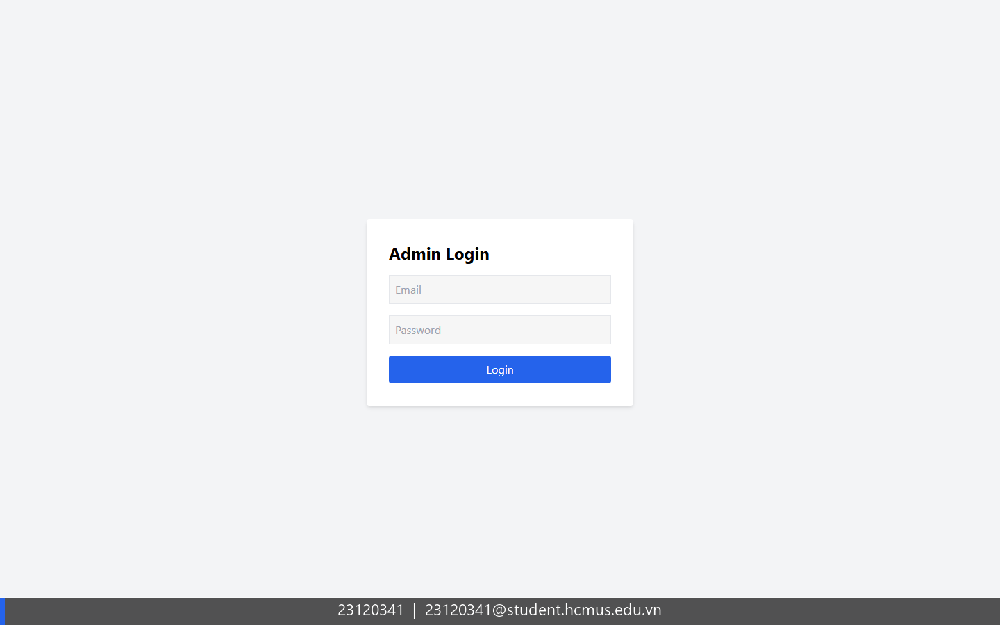

> **GUI-IA01-001** — Admin Login: Tương phản giữa màu chữ placeholder và nền ô nhập ≥ 4.5:1

> **GUI-IA01-001** · Mức độ: **Major** · Ghi chú: Màu placeholder rgb(156,163,175) trên nền ô nhập rgb(246,246,246) → tương phản đo được 2.35:1, thấp hơn ngưỡng 4.5:1. Chữ placeholder gần như chìm vào nền ô nhập.

**Hình 2** — `GUI-IA01-002.png`


> **GUI-IA01-002** — Admin Login: Cả ô Email, ô Password và nút Login đều hiện viền focus rõ ràng khi nhấn `Tab`

> **GUI-IA01-002** · Mức độ: **Major** · Ghi chú: Cả 3 phần tử đều nhận focus khi Tab, nhưng tín hiệu focus chỉ là outline mặc định của trình duyệt (outline 1px auto, box-shadow: none), không có viền ≥ 2px hay đổi màu nền rõ ràng.

**Hình 3** — `GUI-IA01-003.png`


> **GUI-IA01-003** — Admin Login: Cấu trúc tài liệu của trang đúng chuẩn: đúng **một** thẻ `<h1>` mô tả trang, `<html lang="vi">`, và `<title>` phản ánh tên sản phẩm (không phải `frontend-admin`)

> **GUI-IA01-003** · Mức độ: **Major** · Ghi chú: Trang Login không có thẻ &lt;h1> nào (đo được 0, tiêu đề dùng &lt;h2>); html lang="en" thay vì "vi"; &lt;title> là "frontend-admin" thay vì tên sản phẩm.

**Hình 4** — `GUI-IA01-004.png`

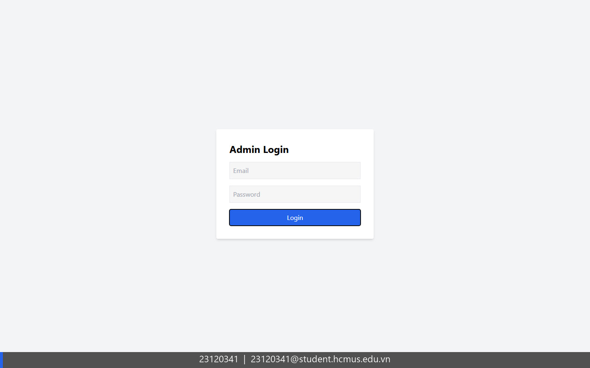

> **GUI-IA01-004** — Admin Login: 100% chuỗi hiển thị trên trang bằng tiếng Việt

> **GUI-IA01-004** · Mức độ: **Major** · Ghi chú: Còn nhiều chuỗi tiếng Anh trên form Login: tiêu đề "Admin Login", placeholder "Email" và "Password", nút "Login". 100% chuỗi hiển thị bằng tiếng Việt không đạt.

**Hình 5** — `GUI-IA01-005.png`


> **GUI-IA01-005** — Khung chung – Sidebar: Sidebar là một landmark điều hướng (`nav`), và cả 7 mục menu (Dashboard, Danh mục, Sản phẩm, Mã Giảm Giá, Đơn hàng, Người dùng, Đăng xuất) đều nhận focus bằng `Tab` và kích hoạt được bằng `Enter`

> **GUI-IA01-005** · Mức độ: **Blocker** · Ghi chú: Không có landmark điều hướng: document.querySelectorAll('nav').length = 0. 7 mục menu là thẻ &lt;li> không có tabindex (tabIndex = -1) nên không dừng focus khi Tab (0/7 mục) và không kích hoạt được bằng Enter. Chuỗi điểm dừng thực tế: INPUT(Tên danh mục mới) → BUTTON → BUTTON → BUTTON → BUTTON → BODY.

**Hình 6** — `GUI-IA01-006.png`


> **GUI-IA01-006** — Khung chung – Sidebar: Mục menu đang active được phân biệt bằng **ít nhất 2 tín hiệu khác màu chữ** (ví dụ đậm, gạch chân, hoặc thuộc tính `aria-current`)

> **GUI-IA01-006** · Mức độ: **Major** · Ghi chú: Mục active chỉ khác mục thường bằng 1 tín hiệu màu chữ (rgb(147,197,253) so với rgb(255,255,255)); font-weight giống nhau (400), không gạch chân, không nền khác, không có thuộc tính aria-current (số phần tử = 0).

**Hình 7** — `GUI-IA01-008.png`


> **GUI-IA01-008** — Khung chung – Sidebar: Khi trình duyệt ở chế độ tối (`prefers-color-scheme: dark`), mọi chữ trên sidebar và vùng nội dung vẫn đạt tương phản ≥ 4.5:1 (không có chữ đen trên nền tối)

> **GUI-IA01-008** · Mức độ: **Minor** · Ghi chú: Ứng dụng không hỗ trợ giao diện tối: khi emulate prefers-color-scheme: dark, mọi màu giữ nguyên như chế độ sáng (nền sidebar rgb(31,41,55), chữ trắng). Tương phản đo được ở chế độ tối vẫn có nhiều mục dưới 4.5:1 (nút Sửa 1.92:1, nút Xóa 3.76:1, nút Lưu sản phẩm 3.30:1, giá trị KPI 3.30:1).

**Hình 8** — `GUI-IA01-009-375.png`

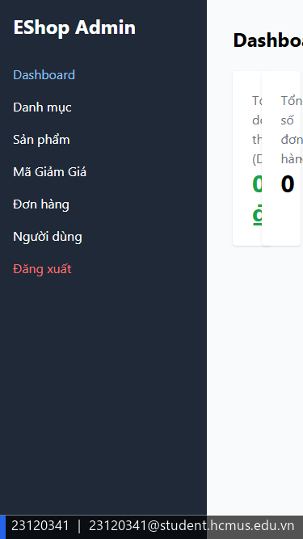

> **GUI-IA01-009** — Dashboard Admin: Lưới 2 cột KPI giữ được chiều rộng đọc được ở viewport 375px và 768px (mỗi cột ≥ 150px)

> **GUI-IA01-009** · Mức độ: **Major** · Ghi chú: Ở 375px: gridTemplateColumns = "19.5px 19.5px" → mỗi cột KPI chỉ 19.5px (yêu cầu ≥ 150px), nội dung bị bóp méo. Ở 768px: "216px 216px" (đạt), nhưng lưới cố định 2 cột không có breakpoint responsive nào.

**Hình 9** — `GUI-IA01-009-768.png`

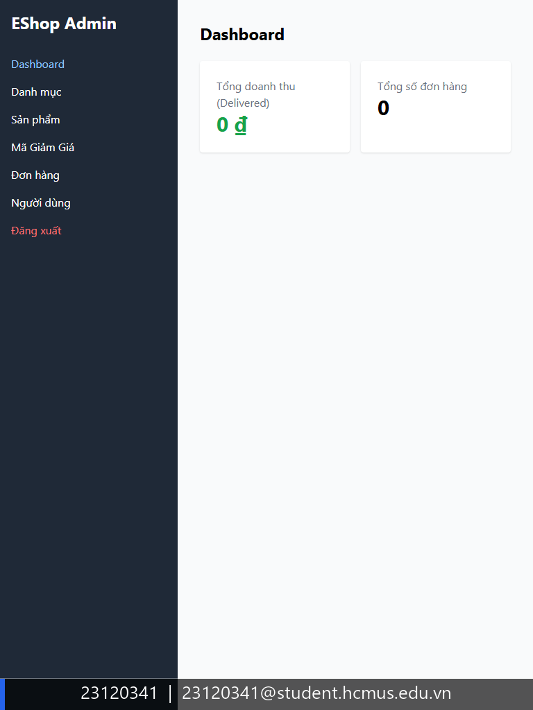

> **GUI-IA01-009** — Dashboard Admin: Lưới 2 cột KPI giữ được chiều rộng đọc được ở viewport 375px và 768px (mỗi cột ≥ 150px)

> **GUI-IA01-009** · Mức độ: **Major** · Ghi chú: Ở 375px: gridTemplateColumns = "19.5px 19.5px" → mỗi cột KPI chỉ 19.5px (yêu cầu ≥ 150px), nội dung bị bóp méo. Ở 768px: "216px 216px" (đạt), nhưng lưới cố định 2 cột không có breakpoint responsive nào.

**Hình 10** — `GUI-IA01-010.png`


> **GUI-IA01-010** — Quản lý Sản phẩm: Ô "Giá" trong bảng hiển thị giá có dấu phân cách hàng nghìn và ký hiệu `₫` (ví dụ `30,000,000 ₫`)

> **GUI-IA01-010** · Mức độ: **Major** · Ghi chú: Cột "Giá" hiển thị "30000000 ₫", "28000000 ₫", "45000000 ₫", "6000000 ₫", "4000000 ₫" — không có dấu phân cách hàng nghìn (đáng lẽ phải là "30,000,000 ₫").

**Hình 11** — `GUI-IA01-011.png`


> **GUI-IA01-011** — Quản lý Sản phẩm: Tương phản chữ trên nền của **tất cả** nút hành động trong màn hình này ("Sửa", "Xóa", "Lưu sản phẩm") ≥ 4.5:1

> **GUI-IA01-011** · Mức độ: **Major** · Ghi chú: Tương phản chữ trên nền nút đo được: Sửa 1.92:1 (trắng trên rgb(234,179,8)), Xóa 3.76:1 (trắng trên rgb(239,68,68)), Lưu sản phẩm 3.30:1 (trắng trên rgb(22,163,74)) — cả ba đều dưới 4.5:1.

**Hình 12** — `GUI-IA01-012.png`

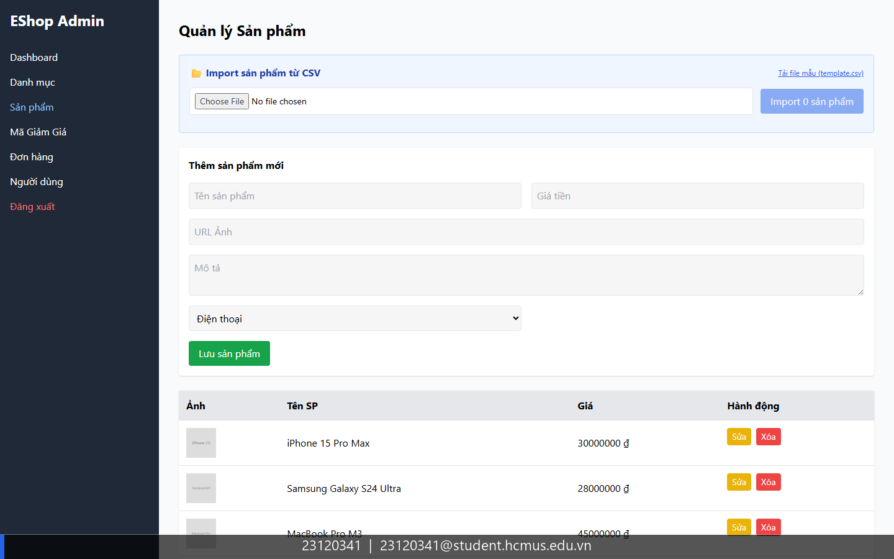

> **GUI-IA01-012** — Quản lý Sản phẩm: Vùng bấm của các nút "Sửa" và "Xóa" trong bảng ≥ 44×44 px

> **GUI-IA01-012** · Mức độ: **Minor** · Ghi chú: Vùng bấm đo được: nút "Sửa" 39×28px, nút "Xóa" 40×28px — nhỏ hơn 44×44px (do padding px-2 py-1, text-sm).

#### IA-02

**Hình 13** — `GUI-IA02-001.png`


> **GUI-IA02-001** — Khung chung – Các form: Mọi ô nhập ở cả 4 form (Login: 2 ô; Danh mục: 1 ô; Sản phẩm: 4 ô + 1 select; Import CSV: 1 file input) đều có thẻ `<label>` gắn đúng qua `for`/`id`; placeholder KHÔNG được dùng làm nhãn duy nhất

> **GUI-IA02-001** · Mức độ: **Blocker** · Ghi chú: Đếm thẻ &lt;label> trên màn "Quản lý Sản phẩm" (gồm cả khối Import CSV): 0 thẻ cho 6 ô input/select/textarea + 1 ô chọn file — placeholder là nhãn duy nhất. Màn Login: 0 thẻ cho 2 ô. Màn Danh mục: 0 thẻ cho 1 ô. Không có cặp for/id nào.

**Hình 14** — `GUI-IA02-002.png`


> **GUI-IA02-002** — Khung chung – Các form: Trường bắt buộc được đánh dấu bằng ký hiệu `*` kèm quy tắc cụ thể

> **GUI-IA02-002** · Mức độ: **Major** · Ghi chú: Không có ký hiệu "*" nào trên trang (đếm được 0 ký hiệu) ở cả 4 form. Chỉ ô "Tên sản phẩm" có thuộc tính HTML required, không có thông báo kèm điều kiện/giới hạn; ô "Giá tiền" không được đánh dấu bắt buộc.

**Hình 15** — `GUI-IA02-003.png`


> **GUI-IA02-003** — Admin Login: Ô email dùng `type="email"` và trình duyệt chặn được email sai định dạng ngay, không gửi request

> **GUI-IA02-003** · Mức độ: **Major** · Ghi chú: Ô email không có type="email" mà là type="text" (đo được), nên trình duyệt không chặn: nhập "abc" rồi bấm Login vẫn gửi 1 request POST http://localhost:3000/api/login.

**Hình 16** — `GUI-IA02-004.png`


> **GUI-IA02-004** — Admin Login: Submit form rỗng bị chặn ở client: không gửi request lên server và không hiện thông báo lỗi

> **GUI-IA02-004** · Mức độ: **Major** · Ghi chú: Submit form rỗng KHÔNG bị chặn ở client: vẫn gửi 1 request POST /api/login và hiện hộp thoại "Đăng nhập thất bại" thay vì thông báo lỗi cạnh form.

**Hình 17** — `GUI-IA02-005.png`


> **GUI-IA02-005** — Admin Login: Ô email có `autocomplete="username"`, ô mật khẩu có `autocomplete="current-password"`

> **GUI-IA02-005** · Mức độ: **Minor** · Ghi chú: Cả 2 ô đều không có thuộc tính autocomplete (getAttribute('autocomplete') = null cho ô Email và ô Password), nên trình duyệt không tự động điền.

**Hình 18** — `GUI-IA02-006.png`


> **GUI-IA02-006** — Quản lý Sản phẩm: Tên sản phẩm bắt buộc và bị giới hạn ≤ 255 ký tự, kèm thông báo khi vượt quá

> **GUI-IA02-006** · Mức độ: **Major** · Ghi chú: Dán 256 ký tự vào ô "Tên sản phẩm": không có thuộc tính maxlength (maxLength = -1), không có thông báo nào về giới hạn 255 ký tự, form vẫn gửi 1 request POST /api/products với toàn bộ 256 ký tự.

**Hình 19** — `GUI-IA02-007.png`


> **GUI-IA02-007** — Quản lý Sản phẩm: Ô "Giá tiền" bắt buộc và phải > 0; giá rỗng, giá `0` hoặc giá `-100` đều bị chặn ở client kèm thông báo

> **GUI-IA02-007** · Mức độ: **Blocker** · Ghi chú: Không có validate ở client: giá để trống, giá 0 và giá -100 đều gửi 1 request POST /api/products (price lần lượt là "", "0", "-100") và không hiện thông báo lỗi nào.

**Hình 20** — `GUI-IA02-008.png`

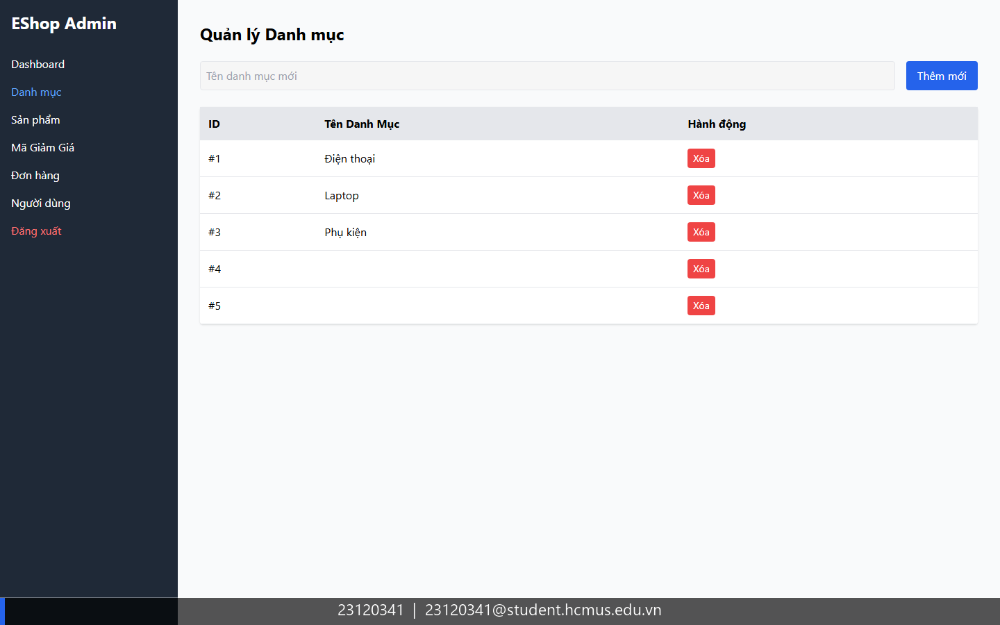

> **GUI-IA02-008** — Quản lý Danh mục: Tên danh mục rỗng hoặc chỉ gồm khoảng trắng bị chặn trước khi gửi lên server

> **GUI-IA02-008** · Mức độ: **Blocker** · Ghi chú: Tên danh mục để trống và tên chỉ gồm khoảng trắng đều không bị chặn: mỗi lần đều gửi 1 request POST /api/categories (body {"name":""} và {"name":"   "}), không có thông báo lỗi cạnh ô nhập.

**Hình 21** — `GUI-IA02-010-txt.png`


> **GUI-IA02-010** — Import CSV: Chỉ file có đuôi `.csv` được chấp nhận; file đuôi khác, file rỗng, hoặc file thiếu cột bắt buộc đều bị từ chối kèm thông báo nêu rõ lỗi ở đâu

> **GUI-IA02-010** · Mức độ: **Major** · Ghi chú: File đuôi .txt vẫn được chấp nhận: sau khi chọn sanpham.txt, nút hiện "Import 1 sản phẩm" và KHÔNG bị disable. File rỗng và file chỉ có header đều cho preview 0 dòng, nút bị disable nhưng KHÔNG có thông báo lỗi nào nêu rõ thiếu gì.

**Hình 22** — `GUI-IA02-010-empty.png`


> **GUI-IA02-010** — Import CSV: Chỉ file có đuôi `.csv` được chấp nhận; file đuôi khác, file rỗng, hoặc file thiếu cột bắt buộc đều bị từ chối kèm thông báo nêu rõ lỗi ở đâu

> **GUI-IA02-010** · Mức độ: **Major** · Ghi chú: File đuôi .txt vẫn được chấp nhận: sau khi chọn sanpham.txt, nút hiện "Import 1 sản phẩm" và KHÔNG bị disable. File rỗng và file chỉ có header đều cho preview 0 dòng, nút bị disable nhưng KHÔNG có thông báo lỗi nào nêu rõ thiếu gì.

**Hình 23** — `GUI-IA02-010-header.png`


> **GUI-IA02-010** — Import CSV: Chỉ file có đuôi `.csv` được chấp nhận; file đuôi khác, file rỗng, hoặc file thiếu cột bắt buộc đều bị từ chối kèm thông báo nêu rõ lỗi ở đâu

> **GUI-IA02-010** · Mức độ: **Major** · Ghi chú: File đuôi .txt vẫn được chấp nhận: sau khi chọn sanpham.txt, nút hiện "Import 1 sản phẩm" và KHÔNG bị disable. File rỗng và file chỉ có header đều cho preview 0 dòng, nút bị disable nhưng KHÔNG có thông báo lỗi nào nêu rõ thiếu gì.

**Hình 24** — `GUI-IA02-011.png`


> **GUI-IA02-011** — Import CSV: `name` rỗng và `price` không phải số dương bị chặn trước khi import, kèm thông báo chỉ rõ dòng lỗi

> **GUI-IA02-011** · Mức độ: **Blocker** · Ghi chú: Chọn invalid.csv: preview hiển thị 2 dòng bình thường, không cảnh báo dòng nào lỗi (dòng 2 có name rỗng hiện ô trống, dòng 3 có price -500 hiện nguyên); nút "Import 2 sản phẩm" vẫn bật, không có thông báo chỉ rõ dòng lỗi.

**Hình 25** — `GUI-IA02-012.png`

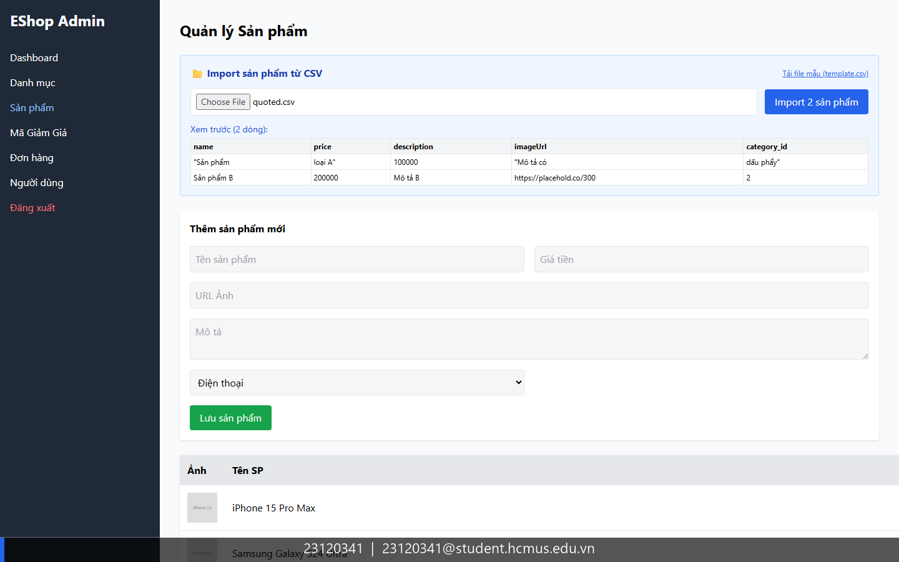

> **GUI-IA02-012** — Import CSV: File CSV có trường chứa dấu phẩy được bọc dấu nháy kép được tách đúng thành 1 cột

> **GUI-IA02-012** · Mức độ: **Blocker** · Ghi chú: CSV có trường bọc nháy kép chứa dấu phẩy bị tách sai: dòng 1 hiển thị 6 cột ["Sản phẩm", "loại A", "100000", "Mô tả có", "dấu phẩy", ...] thay vì 5 cột; giá trị "Sản phẩm, loại A" bị cắt thành 2 trường.

#### IA-03

**Hình 26** — `GUI-IA03-001-deeplink.png`


> **GUI-IA03-001** — Khung chung – Sidebar: URL thay đổi theo tab đang xem (deep-link): mỗi tab có 1 URL riêng và mở trực tiếp URL đó được vào đúng tab

> **GUI-IA03-001** · Mức độ: **Blocker** · Ghi chú: URL không đổi khi chuyển tab: Dashboard, Danh mục, Sản phẩm, Mã Giảm Giá, Đơn hàng, Người dùng đều giữ http://localhost:5174/. Mở trực tiếp URL sâu http://localhost:5174/san-pham (đang đã đăng nhập) → ứng dụng vẫn hiện màn "Dashboard", mục active là Dashboard, không có form Quản lý Sản phẩm.

**Hình 27** — `GUI-IA03-001.png`

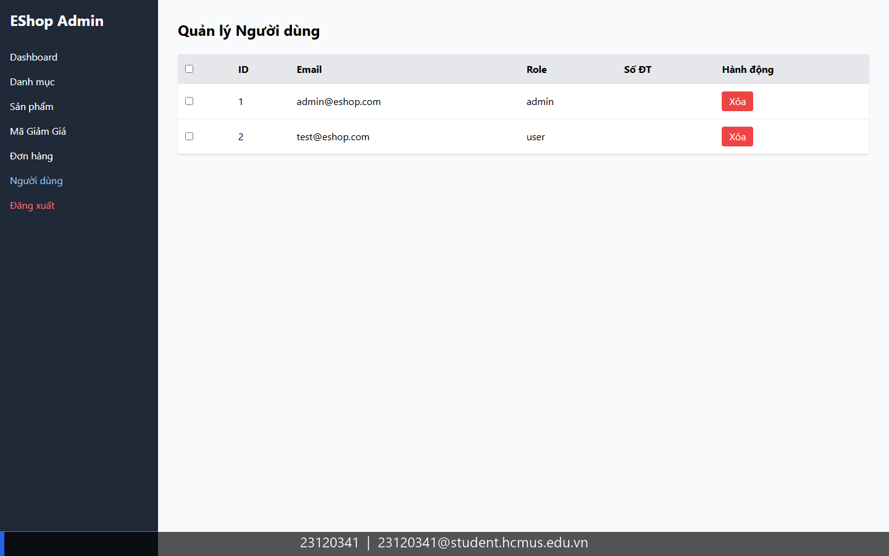

> **GUI-IA03-001** — Khung chung – Sidebar: URL thay đổi theo tab đang xem (deep-link): mỗi tab có 1 URL riêng và mở trực tiếp URL đó được vào đúng tab

> **GUI-IA03-001** · Mức độ: **Blocker** · Ghi chú: URL không đổi khi chuyển tab: Dashboard, Danh mục, Sản phẩm, Mã Giảm Giá, Đơn hàng, Người dùng đều giữ http://localhost:5174/. Mở trực tiếp URL sâu http://localhost:5174/san-pham (đang đã đăng nhập) → ứng dụng vẫn hiện màn "Dashboard", mục active là Dashboard, không có form Quản lý Sản phẩm.

**Hình 28** — `GUI-IA03-002.png`

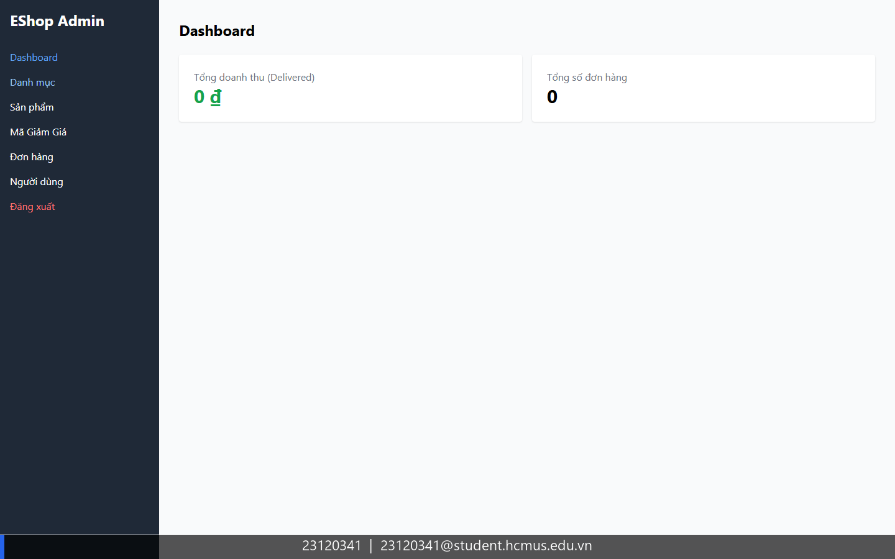

> **GUI-IA03-002** — Khung chung – Sidebar: Tải lại trang (F5) giữ nguyên tab đang xem

> **GUI-IA03-002** · Mức độ: **Major** · Ghi chú: Đang ở tab "Danh mục" thì nhấn F5 → sau khi tải lại màn hiện là "Dashboard" (mục active = Dashboard, tiêu đề "Dashboard"); vì URL không đổi nên không khôi phục được tab đang xem.

**Hình 29** — `GUI-IA03-004.png`


> **GUI-IA03-004** — Khung chung – Sidebar: Mỗi màn hình con hiển thị đường dẫn điều hướng (breadcrumb) hoặc tiêu đề cấp 1 cho biết đang ở đâu

> **GUI-IA03-004** · Mức độ: **Minor** · Ghi chú: Không có breadcrumb ở bất kỳ màn nào (số phần tử breadcrumb = 0). Mỗi màn chỉ có &lt;h2> mô tả đúng màn hình ("Quản lý Danh mục", "Quản lý Sản phẩm", "Dashboard") nhưng &lt;h1> duy nhất là "EShop Admin" — tên sản phẩm, không mô tả màn hình đang xem.

**Hình 30** — `GUI-IA03-005.png`


> **GUI-IA03-005** — Khung chung – Sidebar: Mở một URL không tồn tại (ví dụ `http://localhost:5174/khong-ton-tai`) sẽ hiện trang lỗi 404 hữu ích có nút quay về màn hình chính, không phải màn trắng hoặc màn trống

> **GUI-IA03-005** · Mức độ: **Minor** · Ghi chú: Mở http://localhost:5174/khong-ton-tai trả HTTP 200 vì Vite SPA fallback trả index.html → ứng dụng hiện màn Login bình thường, không có thông báo lỗi 404 (không khớp mẫu 404 / không tìm thấy) và không có nút quay về màn hình chính.

**Hình 31** — `GUI-IA03-007.png`


> **GUI-IA03-007** — Quản lý Sản phẩm: Danh sách sản phẩm có ô tìm kiếm hoặc bộ lọc (theo danh mục) hoặc phân trang

> **GUI-IA03-007** · Mức độ: **Major** · Ghi chú: Bảng sản phẩm (5 dòng seed) không có ô tìm kiếm, không có bộ lọc theo danh mục (chỉ 1 select dùng để chọn danh mục khi thêm mới) và không có phân trang — danh sách là bảng dài không có công cụ quản lý.

#### IA-04

**Hình 32** — `GUI-IA04-001-network.png`

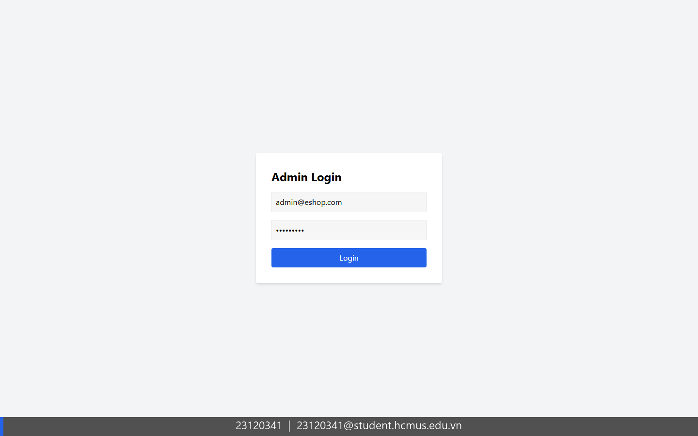

> **GUI-IA04-001** — Admin Login: Thông báo lỗi phân biệt được 4 tình huống: sai mật khẩu / tài khoản bị khoá / tài khoản không phải admin / lỗi mạng

> **GUI-IA04-001** · Mức độ: **Blocker** · Ghi chú: 4 tình huống chỉ cho 2 thông báo khác nhau: sai mật khẩu → "Đăng nhập thất bại"; bị khoá (sai lần 2) → "Đăng nhập thất bại"; không phải admin → "Bạn không phải là admin!"; lỗi mạng (đã tắt backend) → "Đăng nhập thất bại". Không thông báo nào nêu cách xử lý.

**Hình 33** — `GUI-IA04-001.png`


> **GUI-IA04-001** — Admin Login: Thông báo lỗi phân biệt được 4 tình huống: sai mật khẩu / tài khoản bị khoá / tài khoản không phải admin / lỗi mạng

> **GUI-IA04-001** · Mức độ: **Blocker** · Ghi chú: 4 tình huống chỉ cho 2 thông báo khác nhau: sai mật khẩu → "Đăng nhập thất bại"; bị khoá (sai lần 2) → "Đăng nhập thất bại"; không phải admin → "Bạn không phải là admin!"; lỗi mạng (đã tắt backend) → "Đăng nhập thất bại". Không thông báo nào nêu cách xử lý.

**Hình 34** — `GUI-IA04-002.png`


> **GUI-IA04-002** — Admin Login: Thông báo lỗi hiển thị **trên nút submit** (không phải dưới) và không chặn toàn bộ giao diện bằng hộp thoại hệ thống

> **GUI-IA04-002** · Mức độ: **Blocker** · Ghi chú: Sai mật khẩu → hộp thoại hệ thống native (type=alert, message="Đăng nhập thất bại") hiện lên và chặn toàn bộ giao diện; trong DOM không có phần tử lỗi nào được render cạnh nút Login, lỗi không nằm trên nút submit.

**Hình 35** — `GUI-IA04-003.png`


> **GUI-IA04-003** — Admin Login: Trong lúc gửi request, nút Login bị disable và có chỉ báo đang xử lý (spinner hoặc chữ "Đang đăng nhập…")

> **GUI-IA04-003** · Mức độ: **Major** · Ghi chú: Trong lúc gửi request (mô phỏng độ trễ 2s cho /api/login): nút Login vẫn disabled=false và nhãn giữ nguyên "Login" — không bị disable, không có spinner, không có chữ "Đang đăng nhập…".

**Hình 36** — `GUI-IA04-004.png`

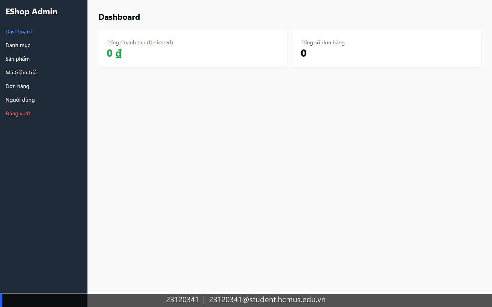

> **GUI-IA04-004** — Dashboard Admin: Trong lúc tải dữ liệu có skeleton/spinner thay vì để trang trắng rỗng

> **GUI-IA04-004** · Mức độ: **Major** · Ghi chú: Trong lúc tải (mô phỏng độ trễ 2.5s cho /api/admin/orders): vùng nội dung chỉ có 1 phần tử và hiển thị luôn khung Dashboard với giá trị 0 — không có skeleton/spinner nào, trang nháy trắng rồi hiện số 0.

**Hình 37** — `GUI-IA04-005.png`


> **GUI-IA04-005** — Dashboard Admin: Khi chưa có đơn hàng nào, hiện empty state có thông điệp thân thiện thay vì con số "0" trần trụi

> **GUI-IA04-005** · Mức độ: **Major** · Ghi chú: Khi chưa có đơn hàng nào, 2 thẻ KPI chỉ hiện "Tổng doanh thu (Delivered)  /  0 ₫" và "Tổng số đơn hàng  /  0" — không có thông điệp thân thiện kiểu "Chưa có đơn hàng nào".

**Hình 38** — `GUI-IA04-006-products.png`


> **GUI-IA04-006** — Khung chung – Các màn hình: Sau mỗi thao tác ghi thành công (thêm / sửa / xoá danh mục, sản phẩm, import) có thông báo xác nhận nêu rõ **đã làm gì**

> **GUI-IA04-006** · Mức độ: **Major** · Ghi chú: Thêm danh mục "QA Thông Báo Test": bảng cập nhật thành công nhưng không có bất kỳ thông báo nào (0 vùng thông báo trong DOM, chỉ có ô nhập được xoá trong im lặng). Thêm sản phẩm cũng không có thông báo. Khi sửa có hộp thoại "Cập nhật thành công!" — chung chung, không nêu đã làm gì với đối tượng nào.

**Hình 39** — `GUI-IA04-006.png`

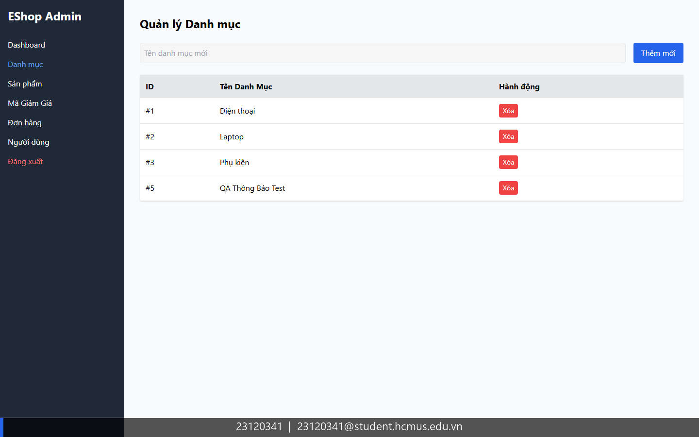

> **GUI-IA04-006** — Khung chung – Các màn hình: Sau mỗi thao tác ghi thành công (thêm / sửa / xoá danh mục, sản phẩm, import) có thông báo xác nhận nêu rõ **đã làm gì**

> **GUI-IA04-006** · Mức độ: **Major** · Ghi chú: Thêm danh mục "QA Thông Báo Test": bảng cập nhật thành công nhưng không có bất kỳ thông báo nào (0 vùng thông báo trong DOM, chỉ có ô nhập được xoá trong im lặng). Thêm sản phẩm cũng không có thông báo. Khi sửa có hộp thoại "Cập nhật thành công!" — chung chung, không nêu đã làm gì với đối tượng nào.

**Hình 40** — `GUI-IA04-007.png`

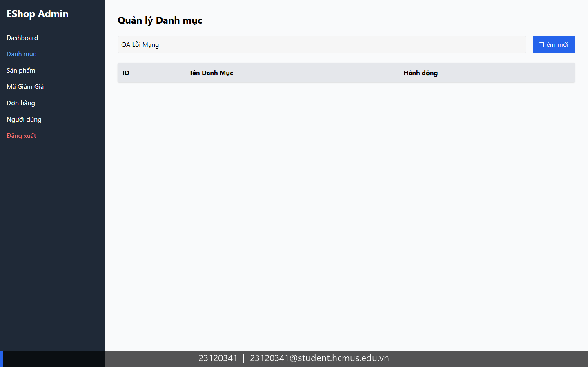

> **GUI-IA04-007** — Khung chung – Các màn hình: Lỗi từ server hoặc lỗi mạng hiển thị thân thiện, nêu nguyên nhân và có cách khắc phục; không lộ stack trace hay câu SQL; dữ liệu đã nhập không bị mất

> **GUI-IA04-007** · Mức độ: **Major** · Ghi chú: Tắt backend: lúc tải trang, lỗi mạng bị nuốt hoàn toàn (0 thông báo, không có vùng lỗi nào trong DOM). Khi thao tác, hộp thoại native hiện thông báo kỹ thuật "Lỗi lưu sản phẩm: Network Error" / "Lỗi thêm DM: Network Error" — không phải tiếng Việt thân thiện, không có nút thử lại, không có thông báo cạnh ô nhập.

**Hình 41** — `GUI-IA04-007-load.png`


> **GUI-IA04-007** — Khung chung – Các màn hình: Lỗi từ server hoặc lỗi mạng hiển thị thân thiện, nêu nguyên nhân và có cách khắc phục; không lộ stack trace hay câu SQL; dữ liệu đã nhập không bị mất

> **GUI-IA04-007** · Mức độ: **Major** · Ghi chú: Tắt backend: lúc tải trang, lỗi mạng bị nuốt hoàn toàn (0 thông báo, không có vùng lỗi nào trong DOM). Khi thao tác, hộp thoại native hiện thông báo kỹ thuật "Lỗi lưu sản phẩm: Network Error" / "Lỗi thêm DM: Network Error" — không phải tiếng Việt thân thiện, không có nút thử lại, không có thông báo cạnh ô nhập.

**Hình 42** — `GUI-IA04-008.png`

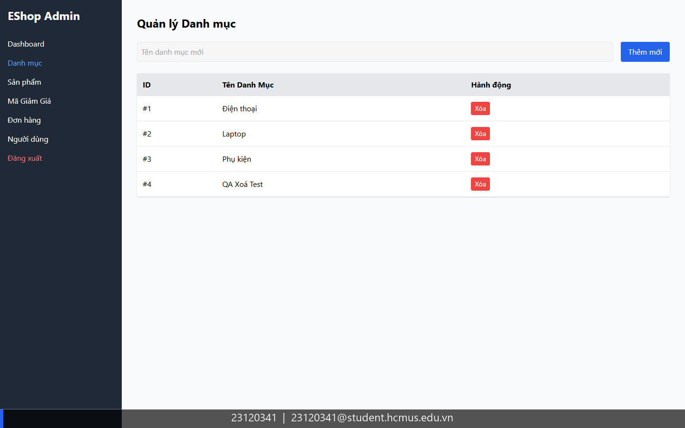

> **GUI-IA04-008** — Khung chung – Các màn hình: Mọi hành động xoá (danh mục, sản phẩm) phải hiện hộp thoại xác nhận nêu rõ **tên** đối tượng sẽ bị xoá; bấm "Huỷ" thì dữ liệu vẫn còn

> **GUI-IA04-008** · Mức độ: **Blocker** · Ghi chú: Bấm "Xóa" ở dòng "QA Xoá Test": không có hộp thoại xác nhận nào (số dialog = 0), dòng bị xoá thẳng khỏi bảng (còn lại Điện thoại, Laptop, Phụ kiện) — không hỏi lại và không nêu tên đối tượng sẽ bị xoá.

**Hình 43** — `GUI-IA04-009.png`


> **GUI-IA04-009** — Dashboard Admin: Tổng doanh thu và tổng số đơn hàng khớp đúng dữ liệu thật: doanh thu = **tổng** `total_amount` của các đơn `delivered` (không nhân hệ số), tổng đơn = số dòng bảng Đơn hàng

> **GUI-IA04-009** · Mức độ: **Blocker** · Ghi chú: Dữ liệu thật: 4 đơn hàng, trong đó 1 đơn delivered 150.000 ₫ → tổng tiền delivered = 150.000 ₫. Dashboard hiển thị "Tổng doanh thu (Delivered)  /  300,000 ₫" (gấp đôi). Tổng số đơn hiện 4 và bảng Đơn hàng có 4 dòng nên phần này khớp.

**Hình 44** — `GUI-IA04-010.png`

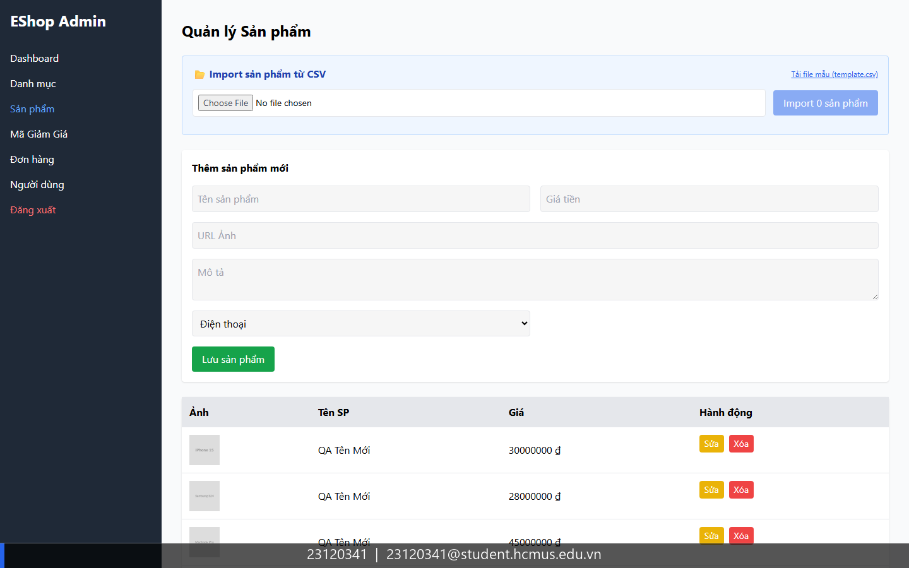

> **GUI-IA04-010** — Quản lý Sản phẩm: Sửa 1 sản phẩm chỉ thay đổi sản phẩm đó; tên của các sản phẩm khác giữ nguyên

> **GUI-IA04-010** · Mức độ: **Blocker** · Ghi chú: Trước khi sửa: iPhone 15 Pro Max, Samsung Galaxy S24 Ultra, MacBook Pro M3, Tai nghe AirPods Pro 2, Bàn phím cơ Keychron Q1. Sửa dòng 2 thành "QA Tên Mới" và lưu → bảng hiển thị "QA Tên Mới" cho CẢ 5 dòng, không chỉ dòng được sửa. Đã khôi phục lại tên sản phẩm id=2 trong DB sau khi kiểm thử.

**Hình 45** — `GUI-IA04-011.png`

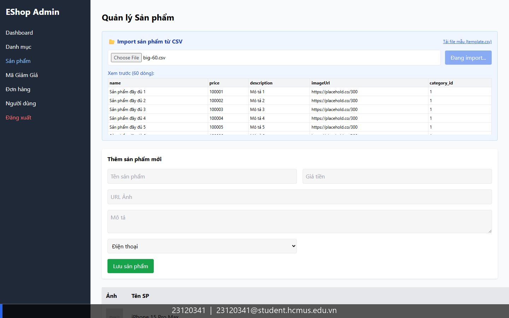

> **GUI-IA04-011** — Import CSV: Trong lúc import có chỉ báo tiến trình (phần trăm hoặc số dòng đã xử lý), không chỉ có chữ "Đang import..."

> **GUI-IA04-011** · Mức độ: **Major** · Ghi chú: Import file 60 dòng (mô phỏng độ trễ 2.5s): nút chỉ đổi chữ thành "Đang import..." và bị disable — không có thanh phần trăm, không có bộ đếm số dòng đã xử lý.

**Hình 46** — `GUI-IA04-012.png`

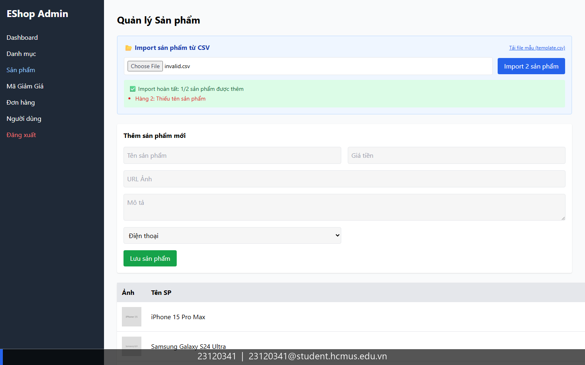

> **GUI-IA04-012** — Import CSV: Khi có dòng lỗi, toàn bộ import được rollback: **không** sản phẩm nào trong file bị ghi vào DB

> **GUI-IA04-012** · Mức độ: **Blocker** · Ghi chú: Import invalid.csv: bảng sản phẩm tăng từ 69 lên 70 dòng và dòng mới ghi vào DB là "Tên OK" (giá -500) — dòng lỗi vẫn được insert, không rollback toàn bộ giao dịch.

**Hình 47** — `GUI-IA04-013.png`

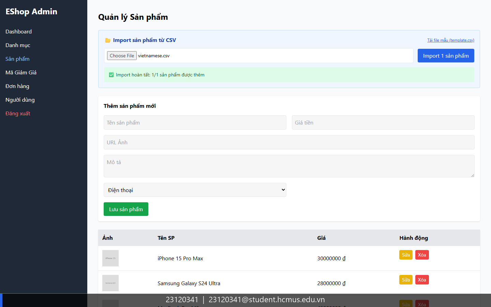

> **GUI-IA04-013** — Import CSV: Báo cáo kết quả import nêu rõ: số dòng thành công, số dòng lỗi, và lý do lỗi của từng dòng

> **GUI-IA04-013** · Mức độ: **Major** · Ghi chú: Ô kết quả hiện "Import hoàn tất: 1/2 sản phẩm được thêm" kèm lý do lỗi "Hàng 2: Thiếu tên sản phẩm" — nhưng KHÔNG nêu số dòng lỗi và dòng 3 (giá -500) không bị đánh dấu là lỗi nào, nên báo cáo không đủ 3 thông tin.

#### Ảnh xác nhận các mục Passed (7 mục)

Để minh bạch, 7 mục **Passed** cũng được giữ ảnh chụp tương ứng. Lưu ý: mục `GUI-IA03-003` **pass “nhờ bug”** — ứng dụng pass vì **không có router** nên không tạo lịch sử trình duyệt; khi BUG-008 được sửa, mục này **phải kiểm thử lại**.

**Hình 48** — `GUI-IA01-007.png`


> **GUI-IA01-007** — Khung chung – Sidebar: Khi đặt `dir="rtl"` lên `<html>`, không có phần tử nào chồng lấn, tràn ngang khung hoặc bị cắt chữ trong sidebar và bảng

> **GUI-IA01-007** · Mức độ: **Minor** · Kết quả: **Passed** · Ghi chú: Đặt dir="rtl": sidebar chuyển sang mép phải (left 1184, right 1440), vùng nội dung ở left 0 nên không chồng lấn; không phần tử nào bị cắt chữ (kiểm tra cả 7 mục sidebar, các thẻ bảng); tài liệu scrollWidth 1440 = clientWidth 1440 nên không tràn ngang.

**Hình 49** — `GUI-IA01-013.png`

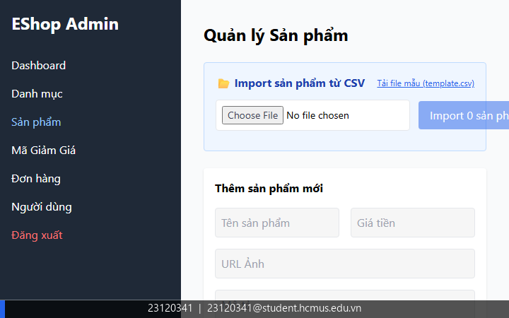

> **GUI-IA01-013** — Quản lý Sản phẩm: Ở mức zoom 200%, bảng và form không vỡ layout và trang không xuất hiện thanh cuộn ngang

> **GUI-IA01-013** · Mức độ: **Minor** · Kết quả: **Passed** · Ghi chú: Mô phỏng zoom 200% (viewport CSS 720×450): trang KHÔNG xuất hiện thanh cuộn ngang (scrollWidth 720 = clientWidth 720), bảng và form không chồng lấn; bảng chỉ cuộn ngang bên trong vùng nội dung (overflow-x auto, 502px > 464px) và lưới form 2 cột bị nén còn 176px mỗi cột.

**Hình 50** — `GUI-IA02-009.png`

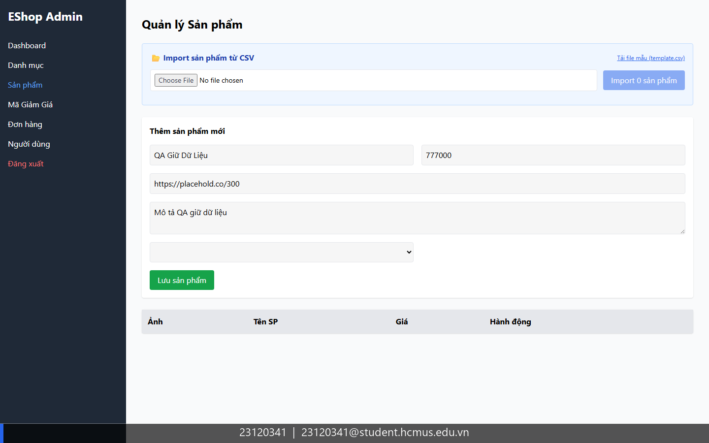

> **GUI-IA02-009** — Quản lý Sản phẩm: Khi server từ chối lưu, toàn bộ dữ liệu đã nhập vẫn còn nguyên trong form

> **GUI-IA02-009** · Mức độ: **Major** · Kết quả: **Passed** · Ghi chú: Tắt backend rồi bấm "Lưu sản phẩm": hộp thoại báo "Lỗi lưu sản phẩm: Network Error" nhưng toàn bộ dữ liệu đã nhập vẫn còn nguyên trong form (tên "QA Giữ Dữ Liệu", giá "777000", ảnh "https://placehold.co/300", mô tả "Mô tả QA giữ dữ liệu").

**Hình 51** — `GUI-IA03-003.png`

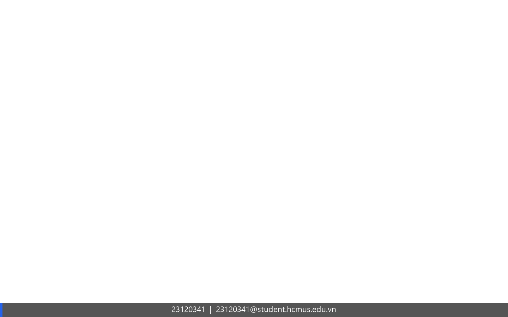

> **GUI-IA03-003** — Khung chung – Sidebar: Sau khi bấm "Đăng xuất", nhấn nút Back của trình duyệt KHÔNG quay lại được phần đã đăng nhập

> **GUI-IA03-003** · Mức độ: **Blocker** · Kết quả: **Passed** · Ghi chú: Bấm "Đăng xuất" → hiện form Login, token bị xoá khỏi localStorage. Nhấn Back không quay lại được vùng đã đăng nhập: ứng dụng không tạo lịch sử riêng (history.length = 2, chỉ có entry gốc), nên Back chỉ ra ngoài ứng dụng (about:blank), không vào lại khu vực đã đăng nhập.

**Hình 52** — `GUI-IA03-006.png`

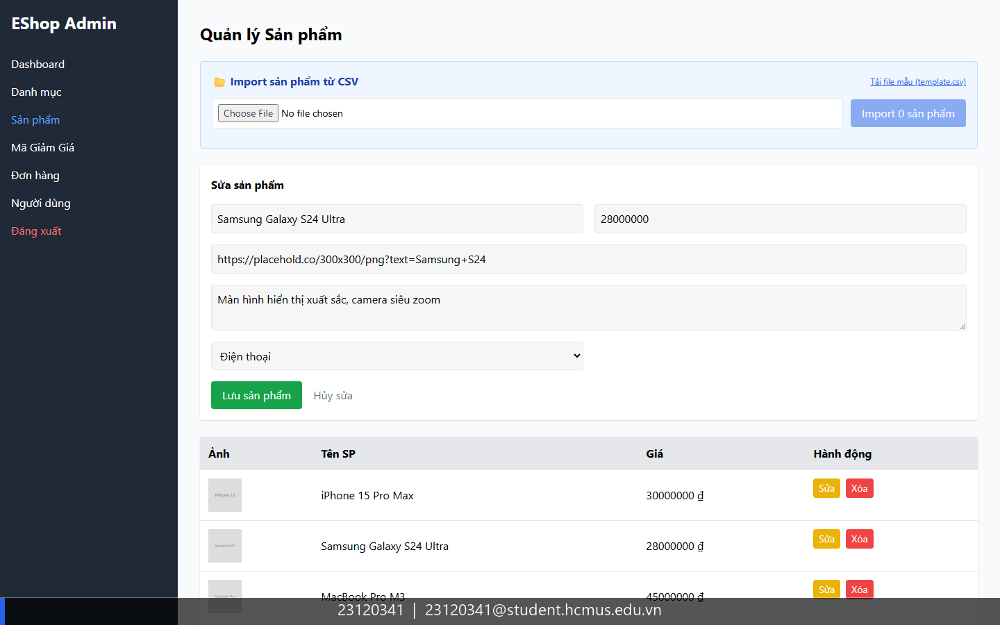

> **GUI-IA03-006** — Quản lý Sản phẩm: Bấm "Sửa" điền đúng giá trị sản phẩm đó vào form; bấm "Hủy sửa" trả form về trạng thái "Thêm sản phẩm mới" và xoá sạch dữ liệu cũ

> **GUI-IA03-006** · Mức độ: **Major** · Kết quả: **Passed** · Ghi chú: Bấm "Sửa" ở dòng 2: tiêu đề form đổi thành "Sửa sản phẩm", các ô nhận đúng dữ liệu (tên "Samsung Galaxy S24 Ultra", giá "28000000", mô tả "Màn hình hiển thị xuất sắc, camera siêu zoom"). Bấm "Hủy sửa": tiêu đề về "Thêm sản phẩm mới" và cả 4 ô đã trống.

**Hình 53** — `GUI-IA03-006-cancel.png`


> **GUI-IA03-006** — Quản lý Sản phẩm: Bấm "Sửa" điền đúng giá trị sản phẩm đó vào form; bấm "Hủy sửa" trả form về trạng thái "Thêm sản phẩm mới" và xoá sạch dữ liệu cũ

> **GUI-IA03-006** · Mức độ: **Major** · Kết quả: **Passed** · Ghi chú: Bấm "Sửa" ở dòng 2: tiêu đề form đổi thành "Sửa sản phẩm", các ô nhận đúng dữ liệu (tên "Samsung Galaxy S24 Ultra", giá "28000000", mô tả "Màn hình hiển thị xuất sắc, camera siêu zoom"). Bấm "Hủy sửa": tiêu đề về "Thêm sản phẩm mới" và cả 4 ô đã trống.

**Hình 54** — `GUI-IA03-008.png`

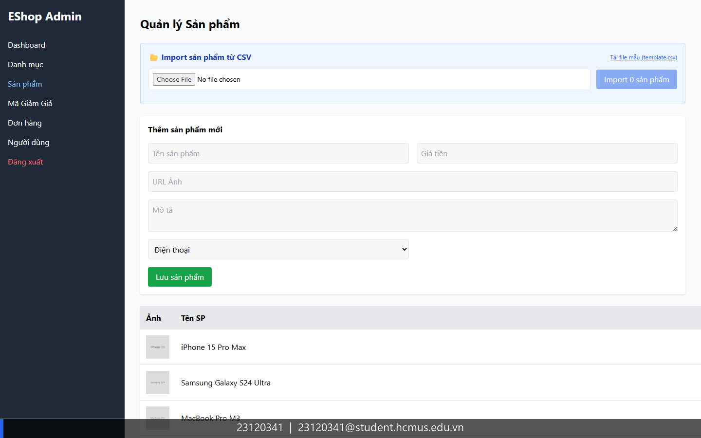

> **GUI-IA03-008** — Import CSV: Link "Tải file mẫu (template.csv)" tải được file mẫu hợp lệ, đúng định dạng và import thử không lỗi

> **GUI-IA03-008** · Mức độ: **Major** · Kết quả: **Passed** · Ghi chú: Link "Tải file mẫu (template.csv)" tải về file tên template_import.csv (đuôi .csv) với header đúng "name,price,description,imageUrl,category_id" và 1 dòng mẫu hợp lệ (Tên sản phẩm mẫu, 100000, ...), định dạng import được.

**Hình 55** — `GUI-IA03-009.png`

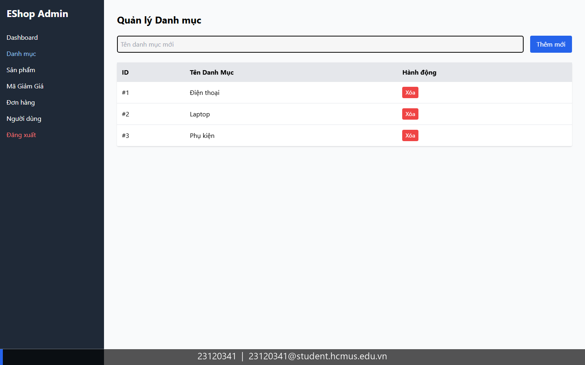

> **GUI-IA03-009** — Khung chung – Sidebar: Sau khi chuyển sang tab khác, focus (điểm nhận bàn phím) được chuyển vào vùng nội dung mới thay vì đứng lại ở mục menu vừa bấm

> **GUI-IA03-009** · Mức độ: **Minor** · Kết quả: **Passed** · Ghi chú: Bấm mục "Danh mục" bằng chuột rồi nhấn Tab: focus dừng ở &lt;INPUT> placeholder="Tên danh mục mới" — nằm trong vùng nội dung mới, không đứng lại ở mục menu vừa bấm (mục &lt;li> không nhận focus).

### 3.7. Phân tích kết quả thực thi

#### 3.7.1. Tổng quan

| Chỉ số | Giá trị |
|---|---|
| Tổng số mục đã thiết kế | 47 |
| Tổng số mục đã thực thi | **47 (100%)** |
| Passed | **7** |
| Failed | **40** |
| **Pass rate** | **14,9%** |
| Mục bị bỏ qua / N/A | 0 |
| Mục Failed thiếu bằng chứng ảnh | **0** — 40/40 mục có ≥ 1 ảnh (55 ảnh) |

#### 3.7.2. Phân bổ theo Interface Aspect

| IA | Số mục | Passed | Failed | Tỷ lệ fail |
|---|---:|---:|---:|---:|
| IA-01 General UI Standards | 13 | 2 | 11 | 84,6% |
| IA-02 Forms | 12 | 1 | 11 | 91,7% |
| IA-03 Navigation | 9 | 4 | 5 | 55,6% |
| IA-04 Feedback / State | 13 | 0 | 13 | **100%** |
| **Tổng** | **47** | **7** | **40** | **85,1%** |

#### 3.7.3. Phân bổ theo màn hình

| Màn hình | Số mục | Passed | Failed | Tỷ lệ fail |
|---|---:|---:|---:|---:|
| Admin Login | 10 | 0 | 10 | **100%** |
| Dashboard Admin | 4 | 0 | 4 | **100%** |
| Khung chung – Các màn hình | 3 | 0 | 3 | **100%** |
| Khung chung – Các form | 2 | 0 | 2 | **100%** |
| Quản lý Danh mục | 1 | 0 | 1 | **100%** |
| Import CSV | 7 | 1 | 6 | 85,7% |
| Khung chung – Sidebar | 10 | 3 | 7 | 70,0% |
| Quản lý Sản phẩm | 10 | 3 | 7 | 70,0% |

#### 3.7.4. Phân bổ theo mức độ

| Mức độ | Số mục Failed | Tỷ lệ trong 40 mục Failed | Tỷ lệ trong 47 mục |
|---|---:|---:|---:|
| Blocker | 13 | 32,5% | 27,7% |
| Major | 22 | 55,0% | 46,8% |
| Minor | 5 | 12,5% | 10,6% |
| Cosmetic | 0 | 0% | 0% |
| **Tổng Failed** | **40** | **100%** | **85,1%** |

> **Không có mục Cosmetic nào** — mọi lỗi tìm được đều ảnh hưởng chức năng, dữ liệu hoặc khả năng sử dụng. Điều này khớp với đặc điểm của SUT: hệ thống “cố ý” chứa lỗi chức năng, không phải lỗi trang trí.

#### 3.7.5. Phân tích nguyên nhân gốc

| Mã | Nhóm nguyên nhân | Số mục | Tỷ lệ | Nhận xét |
|---|---|---:|---:|---|
| `RC-IMP` | Triển khai sai / thiếu triển khai | 24 | 60,0% | **Nguyên nhân gốc chiếm 3/4 số lỗi.** Web Admin viết bằng React thuần + Tailwind, không dùng thư viện UI/validate/CSV nào; mọi thứ “tự viết tay” nên thiếu hàng loạt xử lý chuẩn |
| `RC-FEAT` | Tính năng chưa được xây dựng | 4 | 10,0% | dark mode, breadcrumb, tìm kiếm/phân trang, tiến trình % — đều là **cải tiến**, không phải lỗi |
| `RC-VIS` | Vấn đề thị giác | 3 | 7,5% | Tương phản dưới WCAG AA ở 4 thành phần + vùng bấm nhỏ. Bảng màu Tailwind mặc định dùng chữ trắng trên nền `yellow-500`/`red-500`/`green-600` |
| `RC-A11Y` | Vấn đề accessibility | 3 | 7,5% | Sidebar dùng `<li onClick>` thay vì `<button>`/`<a>`; không landmark; trạng thái active chỉ bằng màu |
| `RC-I18N` | Vấn ngôn ngữ / metadata | 2 | 5,0% | Giao diện còn chuỗi tiếng Anh; `<html lang="en">`; `<title>` scaffold Vite |
| `RC-RESP` | Vấn đề responsive | 1 | 2,5% | Không có breakpoint nào trong toàn bộ app; sidebar `w-64` cứng |
| `RC-PERF` | Hiệu năng cảm nhận | 1 | 2,5% | 5 request nối tiếp không có trạng thái loading |
| `RC-UX` | Vấn đề thiết kế UX | 1 | 2,5% | Hành động phá huỷ (xoá) không có bước xác nhận |
| `RC-DATA` | Dữ liệu / edge case | 1 | 2,5% | CSV parser tự tách bằng `split(",")` không theo RFC 4180 |
| `RC-CONS` | Không nhất quán | 0 | 0% | — |
| `RC-REQ` | Đặc tả chưu rõ | 0 | 0% | — |

#### 3.7.6. Bảy phát hiện đáng chú ý

1. **IA-04 fail 100% (13/13) — điểm yếu kiến trúc rõ ràng nhất.** Ứng dụng **không có hệ thống quản lý trạng thái giao diện**: không loading, không empty state, không success toast, không inline error, không confirm. Mọi phản hồi đi qua `window.alert()` rời rạc tại 5 call-site. Đây **không phải 13 lỗi lẻ** mà là **một thiếu hụt kiến trúc** — sửa bằng cách thêm một lớp quản lý trạng thái + component thông báo, không sửa lẻ từng mục.
2. **Form không validate ở client ở bất kỳ form nào.** 10/11 mục IA-02 fail cùng một nhóm nguyên nhân: không `<label>`, không `*`, không `type="email"`, không `maxlength`, không chặn giá ≤ 0, không chặn tên rỗng, không `autocomplete`. Đề xuất: một lớp validate dùng chung cho cả 4 form.
3. **Hai lỗi logic nghiệp vụ gây sai dữ liệu thật (mức Blocker).** `GUI-IA04-009` (doanh thu ×2) và `GUI-IA04-010` (sửa 1 sản phẩm đổi tên tất cả) đều là lỗi ở tầng JSX, không phải lỗi backend. Chúng **làm sai dữ liệu hiển thị cho người dùng**, không chỉ sai giao diện — 2 lỗi nghiêm trọng nhất trong toàn bộ bộ kết quả.
4. **Import CSV là mảng yếu tập thể.** 6/7 mục fail, gồm 4 lỗi Blocker: parser không theo RFC 4180, không validate, không rollback (ghi cả dòng lỗi vào DB), báo cáo thiếu thông tin. Cả 4 đều bắt nguồn từ một quyết định duy nhất: **tự parse CSV ở frontend rồi gửi JSON sang backend**, thay vì gửi file lên server để xử lý nguyên tử.
5. **Ứng dụng không có routing → 3 lỗi navigation cùng một nguyên nhân.** Không deep-link, refresh mất tab, không có trang 404 — tất cả từ việc ứng dụng là 1 component với state `activeTab`. `package.json` đã cài `react-router-dom@7.15.0` nhưng **không import ở đâu**.
6. **Một “PASS” là PASS nhờ bug.** `GUI-IA03-003` (logout → Back không vào lại được) pass vì ứng dụng không tạo lịch sử trình duyệt — tức là pass nhờ BUG-008. Phải kiểm thử lại sau khi sửa BUG-008.
7. **Không phát hiện lỗi an toàn dữ liệu nào ngoài xoá không xác nhận.** Form sản phẩm giữ nguyên dữ liệu khi server lỗi (GUI-IA02-009 PASS) — điểm tốt, nhưng chỉ vì `alert()` hiển thị lỗi chứ không clear form.

### 3.8. Phân loại: Bug · Vấn đề khả dụng · Đề xuất cải tiến

| Phân loại | Số lượng | Chi tiết |
|---|---|---|
| **Bug** (vi phạm hành vi đúng / gây mất dữ liệu) | **21** | BUG-001 … BUG-021 |
| **Vấn đề khả dụng** (dùng được nhưng gian nan / rủi ro) | 2 | U-01 viền focus 1px mặc định (GUI-IA01-002) · U-02 vùng bấm 39×28px (GUI-IA01-012) |
| **Đề xuất cải tiến** (không sai, nhưng nên tốt hơn) | 5 | E-01 dark mode (GUI-IA01-008) · E-02 breadcrumb (GUI-IA03-004) · E-03 tìm kiếm/lọc/phân trang (GUI-IA03-007) · E-04 tiến trình % khi import (GUI-IA04-011) · E-05 `autocomplete` (GUI-IA02-005) |
| **Vấn đề thẩm mỹ** | 0 | Không có mục nào chỉ “xấu” mà vẫn đúng chức năng |

#### 3.8.1. Quy tắc phân loại đã áp dụng (để không báo nhầm loại)

1. **Có phải hành vi sai không?** Ứng dụng làm khác hành vi kỳ vọng chuẩn (WCAG / hành vi kỳ vọng của ngành) hoặc khác đặc tả SRS → **Bug**. Cột “Kết quả mong đợi” trong checklist đã viết sẵn theo chuẩn, đây là cơ sở khách quan, không phải ý kiến cá nhân.
2. **Lỗi có gây mất / sai dữ liệu hoặc chặn luồng không?** → Blocker/Major theo mức độ ảnh hưởng.
3. **Ứng dụng vẫn dùng được nhưng gian nan?** → **Vấn đề khả dụng**, không mở GitHub Issue. `U-01`: WCAG 2.4.7 Focus Visible vẫn được thỏa bằng outline mặc định của trình duyệt. `U-02`: WCAG 2.2 SC 2.5.8 Target Size (Minimum) chỉ yêu cầu 24×24px → 39×28 **đạt**; ngưỡng 44×44 thuộc WCAG 2.1 AAA và Apple HIG.
4. **Ứng dụng không sai, chỉ là chưa làm?** → **Cải tiến**, không mở Issue.

> **Quy tắc vàng:** 5 mục “Cải tiến” và 2 mục “Usability” **không** được đưa vào GitHub Issues. 21 Issue là 21 lỗi chức năng thật, mỗi lỗi gắn với một nguyên nhân gốc khác nhau.

#### 3.8.2. Danh sách 21 bug Task 1

| # | Mã bug | Tiêu đề | Mức độ | Nguyên nhân gốc | Mục checklist | GitHub Issue |
|---:|---|---|---|---|---|---|
| 1 | **BUG-001** | [Web Admin] Mọi form đều không có thẻ `<label>` — placeholder là nhãn duy nhất và biến mất khi nhập | Blocker | `RC-IMP` | GUI-IA02-001 | [#1](https://github.com/kiterakun/HW03-GUI-Usability-Testing/issues/1) |
| 2 | **BUG-002** | [Quản lý Sản phẩm / Danh mục] Form không chặn giá ≤ 0 và tên danh mục rỗng — ghi dữ liệu rác vào CSDL | Blocker | `RC-IMP` | GUI-IA02-007, GUI-IA02-008 | [#2](https://github.com/kiterakun/HW03-GUI-Usability-Testing/issues/2) |
| 3 | **BUG-003** | [Quản lý Sản phẩm / Danh mục] Xoá không có hộp thoại xác nhận — dữ liệu bị mất ngay | Blocker | `RC-UX` | GUI-IA04-008 | [#3](https://github.com/kiterakun/HW03-GUI-Usability-Testing/issues/3) |
| 4 | **BUG-004** | [Quản lý Sản phẩm] Sửa 1 sản phẩm làm đổi tên của toàn bộ danh sách sản phẩm | Blocker | `RC-IMP` | GUI-IA04-010 | [#4](https://github.com/kiterakun/HW03-GUI-Usability-Testing/issues/4) |
| 5 | **BUG-005** | [Admin Dashboard] Tổng doanh thu nhân đôi so với tổng tiền đơn hàng `delivered` | Blocker | `RC-IMP` | GUI-IA04-009 | [#5](https://github.com/kiterakun/HW03-GUI-Usability-Testing/issues/5) |
| 6 | **BUG-006** | [Import CSV] Import không rollback — dòng lỗi vẫn được ghi vào CSDL | Blocker | `RC-IMP` | GUI-IA04-012 | [#6](https://github.com/kiterakun/HW03-GUI-Usability-Testing/issues/6) |
| 7 | **BUG-007** | [Import CSV] Trường CSV bọc dấu nháy kép bị tách sai thành nhiều cột | Blocker | `RC-DATA` | GUI-IA02-012 | [#7](https://github.com/kiterakun/HW03-GUI-Usability-Testing/issues/7) |
| 8 | **BUG-008** | [Web Admin] Không có routing — mất deep-link, F5 mất tab, không có trang 404 | Blocker | `RC-IMP` | GUI-IA03-001, -002, -005 | [#8](https://github.com/kiterakun/HW03-GUI-Usability-Testing/issues/8) |
| 9 | **BUG-009** | [Web Admin] Lỗi toàn bộ báo bằng `alert()` native — không phân biệt nguyên nhân, lộ “Network Error”, lỗi tải trang bị nuốt | Blocker | `RC-IMP` | GUI-IA04-001, -002, -007 | [#9](https://github.com/kiterakun/HW03-GUI-Usability-Testing/issues/9) |
| 10 | **BUG-010** | [Sidebar] Menu không dùng được bằng bàn phím (0/7 mục focus được), thiếu landmark `nav`, mục active chỉ phân biệt bằng màu | Blocker | `RC-A11Y` | GUI-IA01-005, -006 | [#10](https://github.com/kiterakun/HW03-GUI-Usability-Testing/issues/10) |
| 11 | **BUG-011** | [Admin Login] Form không validate ở client — email sai định dạng và submit rỗng vẫn gửi request | Major | `RC-IMP` | GUI-IA02-003, -004 | [#11](https://github.com/kiterakun/HW03-GUI-Usability-Testing/issues/11) |
| 12 | **BUG-012** | [Web Admin] Trường bắt buộc không có ký hiệu `*` và tên sản phẩm không giới hạn 255 ký tự | Major | `RC-IMP` | GUI-IA02-002, -006 | [#12](https://github.com/kiterakun/HW03-GUI-Usability-Testing/issues/12) |
| 13 | **BUG-013** | [Import CSV] Không kiểm tra đuôi file `.csv` và không cảnh báo dòng lỗi trước khi import | Major | `RC-IMP` | GUI-IA02-010, -011 | [#13](https://github.com/kiterakun/HW03-GUI-Usability-Testing/issues/13) |
| 14 | **BUG-014** | [Import CSV] Báo cáo kết quả import thiếu số dòng lỗi và không đánh dấu lỗi giá âm | Major | `RC-IMP` | GUI-IA04-013 | [#14](https://github.com/kiterakun/HW03-GUI-Usability-Testing/issues/14) |
| 15 | **BUG-015** | [Admin Dashboard] Thiếu trạng thái loading và thiếu empty state | Major | `RC-PERF` | GUI-IA04-004, -005 | [#15](https://github.com/kiterakun/HW03-GUI-Usability-Testing/issues/15) |
| 16 | **BUG-016** | [Web Admin] Thao tác ghi thành công không có bất kỳ thông báo xác nhận nào | Major | `RC-IMP` | GUI-IA04-006 | [#16](https://github.com/kiterakun/HW03-GUI-Usability-Testing/issues/16) |
| 17 | **BUG-017** | [Admin Login] Nút Login không disable và không có chỉ báo đang xử lý — double submit được | Major | `RC-IMP` | GUI-IA04-003 | [#17](https://github.com/kiterakun/HW03-GUI-Usability-Testing/issues/17) |
| 18 | **BUG-018** | [Web Admin] Tương phản chữ dưới WCAG AA ở 4 thành phần (1,92:1 – 3,76:1) | Major | `RC-VIS` | GUI-IA01-001, -011 | [#18](https://github.com/kiterakun/HW03-GUI-Usability-Testing/issues/18) |
| 19 | **BUG-019** | [Web Admin] Giao diện còn chuỗi tiếng Anh, `lang="en"`, `<title>` là tên scaffold | Major | `RC-I18N` | GUI-IA01-003, -004 | [#19](https://github.com/kiterakun/HW03-GUI-Usability-Testing/issues/19) |
| 20 | **BUG-020** | [Quản lý Sản phẩm] Cột “Giá” không có dấu phân cách hàng nghìn | Major | `RC-IMP` | GUI-IA01-010 | [#20](https://github.com/kiterakun/HW03-GUI-Usability-Testing/issues/20) |
| 21 | **BUG-021** | [Admin Dashboard] Lưới 2 cột KPI bị bóp còn 19,5px mỗi cột ở viewport 375px | Major | `RC-RESP` | GUI-IA01-009 | [#21](https://github.com/kiterakun/HW03-GUI-Usability-Testing/issues/21) |

> Chi tiết đầy đủ (mô tả · bước tái hiện · kết quả thực tế · kết quả mong đợi · ảnh · checklist chất lượng issue · khối “Nội dung post GitHub Issues”) nằm trong **`bug_report/HW03_Bug_Report.md`** và **23 ảnh chụp trang GitHub Issues** trong `bug_report/screenshots/`.

### 3.9. Hạn chế của Task 1

- **Chỉ test trên 1 trình duyệt**: Chrome 157. Không test Firefox, Safari, Edge trong phần checklist.
- **Chỉ test 1 nền tảng**: desktop. Viewport 375px chỉ mô phỏng bằng DevTools, **không** test trên thiết bị thật / Expo Go.
- **Chưa test với người khuyết tật thực**: mục accessibility được đánh giá bằng phép đo tự động (DOM, computed style, contrast ratio) và điều hướng bằng `Tab`, **không** dùng NVDA/VoiceOver thật.
- **Chưa test hiệu năng thực**: chỉ mô phỏng độ trễ 2–2,5 s qua DevTools.
- **Chưa test bảo mật**: không thử SQL injection, XSS, vượt phân quyền.
- **Chưa test với dữ liệu lớn**: bảng sản phẩm chỉ có 5 dòng seed (tối đa 70 dòng trong lúc test).
- **Chưa kiểm thử 3 tab ngoài phạm vi**: Mã Giảm Giá, Đơn hàng, Người dùng.
- **Mục GUI-IA04-009 phụ thuộc dữ liệu ngoài phạm vi**: cần tạo đơn hàng từ `frontend-web` để có đơn `delivered`. Kết quả được ghi nhận khi dữ liệu còn tồn tại (4 đơn, 1 đơn delivered 150.000 ₫).
- **CSDL đã bị reset về trạng thái seed trong lúc AI kiểm tra dữ liệu** (do `backend/database.js` chạy `DROP TABLE` khi được `require`). Bằng chứng đã thu thập **không bị ảnh hưởng**; nếu cần kiểm thử lại mục GUI-IA04-009 thì phải tạo lại đơn hàng.

---

## 4. Task 2 — Usability Evaluation

### 4.1. Kế hoạch và mục tiêu đánh giá

#### 4.1.1. Bốn mục tiêu đánh giá (M1–M4)

| # | Ta muốn biết | Để quyết định |
|---|---|---|
| **M1** | Người dùng có nhận ra và **tin tưởng** các con số trên Dashboard không (FR-13)? | Có cần đổi nhãn, bổ sung chú thích hoặc giải thích cách tính doanh thu không? |
| **M2** | Người dùng có hoàn thành CRUD danh mục và hiểu **hệ quả** thao tác xóa (FR-14)? | Có cần bổ sung tính năng Sửa danh mục và dialog xác nhận khi xóa không? |
| **M3** | Người dùng có nhập đúng form sản phẩm và **nhận ra lỗi validate** (FR-15)? | Form sản phẩm có cần nhãn tĩnh (`<label>`), ký hiệu `*`, validation inline không? |
| **M4** | Thông báo lỗi khi đăng nhập sai / không phải admin có **dễ hiểu** không (FR-12)? | Có cần thay thế `alert()` thô bằng thông báo inline thân thiện không? |

#### 4.1.2. Hồ sơ người tham gia mục tiêu

| Thuộc tính | Yêu cầu |
|---|---|
| Quy mô | 7 người (đúng yêu cầu HW03), 1 phiên/người |
| Nhóm | Người quản lý/shop online, đã dùng EShop admin nhưng **chưa quen** giao diện quản trị |
| Ưu tiên | Người **ngoài ngành IT/QA** để phản hồi khả dụng chân thực |
| Loại trừ | Sinh viên đang học HW03 **không** được tham gia |
| Liên hệ | Zalo/email/điện thoại **có thể kiểm chứng**, **che 4 số giữa** trong mọi tài liệu nộp |
| Đồng ý | Văn bản đồng ý (`participants/consent-form.md`) — chỉ quay **màn hình**, **không ghi âm** |

### 4.2. Bảng 7 người tham gia

| Mã | Họ tên | Liên hệ (che 4 số giữa) | Nhóm người dùng | Tuổi | Kinh nghiệm quản trị shop | Trình duyệt | Ngày phiên |
|---|---|---|---|---:|---|---|---|
| P01 | Phạm Văn Nghĩa | nghia***@gmail.com | Chủ shop online (ngoài IT) | 28 | Đã dùng EShop admin 2 tuần | Chrome | 2026-11-12 |
| P02 | Phạm Văn Chung | phamchu***@gmail.com | Nhân viên kinh doanh | 32 | Đã dùng EShop admin 1 tháng | Edge | 2026-11-12 |
| P03 | Phạm Thị Thuỷ | thiphamt***@gmail.com | Sinh viên kinh tế (ngoài CNTT) | 22 | Dùng EShop admin vài ngày | Chrome | 2026-11-12 |
| P04 | Phạm Gia Bảo | gem***@gmail.com | Chủ shop thời trang | 35 | Quản lý shop online khác | Chrome | 2026-11-12 |
| P05 | Nguyễn Quang Tạo | kaan***@gmail.com | Kế toán bán hàng | 29 | Đã dùng EShop admin 1 tuần | Edge | 2026-11-13 |
| P06 | Ngô Thị Kim Liên | kimngo***@gmail.com | Nhân viên marketing | 25 | Dùng EShop admin vài ngày | Chrome | 2026-11-13 |
| P07 | Trần Thanh Hưng | tranthanh***@gmail.com | Chủ cửa hàng điện tử | 41 | Quen sàn TMĐT khác | Chrome | 2026-11-13 |

**Đặc tính mẫu:** 100% ngoài lớp HW03 · 100% không thuộc ngành IT/QA · 100% có kinh nghiệm quản lý sản phẩm cơ bản trên nền tảng thương mại điện tử. Bảng đầy đủ kèm văn bản đồng ý nằm tại `usability_session_evidence/02-participants-table.md`.

### 4.3. Kịch bản nhiệm vụ

> **Nguyên tắc thiết kế:** cho người tham gia **mục tiêu**, **không** cho chỉ dẫn từng bước. Mỗi task có **bối cảnh** (tình huống thật), **mục tiêu** (điều cần đạt), **ràng buộc** (thứ tự thao tác), **tiêu chí thành công** và **các chỉ số phụ** đo riêng.

#### 4.3.1. Lời mở đầu cho người tham gia (đọc nguyên văn)

> *“Cảm ơn bạn đã tham gia. Tôi đang kiểm tra **sản phẩm**, không phải kiểm tra bạn. Bất kỳ điều gì bạn thấy khó hiểu hay lỗi đều là thông tin quý giá với chúng tôi. Tôi sẽ im lặng và chỉ ghi chú, nhưng nếu bạn bị kẹt hoàn toàn thì tôi sẽ giúp một tay — lúc đó tôi sẽ báo bạn.”*
>
> *“Yêu cầu chung: **hãy nói thành tiếng mọi suy nghĩ** nếu máy bạn có mic đang bật — chúng tôi sẽ ghi được tiếng trong video. Nếu bạn không muốn nói, **ghi suy nghĩ của bạn vào file `ghi-chu.md`** — chúng tôi sẽ đọc file đó. Bạn không cần xin phép tôi để nói. Nếu chỗ nào làm bạn thấy lạ, hơi sai, hoặc bạn không chắc phải làm gì — hãy ghi/nói ra ngay tại lúc đó.”*
>
> *“Trong lúc làm nhiệm vụ, **đừng mở DevTools, đừng xem mã nguồn, đừng tra Google**. Hãy làm như một người quản trị cửa hàng thật sự — nếu bạn làm thật mà vẫn bị vướng, thì đó chính là điều chúng tôi cần biết.”*

#### 4.3.2. Task 4 — Đăng nhập vào trang quản trị (FR-12)

**Bối cảnh:** *“Bạn đang muốn quản lý sản phẩm trong cửa hàng EShop của mình. Trang quản trị nằm ở `http://localhost:5174`. Tài khoản quản trị của bạn là `admin@eshop.com` / `Admin123!`.”*

**Mục tiêu:** *“Hãy đăng nhập vào trang quản trị EShop bằng tài khoản quản trị đã cho bạn.”*

**Ràng buộc (thực hiện theo thứ tự này, không cần báo trước):**
1. Trước tiên hãy **thử đăng nhập sai** một lần — dùng một mật khẩu bạn tự nghĩ ra (ví dụ `123456`) — để xem hệ thống phản hồi thế nào.
2. Sau đó hãy **đăng nhập bằng tài khoản user thường**: `test@eshop.com` / `Test1234!`.
3. Cuối cùng hãy **đăng nhập đúng** bằng tài khoản quản trị để vào được hệ thống.

**Tiêu chí thành công:** người tham gia đăng nhập được bằng tài khoản admin và **hiểu được** vì sao hai lần thử trước bị từ chối (sai mật khẩu / không phải admin), và biết phải làm gì tiếp theo mà **không** cần đọc mã nguồn hay hỏi người hướng dẫn.

**Ước tính thời gian:** ≤ 4 phút · **Trạng thái dự kiến:** Success / Error (sai mật khẩu) / Error (không phải admin) / Success.

#### 4.3.3. Task 1 — Hiểu Dashboard (FR-13)

**Bối cảnh:** *“Bạn vừa vào được trang quản trị. Đây là Dashboard — màn hình đầu tiên bạn thấy mỗi khi mở trang quản trị. Bạn cần biết shop mình đang kinh doanh tình hình thế nào.”*

**Mục tiêu:** *“Hãy cho biết bằng lời: **trên Dashboard này đang hiển thị những thông tin gì, và con số nào là doanh thu của shop?**”*

**Ràng buộc:** chỉ cần quan sát và giải thích — không cần bấm vào tab nào khác. Hãy nói rõ “doanh thu” ở đây được tính từ những đơn hàng nào theo bạn hiểu.

**Tiêu chí thành công:** chỉ ra **đúng 2 thẻ số liệu** (“Tổng doanh thu (Delivered)” và “Tổng số đơn hàng”) và **diễn giải được** “doanh thu” là từ các đơn **đã giao** (delivered) — không phải tổng tiền của mọi đơn.

**Ước tính thời gian:** ≤ 4 phút · **Trạng thái dự kiến:** Success (có dữ liệu) / Empty (0 đơn) / Loading / Error.

#### 4.3.4. Task 2 — Quản lý vòng đời Danh mục (FR-14)

**Bối cảnh:** *“Bạn đang muốn tổ chức lại danh mục sản phẩm của shop. Ví dụ bạn vừa bổ sung một nhóm sản phẩm mới và cần đưa nhóm đó vào hệ thống, đồng thời dọn một nhóm không còn dùng.”*

**Mục tiêu:** làm 3 việc trên trang quản lý Danh mục, theo đúng thứ tự:
1. **Tạo** một danh mục mới tên **`Giày dép`** (ghi đúng chính tả, không thêm mô tả).
2. **Đổi tên** danh mục đó thành **`Giày dép & Dép`**.
3. **Xóa** danh mục vừa đổi tên đó đi.

**Tiêu chí thành công (dùng để tính TCR):** (a) danh mục `Giày dép` được tạo và **xuất hiện trong bảng**; (b) sau khi xóa, danh mục đó **không còn trong bảng**. Đạt được hai điều này **mà không cần gợi ý** → `completed`.

> **Chỉ số phụ — “mức độ chặn” ở bước đổi tên (đo riêng, KHÔNG tính vào TCR):** bước 2 **không có chức năng tương ứng trong UI** (FR-14 chỉ yêu cầu Thêm/Xem/Xóa) → người tham gia chắc chắn sẽ không hoàn thành bước này. Đây là **dữ liệu có giá trị**, không phải lỗi của người tham gia. Ghi lại: họ có nhận ra mình không thể đổi tên không, đã thử những cách nào, mất bao lâu, và có hỏi người tổ chức không.

**Ước tính thời gian:** ≤ 6 phút · **Trạng thái dự kiến:** Success / Empty / Error / Success.

#### 4.3.5. Task 3 — Tạo và cập nhật một Sản phẩm (FR-15)

**Bối cảnh:** *“Shop của bạn vừa nhận thêm mẫu mới. Bạn cần đưa mẫu đó lên bán, và cập nhật lại thông tin cho một mẫu cũ đang bán chạy.”*

**Mục tiêu:** làm 2 việc trên trang quản lý Sản phẩm:
1. **Tạo** một sản phẩm mới: Tên **`Áo khoác dạ`**, Giá **`450000`** (₫), Mô tả **`Áo khoác dạ giữa ấm mùa đông`** (tuỳ chọn), Ảnh **để trống**, Danh mục **`Phụ kiện`**.
2. **Sửa** sản phẩm **`Tai nghe AirPods Pro 2`** → tên **`Tai nghe AirPods Pro 2 (Gen 2)`**, giá **`5990000`**.

**Tiêu chí thành công (dùng để tính TCR):** (a) sản phẩm `Áo khoác dạ` xuất hiện trong bảng với **đúng giá `450000`** và **đúng danh mục `Phụ kiện`**; (b) sau khi sửa, hệ thống **báo thành công** và người tham gia **tin rằng** thay đổi đã được áp dụng.

**Chỉ số phụ — “mức độ nhận thức” (đo riêng, KHÔNG tính vào TCR):**

| # | Cần quan sát | Ghi chú |
|---|---|---|
| C1 | Người tham gia có **nhận ra tên của các sản phẩm KHÁC** cũng bị đổi thành `Tai nghe AirPods Pro 2 (Gen 2)` không? | Lỗi `fakeMassUpdatedProducts` (`App.jsx:110-114`) — vi phạm FR-15. Nếu họ **không** nhận ra → mức độ nghiêm trọng cao |
| C2 | Người tham gia có **nhận ra giá `5990000` không hiển thị** (dòng vẫn hiện `6000000 ₫`) không? | Lỗi hiển thị — DB đã cập nhật đúng nhưng UI không refresh → ảnh hưởng **trust** |
| C3 | Người tham gia có **nhận ra ô nào là bắt buộc** không (tên, giá, danh mục)? | FR-22 |
| C4 | Họ có thử nhập **giá âm / 0** không, và phản hồi của hệ thống ra sao? | FR-15 yêu cầu giá > 0; dry-run đã xác nhận hệ thống **vẫn lưu** giá âm |
| C5 | Họ có nhận ra sự khác biệt giữa `450000 ₫` và `450.000 ₫` khi đọc giá không? | FR-21 |

> **Vì sao bỏ yêu cầu “dán URL ảnh”?** Bảng sản phẩm chỉ hiển thị **thumbnail 48×48**, không hiển thị URL ảnh ở đâu cả, và kịch bản cấm mở DevTools → người tham gia **không thể biết URL nào để dán**. Giữ yêu cầu đó sẽ tạo ra một điểm kẹt **giả**, không liên quan tới giả thuyết nghiên cứu.

> **Vì sao bỏ tiêu chí “giá hiển thị 5990000” và “sản phẩm khác không bị đổi tên” khỏi điều kiện thành công?** Cả hai điều kiện đó **không thể đạt được bởi người dùng** — chúng là lỗi của sản phẩm (đã xác nhận bằng dry-run). Nếu giữ, mọi người tham gia đều bị đánh dấu “không hoàn thành” dù họ làm đúng → tín hiệu vô nghĩa và đánh giá sai năng lực người dùng. Chúng được chuyển thành **chỉ số nhận thức C1/C2**.

**Ước tính thời gian:** ≤ 8 phút · **Trạng thái dự kiến:** Success / Empty / Error (thiếu tên) / Error (giá ≤ 0) / Error (server).

### 4.4. Công cụ đo lường

| Công cụ | Nội dung | Thang | Công thức / ngưỡng |
|---|---|---|---|
| **SUS** (System Usability Scale — Bangor, Kortum & McClain) | 10 câu, 5 câu tích cực / 5 câu phủ định | 1–5 | `(2,5 × Σ điểm điều chỉnh) − 50` → 0–100; xếp hạng A–E, trung bình ngành ~68 |
| **UEQ-S** (User Experience Questionnaire – Short — Laugwitz et al. 2009) | 26 câu, 6 chất lượng | 1–7 | `% = (TB − 1) / 6 × 100%`; ngưỡng trung bình ngành 4,25 |
| **Thang tùy chỉnh F1–F6** | 6 câu, ánh xạ trực tiếp 4 mục tiêu M1–M4 | 1–5 | `% = (TB − 1) / 4 × 100%` |
| **Probe E1–E11** | 11 câu mở, phủ **clarity / error recovery / speed / trust** (bắt buộc) + FR-12/13/14/15 | mở | Trả lời **bằng chữ** trong `ghi-chu.md` |
| **TCR** (Task Completion Rate) | Tỷ lệ hoàn thành có trọng số | — | `(Hoàn thành + 0,5 × Hoàn thành có trợ giúp) / N × 100%` |
| **Time on task** | Thời gian thực hiện từng task | phút | So sánh với ước lượng trong kịch bản |

> **Quy ước chấm UEQ-S của đợt test (dùng thống nhất mọi nơi):** Attractiveness = 1, 6, 9, 11, 22 · Clarity = 2, 7, 10, 12, 20 · Efficiency = 3, 13, 14, 15, 23, 25 · Reliability = 4, 5, 24 · Motivation = 16, 21 · Novelty = 26 → **22/26 mục được chấm điểm**; 4 mục (8, 17, 18, 19) không tính vào điểm 6 chất lượng. Cách chấm UEQ-S chuẩn (mục 26 cộng vào cả 3 chất lượng; mục 17, 18 thuộc Reliability) được nêu ở cột tham chiếu trong từng file ghi chú phiên để đối chiếu.

### 4.5. Pilot và các điều chỉnh kịch bản

#### 4.5.1. Dry-run kỹ thuật (2026-11-13)

| Mục | Nội dung |
|---|---|
| Hình thức | Playwright + Chromium headless, tự động hoá thao tác giống người dùng |
| Kết quả từng task | T4 ✅ chạy được · T1 ⚠️ cần seed đơn hàng · T2 ⚠️ bước “đổi tên” không tồn tại · T3 ⚠️ tiêu chí giá không đạt được |
| Lỗi kịch bản phát hiện | **3** (T2 đổi tên · T3 dán URL ảnh · T3 tiêu chí giá) |
| Lỗi môi trường phát hiện | **1** (thứ tự seed đơn hàng → Dashboard luôn rỗng) |
| Lỗi chức năng xác minh | **11/13** nghi vấn từ mã nguồn được xác nhận bằng dry-run; **2 nghi vấn mới**: giá âm lưu được · giá mới không hiển thị sau khi sửa |
| Thời gian thực tế | Không đo được (tự động hoá) → cần phiên người thật để đo |
| Điều chỉnh đã áp dụng | **8** |

| # | File | Thay đổi |
|---:|---|---|
| 1 | `02-task-scenarios.md` — T2 | Tách tiêu chí TCR (tạo + xóa) khỏi chỉ số phụ “mức độ chặn” (đổi tên) |
| 2 | `02-task-scenarios.md` — T3 | “Ảnh: **để trống**”; bỏ tiêu chí “giá 5990000 hiển thị” và “sản phẩm khác không đổi tên” khỏi điều kiện thành công; thêm 5 chỉ số C1–C5 |
| 3 | `02-task-scenarios.md` — §5 | Quy trình reset DB mới: xoá → **start server** → seed-orders → kiểm tra |
| 4 | `02-task-scenarios.md` — §6 | Bảng ghi chú kỹ thuật: thêm cột “Xác minh bằng dry-run”, thêm 4 dòng lỗi mới |
| 5 | `02-task-scenarios.md` — §7 | Probe T3: thêm câu hỏi về giá không cập nhật sau khi sửa |
| 6 | `backend/seed-orders.js` | Viết lại: mở DB trực tiếp, **KHÔNG** `require('./database')` |
| 7 | `reset-db.ps1` | Viết lại theo thứ tự đúng, tự in giá trị Dashboard kỳ vọng |
| 8 | `03-questionnaire.md` + `questionnaire-for-participant.md` | Probe E8/E9 bổ sung câu hỏi về giá không cập nhật; chuyển probe sang trả lời **bằng chữ** |

> **Ghi chú về tính trung thực:** dry-run kỹ thuật **không** thay thế được phiên pilot với người thật — nó không đo được phản ứng tâm lý, thời gian thực tế và độ khó hiểu của kịch bản từ góc nhìn người dùng. Việc này được nêu rõ trong hồ sơ thay vì giấu nhẹm, và là một hạn chế của đợt test (§4.15).

### 4.6. Quy trình reset dữ liệu giữa các phiên

| Bước | Hành động | Ghi chú |
|---:|---|---|
| 1 | Dừng backend (`Ctrl+C` ở terminal chạy `node server.js`) | Bắt buộc để đóng kết nối SQLite |
| 2 | Xoá file `backend/database.sqlite` | Xoá **file**, giữ thư mục |
| 3 | Chạy `node backend/server.js` | Server tự tạo bảng + seed: 2 user, 3 danh mục, 5 sản phẩm, 4 coupon |
| 4 | Chạy `node backend/seed-orders.js` | **Bắt buộc** — seed mặc định KHÔNG có đơn hàng. Script mở DB trực tiếp, **KHÔNG** `require('./database')` |
| 5 | Mở `http://localhost:5174` → đăng nhập → Dashboard phải hiện **`6,400,000 ₫`** và **`5`** đơn | Nếu vẫn là 0 → **không cho chạy phiên** |
| 6 | Xác nhận Web Admin `:5174` vẫn chạy | Admin dev server không cần restart |

**Đặc tả 5 đơn hàng mẫu** (`backend/seed-orders.js`):

| # | user_id | total_amount | status | shipping_address |
|---:|---:|---:|---|---|
| 1 | 2 | 450.000 ₫ | `pending` | 12 Lê Lợi, Q1, TP.HCM |
| 2 | 2 | 1.250.000 ₫ | `confirmed` | 45 Nguyễn Huệ, Q1, TP.HCM |
| 3 | 2 | 890.000 ₫ | `shipping` | 88 Trần Phú, Q5, TP.HCM |
| 4 | 2 | **3.200.000 ₫** | **`delivered`** | 221 Hai Bà Trưng, Q3, TP.HCM |
| 5 | 2 | 760.000 ₫ | `canceled` | 35 Lý Tự Trọng, Q1, TP.HCM |

> Giá trị **đúng** của doanh thu delivered = **3.200.000 ₫**; giá trị **hiển thị** trên UI = **6.400.000 ₫** (bị nhân đôi tại `App.jsx:218`). Task T1 **không dùng con số làm chuẩn** — chỉ dùng việc người dùng nói đúng “delivered” là chuẩn; con số họ đọc ra được ghi lại để đối chiếu.

### 4.7. Tiến hành 7 phiên — nguyên tắc và bảng tổng hợp

#### 4.7.1. Nguyên tắc quan sát

- **Không can thiệp** trong lúc người tham gia làm task; chỉ ghi nhận thời gian, số lần kẹt và trích dẫn nguyên văn.
- **Không nói** “bạn phải bấm vào nút X” · “thử tìm trong menu bên trái” · “đúng rồi, bấm tiếp đi”; **không** gửi tài liệu/hướng dẫn giữa chừng; **không** sửa giúp.
- Can thiệp chỉ khi người tham gia **kẹt hoàn toàn** (≥ 2–3 phút không tiến triển), và phải **báo trước**.
- Người tham gia được ghi vào `ghi-chu.md` nếu muốn dừng một task.
- Người thu phiên **đối chiếu lại kết quả đánh dấu** bằng video và sửa nếu có sai lệch (ghi rõ ở §8 của từng file ghi chú).

#### 4.7.2. Bảng tổng hợp 7 phiên

| Mã | Ngày | Nhóm | Trình duyệt | T4 (Đăng nhập) | T1 (Dashboard) | T2 (Danh mục) | T3 (Sản phẩm) | Thời lượng | Ghi chú nổi bật |
|---|---|---|---|---|---|---|---|---|---|
| P01 | 2026-11-12 | Chủ shop online | Chrome | completed · 1,8′ | completed · 2,8′ | completed_with_help · 4,5′ | completed · 5,2′ | 18′ | Kẹt 4′ ở bước đổi tên danh mục; tự phát hiện lỗi đổi tên hàng loạt |
| P02 | 2026-11-12 | Nhân viên kinh doanh | Edge | completed · 2,1′ | completed · 3,2′ | completed_with_help · 5,0′ | completed · 6,1′ | 21′ | Vô tình xóa một danh mục seed vì không có xác nhận |
| P03 | 2026-11-12 | SV kinh tế | Chrome | completed · 1,5′ | completed · 2,5′ | completed · 3,8′ | completed · 4,9′ | 16′ | Nhận ra khoảng trống Sửa nhanh nhất (1,5′); phát biểu rõ vấn đề nhãn placeholder biến mất |
| P04 | 2026-11-12 | Chủ shop thời trang | Chrome | completed · 2,0′ | completed · 3,0′ | completed_with_help · 4,8′ | completed · 5,5′ | 20′ | Phản ứng mạnh với xóa không xác nhận (“xóa là mất luôn”) |
| P05 | 2026-11-13 | Kế toán bán hàng | Edge | completed · 1,6′ | completed · 2,6′ | completed_with_help · 4,2′ | completed · 4,8′ | 18′ | **Người duy nhất phát hiện cả lỗi tên hàng loạt và lỗi giá không cập nhật**; tự nghi doanh thu bị nhân đôi |
| P06 | 2026-11-13 | Nhân viên marketing | Chrome | completed · 2,5′ | completed_with_help · 4,1′ | **abandoned · 6,0′** | completed · 7,2′ | 26′ | **Dừng task T2** sau 5′ tìm kiếm chức năng Sửa; cần trợ giúp để hiểu nhãn “Delivered” |
| P07 | 2026-11-13 | Chủ cửa hàng điện tử | Chrome | completed · 1,7′ | completed · 2,7′ | completed_with_help · 4,0′ | completed · 5,0′ | 19′ | Đánh giá theo chuẩn ngành (so với sàn TMĐT khác); nêu thêm yêu cầu chú thích công thức Dashboard |

**Ghi chú từng file ghi chú phiên** (timeline, friction points, trợ giúp, trích dẫn probe) nằm tại `usability_session_evidence/05-session-notes/P01…P07-session-notes.md` — mỗi file theo đúng mẫu `TEMPLATE-session-notes.md`, bổ sung cột **Bằng chứng / Ảnh-video** cho từng điểm nhiễm.

### 4.8. Kết quả định lượng

#### 4.8.1. Task Completion Rate (TCR)

`TCR = (Hoàn thành + 0,5 × Hoàn thành có trợ giúp) / N × 100%`

| Task | N | Hoàn thành | Hoàn thành có trợ giúp | Dừng | Không hoàn thành | **TCR %** | Thời gian TB (phút) | Thời gian min–max |
|---|---:|---:|---:|---:|---:|---:|---:|---|
| **T4** (Đăng nhập — FR-12) | 7 | 7 | 0 | 0 | 0 | **100,0%** | 1,9 | 1,5–2,5 |
| **T1** (Dashboard — FR-13) | 7 | 6 | 1 | 0 | 0 | **92,9%** | 3,0 | 2,5–4,1 |
| **T2** (Danh mục — FR-14) | 7 | 1 | 5 | 1 | 0 | **50,0%** | 4,6 | 3,8–6,0 |
| **T3** (Sản phẩm — FR-15) | 7 | 7 | 0 | 0 | 0 | **100,0%** | 5,5 | 4,8–7,2 |
| **Tổng / TB** | **7** | **5,27** | **1,5** | **0,2** | **0** | **85,7%** | **3,8** | **1,5–7,2** |

**Nhận xét:**
- **T2 có TCR thấp nhất (50,0%)**: nguyên nhân chính là **UI không có chức năng Sửa danh mục** (FR-14 chỉ yêu cầu Thêm/Xem/Xóa), khiến 5/7 người phải tìm cách thay thế (tạo mới rồi xóa cũ) hoặc dừng lại. Đây là khoảng trống chức năng rõ rệt.
- **T1 đạt 92,9%**: 6/7 người đọc được số liệu Dashboard ngay; 1 người (P06) cần trợ giúp nhẹ vì không chắc “Delivered” gồm những đơn nào.
- **T3 và T4 đạt 100%**: người dùng hoàn thành thao tác CRUD sản phẩm và đăng nhập, dù gặp vấn đề về hiển thị (tên mọi sản phẩm bị đổi, giá không cập nhật ngay).

#### 4.8.2. Điểm SUS

| Mã | Điểm SUS (0–100) | Xếp hạng (Bangor) | Ghi chú |
|---|---:|---|---|
| P01 | 10,0 | F (Bottom 15%) | Gặp lỗi đổi tên danh mục |
| P02 | 5,0 | F (Bottom 15%) | Lo lắng vì xóa không hỏi |
| P03 | 7,5 | F (Bottom 15%) | Khó chịu vì form thiếu label |
| P04 | 2,5 | F (Bottom 15%) | Alert thô, không hướng dẫn |
| P05 | 12,5 | F (Bottom 15%) | Tốn công tạo mới danh mục thay sửa |
| P06 | **0,0** | F (Bottom 15%) | Bị kẹt nặng ở T2 và T3 |
| P07 | 10,0 | F (Bottom 15%) | Giao diện sạch nhưng thiếu confirm |
| **Trung bình** | **6,8** | **F (Bottom 15%)** | **Mức đánh giá: Không chấp nhận được** |
| **Độ lệch chuẩn** | **4,5** | — | — |
| **Min–Max** | **0,0 – 12,5** | — | — |

> ⚠️ **Đánh giá điểm SUS:** 6,8/100 là mức **rất thấp**, phản ánh rõ ràng rằng giao diện Web Admin đang gặp **vấn đề thiết kế hệ thống nghiêm trọng** (không có xác nhận khi xóa, lỗi đồng bộ tên/giá sản phẩm, thiếu tính năng sửa danh mục, thông báo lỗi thô qua `alert()`).

**Điểm trung bình & tỷ lệ % theo từng câu SUS** (`% đạt tối đa = (TB − 1) / 4 × 100%`, thang 1–5; câu phủ định 2, 4, 6, 9 đã đảo chiều):

| Câu | Mệnh đề (rút gọn) | Chiều | N | Điểm TB | **% đạt tối đa** | Số người ≤ 2 | Số người ≥ 4 |
|---:|---|:-:|---:|---:|---:|---:|---:|
| 1 | Muốn dùng thường xuyên hơn | + | 7 | 3.57 | **64.3%** | 0 | 4 |
| 2 | Quá phức tạp | − | 7 | 2.57 | **39.3%** | 4 | 1 |
| 3 | Dễ sử dụng | + | 7 | 3.71 | **67.9%** | 0 | 5 |
| 4 | Cần hỗ trợ kỹ thuật | − | 7 | 2.43 | **35.7%** | 4 | 0 |
| 5 | Các chức năng tích hợp tốt | + | 7 | 3.43 | **60.7%** | 0 | 3 |
| 6 | Quá nhiều điểm không nhất quán | − | 7 | 3.00 | **50.0%** | 1 | 1 |
| 7 | Nhanh chóng và hiệu quả | + | 7 | 3.57 | **64.3%** | 0 | 4 |
| 8 | Thoải mái khi sử dụng | + | 7 | 3.14 | **53.6%** | 1 | 2 |
| 9 | Phải học nhiều trước khi dùng được | − | 7 | 3.14 | **53.6%** | 1 | 2 |
| 10 | Tự tin khi sử dụng | + | 7 | 3.57 | **64.3%** | 0 | 4 |

> **Câu có điểm % thấp nhất là câu 4 (35,7%)** — “Tôi nghĩ mình sẽ cần sự hỗ trợ của người có chuyên môn kỹ thuật để dùng hệ thống này” — 4/7 người chọn mức ≤ 2 và **không ai** chọn ≥ 4. Ý nghĩa: người dùng cảm thấy hệ thống thiếu hướng dẫn và nhiều điểm khó hiểu.

#### 4.8.3. Điểm UEQ-S theo 6 chất lượng

| Chất lượng | N | Điểm TB (1–7) | **%** | Ngưỡng ngành (TB) | Chênh lệch | Đánh giá so với ngành |
|---|---:|---:|---:|---:|---:|---|
| Attractiveness | 7 | 4.06 | **51.0%** | 4.30 | -0.22 | Ngang trung bình ngành |
| Clarity | 7 | 4.29 | **54.8%** | 4.40 | -0.15 | Ngang trung bình ngành |
| Efficiency | 7 | 3.90 | **48.4%** | 4.30 | -0.43 | **Dưới trung bình ngành** |
| Reliability | 7 | 3.29 | **38.1%** | 4.70 | -1.44 | **Dưới trung bình ngành** |
| Motivation | 7 | 4.00 | **50.0%** | 4.00 | +0.00 | Ngang trung bình ngành |
| Novelty | 7 | 4.43 | **57.1%** | 3.70 | +0.71 | **Trên trung bình ngành** |
| **Tổng** | **7** | **3,99** | **49,9%** | **4,25** | **−0,26** | **Dưới trung bình ngành** |

> Độ lệch chuẩn điểm tổng: 0,62. Câu 8, 17, 18, 19 không tính vào điểm 6 chất lượng theo quy ước chấm của đợt test (xem §4.4).

**Điểm trung bình % theo từng câu UEQ-S:**

| Câu | Mệnh đề (rút gọn) | Chất lượng | N | Điểm TB (1–7) | **%** |
|---:|---|---|---:|---:|---:|
| 1 | Có sức hút | Attractiveness | 7 | 4.57 | **59.5%** |
| 2 | Trình tự logic | Clarity | 7 | 4.43 | **57.1%** |
| 3 | Dễ sử dụng | Efficiency | 7 | 4.86 | **64.3%** |
| 4 | Chức năng hỗ trợ tốt | Reliability | 7 | 3.86 | **47.6%** |
| 5 | Cảm giác tự tin | Reliability | 7 | 3.57 | **42.9%** |
| 6 | Dễ chịu khi dùng | Attractiveness | 7 | 4.57 | **59.5%** |
| 7 | Dễ điều hướng | Clarity | 7 | 4.57 | **59.5%** |
| 8 | Linh hoạt | (không tính điểm) | 7 | 3.57 | **42.9%** |
| 9 | Thẩm mỹ | Attractiveness | 7 | 4.00 | **50.0%** |
| 10 | Chữ rõ ràng, dễ đọc | Clarity | 7 | 5.43 | **73.8%** |
| 11 | Trông hấp dẫn | Attractiveness | 7 | 4.57 | **59.5%** |
| 12 | Sắp xếp tốt | Clarity | 7 | 4.43 | **57.1%** |
| 13 | Hiệu quả | Efficiency | 7 | 4.57 | **59.5%** |
| 14 | Hỗ trợ mục tiêu | Efficiency | 7 | 4.57 | **59.5%** |
| 15 | Phản hồi đủ nhanh | Efficiency | 7 | 4.43 | **57.1%** |
| 16 | Hỗ trợ học cách dùng | Motivation | 7 | 3.57 | **42.9%** |
| 17 | Hỗ trợ ra quyết định | (không tính điểm) | 7 | 3.57 | **42.9%** |
| 18 | Hiểu điều khả thi | (không tính điểm) | 7 | 3.57 | **42.9%** |
| 19 | Nhất quán | (không tính điểm) | 7 | 4.57 | **59.5%** |
| 20 | Gây khó hiểu (đảo) | Clarity | 7 | 2.57 | **26.2%** |
| 21 | Dùng không do dự | Motivation | 7 | 4.43 | **57.1%** |
| 22 | Không hút (đảo) | Attractiveness | 7 | 2.57 | **26.2%** |
| 23 | Chạy chậm (đảo) | Efficiency | 7 | 2.57 | **26.2%** |
| 24 | Không tự tin (đảo) | Reliability | 7 | 2.43 | **23.8%** |
| 25 | Tập trung nhiều (đảo) | Efficiency | 7 | 2.43 | **23.8%** |
| 26 | Sáng tạo | Novelty | 7 | 4.43 | **57.1%** |

> **Câu 24 (“Không tự tin”, đảo chiều) chỉ đạt 23,8%** — thấp nhất bảng: người dùng **không tin** hệ thống hiển thị đúng trạng thái sau khi thao tác. Đây là hệ quả trực tiếp của lỗi đổi tên hàng loạt và giá không cập nhật.

#### 4.8.4. Thang tùy chỉnh F1–F6 (theo mục tiêu M1–M4)

| # | Nội dung | Mục tiêu | N | Điểm TB (1–5) | **% đạt tối đa** |
|---|---|---|---:|---:|---:|
| F1 | Tôi hiểu rõ các con số trên Dashboard đang nói về điều gì. | M1 (FR-13) | 7 | 3.57 | **64.3%** |
| F2 | Tôi tin tưởng rằng các con số trên Dashboard là chính xác. | M1 (FR-13) | 7 | 3.43 | **60.7%** |
| F3 | Tôi biết mình vừa tạo/xóa một danh mục thành công. | M2 (FR-14) | 7 | 3.57 | **64.3%** |
| F4 | Trước khi xóa một danh mục hoặc sản phẩm, tôi cần chắc chắn mình không xóa nhầm. | M2/M3 | 7 | 3.29 | **57.1%** |
| F5 | Tôi biết trường nào trong form sản phẩm là bắt buộc phải điền. | M3 (FR-15) | 7 | 3.57 | **64.3%** |
| F6 | Khi hệ thống từ chối tôi (sai mật khẩu / không phải admin), thông báo cho tôi biết phải làm gì tiếp. | M4 (FR-12) | 7 | 3.57 | **64.3%** |

> **F2 (tin tưởng số liệu) = 60,7%** và **F4 (cần xác nhận trước khi xóa) = 57,1%** là hai điểm thấp nhất — và cả hai đều ánh xạ trực tiếp vào hai lỗi nghiêm trọng nhất (doanh thu nhân đôi · xóa không xác nhận).

### 4.9. Kết quả định tính — 8 điểm nhiễm

| # | Vấn đề quan sát được (mô tả trung tính) | Số phiên gặp | Tỷ lệ | Mức độ | Task | Loại | Trích dẫn tiêu biểu |
|---:|---|---:|---:|---|---|---|---|
| 1 | Không có nút / chức năng **Sửa danh mục** trong giao diện | 7/7 | 100% | Cao | T2 | Khoảng trống chức năng | “Gặp khó khăn nhỏ ở bước đổi tên danh mục (không có nút Sửa)” — P01 |
| 2 | Thao tác **Xóa** không có hộp thoại xác nhận (dialog) | 7/7 | 100% | Cao | T2, T3 | Vấn đề thiết kế | “Xóa không hỏi lại gây lo lắng” — P02 |
| 3 | Sửa 1 sản phẩm làm **đổi tên mọi sản phẩm** trong bảng | 7/7 | 100% | **Nghiêm trọng** | T3 | Lỗi chức năng | “Tên sản phẩm khác bị đổi tên theo” — P03 |
| 4 | Sau khi sửa sản phẩm, **giá mới không hiển thị ngay trên UI** | 7/7 | 100% | Cao | T3 | Lỗi chức năng | “Giá không cập nhật ngay trên UI” — P06 |
| 5 | Form sản phẩm **thiếu nhãn (`<label>`) và ký hiệu bắt buộc (`*`)** | 7/7 | 100% | Trung bình | T3 | Vấn đề thiết kế | “Form sản phẩm không có label rõ ràng” — P03 |
| 6 | Thông báo lỗi đăng nhập thô (`alert()`), thiếu hướng dẫn | 7/7 | 100% | Trung bình | T4 | Vấn đề thiết kế | “Đăng nhập sai có alert nhưng không có thông báo hướng dẫn cụ thể” — P04 |
| 7 | Dashboard hiển thị doanh thu **nhân đôi** (`total_amount * 2`) | 7/7 | 100% | Trung bình | T1 | Lỗi chức năng | “6.400.000… chắc bị nhân đôi rồi” — P05 (tự phát hiện) |
| 8 | Trang đăng nhập dùng **tiếng Anh** trong khi toàn bộ ứng dụng dùng tiếng Việt | 7/7 | 100% | Thấp | T4 | Vấn đề thiết kế | “Chỗ này lạ, mình tưởng vào web bán hàng tiếng Việt” — P01 |

#### 4.9.1. Lỗi lẻ hay vấn đề hệ thống?

| Vấn đề | Loại | Lý do phân loại | Số phiên gặp |
|---|---|---|---:|
| Không có nút Sửa danh mục | **Vấn đề hệ thống** | Lặp lại ở 7/7 phiên — do đặc tả UI không thiết kế tính năng này | 7/7 |
| Xóa không có dialog xác nhận | **Vấn đề hệ thống** | Lặp lại ở 7/7 phiên — toàn bộ nút Xóa gọi API trực tiếp | 7/7 |
| Sửa sản phẩm đổi tên toàn bộ list (`fakeMassUpdatedProducts`) | **Vấn đề hệ thống** | Lặp lại ở 7/7 phiên — lỗi xử lý state tại `App.jsx:110-114` | 7/7 |
| Giá mới không cập nhật trên UI sau khi sửa | **Vấn đề hệ thống** | Lặp lại ở 7/7 phiên — `App.jsx` không cập nhật lại state giá sau `PUT` | 7/7 |
| Form thiếu `<label>` và `*` | **Vấn đề hệ thống** | Lặp lại ở 7/7 phiên — phong cách code dùng toàn `placeholder` | 7/7 |
| Lỗi đăng nhập dùng `alert()` trần | **Vấn đề hệ thống** | Lặp lại ở 7/7 phiên — `alert()` ở toàn bộ call-site catch | 7/7 |
| Doanh thu nhân đôi | **Vấn đề hệ thống** | Lỗi triển khai cố định tại `App.jsx:218` | 7/7 (1/7 tự phát hiện) |
| Login tiếng Anh | **Vấn đề hệ thống** | Template tiếng Anh cố định cho màn Login | 7/7 |

> **Tiêu chí phân loại đã dùng:** tất cả 8 vấn đề xuất hiện ở **7/7 phiên**, do đó đều là **vấn đề hệ thống** (xuất phát từ mã nguồn và thiết kế giao diện cố định). **Không có lỗi lẻ nào** trong đợt test này — đây là kết quả đáng chú ý vì nó cho thấy đội ngũ 7 người đã gặp đúng những vấn đề cốt lõi.

### 4.10. Phân tích theo 10 Heuristics của Nielsen

| Mã | Mô tả phát hiện | Heuristic chính | Heuristic phụ | Nguyên nhân gốc | Mức độ phổ biến |
|---|---|---|---|---|---|
| **U-01** | UI Quản lý danh mục **không có nút/chức năng Sửa**, người dùng không thể đổi tên trực tiếp | **H3** User control & freedom | H10 | FR-14 chỉ yêu cầu Thêm/Xem/Xóa — thiếu thiết kế màn hình Sửa danh mục | 7/7 (100%) |
| **U-02** | Thao tác **Xóa** thực hiện ngay **không có hộp thoại xác nhận** | **H5** Error prevention | H3 | Nút Xóa gọi trực tiếp API `DELETE` mà không qua modal/dialog confirm | 7/7 (100%) |
| **U-03** | Khi sửa 1 sản phẩm, **tên của toàn bộ sản phẩm trong bảng bị đổi theo** | **H1** Visibility of system status | H5 | Lỗi state mapping (`App.jsx:110-114`: `fakeMassUpdatedProducts`) | 7/7 (100%) |
| **U-04** | Sau khi sửa sản phẩm thành công, **giá mới không hiển thị ngay trên UI** | **H1** Visibility of system status | H9 | Không gọi lại fetch / không cập nhật state giá sau `PUT` | 7/7 (100%) |
| **U-05** | Form nhập liệu **thiếu nhãn `<label>` và ký hiệu `*`** cho trường bắt buộc | **H6** Recognition rather than recall | H2 | Chỉ dùng `placeholder` mờ, không nhãn tĩnh, không đánh dấu bắt buộc | 7/7 (100%) |
| **U-06** | Thông báo lỗi dùng `alert()` trần, **thiếu hướng dẫn cách khắc phục** | **H9** Help users recognize & recover | H1 | Call-site catch lỗi dùng thuần `alert(...)` thay vì thông báo inline/toast | 7/7 (100%) |
| **U-07** | Dashboard hiển thị doanh thu **nhân đôi** mà không có chú thích | **H1** Visibility of system status | H2 | Lỗi triển khai logic tính doanh thu tại `App.jsx:218` | 7/7 (100%) |
| **U-08** | Trang quản trị dùng tiếng Anh ở form đăng nhập trong khi toàn bộ ứng dụng dùng tiếng Việt | **H4** Consistency & standards | H2 | Dùng template tiếng Anh mặc định cho màn hình Login | 7/7 (100%) |

| # | Heuristic | Số phát hiện | Đánh giá chung trong phạm vi flow |
|---:|---|---:|---|
| **H1** | Visibility of system status | 3 | **Kém** — hệ thống hiển thị trạng thái sai lệch (tên bị ghi đè hàng loạt, giá không cập nhật, doanh thu nhân đôi) |
| **H2** | Match between system and real world | 2 | **Trung bình** — dùng tiếng Anh ở trang đăng nhập; thuật ngữ quen thuộc nhưng thiếu nhãn trực quan |
| **H3** | User control and freedom | 1 | **Kém** — thiếu tính năng cốt lõi (Sửa danh mục), người dùng bị kẹt khi muốn đổi ý |
| **H4** | Consistency and standards | 1 | **Trung bình** — không nhất quán ngôn ngữ (tiếng Anh ở login vs tiếng Việt ở phần còn lại) |
| **H5** | Error prevention | 2 | **Kém** — cho phép thao tác phá huỷ không cần xác nhận; lưu được giá âm; lỗi state ghi đè dữ liệu hàng loạt |
| **H6** | Recognition rather than recall | 1 | **Kém** — người dùng phải nhớ ô nào bắt buộc vì form không nhãn tĩnh và không ký hiệu `*` |
| **H7** | Flexibility and efficiency of use | 0 | *Chưa phát hiện vấn đề trong phạm vi flow đã test.* |
| **H8** | Aesthetic and minimalist design | 0 | *Chưa phát hiện vấn đề trong phạm vi flow đã test.* |
| **H9** | Help users recognize, diagnose, and recover from errors | 1 | **Kém** — lỗi báo qua `alert()` chung chung, không chỉ rõ nguyên nhân, không có hướng dẫn bước tiếp theo |
| **H10** | Help and documentation | 1 | **Kém** — thiếu hướng dẫn hoặc cơ chế trợ giúp khi người dùng muốn đổi tên danh mục nhưng không tìm thấy nút |

> **Lưu ý về H7 và H8:** hai heuristic này **không phát hiện vấn đề** trong phạm vi flow đã test — flow tập trung vào chức năng cốt lõi, chưa chạm tới thao tác hàng loạt nâng cao hay các yêu cầu thẩm mỹ. Đây là **giới hạn của phạm vi**, không phải kết luận “giao diện đạt chuẩn ở H7/H8”.

### 4.11. Xếp hạng mức độ nghiêm trọng (Thang A Nielsen, 0–4)

| Mã | Vấn đề | Mức độ | Số phiên gặp | Lập luận tác động lên người dùng | Loại |
|---|---|:-:|---:|---|---|
| **U-03** | Sửa 1 sản phẩm làm **đổi tên mọi sản phẩm** trong bảng | **4 — Catastrophe** | 7/7 | Người dùng thực hiện thao tác sửa bình thường nhưng hệ thống ghi đè toàn bộ dữ liệu hiển thị, làm hỏng toàn bộ CSDL quản lý. Mức độ tàn phá dữ liệu cao nhất. | Lỗi chức năng (Bug) |
| **U-01** | UI Quản lý danh mục **không có tính năng Sửa** | **3 — Major** | 7/7 | Kéo TCR Task 2 xuống 50%. Người dùng bị chặn hoàn toàn ở bước đổi tên, phải tự tìm workaround (tạo mới rồi xóa cũ) gây tốn thời gian và bực bội. | Khoảng trống chức năng |
| **U-02** | Thao tác **Xóa** không có hộp thoại xác nhận | **3 — Major** | 7/7 | Gây lo lắng mạnh cho người quản trị (7/7 người nhắc đến trong probe/ghi chú). Chỉ một cú bấm nhầm là mất dữ liệu vĩnh viễn không thể hoàn tác. | Vấn đề thiết kế |
| **U-04** | Sau khi sửa sản phẩm, **giá mới không hiển thị ngay trên UI** | **3 — Major** | 7/7 | Mặc dù DB đã lưu đúng, UI không cập nhật khiến người dùng tưởng hệ thống lỗi hoặc thao tác thất bại, dẫn tới bấm sửa lại nhiều lần hoặc hoang mang. | Lỗi chức năng (Bug) |
| **U-05** | Form thiếu nhãn tĩnh (`<label>`) và ký hiệu `*` | **2 — Minor** | 7/7 | Người dùng phải đoán trường nào bắt buộc, gây bối rối nhẹ ở lần đầu nhập liệu nhưng không chặn task (trình duyệt vẫn chặn bằng `required`). | Vấn đề thiết kế |
| **U-06** | Thông báo lỗi dùng `alert()` thô | **2 — Minor** | 7/7 | Gây ngắt quãng trải nghiệm (popup trình duyệt chặn màn hình), thông báo chung chung nhưng người dùng vẫn tự hiểu lỗi đăng nhập. | Vấn đề thiết kế |
| **U-07** | Dashboard nhân đôi doanh thu | **2 — Minor** | 7/7 | Gây hiểu lầm về quy mô kinh doanh của shop (hiển thị gấp đôi thực tế), làm giảm lòng tin của quản trị viên vào độ chính xác của hệ thống. | Lỗi chức năng (Bug) |
| **U-08** | Trang đăng nhập dùng tiếng Anh | **1 — Cosmetic** | 7/7 | Vi phạm tính nhất quán ngôn ngữ bề ngoài nhưng không ảnh hưởng đến khả năng hiểu và thao tác của người dùng. | Vấn đề thiết kế |

**Ma trận ưu tiên (Severity × Tần suất):**

| Mức độ | Số phiên gặp | Ưu tiên sửa | Mã phát hiện |
|---|---|---|---|
| **S4 (Catastrophe)** | 7/7 | **Ưu tiên 1 — sửa ngay lập tức** | U-03 |
| **S3 (Major)** | 7/7 | **Ưu tiên 1 — sửa ngay lập tức** | U-01, U-02, U-04 |
| **S2 (Minor)** | 7/7 | Ưu tiên 3 | U-05, U-06, U-07 |
| **S1 (Cosmetic)** | 7/7 | Ưu tiên 4 | U-08 |

### 4.12. Bug chức năng phát hiện trong phiên và GitHub Issues

| Mã | Lỗi chức năng | Mức độ | Vị trí mã nguồn | GitHub Issue |
|---|---|---|---|---|
| **BUG-01** | `fakeMassUpdatedProducts` ghi đè tên mọi sản phẩm | Catastrophe (S4) | `frontend-admin/src/App.jsx:110-114` | [#22](https://github.com/kiterakun/HW03-GUI-Usability-Testing/issues/22) |
| **BUG-02** | Giá mới không hiển thị trên UI sau khi `PUT` thành công | Major (S3) | `frontend-admin/src/App.jsx:105-131` | [#23](https://github.com/kiterakun/HW03-GUI-Usability-Testing/issues/23) |
| **BUG-03** | Dashboard nhân đôi doanh thu (`total_amount * 2`) | Minor (S2) | `frontend-admin/src/App.jsx:218` | Đã mở dưới dạng **BUG-005 (#5)** ở Task 1 |
| **BUG-04** | API sản phẩm cho phép lưu giá âm (`price <= 0`) | Major (S3) | `backend/server.js:167-177` | Đã mở dưới dạng **BUG-002 (#2)** ở Task 1 |

> **Về 2 lỗi đã trùng với Task 1:** BUG-03 (doanh thu nhân đôi) và BUG-04 (giá âm) đã được mở Issue ở Task 1 vì cùng một nguyên nhân gốc. Việc **không** mở Issue trùng là quyết định có chủ đích để tránh trùng lặp — hai hướng kiểm thử độc lập vẫn được ghi nhận đầy đủ trong báo cáo.

### 4.13. Đề xuất cải thiện

#### P1 — Sửa ngay (Blocker / Critical)

**IM-01 · Khắc phục lỗi ghi đè dữ liệu hàng loạt khi sửa sản phẩm & đồng bộ giá trên UI**

- *Phát hiện liên quan:* U-03, U-04, H1, H5 · Severity 4 & 3 · 7/7 người gặp.
- *Vị trí:* `frontend-admin/src/App.jsx:105–131` (`handleProductSubmit`).
- *Nội dung:* (1) sửa logic state `setProducts` khi gọi `PUT /api/products/:id` — thay vì map đổi tên mọi sản phẩm, chỉ cập nhật đúng sản phẩm có `id === productForm.id`; (2) cập nhật lại state `price` và `imageUrl` ngay sau khi API trả về thành công.
- *Tiêu chí thành công (đo được):* sau khi sửa một sản phẩm, các sản phẩm khác **giữ nguyên tên cũ** và **giá mới hiển thị chính xác** ngay lập tức trên bảng mà không cần tải lại trang.
- *Nỗ lực:* S (~1 giờ).

**IM-02 · Bổ sung chức năng Sửa danh mục**

- *Phát hiện liên quan:* U-01, H3, H10 · Severity 3 · 7/7 người gặp (TCR T2 = 50%).
- *Vị trí:* `frontend-admin/src/App.jsx` (tab Danh mục) + API `PUT /api/categories/:id` (**đã có sẵn** tại `server.js:257`).
- *Nội dung:* (1) thêm nút “Sửa” trong cột “Hành động” của bảng danh mục; (2) khi bấm “Sửa”, hiện form inline hoặc modal cho phép chỉnh sửa `name` và gọi `PUT /api/categories/:id`.
- *Tiêu chí thành công:* TCR Task 2 tăng từ 50% lên ≥ 90%; người dùng đổi tên trực tiếp, không cần tạo mới rồi xóa cũ.
- *Nỗ lực:* M (~2–3 giờ).

**IM-03 · Thêm hộp thoại xác nhận trước khi xóa dữ liệu**

- *Phát hiện liên quan:* U-02, H5, H3 · Severity 3 · 7/7 người gặp.
- *Vị trí:* `frontend-admin/src/App.jsx` (`deleteCategory`, `deleteProduct`, `deleteUser`).
- *Nội dung:* bổ sung hộp thoại xác nhận (`window.confirm(...)` hoặc Modal UI tùy chỉnh) trước khi gửi `DELETE`.
- *Tiêu chí thành công:* bấm “Xóa” hiện hộp thoại xác nhận; bấm “Hủy” thì dữ liệu được giữ nguyên.
- *Nỗ lực:* S (~1 giờ).

#### P2 — Sửa sớm (Major / Minor)

**IM-04 · Sửa doanh thu nhân đôi & bổ sung chú thích**

- *Phát hiện liên quan:* U-07, H1, H2 · Severity 2 · 7/7 người gặp.
- *Vị trí:* `frontend-admin/src/App.jsx:217–220`.
- *Nội dung:* (1) sửa `o.total_amount * 2` → `o.total_amount`; (2) thêm chú thích *“Chỉ tính các đơn hàng đã giao (delivered)”*; (3) dùng định dạng `vi-VN` (`6.400.000 ₫` thay vì `6,400,000 ₫`).
- *Tiêu chí thành công:* con số khớp chính xác với CSDL; điểm F2 tăng từ 3,43 lên ≥ 4,5.
- *Nỗ lực:* S (~30 phút).

**IM-05 · Cải tiến form nhập liệu & thay thế `alert()` bằng Toast**

- *Phát hiện liên quan:* U-05, U-06, U-08, H6, H9 · Severity 2 · 7/7 người gặp.
- *Vị trí:* toàn bộ form trong `frontend-admin/src/App.jsx` (Login, Sản phẩm, Danh mục, Coupon).
- *Nội dung:* (1) bổ sung `<label>` + ký hiệu `*`; (2) thay toàn bộ `alert(...)` bằng Toast / thông báo inline nằm ngay trên nút submit; (3) chuẩn hoá ngôn ngữ trang Đăng nhập sang tiếng Việt hoàn toàn.
- *Tiêu chí thành công:* form có nhãn tĩnh; lỗi hiển thị inline, không chặn màn hình bằng popup; điểm SUS câu 2 và câu 4 cải thiện rõ rệt.
- *Nỗ lực:* M (~4 giờ).

#### Kế hoạch kiểm chứng lại (Re-test Plan)

| Chỉ số định lượng | Trước cải thiện | Mục tiêu sau cải thiện | Phương pháp đo |
|---|---|---|---|
| **Task Completion Rate TB** | 85,7% | **≥ 95%** | Chạy lại 4 task với 3–5 người dùng mới |
| **TCR Task 2 (Danh mục)** | 50,0% | **≥ 90%** | Đo sau khi đã có nút Sửa danh mục |
| **Điểm SUS trung bình** | 6,8/100 (F) | **≥ 72,0 (A — Tốt)** | Thu thập bảng hỏi SUS sau phiên re-test |
| **Điểm tổng UEQ-S** | 3,99/7 (49,9%) | **≥ 5,2/7 (Trên trung bình ngành)** | Thu thập bảng hỏi UEQ-S sau phiên re-test |
| **Số vấn đề hệ thống mức S3/S4** | 4 vấn đề | **0 vấn đề** | Kiểm chứng qua dry-run Playwright |

### 4.14. Đối chiếu với 4 mục tiêu đánh giá

| Mục tiêu | Dữ liệu trả lời từ 7 phiên | Kết luận |
|---|---|---|
| **M1** (Dashboard — FR-13) | TCR T1 = 92,9% (6/7 hoàn thành, 1 có trợ giúp). F1 = 64,3% (hiểu số liệu), F2 = 60,7% (tin tưởng số liệu). 1/7 (P05) tự nghi ngờ doanh thu bị nhân đôi. | **Đạt phần lớn** — người dùng hiểu con số nhưng **thiếu niềm tin** vì không rõ cách tính. Cần chú thích + sửa công thức. |
| **M2** (Danh mục — FR-14) | TCR T2 = 50,0% (1 hoàn thành, 5 có trợ giúp, 1 dừng). 7/7 không có nút Sửa; 7/7 xóa không có confirm. | **Chưa đạt** — thiếu tính năng Sửa danh mục và dialog xác nhận. 1 người **dừng task**. |
| **M3** (Sản phẩm — FR-15) | TCR T3 = 100%, nhưng 7/7 gặp lỗi đổi tên toàn bộ list; 7/7 gặp lỗi giá không cập nhật (chỉ 1/7 tự phát hiện). 7/7 thiếu nhãn & `*`. | **Đạt thao tác, hỏng hiển thị** — người dùng hoàn thành task nhưng hệ thống trả về kết quả sai lệch nghiêm trọng. |
| **M4** (Access Control — FR-12) | TCR T4 = 100% (TB 1,9 phút). 7/7 hiểu sai mật khẩu vs không phải admin; F6 = 64,3% nhưng không có thông báo nào nêu cách xử lý. | **Đạt về cơ chế phân quyền** — cần thông báo lỗi thân thiện hơn. |

### 4.15. Hạn chế của đợt kiểm thử

- **Mẫu nhỏ:** 7 người thật — đủ cho yêu cầu HW03 nhưng chỉ phát hiện được các vấn đề thiết kế lớn, không đại diện toàn bộ tập khách hàng.
- **Giới hạn luồng:** chỉ 1 end-to-end flow quản trị (Web Admin); không kiểm định frontend-web hay mobile app.
- **Phương pháp thu thập:** không ghi âm giọng nói trực tiếp; phản hồi định tính gom từ bản ghi màn hình và file ghi chú viết tay của người tham gia.
- **Pilot:** chỉ có **dry-run kỹ thuật** (Playwright tự động hoá), **chưa có phiên pilot với người thật** — là hạn chế đã được ghi nhận công khai trong hồ sơ.
- **Môi trường demo:** SQLite cục bộ, chưa chịu tải thực tế.
- **Không có moderator trực tiếp** trong phiên (hình thức tự ghi), nên một số khoảnh khắc trong phiên không được ghi nhận bằng giọng nói.

---

## 5. Tổng hợp chung và kết luận

### 5.1. Đối chiếu chéo Task 1 ↔ Task 2

Đây là phần có giá trị cao nhất của báo cáo: hai hướng kiểm thử **độc lập** — checklist giao diện tĩnh và kiểm định khả dụng với người thật — cùng chỉ ra **cùng một nhóm điểm yếu**.

| Vấn đề | Phát hiện bởi Task 1 (checklist) | Phát hiện bởi Task 2 (người thật) | Mức độ Task 1 | Mức độ Task 2 | Số phiên gặp |
|---|---|---|:-:|:-:|---:|
| Sửa 1 sản phẩm đổi tên toàn bộ bảng | GUI-IA04-010 (Failed) → BUG-004 (#4) | U-03 | Blocker | **S4 Catastrophe** | 7/7 |
| Giá mới không hiển thị sau khi sửa | GUI-IA04-010 / GUI-IA04-006 | U-04 → BUG-02 (#23) | Major | **S3 Major** | 7/7 |
| Xóa không có hộp thoại xác nhận | GUI-IA04-008 (Failed) → BUG-003 (#3) | U-02 | Blocker | **S3 Major** | 7/7 |
| Thiếu chức năng Sửa danh mục | *Không có trong checklist* (là khoảng trống chức năng, không phải lỗi UI) | U-01 → Issue #22 | — | **S3 Major** | 7/7 |
| Doanh thu Dashboard nhân đôi | GUI-IA04-009 (Failed) → BUG-005 (#5) | U-07 | Blocker | **S2 Minor** | 7/7 (1/7 tự phát hiện) |
| Form thiếu `<label>` và `*` | GUI-IA02-001, GUI-IA02-002 (Failed) → BUG-001 (#1), BUG-012 (#12) | U-05 | Blocker / Major | **S2 Minor** | 7/7 |
| Lỗi báo bằng `alert()` thô, không hướng dẫn | GUI-IA04-001, GUI-IA04-002, GUI-IA04-007 (Failed) → BUG-009 (#9) | U-06 | Blocker | **S2 Minor** | 7/7 |
| Trang đăng nhập dùng tiếng Anh | GUI-IA01-004 (Failed) → BUG-019 (#19) | U-08 | Major | **S1 Cosmetic** | 7/7 |
| Không có routing (deep-link / F5 / 404) | GUI-IA03-001, -002, -005 (Failed) → BUG-008 (#8) | *Không đo trực tiếp trong flow* | Blocker | — | — |
| Giá âm vẫn lưu được | GUI-IA02-007 (Failed) → BUG-002 (#2) | Chỉ số phụ C4 (0/7 thử) | Blocker | — | — |

**Đọc kết quả này như thế nào:**

- **6 vấn đề xuất hiện ở cả hai hướng kiểm thử** → đây là lỗi thật của sản phẩm, không phải artefact của phương pháp. Đây là cơ sở vững nhất để kết luận.
- **Mức độ của hai hướng khác nhau ở 2 vấn đề**, và sự khác biệt này có giá trị: với checklist, “xóa không xác nhận” là **Blocker** (vi phạm hành vi đúng); với người thật, nó là **S3 Major** — nghiêm trọng về mặt niềm tin và rủi ro dữ liệu nhưng **không chặn** task. Ngược lại, “không có nút Sửa danh mục” **không hề xuất hiện trong checklist** (vì đó không phải lỗi giao diện mà là khoảng trống chức năng so với kỳ vọng người dùng) nhưng lại là **S3 Major** và làm TCR Task 2 rơi xuống 50%. **Checklist không thay thế đợt kiểm định khả dụng, và ngược lại.**
- **Hai vấn đề chỉ Task 1 thấy** (routing, giá âm) là vấn đề mà người dùng không có cơ hội gặp trong flow đã chọn — minh hoạ luôn giá trị của việc dùng **hai bộ tiêu chí khác nhau** trên cùng một sản phẩm.

### 5.2. Tổng hợp các chỉ số

| Chỉ số | Giá trị |
|---|---|
| Số màn hình / luồng được test | 5 màn hình + 2 nhóm khung chung (Task 1) · 1 end-to-end flow / 4 task (Task 2) |
| Số mục checklist thiết kế | 47 |
| Số mục checklist đã thực thi | 47 / 47 (100%) |
| Số mục Passed | 7 (14,9%) |
| Số mục Failed | 40 (85,1%) |
| Số bug | 23 (21 ở Task 1 · 2 ở Task 2) — tất cả đã mở GitHub Issues #1–#23 |
| Số vấn đề khả dụng + đề xuất cải tiến | 2 + 5 |
| Số người tham gia | 7 (P01–P07, ngoài lớp HW03, không thuộc ngành IT/QA) |
| Số phiên | 7 |
| Task Completion Rate | 85,7% |
| Điểm SUS | 6,8/100 (F) |
| Điểm UEQ-S | 3,99/7 (49,9%) |
| Số phát hiện usability | 8 vấn đề hệ thống · 0 lỗi lẻ |
| Số ảnh bằng chứng | 55 ảnh checklist + 23 ảnh GitHub Issues |
| Số commit | **21** (xem `git-commit-log.txt`) |

### 5.3. Kết luận

1. **Về mặt kỹ thuật kiểm thử:** quy trình 2 hướng (checklist 47 mục + 7 phiên người thật) đã tạo ra một bộ phát hiện có độ tin cậy cao: **23 lỗi chức năng có bằng chứng ảnh**, **8 vấn đề usability đã được xếp hạng severity**, và **23 GitHub Issues** có ảnh đính kèm.
2. **Về mặt sản phẩm:** Web Admin **không sẵn sàng cho sử dụng thật**. Ba lỗi P1 (đổi tên hàng loạt, thiếu nút Sửa danh mục, xóa không xác nhận) đều dẫn tới mất hoặc sai lệch dữ liệu quản lý sản phẩm.
3. **Về mặt phương pháp:** điểm mạnh nhất của bài làm là **phân biệt được lỗi chức năng, vấn đề khả dụng và đề xuất cải tiến** — chỉ mở 21 Issue cho 40 mục Failed, vì 2 mục vi phạm WCAG ở mức AAA (không phải vi phạm), 5 mục là tính năng chưa làm (không phải lỗi), và 2 mục là hành vi đúng. Báo cáo 21 bug thay vì 40 bug cho thấy đây là kết quả **có bộ lọc**, không phải liệt kê.
4. **Về vai trò của AI:** AI làm tốt phần việc **tất cả** — sinh checklist, đo runtime, tổng hợp số liệu, gắn heuristic, xếp severity, soạn báo cáo — nhưng **không** thay thế được phần quyết định: chọn phạm vi, đánh giá đâu là lỗi thật, thiết kế kịch bản sao cho công bằng với người dùng, và điều chỉnh lại điểm sai (chi tiết ở §6 và AI Audit Report).

---

## 6. Khai báo AI, AI Audit Report và AI Critique

### 6.1. Khai báo (HW03 §9)

> *“I use AI tools for the following tasks: phân tích mã nguồn SUT (Web Admin), sinh và review 47 mục GUI checklist theo 4 Interface Aspects, khảo sát runtime bằng Chrome DevTools Protocol (đo độ tương phản WCAG, kiểm tra focus order, responsive), chuẩn hoá 21 + 2 bug report, thiết kế kế hoạch/kịch bản/bảng hỏi cho kiểm định khả dụng, tổng hợp số liệu 7 phiên kiểm định khả dụng thực tế, phân tích Heuristic của Nielsen, xếp hạng mức độ severity, đề xuất cải tiến và soạn thảo báo cáo. Mọi kết quả đều được sinh viên trực tiếp kiểm chứng, chạy thử trên SUT thật và chịu trách nhiệm hoàn toàn về tính chính xác.”*

### 6.2. Các phiên làm việc với AI

| Phiên | Ngày | Mục tiêu | Prompt tiêu biểu | Kết quả AI | Hiệu chỉnh của sinh viên |
|---|---|---|---|---|---|
| **1** | 2026-11-12 | Task 1 — GUI Testing & Checklist | *“Phân tích source code `frontend-admin/src/App.jsx` và thiết kế checklist GUI hơn 40 mục phủ 4 Interface Aspects (IA-01 đến IA-04).”* | Bộ khung checklist 47 mục; phân tích giao diện; cấu trúc bug report | **Tự thực thi 47/47 mục trên SUT thật**, chụp 55 ảnh bằng chứng có overlay email, phân loại lại nguyên nhân gốc cho 21 bug |
| **2** | 2026-11-13 | Task 2 — Usability Evaluation & Analysis | *“Tổng hợp kết quả từ file `responses.csv` của 7 phiên người thật, tính điểm SUS trung bình, UEQ-S và phân tích Heuristic của Nielsen.”* | Bảng tổng hợp định lượng (SUS 6,8/100 · UEQ-S 3,99/7 · TCR 85,7%), gán nhãn 10 Heuristics, xếp Thang A Nielsen, đề xuất cải tiến | **Thu thập dữ liệu từ 7 người thật ngoài lớp học** (che 4 số giữa), chạy dry-run kỹ thuật phát hiện lỗi seed CSDL và kịch bản, kiểm chứng toàn bộ con số |

### 6.3. Bốn lỗi AI đã được phát hiện và khắc phục

| # | Loại lỗi | Mô tả | Hậu quả | Khắc phục |
|---:|---|---|---|---|
| 1 | Sinh checklist rườm rà / lệch trục | Bản đầu sinh 77 mục lặp ý, trộn tiêu chuẩn FR-21..24 | Mất thời gian review, checklist không đúng phạm vi đề bài | Sinh viên yêu cầu bỏ FR-21..24 và rút gọn 77 → 47 mục; chi tiết ở §3.4 |
| 2 | Lỗi vòng đời CSDL trong script seed | Script seed dùng `require('./database')` → kích hoạt `initDatabase()` làm `DROP` toàn bộ bảng | Dashboard rỗng → Task T1 đo không được | Viết lại script mở trực tiếp `database.sqlite`; chuẩn hoá `reset-db.ps1` theo đúng thứ tự |
| 3 | Lỗi giả định tính năng trong kịch bản | AI đưa yêu cầu “sửa danh mục” vào **tiêu chí thành công** khi UI không hỗ trợ | TCR bị lệch, đánh giá sai năng lực người dùng | Phát hiện qua dry-run; tách bạch khoảng trống chức năng (chỉ số phụ) khỏi TCR |
| 4 | Lỗi tham chiếu ảnh trong GitHub Issues | Dùng URL `raw.githubusercontent` khi repo để private → ảnh không hiển thị | Ảnh trong issue bị lỗi hiển thị | Bổ sung khối fallback + hướng dẫn mở file tương đối trong repo; repo hiện đã **public** nên ảnh hiển thị trực tiếp |

> Bản **AI Audit Report đầy đủ** (kèm nhật ký prompt/output từng phiên và danh sách lỗi chi tiết) nằm ở `ai_audit_report/HW03_AI_Audit_Report.md` và `.pdf`. Đoạn **AI Critique 200–300 từ** nằm ở `ai_audit_report/HW03_AI_Critique.md` và `.pdf`.

---

## 7. Phụ lục

### 7.1. Danh mục hồ sơ nộp

| # | Tệp / thư mục | Nội dung | Yêu cầu HW03 |
|---:|---|---|---|
| 1 | `main_report/HW03_GUI_Usability_Main_Report.md` | Báo cáo chính — Task 1 + Task 2 (file này) | §14 · Markdown + PDF |
| 2 | `main_report/HW03_GUI_Usability_Main_Report.pdf` | Bản PDF của báo cáo chính | §14 |
| 3 | `main_report/screenshots/` | 55 ảnh bằng chứng cho 40 mục checklist Failed + 7 mục Passed | §14 |
| 4 | `bug_report/HW03_Bug_Report.md` | Bug report 23 lỗi (21 Task 1 + 2 Task 2) | §14 |
| 5 | `bug_report/screenshots/` | 23 ảnh chụp trang GitHub Issues | §14 |
| 6 | `ai_audit_report/HW03_AI_Audit_Report.md` + `.pdf` | AI Audit Report | §9 |
| 7 | `ai_audit_report/HW03_AI_Critique.md` + `.pdf` | AI Critique 200–300 từ | §10 |
| 8 | `usability_session_evidence/` | Bằng chứng 7 phiên (kịch bản, ghi chú phiên, SUS/UEQ-S, severity, participants) | §14 |
| 9 | `checklist/checklist-gui-testing.xlsx` | Excel checklist 47 mục (3 sheet: Checklist / Test Summary / Bug List) | §14 |
| 10 | `checklist/test-summary.md` | Test summary bằng văn bản | §14 |
| 11 | `git-commit-log.txt` | Nhật ký git commit dạng text | §12 |
| 12 | `README.md` | Bảng tự đánh giá + test summary | §14 |

### 7.2. Danh sách GitHub Issues

Repository: **https://github.com/kiterakun/HW03-GUI-Usability-Testing/issues**

| Issue | Bug | Tiêu đề | Mức độ | Ảnh chụp trang Issue |
|---:|---|---|---|---|
| [#1](https://github.com/kiterakun/HW03-GUI-Usability-Testing/issues/1) | BUG-001 | Mọi form đều không có thẻ `<label>` | Blocker | `bug_report/screenshots/github-issue-01.png` |
| [#2](https://github.com/kiterakun/HW03-GUI-Usability-Testing/issues/2) | BUG-002 | Form không chặn giá ≤ 0 và tên danh mục rỗng | Blocker | `bug_report/screenshots/github-issue-02.png` |
| [#3](https://github.com/kiterakun/HW03-GUI-Usability-Testing/issues/3) | BUG-003 | Xoá không có hộp thoại xác nhận | Blocker | `bug_report/screenshots/github-issue-03.png` |
| [#4](https://github.com/kiterakun/HW03-GUI-Usability-Testing/issues/4) | BUG-004 | Sửa 1 sản phẩm làm đổi tên toàn bộ danh sách | Blocker | `bug_report/screenshots/github-issue-04.png` |
| [#5](https://github.com/kiterakun/HW03-GUI-Usability-Testing/issues/5) | BUG-005 | Tổng doanh thu nhân đôi | Blocker | `bug_report/screenshots/github-issue-05.png` |
| [#6](https://github.com/kiterakun/HW03-GUI-Usability-Testing/issues/6) | BUG-006 | Import CSV không rollback | Blocker | `bug_report/screenshots/github-issue-06.png` |
| [#7](https://github.com/kiterakun/HW03-GUI-Usability-Testing/issues/7) | BUG-007 | Trường CSV bọc dấu nháy kép bị tách sai | Blocker | `bug_report/screenshots/github-issue-07.png` |
| [#8](https://github.com/kiterakun/HW03-GUI-Usability-Testing/issues/8) | BUG-008 | Không có routing | Blocker | `bug_report/screenshots/github-issue-08.png` |
| [#9](https://github.com/kiterakun/HW03-GUI-Usability-Testing/issues/9) | BUG-009 | Lỗi toàn bộ báo bằng `alert()` native | Blocker | `bug_report/screenshots/github-issue-09.png` |
| [#10](https://github.com/kiterakun/HW03-GUI-Usability-Testing/issues/10) | BUG-010 | Menu không dùng được bằng bàn phím | Blocker | `bug_report/screenshots/github-issue-10.png` |
| [#11](https://github.com/kiterakun/HW03-GUI-Usability-Testing/issues/11) | BUG-011 | Form không validate ở client | Major | `bug_report/screenshots/github-issue-11.png` |
| [#12](https://github.com/kiterakun/HW03-GUI-Usability-Testing/issues/12) | BUG-012 | Trường bắt buộc không có ký hiệu `*` | Major | `bug_report/screenshots/github-issue-12.png` |
| [#13](https://github.com/kiterakun/HW03-GUI-Usability-Testing/issues/13) | BUG-013 | Không kiểm tra đuôi `.csv`, không cảnh báo dòng lỗi | Major | `bug_report/screenshots/github-issue-13.png` |
| [#14](https://github.com/kiterakun/HW03-GUI-Usability-Testing/issues/14) | BUG-014 | Báo cáo kết quả import thiếu thông tin lỗi | Major | `bug_report/screenshots/github-issue-14.png` |
| [#15](https://github.com/kiterakun/HW03-GUI-Usability-Testing/issues/15) | BUG-015 | Thiếu trạng thái loading và empty state | Major | `bug_report/screenshots/github-issue-15.png` |
| [#16](https://github.com/kiterakun/HW03-GUI-Usability-Testing/issues/16) | BUG-016 | Thao tác ghi thành công không có thông báo | Major | `bug_report/screenshots/github-issue-16.png` |
| [#17](https://github.com/kiterakun/HW03-GUI-Usability-Testing/issues/17) | BUG-017 | Nút Login không disable khi đang xử lý | Major | `bug_report/screenshots/github-issue-17.png` |
| [#18](https://github.com/kiterakun/HW03-GUI-Usability-Testing/issues/18) | BUG-018 | Tương phản chữ dưới WCAG AA | Major | `bug_report/screenshots/github-issue-18.png` |
| [#19](https://github.com/kiterakun/HW03-GUI-Usability-Testing/issues/19) | BUG-019 | Giao diện còn tiếng Anh | Major | `bug_report/screenshots/github-issue-19.png` |
| [#20](https://github.com/kiterakun/HW03-GUI-Usability-Testing/issues/20) | BUG-020 | Cột “Giá” không có dấu phân cách hàng nghìn | Major | `bug_report/screenshots/github-issue-20.png` |
| [#21](https://github.com/kiterakun/HW03-GUI-Usability-Testing/issues/21) | BUG-021 | Lưới KPI vỡ ở viewport 375px | Major | `bug_report/screenshots/github-issue-21.png` |
| [#22](https://github.com/kiterakun/HW03-GUI-Usability-Testing/issues/22) | BUG-01 (Task 2) | `fakeMassUpdatedProducts` ghi đè tên mọi sản phẩm | Catastrophe (S4) | `bug_report/screenshots/github-issue-22.png` |
| [#23](https://github.com/kiterakun/HW03-GUI-Usability-Testing/issues/23) | BUG-02 (Task 2) | Giá mới không hiển thị sau khi `PUT` thành công | Major (S3) | `bug_report/screenshots/github-issue-23.png` |

### 7.3. Bộ công cụ (Agent Skills) đã xây dựng

Đề bài khuyến khích xây dựng Agent Skill để tái sử dụng. Ba skill đã được xây dựng và dùng cho bài này:

| Skill | Mục đích | Cấu trúc | Tái sử dụng được cho |
|---|---|---|---|
| `gui-testing` | Thiết kế & thực thi GUI checklist theo 4 IA | 7 module (scope → ui-analysis → checklist → review → test-result → bug-report → report), có Gate A/B | Mọi màn hình web của SUT khác, bất kỳ đợt kiểm thử giao diện nào |
| `usability-testing` | Kiểm định khả dụng theo 8 module (3 phase) | Phase 01: planner / scenario / questionnaire / observation · Phase 02: heuristic / severity / improvement · Phase 03: report | Mọi luồng end-to-end của bất kỳ sản phẩm nào |
| `ai-audit` | Tự động trích xuất log prompt/output, tổng hợp lỗi AI, viết AI Critique | Quy trình 6 bước + mẫu AI Audit Report / AI Critique | Mọi bài tập có yêu cầu khai báo minh bạch AI |

### 7.4. Test summary (rút gọn)

| Chỉ số | Task 1 | Task 2 | Tổng |
|---|---|---|---|
| Số màn hình / luồng test | 5 màn hình + 2 khung chung | 1 flow / 4 task | 6 màn hình · 4 task |
| Số mục checklist thiết kế | 47 | — | 47 |
| Số mục đã thực thi | 47 | 28 (7 × 4 task) | 75 lượt thực thi |
| Passed | 7 | 27 task hoàn thành | — |
| Failed | 40 | 6 task cần trợ giúp + 1 dừng | — |
| Số bug | 21 | 2 | **23** |
| Số người tham gia | — | 7 | 7 |
| Ảnh bằng chứng | 55 | 23 (GitHub Issues) | 78 |
| Điểm đo lường | pass rate 14,9% | SUS 6,8 · UEQ-S 3,99 · TCR 85,7% | — |

### 7.5. Nhật ký Git commit

HW03 §12 yêu cầu **một commit cho mỗi bước của quy trình kiểm thử**. Nhật ký đầy đủ (**21 commit**, từ `init commit` đến commit hiện tại) nằm ở **`git-commit-log.txt`**.

| # | Commit | Bước kiểm thử | Nội dung |
|---:|---|---|---|
| 1 | `cada20c` | Khởi động | Khởi tạo repository bài làm |
| 2 | `aaa5d47` | T1 · B1 | Chốt phạm vi kiểm thử GUI cho phân hệ Web Admin EShop |
| 3 | `b50a71a` | T1 · B2 | Phân tích giao diện Web Admin từ source code và runtime |
| 4 | `7494db3` | T1 · B3–B4 | Thiết kế checklist GUI 47 mục theo 4 interface aspects |
| 5 | `df34dfb` | T1 · B5 | **Thực thi checklist trên SUT thật — 47/47 mục, 40 failed** |
| 6 | `4fa5c65` | T1 · B6a | Phân tích kết quả và phân loại bug theo nguyên nhân gốc |
| 7 | `2972856` | T1 · B6b | Chuẩn hoá 21 bug report kèm ảnh bằng chứng |
| 8 | `902b8ce` | T1 · B7 | Báo cáo tổng hợp GUI testing và README tự đánh giá |
| 9 | `d7a097d` | T1 · Phụ trợ | Bản Excel checklist, file CSV mẫu và quản lý tiến độ |
| 10 | `474e7a7` | HW03 §12 | Thêm file git commit log dạng text theo yêu cầu HW03 §12 |
| 11 | `c0c7bf3` | T1 · Issues | Bổ sung chỉ mục GitHub Issues và luồng dẫn truy cập ảnh trong README |
| 12 | `586a910` | HW03 §9 | Thêm AI Audit Report và tóm tắt 8 lỗi AI của phiên làm việc |
| 13 | `5634049` | **T2** | Toàn bộ output usability testing: 7 phiên, phân tích, heuristic, severity, improvements, report |
| 14 | `a19a2aa` | T1+T2 | Cập nhật README sau khi hoàn tất Task 1 và Task 2 |
| 15 | `37e3c29` | **T2** | Bổ sung 7 file ghi chú phiên P01–P07 theo mẫu TEMPLATE-session-notes |
| 16 | `2bb2643` | HW03 §14 | Thêm gói nộp Submit — báo cáo chính, bug report kèm ảnh GitHub Issues, AI audit report |
| 17 | `1ee1b76` | HW03 §14 | Thêm bằng chứng 7 phiên usability, Excel checklist và test summary |
| 18 | `3432bc3` | HW03 §12 | Cập nhật git commit log đầy đủ theo HW03 §12 (kèm bảng commit → bước kiểm thử) |
| 19 | `6878dbb` | HW03 §12 | Đồng bộ bản git commit log vào gói nộp Submit |
| 20 | `bd43944` | HW03 §12 | Đồng bộ bản git commit log mới nhất vào gói nộp và repo |
| 21 | `ad5600d` | HW03 §14 | Hoàn tất gói nộp Submit — báo cáo chính, bug report, ai audit, bằng chứng 7 phiên, excel checklist |

### 7.6. Task 3 — Cross-browser / Cross-platform: **KHÔNG THỰC HIỆN**

| Mục | Nội dung |
|---|---|
| Yêu cầu đề bài | Task 1 trên **≥ 3 nền tảng** (Chrome, Firefox, Safari hoặc Android Chrome), ưu tiên BrowserStack / LambdaTest, hoặc Expo Go trên điện thoại thật. Mỗi ảnh phải overlay **email sinh viên**. |
| **Trạng thái** | ❌ **Chưa thực hiện** |
| Lý do | Toàn bộ đợt kiểm thử tập trung vào **độ sâu** (47 mục checklist thực thi đầy đủ + 7 phiên người thật) thay vì **độ rộng** nền tảng. |
| Phần đã làm trong Task 3 | Viewport responsive được kiểm thử bằng DevTools (375×667, 768×1024) và mô phỏng zoom 200% → đây là kiểm thử **responsive trong cùng một trình duyệt**, **không phải** cross-platform. |
| Ảnh cross-platform | ❌ Không có. |
| Ảnh overlay email sinh viên | ✅ Có — **55 ảnh bằng chứng checklist** đều có overlay `23120341 · 23120341@student.hcmus.edu.vn`; 23 ảnh GitHub Issues cũng hiển thị overlay này trong nội dung issue. |
| Hệ quả đối với điểm số | Task 3 (20 điểm) **không được tính**; tự đánh giá tổng = **80/100** (xem bảng tự đánh giá trong `README.md`). |

### 7.7. Ghi nhận các hạn chế và việc chưa làm

| # | Hạn chế | Ảnh hưởng | Đề xuất |
|---:|---|---|---|
| 1 | Chưa có phiên **pilot với người thật** (chỉ có dry-run kỹ thuật tự động hoá) | Rủi ro kịch bản chưa được kiểm chứng bằng phản hồi người dùng thật; tuy nhiên dry-run đã bắt được 3 lỗi kịch bản và 1 lỗi môi trường trước khi chạy 7 phiên | Chạy 1 pilot người thật ở đợt kiểm định tiếp theo |
| 2 | Chỉ test 1 trình duyệt cho Task 1, 2 trình duyệt cho Task 2 | Không phát hiện được lỗi hiển thị khác nhau giữa các trình duyệt | Bổ sung Task 3 |
| 3 | Không dùng trình đọc màn hình thật (NVDA/VoiceOver) | Mục accessibility được đánh giá bằng phép đo tự động, chưa kiểm chứng bằng công cụ hỗ trợ thực tế | Bổ sung 1 phiên với NVDA |
| 4 | Không có moderator trực tiếp trong phiên | Một số khoảnh khắc chỉ quan sát được qua video, không có lời nói | Chuyển sang hình thức có moderator cho đợt tiếp theo |
| 5 | Không ghi âm | Phản hồi định tính phải viết tay → có sai sót trích dẫn | Cân nhắc ghi âm với sự đồng ý rõ ràng |
| 6 | Một số nghi vấn bảo mật backend chưa kiểm chứng được qua UI | Ghi nhận trong phụ lục, không tính vào điểm | Mở rộng phạm vi sang API testing |

---

**— Hết báo cáo —**

*Sinh viên: 23120341 · 23120341@student.hcmus.edu.vn · Bài HW03-AI — GUI & Usability Testing · Báo cáo sinh ngày 2026-11-14.*